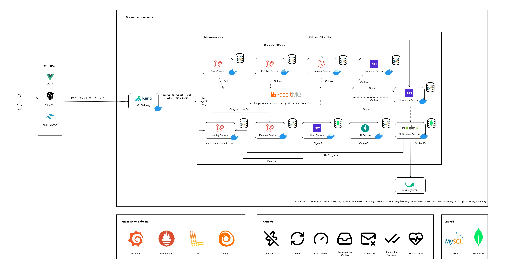

# Smart Distributed ERP

> **Xây dựng hệ thống ERP phân tán theo kiến trúc Microservices hướng sự kiện, ứng dụng RabbitMQ và Transactional Outbox**
> *Building an Event-Driven Microservices ERP System with RabbitMQ and Transactional Outbox*

Hệ thống quản trị doanh nghiệp (bán hàng, mua hàng, kho, tài chính, văn phòng điện tử, chat nội bộ, trợ lý AI) được tách thành **10 microservice độc lập**, viết bằng 4 nền tảng (Laravel, .NET, Node.js, Python). Mỗi service có database riêng; các service giao tiếp qua REST đồng bộ và qua **RabbitMQ** bất đồng bộ.

---

## Mục lục

1. [Kiến trúc tổng quan](#1-kiến-trúc-tổng-quan)
2. [Danh sách service](#2-danh-sách-service)
3. [Các cơ chế hệ phân tán](#3-các-cơ-chế-hệ-phân-tán)
4. [Luồng tiêu biểu: phê duyệt và thông báo realtime](#4-luồng-tiêu-biểu-phê-duyệt-và-thông-báo-realtime)
5. [Cài đặt và chạy](#5-cài-đặt-và-chạy)
6. [Tài khoản mẫu](#6-tài-khoản-mẫu)
7. [Quan sát hệ thống](#7-quan-sát-hệ-thống)
8. [Kiểm thử](#8-kiểm-thử)
9. [Cấu trúc thư mục](#9-cấu-trúc-thư-mục)
10. [Tài liệu](#10-tài-liệu)

---

## 1. Kiến trúc tổng quan



- **Database per service**: mỗi service sở hữu dữ liệu của mình. MySQL 8 cho 8 service nghiệp vụ và kho phân tích của AI (mỗi service một schema `erp_*_db`); MongoDB 7 cho Chat và Notification. Không service nào đọc trực tiếp DB của service khác.
- **Đồng bộ (REST)**: dùng khi cần kết quả ngay, ví dụ Sales gọi Inventory để giữ hàng khi lập chứng từ, E-Office gọi Identity để tìm người duyệt.
- **Bất đồng bộ (RabbitMQ)**: dùng cho domain event như báo giá cần duyệt, hàng nhập kho, đơn nghỉ phép. Bên phát không cần biết bên nhận là ai. Sales, E-Office, Catalog, Purchase và Inventory phát event qua **Transactional Outbox**; Notification và Inventory nhận event.
- **Gateway**: mọi request từ trình duyệt đi qua Kong (`:8000`), kể cả REST và WebSocket (Socket.IO, SignalR).

## 2. Danh sách service

| Service | Port | Công nghệ | Trách nhiệm chính | Database |
| :--- | :--- | :--- | :--- | :--- |
| `identity-service` | 8001 | Laravel 13 / PHP | Người dùng, phòng ban, vai trò, phân quyền RBAC, cấp JWT | MySQL |
| `catalog-service` | 8002 | Laravel 13 / PHP | Danh mục sản phẩm, đối tác (master data) | MySQL |
| `purchase-service` | 8003 | ASP.NET Core (.NET 10) | Hỏi hàng, đề nghị mua (PR), đơn mua (PO), nhập hàng, hóa đơn mua | MySQL |
| `inventory-service` | 8004 | ASP.NET Core (.NET 10) | Kho, tồn thực tế và tồn khả dụng, giữ chỗ nguyên tử, sổ cái biến động | MySQL |
| `sales-service` | 8005 | Laravel 13 / PHP | Báo giá, đơn bán, yêu cầu giao hàng, chứng từ bán, hóa đơn GTGT, công nợ | MySQL |
| `notification-service` | 8006 | Node.js 22+ / Express | Hộp thư thông báo, đẩy realtime (Socket.IO), gửi email | MongoDB |
| `eoffice-service` | 8007 | Laravel 13 / PHP | Nghỉ phép, đề nghị mua sắm và thanh toán, chấm công, bảng lương | MySQL |
| `finance-service` | 8008 | Laravel 13 / PHP | Phiếu thu chi, sổ quỹ, công nợ, sổ cái | MySQL |
| `chat-service` | 8009 | ASP.NET Core (.NET 10) + SignalR | Chat 1-1, nhóm, luồng thảo luận theo chứng từ, tệp đính kèm | MongoDB |
| `ai-service` | 8010 | Python 3.12 / FastAPI | Trợ lý AI chỉ đọc, trả lời bằng công cụ SQL theo quyền người hỏi (LLM qua Groq) | MySQL |

Hạ tầng (Docker Compose): **Kong OSS** DB-less (API gateway), **RabbitMQ 3.13** (message broker), **MySQL 8**, **MongoDB 7** (replica set một node), **Mailpit** (SMTP giả lập để test email), và profile tùy chọn **monitoring** (Grafana, Prometheus, Loki, Alloy).

## 3. Các cơ chế hệ phân tán

| Vấn đề của hệ phân tán | Giải pháp trong dự án | Vị trí |
| :--- | :--- | :--- |
| Ghi DB xong nhưng gửi message lỗi (dual-write) | **Transactional Outbox**: event ghi vào `outbox_events` trong cùng transaction với nghiệp vụ; relay đẩy lên broker và chỉ đánh dấu `PUBLISHED` sau khi broker xác nhận | Relay PHP: `sales`, `eoffice`, `catalog` (`php artisan outbox:relay`); relay .NET: `purchase`, `inventory` (BackgroundService) |
| RabbitMQ sập tạm thời | Relay không bỏ event: chờ giãn dần tối đa 60 giây, gửi lại đúng thứ tự khi broker sống lại | `RelayOutboxEvents` (PHP), `OutboxDispatcher` (.NET) |
| Message bị gửi lặp (at-least-once) | **Idempotent consumer**: `event_id` làm khóa chống trùng; `UNIQUE(event_id, recipient_id)` | `notification` (MongoDB), `inventory` (`processed_events`) |
| Consumer lỗi tạm thời | **Retry queue** có TTL 10 giây, tối đa 5 lần, quá thì chuyển sang **Dead Letter Exchange** `erp.dlx` | `notification-service`, `infrastructure/rabbitmq/definitions.json` |
| Định tuyến message | **Topic exchange** `erp.events`, routing key dạng `<service>.<aggregate>.<action>` | `infrastructure/rabbitmq/definitions.json` |
| Hợp đồng dữ liệu giữa các service | **Envelope chuẩn** (tương thích CloudEvents): `event_id`, `event_type`, `correlation_id`, `producer`, `payload` | `docs/contracts/events-spec.md` |
| Xác thực không tập trung | **JWT HS256** do Identity cấp; mọi service tự kiểm tra chữ ký, `iss`, `exp` bằng secret dùng chung, không gọi lại Identity | `JwtVerifier` (PHP), `HmacJwtTokenValidator` (.NET), `auth/jwt.js` (Node), `auth.py` (Python) |
| Service gọi nhau không có token người dùng | **Internal service key**: header `X-Internal-Service-Key`; Kong xóa header này nếu client gửi lên | Identity, Catalog, E-Office, Notification, Purchase, Inventory |
| Truy vết request xuyên service | **Correlation ID** sinh ở Kong, trả về trong response, ghi vào event và access log | `infrastructure/kong/kong.yml`, envelope |
| Đồng thời khi giữ chỗ tồn kho | **Atomic reservation**: `UPDATE ... WHERE quantity >= số cần`, không bao giờ âm kho; giữ nhiều dòng trong một transaction | `inventory-service` (`InventoryStockManager`) |
| Giữ hàng bị timeout hoặc Sales lỗi giữa chừng | Sales nhả hàng bù trừ ngay; lệnh đối soát `sales:reconcile-reservations` (mỗi 5 phút) nhả hàng treo của chứng từ không tồn tại hoặc đã hủy; số chứng từ không bao giờ bị cấp lại | `sales-service`, container `sales-scheduler` |
| Gửi email ra ngoài | **Một đường duy nhất qua event**: Sales / Purchase ghi `*EmailRequested` vào outbox, Notification kiểm tra, xếp hàng và gửi SMTP có retry; tệp đính kèm chỉ là tham chiếu, được tải lúc gửi | `sales.quotation.email_requested`, `purchase.inquiry.email_requested`, `notification-service/src/email/` |
| Quá tải hoặc service phụ thuộc sập | **Circuit breaker** mở 30 giây sau 5 lỗi liên tiếp; **retry** chỉ với lệnh an toàn khi gọi lại; **rate limit** theo IP tại Kong | Sales, E-Office (cache), Chat và Purchase (Polly), Kong |
| Thông báo thời gian thực | **Socket.IO** chia room theo `user:{id}`; DB là nguồn sự thật, socket chỉ báo có thay đổi | `notification-service`, `frontend` |
| Chat thời gian thực | **SignalR** hub, nhóm theo người dùng; mọi thao tác ghi đi qua REST để kiểm tra quyền một chỗ | `chat-service` |
| Hai relay cùng publish một event | Khóa `flock` (PHP), một tiến trình relay cho mỗi service | `RelayOutboxEvents` |

Chi tiết và bằng chứng kiểm chứng: [docs/architecture/ARCHITECTURE.md](docs/architecture/ARCHITECTURE.md), [docs/deployment.md](docs/deployment.md).

## 4. Luồng tiêu biểu: phê duyệt và thông báo realtime

Ví dụ: nhân viên kinh doanh gửi duyệt một báo giá.

```
 Sale bấm "Gửi duyệt"
   │
   ▼
 sales-service ── DB::transaction { quotation.status = PENDING_APPROVAL ; INSERT outbox_events }
   │
   ▼  outbox:relay (publisher confirm)
 RabbitMQ erp.events ── routing key: sales.quotation.submitted ──► queue erp.notification.events
   │
   ▼
 notification-service
   1. Bỏ qua nếu event_id đã xử lý
   2. Rule: QuotationSubmitted → người có quyền quotation.approve (hỏi identity-service, cache 5 phút)
   3. Ghi thông báo cho từng người nhận (trừ chính người gửi) → ACK
   4. Socket.IO emit tới room user:{id}
   │
   ▼
 Trình duyệt người duyệt: chuông +1, hiện toast "Báo giá QT-... cần phê duyệt"
```

Khi một người duyệt xong, event `sales.quotation.approved` sẽ:
- đóng việc cần làm của những người duyệt còn lại (chuyển sang "Đã xử lý");
- gửi thông báo kết quả cho người tạo báo giá.

Các luồng thông báo đang có:

| Sự kiện | Người nhận |
| :--- | :--- |
| Báo giá / đơn hàng cần duyệt | Người có quyền `quotation.approve` / `order.approve` |
| Yêu cầu giao hàng | Người có quyền duyệt giao hàng `delivery.manage` |
| Yêu cầu xuất kho | Người có quyền kho `inventory.manage` / `inventory.issue` |
| Đơn nghỉ phép, mua sắm, thanh toán | Người duyệt (line manager); kết quả gửi lại người làm đơn |
| Chấm công, bảng lương | Người duyệt theo quyền `payroll.approve`; phiếu lương gửi từng nhân viên |
| Hỏi hàng (purchase) | Người được giao xử lý và người theo dõi |
| Sản phẩm mới, nhập hàng | Người có quyền liên quan (`catalog.product.*`, `purchase.goods.*`) |

Chi tiết: [docs/notification-architecture.md](docs/notification-architecture.md).

## 5. Cài đặt và chạy

Có hai cách chạy:
- **Toàn bộ trên Docker** (đề xuất, giống môi trường triển khai): mọi service, MySQL, MongoDB, RabbitMQ, Kong trong container.
- **Dev từng service trên máy**: Laravel dùng SQLite, Chat và Notification vẫn cần MongoDB, AI cần MySQL; hạ tầng lấy từ Docker.

### 5.1. Yêu cầu môi trường

| Công cụ | Phiên bản | Ghi chú |
| :--- | :--- | :--- |
| Docker Desktop | bản mới | Bắt buộc: chạy hạ tầng và toàn bộ hệ thống |
| PHP | ≥ 8.3 | Dev local: extension `pdo_sqlite`, `sqlite3`; chạy với MySQL: thêm `pdo_mysql`; cả hai cần `mbstring`, `curl`, `sockets` (cho `php-amqplib`) |
| Composer | ≥ 2.5 | |
| .NET SDK | 10 | purchase-service, inventory-service, chat-service |
| Node.js | ≥ 22 | notification-service và frontend (Vite) |
| Python | 3.12 | ai-service (`requirements.txt`) |
| Windows Terminal | | `start_dev.ps1` mở mỗi service một tab |

### 5.2. Cài đặt lần đầu

```powershell
git clone <repo-url> smart-erp
cd smart-erp
copy .env.example .env      # điền các giá trị "change-me" (xem bên dưới)
.\setup.ps1                 # hoặc double-click setup.bat
```

`setup.ps1` thực hiện cho từng service: `composer install` / `dotnet build` / `npm install` / `pip install`, tạo file SQLite cho các service Laravel và seed dữ liệu mẫu (`php artisan migrate:fresh --seed`).

> Mọi service phải dùng **cùng một `JWT_SECRET`** và **cùng một `INTERNAL_SERVICE_KEY`** (.NET: `Jwt:Secret`, `Services:InternalKey`). Các file `.env.example` / `appsettings.json` có sẵn giá trị dùng cho môi trường dev; khi triển khai phải thay bằng giá trị riêng. Code không còn giá trị mặc định: thiếu cấu hình thì service báo lỗi thay vì chạy với secret công khai.

### 5.3. Chạy toàn bộ bằng Docker (đề xuất)

```powershell
.\scripts\deploy.ps1          # kiểm tra cấu hình, build image, chạy migration, khởi động toàn bộ, kiểm tra route
```

Bật thêm giám sát (tùy chọn, nặng khoảng 1 GB RAM):

```powershell
docker compose --profile monitoring up -d
```

### 5.4. Chạy dev từng service trên máy

```powershell
docker compose up -d mysql mongo rabbitmq mailpit   # hạ tầng
.\start_dev.ps1                                     # hoặc double-click start_dev.bat
```

`start_dev.ps1` mở một cửa sổ Windows Terminal, mỗi tiến trình một tab:
- 10 service (identity → ai-service), frontend;
- 3 worker **Outbox Relay** (catalog, sales, eoffice).

Tiến trình nào đang chạy rồi sẽ được bỏ qua. Dùng `.\start_dev.ps1 -Preview` để xem trước danh sách tab sẽ mở.

| Địa chỉ | Mô tả |
| :--- | :--- |
| http://localhost:5175 | **Giao diện web** (dev) |
| http://localhost:8000 | **Kong gateway**: mọi API đi qua đây |
| http://localhost:15672 | RabbitMQ Management (`erp_rabbit` / `rabbit_secret`) |
| http://localhost:8125 | Mailpit, xem email đã gửi (đổi bằng `MAILPIT_UI_PORT`) |
| http://localhost:3000 | Grafana (chỉ khi bật profile `monitoring`, đăng nhập `admin` / `GRAFANA_ADMIN_PASSWORD`) |
| http://127.0.0.1:8003/swagger · http://127.0.0.1:8004/swagger | Swagger của purchase / inventory |

> Khi dev, frontend gọi thẳng các service qua Vite proxy (`frontend/vite.config.js`). Kong (`:8000`) được cấu hình cho môi trường container, nơi mỗi service chạy với hostname riêng.

### 5.5. Chạy thủ công một service

```powershell
cd services\sales-service
copy .env.example .env
composer install
php artisan key:generate
php artisan migrate --seed
php artisan serve --port=8005     # tab 1: API
php artisan outbox:relay          # tab 2: đẩy domain event lên RabbitMQ
```

## 6. Tài khoản mẫu

Mật khẩu mặc định của mọi tài khoản: **`password123`**

| Email | Vai trò | Mô tả |
| :--- | :--- | :--- |
| `admin@erp.local` | `SUPER_ADMIN` | Toàn quyền hệ thống |
| `sale@erp.local` | `SALE` | Chuyên viên kinh doanh |
| `sale.manager@erp.local` | `SALE_MANAGER` | Trưởng phòng kinh doanh, duyệt báo giá / đơn hàng |
| `purchase@erp.local` | `PURCHASE` | Chuyên viên mua hàng |
| `purchase.manager@erp.local` | `PURCHASE_MANAGER` | Trưởng phòng mua hàng |
| `technical@erp.local` | `TECHNICAL` | Kỹ thuật viên |
| `technical.manager@erp.local` | `TECHNICAL_MANAGER` | Trưởng phòng kỹ thuật |
| `finance@erp.local` | `FINANCE_ACCOUNTING` | Chuyên viên kế toán |
| `finance.manager@erp.local` | `FINANCE_ACCOUNTING_MANAGER` | Kế toán trưởng |
| `logistic@erp.local` | `LOGISTIC` | Chuyên viên kho vận |
| `logistic.manager@erp.local` | `LOGISTIC_MANAGER` | Trưởng phòng kho vận |

**Demo thông báo realtime:**
1. Mở 2 trình duyệt (hoặc 1 cửa sổ thường + 1 cửa sổ ẩn danh).
2. Đăng nhập `sale@erp.local` ở cửa sổ thứ nhất, `sale.manager@erp.local` ở cửa sổ thứ hai.
3. Ở cửa sổ sale: tạo báo giá rồi bấm **Gửi duyệt**.
4. Chuông ở cửa sổ manager sáng lên ngay. Manager duyệt xong thì sale nhận thông báo kết quả.

## 7. Quan sát hệ thống

| Muốn xem | Ở đâu |
| :--- | :--- |
| Event đã được ghi chưa | Bảng `outbox_events` của sales/eoffice/catalog: `PENDING` → `PUBLISHED` (lỗi: `FAILED` + `last_error`) |
| Message đi qua broker | RabbitMQ UI → **Exchanges › erp.events**, **Queues › erp.notification.events** |
| Message lỗi | Queue `erp.notification.retry` (chờ thử lại), `erp.dead_letters` (đã hết số lần thử) |
| Xem và đẩy lại dead letter | `.\scripts\replay-dead-letters.ps1` (liệt kê), thêm `-Replay` để đẩy lại sau khi sửa lỗi |
| Kết quả xử lý thông báo | Log `notification-service`: `[AMQP] QuotationSubmitted (...) → { created: 1, resolved: 0 }` |
| Trạng thái circuit breaker | `GET /api/v1/sales/health` (mục `circuit_breakers`) |
| Đối soát hàng giữ treo | `docker compose exec sales-scheduler php artisan sales:reconcile-reservations --dry-run` |
| Log một request | Lấy `X-Correlation-ID` từ response, tìm trên Grafana → dashboard **Logs** (profile `monitoring`) |
| Số liệu gateway và RabbitMQ | Grafana → **ERP Overview** và **RabbitMQ** (profile `monitoring`) |
| Email đã gửi | Mailpit UI (`http://localhost:8125`) |

## 8. Kiểm thử

```powershell
cd services\identity-service;     php artisan test
cd services\sales-service;        php artisan test
cd services\eoffice-service;      php artisan test
cd services\finance-service;      php artisan test
cd services\purchase-service;     dotnet test tests\Purchase.Tests
cd services\inventory-service;    dotnet test tests\Inventory.Infrastructure.Tests
cd services\chat-service;         dotnet test tests\Chat.Tests      # cần MongoDB đang chạy
cd services\notification-service; npm test                           # cần MongoDB đang chạy
cd frontend;                      npm run lint; npm run build
```

Test của Chat và Notification dùng MongoDB thật (`docker compose up -d mongo`). Test tranh chấp đồng thời của Inventory chạy 20 luồng song song trên SQLite tạm.

## 9. Cấu trúc thư mục

```text
smart-erp/
├── docker-compose.yml          # Toàn bộ hệ thống; profile "monitoring" cho Grafana/Prometheus/Loki/Alloy
├── docker-compose.prod.yml     # Override production: bắt buộc secret, chỉ mở gateway và frontend
├── infrastructure/
│   ├── kong/                   # Khai báo route, rate limit, timeout, plugin của gateway
│   ├── mysql/init/             # Tạo các schema erp_*_db và user ứng dụng
│   ├── rabbitmq/               # definitions.json (exchange, queue, binding, DLX), bật plugin Prometheus
│   └── monitoring/             # Loki, Alloy, Prometheus (kèm luật cảnh báo), dashboard Grafana
├── gateway/nginx.conf          # Gateway cũ, chỉ dùng cho profile rollback
├── packages/shared-kernel/     # Hợp đồng dùng chung (envelope, outbox model, enum)
├── services/
│   ├── identity-service/       # :8001  Laravel · RBAC, JWT
│   ├── catalog-service/        # :8002  Laravel · Master data, outbox relay
│   ├── purchase-service/       # :8003  .NET · Hỏi hàng, PR/PO, outbox relay
│   ├── inventory-service/      # :8004  .NET · Tồn kho, giữ chỗ, consumer, outbox
│   ├── sales-service/          # :8005  Laravel · Bán hàng, outbox relay, đối soát giữ hàng
│   ├── notification-service/   # :8006  Node.js · Thông báo, Socket.IO, email
│   ├── eoffice-service/        # :8007  Laravel · Nghỉ phép, phê duyệt, outbox relay
│   ├── finance-service/        # :8008  Laravel · Tài chính kế toán
│   ├── chat-service/           # :8009  .NET · Chat, SignalR, MongoDB
│   └── ai-service/             # :8010  Python · Trợ lý AI, kho phân tích MySQL
├── frontend/                   # Vue 3 + PrimeVue + Tailwind CSS
├── scripts/                    # deploy, smoke test, kiểm tra cấu hình production, replay dead letter
├── docs/                       # Đặc tả API, event, kiến trúc, triển khai, ảnh kiến trúc
├── rules/                      # Quy chuẩn giao diện
├── setup.ps1 / setup.bat       # Cài đặt lần đầu
└── start_dev.ps1 / start_dev.bat
```

## 10. Tài liệu

| Tài liệu | Nội dung |
| :--- | :--- |
| [docs/architecture/ARCHITECTURE.md](docs/architecture/ARCHITECTURE.md) | Kiến trúc chi tiết, đối chiếu với code, các mục đã và chưa triển khai |
| [docs/deployment.md](docs/deployment.md) | Runbook triển khai, giám sát, chịu lỗi, xử lý sự cố |
| [docs/contracts/events-spec.md](docs/contracts/events-spec.md) | Envelope chuẩn và danh mục domain event |
| [docs/contracts/api-spec.md](docs/contracts/api-spec.md) | Đặc tả REST API |
| [docs/notification-architecture.md](docs/notification-architecture.md) | Kiến trúc thông báo qua message queue |
| [docs/chat-spec.md](docs/chat-spec.md) | Đặc tả chat nội bộ |
| [rules/ui-guidelines.md](rules/ui-guidelines.md) | Quy chuẩn giao diện |
