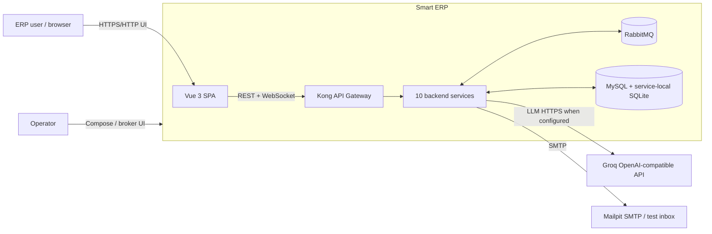
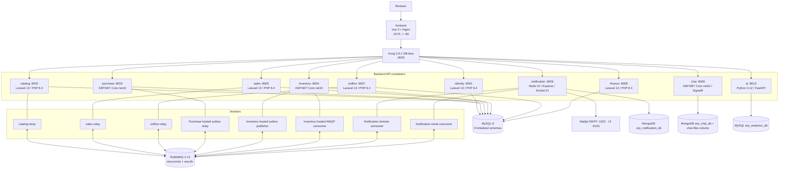
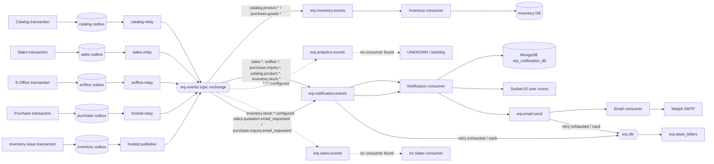
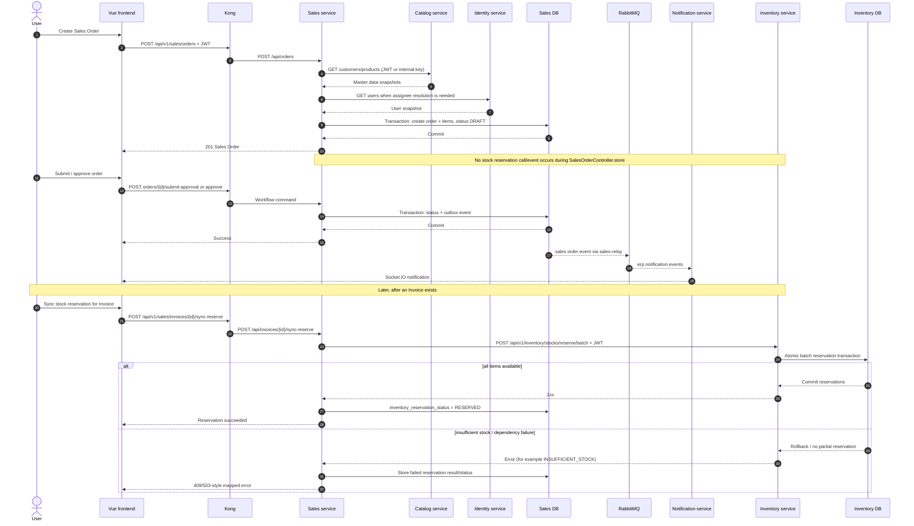

# Smart ERP — Current-State Architecture

> Static, read-only repository assessment as of **2026-10-26**. This document describes evidence found in source and configuration; it does not assert that containers are currently running or healthy.

## 1. Scope, method, and status vocabulary

Scope: `docker-compose.yml`, every Dockerfile, Kong, RabbitMQ, MySQL bootstrap, frontend, the ten backend services, relay/background workers, migrations, routes/controllers, inter-service clients, and relevant architecture/roadmap documents.

Status labels used throughout:

| Label | Meaning |
|---|---|
| **IMPLEMENTED** | Executable source is wired into the application/container. Runtime success is still not claimed unless executed. |
| **CONFIGURED_ONLY** | Infrastructure/configuration declares the path, queue, schema, or dependency, but no complete executable producer/consumer path was found. |
| **PLANNED / DOC_ONLY** | Described in a roadmap/target document but contradicted by, or absent from, current executable source. |
| **UNKNOWN** | Repository evidence is insufficient. |

Evidence format is `path:line — symbol`. Line numbers are anchors for this revision; the symbol is the durable reference. Searches excluded generated dependency trees (`vendor`, `node_modules`, `bin`, `obj`).

Important boundary: this is a static review. Live broker bindings, migrated production schema, seeded data, container health, external Groq availability, and actual secrets are **UNKNOWN**.

## 2. Executive findings

1. The repository contains **10 backend services**: Identity, Catalog, Purchase, Inventory, Sales, Notification, E-Office, Finance, Chat, and AI. Kong exposes all ten; Vue/Nginx is the browser entry point. Evidence: `docker-compose.yml` service definitions; `infrastructure/kong/kong.yml` — `services`.
2. Database-per-service is logical rather than physical for the six MySQL-backed business services: they use separate schemas on one MySQL 8 container. Notification and Chat use a separate MongoDB 7 container (single-node replica set, databases `erp_notification_db` and `erp_chat_db`); AI keeps its conversation history and analytics read model in the MySQL schema `erp_analytics_db`. Evidence: `docker-compose.yml` — `mysql` and service connection environments; `infrastructure/mysql/init/01-create-databases.sql`.
3. Actual asynchronous business integration exists for Catalog/Sales/E-Office/Purchase producers, Inventory producer+consumer, and Notification consumers. Only Inventory and Notification consume domain events in current source. Evidence: `Inventory.Infrastructure.DependencyInjection.AddInfrastructure`, `notification-service/src/index.js — startConsumer`, and repository-wide consumer search.
4. Sales Order creation does **not** reserve stock. It snapshots Catalog/Identity data and commits a `DRAFT`. Reservation is a later synchronous call from an Invoice action to Inventory `POST /stocks/reserve/batch`. Evidence: `SalesOrderController.store`, `ReferenceSnapshot`, `InvoiceController.syncReserve`, `InvoiceController.reserveStockForInvoice`.
5. The Transactional Outbox is implemented in Catalog, Sales, E-Office, Purchase, and Inventory. Catalog/Sales/E-Office run separate Compose relay containers; Purchase and Inventory host background relay workers in their API processes. Evidence: Compose `*-relay`; `RelayOutboxEvents.handle`; `Purchase.Infrastructure.DependencyInjection.AddInfrastructure`; `Inventory.Infrastructure.DependencyInjection.AddInfrastructure`.
6. Chat realtime is implemented with SignalR over `/api/v1/chat/hub`; Notification realtime is independently implemented with Socket.IO over `/api/v1/notifications/socket.io`. They are not connected to each other. Evidence: `Chat.Api.Program`, `ChatHub`, `notification-service/src/realtime/socket.js — createRealtime`.
7. RabbitMQ analytics routing is configured, but AI has no AMQP consumer. Chat's roadmap claims a RabbitMQ bot worker, but current Chat project has neither `RabbitMQ.Client` nor a worker registration. Both are **CONFIGURED_ONLY / DOC_ONLY**, not implemented integration. Evidence: `infrastructure/rabbitmq/definitions.json`; `services/ai-service/requirements.txt`; `services/chat-service/src/Chat.Infrastructure/Chat.Infrastructure.csproj`; contrast `docs/csharp-realtime-chat-roadmap.md:201-205`.
8. AI's ETL reads the other services' MySQL schemas read-only and refreshes the analytics read model every `SYNC_INTERVAL_SECONDS` when `AI_WAREHOUSE_SYNC_ENABLED=true` (default off). This crosses service boundaries and is a known deviation until an `erp.analytics.events` consumer or export APIs replace it. Evidence: `services/ai-service/app/warehouse.py — _src/build/sync`; `services/ai-service/app/main.py — lifespan`; `docker-compose.yml — ai-service`.

## 3. System context

Evidence: `frontend/nginx.conf:20-31`; `infrastructure/kong/kong.yml`; `docker-compose.yml`; `services/ai-service/app/llm.py — chat/_call`; `services/notification-service/src/email/email.routes.js — createTransport`.

## 4. Container architecture

Notes:

- `gateway-legacy` is behind Compose profile `legacy-gateway`; it is rollback infrastructure, not part of the default topology. Evidence: `docker-compose.yml — gateway-legacy`; `gateway/nginx.conf`.
- Compose initializes `erp_analytics_db` and `erp_chat_db`, but current AI and Chat containers do not use them. This is **CONFIGURED_ONLY**. Evidence: `01-create-databases.sql`; `Chat.Infrastructure.DependencyInjection.AddInfrastructure`; `ai-service/app/config.py`.
- Compose comments say PHP 8.3, while every Laravel Dockerfile uses `php:8.4-cli-alpine`; Composer accepts `^8.3`. Runtime image evidence wins. Evidence: service Dockerfiles and each root `composer.json`.

## 5. Service catalog

| Service | Technology / process | Implemented responsibility | Owned persistence | Actual dependencies | Status and evidence |
|---|---|---|---|---|---|
| `identity-service` | Laravel 13.17, PHP 8.4 | Login, HS256 JWT issuance, users, roles, permissions, departments, company profile/logo | `erp_identity_db`: users, roles, permissions, role/user links, departments, company profile | MySQL only | **IMPLEMENTED** — `AuthController.login/me`; `JwtIssuer.issue`; `routes/api.php` |
| `catalog-service` | Laravel 13.17, PHP 8.4; separate relay | Products, brands, categories, customers/contacts, suppliers, partners; emits product-created | `erp_catalog_db`: catalog/master-data tables + `outbox_events` | MySQL, RabbitMQ | **IMPLEMENTED** — `ProductController`; `ProductEvents.created`; `RelayOutboxEvents.handle` |
| `purchase-service` | ASP.NET Core `net10.0`, EF Core 8/Pomelo; hosted relay | PR, PO, goods receipt, 3-way invoice matching/posting, purchase returns, item/supplier inquiries | `erp_purchase_db`: purchase aggregate tables, inquiry tables, outbox/processed events | MySQL, RabbitMQ; HTTP to Identity/Catalog/Notification endpoints inside item inquiry code | **IMPLEMENTED** — controllers under `Purchase.Api/Controllers`; `Purchase.Application.DependencyInjection.AddApplication`; `ItemInquiriesController` |
| `inventory-service` | ASP.NET Core `net10.0`, EF Core 8/Pomelo; two hosted workers | Warehouses, stock/on-hand ledger, reservations, receive/issue/return transfer; consumes product and goods-received events | `erp_inventory_db`: warehouses, stock, reservation and transaction ledgers, outbox/processed events | MySQL, RabbitMQ | **IMPLEMENTED** — `StocksController`; `WarehousesController`; `RabbitMqConsumerWorker.ProcessMessageAsync` |
| `sales-service` | Laravel 13.17, PHP 8.4; separate relay | Quotations, sales orders, deliveries, invoices/dispatch, VAT invoices/adjustments, returns, reports, attachments | `erp_sales_db`: sales documents/reporting/return tables + `outbox_events` | MySQL, RabbitMQ; synchronous Catalog, Identity, Inventory, Finance | **IMPLEMENTED** — `routes/api.php`; `ReferenceSnapshot`; `InvoiceController`; `CustomerReceivableService` |
| `notification-service` | Node 22, Express 4, MongoDB driver 6, Socket.IO 4, Nodemailer; two in-process consumers | Notification inbox, recipient resolution, idempotent event handling, realtime push, queued email | MongoDB `erp_notification_db`: notifications, processed_events (TTL 30 days), email_jobs | RabbitMQ, Identity REST, Mailpit SMTP | **IMPLEMENTED** — `src/index.js`; `NotificationService.handleEvent`; `email.queue.js` |
| `eoffice-service` | Laravel 13.17, PHP 8.4; separate relay | Leave, purchase/payment office requests, approval steps/history, balances/holidays | `erp_eoffice_db`: leave/approval/office request tables + `outbox_events` | MySQL, RabbitMQ, Identity REST | **IMPLEMENTED** — `routes/api.php`; `LeaveRequestService`; `OfficeRequestService`; `IdentityClient` |
| `finance-service` | Laravel 13.17, PHP 8.4 | Chart of accounts, cash/bank books, vouchers/posting/allocation, receivables, GL, invoice adjustment sync | `erp_finance_db`: accounts, funds/banks, vouchers/lines, allocations, receivables/adjustments, GL | MySQL; receives Sales REST calls | **IMPLEMENTED** — `routes/api.php`; Finance controllers |
| `chat-service` | ASP.NET Core `net10.0`, MongoDB.Driver 3, SignalR | Direct/group/work-thread chat, messages/files/reactions/pins/read state, presence/typing | MongoDB `erp_chat_db`: conversations (members embedded), chat_messages (attachments and reactions embedded), message_hides, contact_aliases, counters; local file volume | Identity REST; no RabbitMQ package in current project | REST/SignalR **IMPLEMENTED**; Rabbit bot **DOC_ONLY** — `Program.cs`; `ChatHub`; `IdentityUserDirectory`; `.csproj` |
| `ai-service` | Python 3.12, FastAPI, PyMySQL, HTTPX, external Groq | Permission-gated conversational analytics and conversation history; optional local ETL read model | MySQL `erp_analytics_db`: conversations/messages/tool_calls and the analytics read model | Groq HTTPS; read-only MySQL access to the six service schemas for the ETL | API **IMPLEMENTED**; Compose ETL **OPT-IN (default OFF)**; AMQP analytics consumer **ABSENT** — `main.py`; `warehouse.py`; Compose `WAREHOUSE_SYNC_ENABLED` |

### Frontend and gateway

- Frontend is Vue 3.5 + Pinia 4 + PrimeVue 5 + Tailwind 4, built with Vite 8 and served by Nginx. It uses relative `/api/v1/*` URLs, SignalR client, and Socket.IO client. Evidence: `frontend/package.json`; `frontend/src/api/*`; `frontend/src/stores/chatStore.js — buildConnection`; `frontend/src/composables/useNotifications.js — connect`.
- Kong is DB-less, injects/echoes `X-Correlation-ID`, enables permissive CORS, removes client-supplied `X-Internal-Service-Key`, and preserves long timeouts for realtime routes. Evidence: `infrastructure/kong/kong.yml — plugins/services`.
- Authentication is application-level, not a Kong JWT plugin. All services verify the shared HS256 token locally. Evidence: no auth plugin in `kong.yml`; `JwtVerifier`/`HmacJwtTokenValidator` implementations.

## 6. Database ownership

| Owner | Deployment database | Principal owned tables/read models | Evidence |
|---|---|---|---|
| Identity | MySQL `erp_identity_db` | departments, permissions, roles, role_permissions, users, user_roles, company_profiles | `identity-service/database/migrations/*` |
| Catalog | MySQL `erp_catalog_db` | categories, brands, products, partners, customers, customer_contacts, suppliers, product_price_histories, outbox_events | `catalog-service/database/migrations/*`; the later migration drops Catalog warehouses |
| Purchase | MySQL `erp_purchase_db` (SQLite fallback for dev/tests) | requisitions/items, orders/items/PR allocations, receipts/items, invoices/items, returns/items, inquiry aggregates, outbox_events, processed_events | `Purchase.Infrastructure.Persistence.Configurations.*`; `DependencyInjection.AddInfrastructure` |
| Inventory | MySQL `erp_inventory_db` (SQLite fallback for dev/tests) | warehouses, inventory_stocks, reservation/transaction ledgers, outbox_events, processed_events | `InventoryDbContext.OnModelCreating`; `DependencyInjection.AddInfrastructure` |
| Sales | MySQL `erp_sales_db` | quotations/orders/deliveries/invoices and lines, dispatches, VAT documents/adjustments, sale returns, attachments, reports, sequences, outbox_events | `sales-service/database/migrations/*` |
| E-Office | MySQL `erp_eoffice_db` | leave types/balances/requests, holidays, approval steps/history, office requests/items/attachments, outbox_events | `eoffice-service/database/migrations/*` |
| Finance | MySQL `erp_finance_db` | chart_of_accounts, cash_funds, bank_accounts, customer_receivables, vouchers/lines, allocations, GL entries, receivable_adjustments | `finance-service/database/migrations/*` |
| Notification | MongoDB `erp_notification_db` | notifications (unique `event_id`+`recipient_id`), processed_events (TTL), email_jobs | `notification-service/src/db.js — openDatabase` |
| Chat | MongoDB `erp_chat_db`; files in `/app/chat-files` | conversations (embedded members), chat_messages (embedded attachments/reactions), message_hides, contact_aliases, counters | `MongoChatContext.EnsureIndexesAsync`; `MongoChatRepository`; Compose volumes |
| AI | MySQL `erp_analytics_db` | conversations/messages/tool_calls; dimensions/facts/stock/receivable read model (rebuilt as `<table>_new` and swapped with one atomic `RENAME TABLE`) | `ai-service/app/store.py — SCHEMA`; `warehouse.py — TABLES` |

The generic Laravel skeleton tables (`users`, sessions, jobs, cache) also exist in Finance/E-Office migrations, but no evidence makes them authoritative identity data. Treat them as framework residue, not cross-service ownership.

## 7. Synchronous HTTP communication

### Browser-facing API routing

| Public prefix | Kong upstream behavior | Backend route evidence |
|---|---|---|
| `/api/v1/auth` | strip prefix; upstream base `/api` | Identity `routes/api.php` |
| `/api/v1/catalog` | strip prefix; upstream base `/api` | Catalog `routes/api.php` |
| `/api/v1/purchase` | preserve path | Purchase controller `[Route("api/v1/purchase/...")]` |
| `/api/v1/inventory` | preserve path | Inventory controllers |
| `/api/v1/sales` | strip prefix; upstream base `/api` | Sales `routes/api.php` |
| `/api/v1/notifications` | preserve path; one-hour read/write timeout | Notification `app.js`; Socket.IO path |
| `/api/v1/eoffice` | strip prefix; upstream base `/api` | E-Office `routes/api.php` |
| `/api/v1/finance` | strip prefix; upstream base `/api` | Finance `routes/api.php` |
| `/api/v1/chat` | preserve path; one-hour read/write timeout | Chat controllers and hub |
| `/api/v1/ai` | preserve path; 120-second timeout | AI `APIRouter(prefix="/api/v1/ai")` |

Evidence: `infrastructure/kong/kong.yml`.

### Actual service-to-service calls

| Caller → callee | Actual purpose / endpoint family | Auth | Classification / evidence |
|---|---|---|---|
| Sales → Catalog | Product and customer snapshots: direct `/api/products`, `/api/customers` | Forwarded user JWT or internal key | **IMPLEMENTED** — `ServiceClient.getData/http`; `CatalogClient.fetch`; `PartnerClient.customer` |
| Sales → Identity | Resolve assignee/user snapshots through `/api/users` | Forwarded JWT or internal key | **IMPLEMENTED** — `IdentityClient.users/findByNameOrEmail` |
| Sales → Inventory | Warehouses; reserve/release batch; issue; receive/transfer sales returns | Forwarded user JWT | **IMPLEMENTED** — `DeliveryController.sellableWarehouse`; `InvoiceController.reserveStockForInvoice/releaseStockForInvoice/issueStock`; sale-return controllers |
| Sales → Finance | Sync customer receivable and VAT adjustment | Forwarded user JWT | **IMPLEMENTED** — `CustomerReceivableService.sync`; `VatInvoiceAdjustmentService.issue` |
| E-Office → Identity | Users/departments and line-manager/approver resolution | `X-Internal-Service-Key` | **IMPLEMENTED** — `EOffice IdentityClient.get/directReportIds` |
| Notification → Identity | Resolve recipients by permission | `X-Internal-Service-Key` | **IMPLEMENTED** — `RecipientResolver`; wired in `src/index.js:48-52` |
| Chat → Identity | User directory, cached 60 seconds | `X-Internal-Service-Key` | **IMPLEMENTED** — `IdentityUserDirectory.GetUsersAsync` |
| Purchase → Identity/Catalog/Notification | Item-inquiry user checks, applying inquiry results, supplier email status lookups (sending is an event) | Mixed internal key/JWT depending method | **IMPLEMENTED**, concentrated in `ItemInquiriesController` |
| AI → other APIs | None found | N/A | **UNKNOWN/ABSENT**; AI reads its SQLite warehouse rather than calling domain APIs |

Kong removes `X-Internal-Service-Key` only at the public gateway. Internal callers address service DNS directly, so the header is preserved. Evidence: `kong.yml — request-transformer`; service base URLs in Compose.

## 8. Asynchronous communication and Transactional Outbox

### Event flow

### Producers and relays

| Producer | Events found | Relay behavior | Evidence |
|---|---|---|---|
| Catalog | `ProductCreated` → `catalog.product.created` | Separate `catalog-relay`; publisher confirm + mandatory/unroutable handling | `ProductEvents.created`; `RelayOutboxEvents.relayBatch`; `RabbitMqPublisher.publish` |
| Sales | quotation submitted/approved/rejected; order submitted/approved/rejected; delivery state events; dispatch requested | Separate `sales-relay`; same Laravel relay/publisher pattern | controller `recordEvent` methods; `Outbox.record` |
| E-Office | leave and office purchase/payment lifecycle | Separate `eoffice-relay` | `LeaveRequestService.recordEvent`; `OfficeRequestService.recordEvent` |
| Purchase | goods received, PO approved/cancelled, return dispatched, inquiry requested/responded | Hosted `OutboxRelayBackgroundService` polls every 1.5 s | application services; `ItemInquiriesController`; relay worker |
| Inventory | only `GoodsIssued` → `inventory.goods.issued` found | Hosted `OutboxPublisherWorker` polls every 1.5 s | `StocksController.Issue`; `OutboxPublisherWorker` |

Laravel `Outbox::record` is called within the same `DB::transaction` for approval transitions, satisfying the atomic write portion of Transactional Outbox. The separate relay later publishes. Evidence example: `SalesOrderController.submitApproval/approve`; `Outbox.record`.

### Routing and consumers

| Queue / bindings | Consumer in current code | Effective behavior |
|---|---|---|
| `erp.inventory.events`: `purchase.goods.*`, `catalog.product.*` | `RabbitMqConsumerWorker` | Handles only `GoodsReceived` and `ProductCreated`; idempotency is delegated to `IEventConsumerHandler`/`processed_events`. **IMPLEMENTED**. |
| `erp.notification.events`: sales approval/delivery/dispatch, E-Office, inquiry, product, `inventory.stock.*` | Notification `startConsumer` | Rule lookup, recipient resolution, idempotent SQLite write, Socket.IO push. Unknown event types are marked processed as `NO_RULE`. **IMPLEMENTED**. |
| `erp.email.send` | Notification `startEmailConsumer` | SMTP send with retry queue and DLX. **IMPLEMENTED**. |
| `erp.analytics.events`: `*.*.*` | None found | Queue/binding only. **CONFIGURED_ONLY**; messages may accumulate at runtime. |
| `erp.sales.events`: `inventory.stock.*` | None found in Sales | Queue/binding only. **CONFIGURED_ONLY**. |
| `erp.purchase.events` | None; no binding in definitions | Declared queue only. **CONFIGURED_ONLY**. |
| `erp.eoffice.events` | None; no binding in definitions | Declared queue only. **CONFIGURED_ONLY**. |
| Chat event queue | No `erp.chat.events` in definitions and no consumer/package in current source | **PLANNED / DOC_ONLY**, despite roadmap checkboxes. |

Critical routing mismatch: Inventory publishes `inventory.goods.issued`, but configured Sales/Notification bindings listen to `inventory.stock.*`. Analytics is the only wildcard receiver. Inventory's publisher does not use mandatory routing or publisher confirms before marking the outbox row `PUBLISHED`. Thus business delivery of `GoodsIssued` is not assured by code. Evidence: `StocksController:562-568`; `definitions.json`; `OutboxPublisherWorker:86-95`.

## 9. Realtime communication

| Channel | Path | Data direction and authority | Evidence |
|---|---|---|---|
| Chat SignalR | `/api/v1/chat/hub` | Server→client conversation/message/read/presence events; client→server only typing. Writes use REST. JWT is supplied as SignalR `access_token`. | `ChatHub`; `JwtAuthMiddleware.HubPath`; `chatStore.buildConnection` |
| Notification Socket.IO | `/api/v1/notifications/socket.io` | User-room notification signals and catalog/stock broadcasts. Source of truth remains Notification REST/SQLite. JWT in handshake `auth.token`. | `createRealtime`; `useNotifications.connect` |

There is no evidence of SignalR in Notification or Socket.IO in Chat. There is no direct Chat↔Notification link.

## 10. Main business flows

### 10.1 Authentication — IMPLEMENTED

1. Browser posts credentials through Kong to Identity `/api/login`.
2. `AuthController.login` validates active user and password hash, loads roles/permissions, and issues an HS256 JWT containing identity and authorization claims.
3. Frontend sends `Authorization: Bearer`; every service validates the shared secret locally and enforces permissions in middleware/controllers.
4. Internal directory reads may instead use `X-Internal-Service-Key`; Kong strips this header from public traffic.

Evidence: `identity-service/routes/api.php`; `AuthController.login`; `JwtIssuer.issue`; `JwtVerifier.verify`; each service's `AuthenticateJwt` or `HmacJwtTokenValidator`; `kong.yml` request transformer.

Token revocation/refresh/rotation endpoints were not found. A user's embedded permissions remain as issued until token expiry; `/me` can return fresher data but does not invalidate the existing token. Runtime TTL/rotation policy beyond `JwtIssuer` configuration is **UNKNOWN**.

### 10.2 Catalog — IMPLEMENTED

- CRUD/import exists for products plus brands/categories; Catalog also owns customers, contacts, suppliers, and partners.
- Product creation/import/upsert calls `ProductEvents.created` inside DB work, recording `ProductCreated` in outbox.
- Inventory consumes that event to initialize its local stock projection; Notification also produces inbox/realtime signals.
- Product updates/deletes have no corresponding executable outbox event found, even though wildcard bindings could accept them. Therefore update/delete propagation is **UNKNOWN/ABSENT**, not inferred.

Evidence: `catalog-service/routes/api.php`; `ProductController` calls at lines 110, 249, 390; `ProductEvents.created`; `RabbitMqConsumerWorker.ProcessMessageAsync`.

### 10.3 Sales — IMPLEMENTED with explicit cross-service boundaries

- Quotation and Sales Order workflows support draft, submit, approve, reject, and conversion.
- On document creation, Sales calls Catalog/Identity synchronously before opening its local DB transaction, then stores snapshots.
- Approval state changes and their outbox event are committed in one local transaction; Notification consumes them.
- Delivery validates Inventory warehouse synchronously. Invoice actions reserve/release/issue stock synchronously. VAT invoice issuance synchronizes receivables to Finance synchronously.
- Returns call Inventory receive/transfer synchronously.

Evidence: `QuotationController`; `SalesOrderController.store/submitApproval/approve/reject`; `ReferenceSnapshot`; `DeliveryController`; `InvoiceController`; `CustomerReceivableService`; return controllers.

### 10.4 Inventory — IMPLEMENTED

- Inventory is the owner of warehouses, on-hand, reserved, and stock ledgers.
- `reserve/batch` is synchronous and intended to be all-or-nothing; Sales receives immediate insufficient-stock errors.
- Goods receipt events from Purchase update Inventory asynchronously. Product-created events initialize Inventory records.
- Goods issue is performed synchronously from Sales and emits `GoodsIssued`, but no business consumer is wired for that routing key.

Evidence: `StocksController.ReserveBatch/Receive/Issue`; `RabbitMqConsumerWorker.ProcessMessageAsync`; `InventoryStockManager`; `StocksController` outbox call.

### 10.5 Purchase — IMPLEMENTED

- PR → approval/rejection → PO → approval/cancel/close → GRN confirmation → purchase invoice matching/posting and returns are exposed as REST APIs.
- Confirmed goods receipt writes `GoodsReceived` to Purchase outbox; Inventory consumes it asynchronously.
- Item inquiries emit requested/responded notifications and use synchronous service calls for users, Catalog result application, and email status lookups (sending is the `SupplierInquiryEmailRequested` event).

Evidence: Purchase controllers and application services; `GoodsReceiptService`; `PurchaseOrderService`; `PurchaseReturnService`; `ItemInquiriesController`.

### 10.6 Finance — IMPLEMENTED, synchronously fed by Sales

- Finance exposes accounts, GL, cash/bank books, receivables, vouchers, posting and allocation.
- Sales posts customer receivable and invoice adjustment synchronization directly to Finance with the current bearer token.
- No Finance outbox, RabbitMQ package, or Finance event consumer was found. Any event-driven finance integration is **ABSENT/UNKNOWN**.

Evidence: `finance-service/routes/api.php`; finance migrations; `CustomerReceivableService.sync`; `VatInvoiceAdjustmentService.issue`; `finance-service/composer.json`.

### 10.7 Notification — IMPLEMENTED

- Domain consumer resolves recipients, writes notifications and processed-event idempotency state in one SQLite transaction, then pushes Socket.IO events.
- Retry is a 10-second TTL queue, maximum five attempts; exhausted/invalid messages go to DLX.
- Email is sent only through events: Sales (`QuotationEmailRequested`) and Purchase (`SupplierInquiryEmailRequested`) write the event to their outbox; `EmailEventHandler` validates it, records `email_jobs` as `QUEUED` and queues the job to `erp.email.send`; the email consumer downloads attachments from the owning service (internal key) and sends through Nodemailer/Mailpit, tracking job state. The old direct `POST /email/send` API is removed.
- The remaining email routes (`/logs`, `/logs/{id}`) are guarded by `authenticateEmailCaller` (JWT with a business permission, or internal key).

Evidence: `NotificationService.handleEvent`; `consumer.js`; `email.events.js`; `attachment.fetcher.js`; `email.queue.js`; `email.auth.js`.

### 10.8 Chat — REST + SignalR IMPLEMENTED; AMQP bot DOC_ONLY

- REST owns all writes and authorization; SignalR distributes changes and accepts typing signals.
- Direct, group, and work-thread conversations are implemented; messages support files, reactions, pins, forwarding, recall/hide, read state, presence, and reconnect catch-up.
- Chat resolves users from Identity through an internal-key REST client with a 60-second cache.
- Current Chat source has no RabbitMQ dependency, queue, or hosted bot consumer. The roadmap statement that phase 3 is complete is documentation drift.

Evidence: `ConversationsController`; `MessagesController`; `MessageService.SendAsync`; `ChatHub`; `IdentityUserDirectory`; `Chat.Infrastructure.csproj`; `docs/csharp-realtime-chat-roadmap.md:201-205`.

### 10.9 AI/analytics — API IMPLEMENTED; production refresh CONFIGURED OFF

- FastAPI provides health, chat, conversation history/delete, and admin sync. JWT requires `ai.use`; manual sync requires `SUPER_ADMIN`.
- The agent invokes external Groq and reads the MySQL analytics schema `erp_analytics_db` through registered tools.
- The ETL reads the six other services' MySQL schemas directly (read-only session) and builds a star-like read model in `erp_analytics_db`; Compose keeps it off by default (`AI_WAREHOUSE_SYNC_ENABLED=false`) and it is meant for demos. Reading another service's schema still crosses a service boundary; the target is the `erp.analytics.events` consumer or export APIs (architecture.md §13 item 2).
- Roadmap analytics endpoints (`/analytics/overview`, forecast, RFM, credit risk, summary) are not present in `main.py`; classify them as **PLANNED / DOC_ONLY**.

Evidence: `ai-service/app/main.py`; `auth.py`; `agent.py`; `warehouse.py`; `docker-compose.yml`; `docs/data-analytics-ml-bi-roadmap.md:100-112`.

## 11. Sequence: create Sales Order and reserve stock

This diagram deliberately shows the implemented discontinuity: Sales Order creation does not reserve stock. Reservation is performed later for an Invoice.

Evidence: `SalesOrderController.store:56-230`; `SalesOrderController.submitApproval/approve`; `InvoiceController.syncReserve:272-306`; `InvoiceController.reserveStockForInvoice:766-817`; `StocksController.BatchReserveStock`.

## 12. Deployment topology and operational behavior

- One Docker bridge network (`erp-network`) gives DNS discovery by Compose service name.
- Public host ports expose every backend directly (`8001`–`8010`) in addition to Kong `8000`; the gateway is therefore not the sole network boundary on the host.
- MySQL and RabbitMQ have named volumes and health checks. Notification/Chat/AI data and chat files have named volumes. Laravel/Purchase/Inventory data persists in MySQL.
- Gateway waits for all ten service health checks. A degraded optional AI/Chat service prevents the default gateway from becoming startable, creating broad startup coupling.
- Laravel containers run `php artisan serve`, not PHP-FPM; this is a development server used in the production Compose environment.
- `AUTO_SEED=true` is set for Identity, Catalog, Sales, E-Office, and Finance; entrypoint behavior determines whether production startup mutates seed data. Evidence: Compose and each `docker-entrypoint.sh`.
- Compose pins Kong (`3.9.1`), MySQL (`8.0`), RabbitMQ (`3.13-management-alpine`), Node (`22-alpine`), Python (`3.12-slim`), and .NET (`10.0`); frontend/runtime Nginx and Mailpit use floating tags.

### Observability and resilience — IMPLEMENTED (2026-10-27)

| Area | Implementation | Evidence |
|---|---|---|
| Logs | Grafana Alloy tails every `smart-erp` container into Loki (label `service`, structured metadata `correlation_id`); Laravel services log to stderr | `infrastructure/monitoring/alloy/config.alloy`; Compose `LOG_CHANNEL` |
| Metrics | Prometheus scrapes Kong (`prometheus` plugin) and RabbitMQ (`rabbitmq_prometheus`); no container CPU/RAM | `infrastructure/monitoring/prometheus/prometheus.yml` |
| Dashboards / alerts | Grafana: ERP Overview, RabbitMQ, Logs; alerts dead letter, 5xx ratio, target down | `infrastructure/monitoring/grafana`, `prometheus/alerts.yml` |
| Edge protection | Kong rate limiting (IP), per-service timeouts/retries, DNS TTL 10 s | `infrastructure/kong/kong.yml`; Compose `KONG_DNS_VALID_TTL` |
| Circuit breakers | Laravel cache-based Guzzle middleware (Sales, E-Office); Polly standard handler (Chat, Purchase) | `sales-service/app/Infrastructure/Clients/CircuitBreaker.php`; `Chat.Infrastructure.DependencyInjection`; `Purchase.Api/Program.cs` |
| Dead letters | Alert + `scripts/replay-dead-letters.ps1` | `scripts/replay-dead-letters.ps1` |

Not implemented: distributed tracing (OpenTelemetry), log/metric alert delivery (no Alertmanager), circuit breaker on Notification → Identity (that consumer relies on the RabbitMQ retry queue instead).

## 13. Risks, bottlenecks, and inconsistencies

| Priority | Finding | Impact | Evidence / status |
|---|---|---|---|
| Critical | Default secrets and application keys are embedded as Compose fallbacks. | A deployment that omits environment overrides has predictable credentials/JWT/internal keys. | `docker-compose.yml` environments — **CONFIGURED risk** |
| High | `GoodsIssued` routing key has no business consumer and does not match `inventory.stock.*` bindings. | Downstream Sales/Notification updates may never occur; Inventory marks events published without confirm/mandatory guarantees. | `StocksController`; `definitions.json`; `OutboxPublisherWorker` — **IMPLEMENTED mismatch** |
| High | Analytics queue has wildcard binding but no consumer; Chat queue/consumer exists only in roadmap. | Unbounded queue growth and false architectural expectations. | Rabbit definitions; AI/Chat manifests/source; roadmap — **CONFIGURED_ONLY / DOC_ONLY** |
| High | AI ETL directly reads other service DB files and is unusable in default MySQL Compose topology. | Violates strict service DB boundary in dev design; production analytics can be stale/missing. | `warehouse.py`; Compose AI config — **disabled in deployment** |
| High | All MySQL schemas share one server, volume, root failure domain, and one broad `erp_user` credential. | Logical isolation does not provide independent availability/scaling; compromise may cross schemas if grants/credential leak. | Compose MySQL; init SQL |
| High | Every backend port is host-published. | Kong header stripping/policy can be bypassed by direct host access. | `docker-compose.yml` ports |
| Medium | Gateway startup depends on health of all ten services. | One optional service blocks the single API entry point. | `docker-compose.yml — gateway.depends_on` |
| Medium | Outbox implementations differ: Laravel has confirms+mandatory, .NET workers mark published after `BasicPublish` without confirms. | Delivery guarantees are inconsistent and weaker for Purchase/Inventory. | Laravel `RabbitMqPublisher.publish`; .NET relay workers |
| Medium | PHP API containers use `artisan serve` with production env. | Throughput/process management bottleneck and unsuitable production serving model. | Laravel Dockerfiles and Compose `APP_ENV=production` |
| Medium | Chat attachments are local volume files; MongoDB runs as a single-node replica set without authentication (bound to 127.0.0.1 in development, unpublished in production). | Chat cannot scale across nodes (shared storage and SignalR backplane missing); anyone on `erp-network` can reach MongoDB. | Compose `mongo`, `chat_files` |
| Medium | Shared symmetric JWT secret across all services. | Any compromised verifier can mint tokens; no key rotation/revocation evidence. | Compose `JWT_SECRET`; verifier/issuer implementations |
| Medium | Rabbit declarations are duplicated between static definitions and consumer startup code. | Argument/binding drift can close channels or change effective topology. | `definitions.json`; `RabbitMqConnection.TryConnect`; Notification `consumer.setup` |
| Medium | Roadmaps/report claim completed features not present in executable source. | Architecture documentation is unreliable without code verification. | Chat roadmap phase 3; AI roadmap endpoints |
| Low | Compose comments/version counts are stale (for example “8 schemas”, “PHP 8.3”; init creates 9 schemas, Docker uses PHP 8.4). | Operational confusion. | Compose comments vs init SQL/Dockerfiles |

### Bottlenecks

1. Single Kong instance, single MySQL instance, single RabbitMQ node, and single replicas for every service are single points of failure.
2. Sales creation synchronously depends on Catalog (and sometimes Identity); document creation latency/failure is coupled to those services.
3. Notification recipient resolution synchronously depends on Identity while consuming RabbitMQ; Identity failure drives retries and can stall the queue.
4. Chat/Notification realtime state is process-local; no Redis/backplane adapter is configured.
5. Outbox polling is fixed at 1.5 seconds for .NET and continuously loops for Laravel commands; throughput/backpressure metrics are absent.

Observability beyond correlation IDs and container logs is **UNKNOWN**: no metrics, distributed tracing collector, centralized logs, alerting, or queue-depth monitoring configuration was found.

## 14. Evidence index by key conclusion

| Conclusion | Primary path + symbol |
|---|---|
| JWT issued with roles/permissions | `services/identity-service/app/Http/Controllers/AuthController.php — login`; `app/Auth/JwtIssuer.php — issue` |
| Public/internal dual auth | `identity-service/app/Http/Middleware/AuthenticateUserOrService.php — handle`; Catalog equivalent |
| Sales snapshot calls | `sales-service/app/Services/ReferenceSnapshot.php — customer/products/resolveUserId`; `Infrastructure/Clients/ServiceClient.php — getData/http` |
| Sales order does not reserve | `SalesOrderController.php — store` (no Inventory call/outbox); reservation only in `InvoiceController.php — syncReserve/reserveStockForInvoice` |
| Inventory batch reservation API | `inventory-service/src/Inventory.Api/Controllers/StocksController.cs — BatchReserveStock` |
| Purchase→Inventory async receipt | `Purchase.Application/Services/GoodsReceiptService.cs`; `Inventory.Infrastructure/Messaging/RabbitMqConsumerWorker.cs — ProcessMessageAsync` |
| Laravel outbox relays | each `app/Console/Commands/RelayOutboxEvents.php — handle/relayBatch`; Compose `catalog-relay`, `sales-relay`, `eoffice-relay` |
| .NET hosted relays | `Purchase.Infrastructure/DependencyInjection.cs — AddInfrastructure`; `Inventory.Infrastructure/DependencyInjection.cs — AddInfrastructure` |
| Notification event/retry/idempotency | `notification-service/src/messaging/consumer.js — startConsumer`; `notifications/notification.service.js — handleEvent`; `notification.repository.js` |
| SignalR chat | `chat-service/src/Chat.Api/Program.cs — AddSignalR/MapHub`; `Realtime/ChatHub.cs`; frontend `chatStore.js — buildConnection` |
| Socket.IO notifications | `notification-service/src/realtime/socket.js — createRealtime`; frontend `useNotifications.js — connect` |
| AI ETL disabled in Compose | `docker-compose.yml — ai-service.WAREHOUSE_SYNC_ENABLED`; `ai-service/app/main.py — lifespan`; `warehouse.py — sync` |
| Kong routes/header stripping | `infrastructure/kong/kong.yml — services/plugins` |
| Rabbit topology | `infrastructure/rabbitmq/definitions.json` plus runtime declarations in Inventory/Notification |

## 15. Unknowns requiring runtime verification

- Whether the current MySQL volume contains all latest migrations and whether seeders have run successfully.
- Whether live RabbitMQ definitions exactly match the checked-in JSON after runtime declarations/unbinds.
- Queue depths, dead letters, outbox backlog, duplicate rates, and event delivery latency.
- Whether all ten health checks pass simultaneously under Compose.
- Actual environment secret overrides, TLS termination, firewall rules, and whether direct service ports are externally reachable.
- Production backup/restore, retention, disaster recovery, monitoring, and horizontal scaling policies.
- End-to-end transactional behavior under failure (network timeout after remote commit, relay crash between publish and status update).

These items are deliberately marked **UNKNOWN** because source/configuration alone cannot prove live state.
