### 2.4.5 Các màn hình giao diện người dùng

Giao diện của Smart ERP là một ứng dụng một trang (Single Page Application) xây dựng bằng Vue 3, Pinia và PrimeVue 4, phục vụ qua Nginx tại cổng 5175 và gọi toàn bộ API qua Kong API Gateway (cổng 8000). Mọi màn hình dùng chung một khung bố cục: thanh menu bên trái chia theo phân hệ nghiệp vụ (Văn phòng số, Đối tác, Sản phẩm, Bán hàng, Mua hàng, Kế toán, Quỹ, Ngân hàng, Quản lý kho), thanh tiêu đề phía trên hiển thị người dùng đang đăng nhập, và hai nút nổi ở góc dưới bên phải để mở nhanh Trợ lý AI và Tin nhắn nội bộ.

Quyền truy cập được kiểm tra ở hai lớp. Lớp thứ nhất là Route Guard trên trình duyệt: mỗi route khai báo quyền cần có (ví dụ `order.view`, `finance.view`), người dùng thiếu quyền sẽ bị chuyển sang trang 403. Lớp thứ hai là RBAC tại API Gateway và từng microservice (xem Biểu đồ 7), nên việc ẩn menu không thay thế cho kiểm tra phía máy chủ. Các ảnh dưới đây được chụp từ hệ thống đang chạy trong Docker với bộ dữ liệu 24 tháng (61.982 dòng hàng, 766,3 tỷ VNĐ) đã nạp, bằng tài khoản Super Admin trừ khi ghi chú khác.

#### 2.4.5.1 Màn hình chung và quản trị hệ thống

**Màn hình Đăng nhập** (`/login`). Người dùng nhập email và mật khẩu, tùy chọn "Ghi nhớ phiên đăng nhập". Phía dưới có bảng chọn nhanh 11 tài khoản mẫu theo vai trò; bấm vào một vai trò sẽ tự điền email để thuận tiện khi trình diễn. Sau khi xác thực, `identity-service` cấp JWT và giao diện lưu vào bộ nhớ trình duyệt, các lời gọi tiếp theo đính kèm token này (Biểu đồ 6).

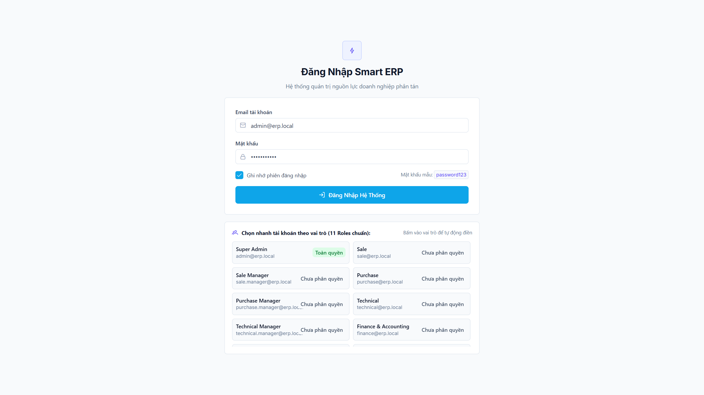

Hình 22 Màn hình đăng nhập hệ thống

**Màn hình Giới thiệu** (`/intro`). Trang đích sau khi đăng nhập, giới thiệu nền tảng và là nơi người dùng quan sát toàn bộ cấu trúc menu theo phân hệ. Hai nút nổi ở góc phải mở Trợ lý AI và Tin nhắn nội bộ từ bất kỳ màn hình nào.

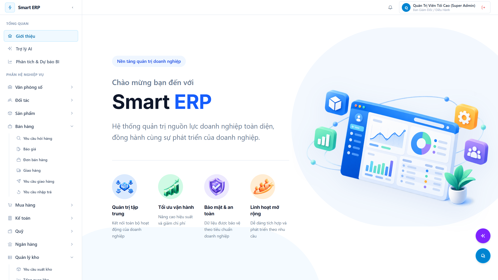

Hình 23 Màn hình giới thiệu và cấu trúc menu theo phân hệ

**Màn hình Trạng thái Dịch vụ** (`/service-status`). Giám sát tình trạng các microservice: tổng số dịch vụ, số dịch vụ đang hoạt động, công nghệ, cổng và endpoint `/health` của từng dịch vụ (từ `:8001` đến `:8009`), độ trễ phản hồi tính bằng mili giây và trạng thái "Sẵn sàng (Online)". Trang tự làm mới theo chu kỳ chọn được (mặc định 30 giây) và có nút kiểm tra lại toàn bộ. Màn hình này giúp nhóm vận hành phát hiện sớm một dịch vụ mất kết nối mà không cần vào Docker.

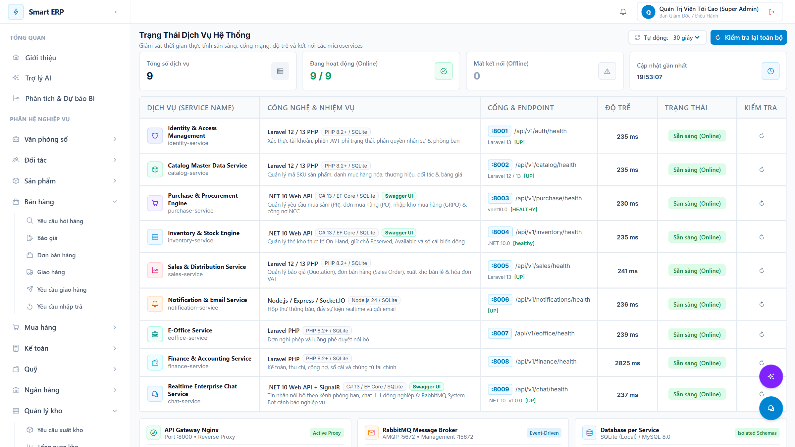

Hình 24 Màn hình theo dõi trạng thái các microservice

**Màn hình Danh sách Nhân viên** (`/employee`). Hiển thị 23 tài khoản nhân sự kèm phòng ban, quản lý trực tiếp, vai trò, trạng thái và ngày tạo. Có ô tìm theo tên hoặc email, bộ lọc theo phòng ban và theo vai trò, nút thêm nhân viên và nút phân vai trò trên từng dòng. Cột "Quản lý trực tiếp" chính là `manager_id`, được dùng làm người phê duyệt đơn nghỉ phép và các đề xuất trong phân hệ Văn phòng số.

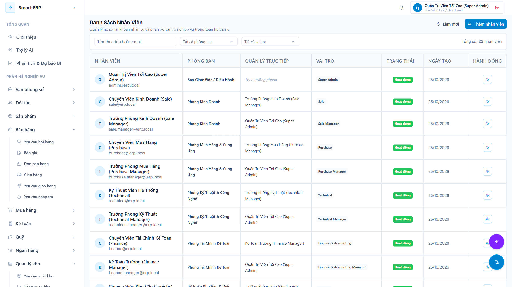

Hình 25 Màn hình quản lý nhân viên

**Màn hình Quản lý Vai trò & Thẩm quyền** (`/role`). Liệt kê 11 vai trò chuẩn (Super Admin, Sale, Sale Manager, Purchase, Purchase Manager, Technical, Technical Manager, Finance & Accounting, Finance & Accounting Manager, Logistic, Logistic Manager) cùng số người đảm nhiệm và số quyền được cấp (Super Admin có 71 quyền). Người quản trị có thể thêm vai trò mới, mở ma trận quyền để cấp hoặc thu hồi quyền động mà không cần sửa mã nguồn.

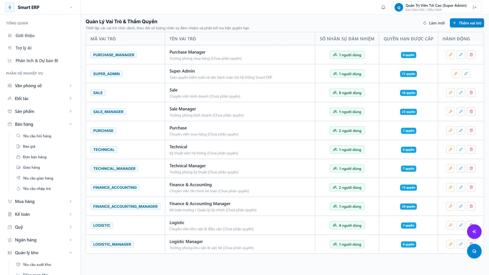

Hình 26 Màn hình quản lý vai trò và số quyền được cấp

#### 2.4.5.2 Phân hệ Bán hàng, Mua hàng, Kho và Kế toán (UC-01)

**Màn hình Danh mục Sản phẩm** (`/product`). Quản lý 915 mã hàng (SKU) với các cột mã SKU, designation, thương hiệu, danh mục, mô tả, xuất xứ, đơn vị và giá gross chuẩn. Hỗ trợ tìm kiếm, lọc theo hãng và danh mục, nhập hàng loạt từ Excel và phân trang. Đây là dữ liệu gốc do `catalog-service` quản lý; các phân hệ khác chỉ tham chiếu mã SKU.

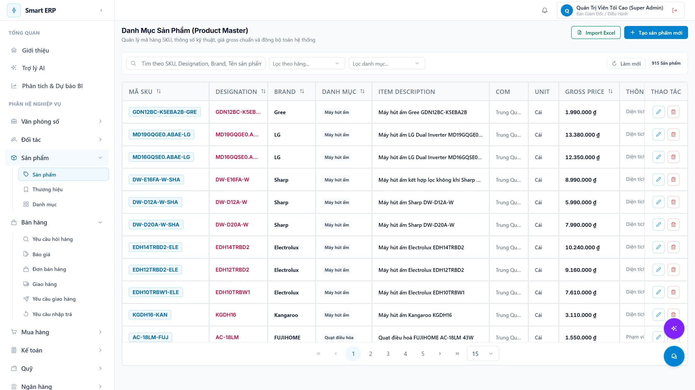

Hình 27 Màn hình danh mục sản phẩm (Product Master)

**Màn hình Quản lý Khách hàng** (`/customer`). Danh mục 2.591 khách hàng B2B với mã khách hàng, tên, mã số thuế, loại khách hàng (Retail, MA, EA, TA, RA), người tạo, số người liên hệ và trạng thái. Có tìm kiếm theo mã, tên, mã số thuế và bộ lọc theo loại, trạng thái.

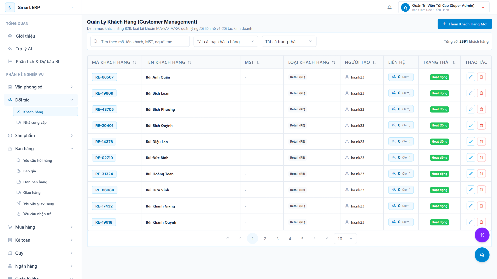

Hình 28 Màn hình quản lý khách hàng

**Màn hình Báo giá** (`/quotation/:id/edit`). Chi tiết một báo giá gồm khách hàng, người liên hệ, nhân viên phụ trách và theo dõi, số báo giá, tiền tệ, tỷ giá và trạng thái ("Đã tạo đơn bán"). Bảng mặt hàng hiển thị tồn kho hiện có của từng SKU ngay trên dòng báo giá, kèm tổng tiền hàng, thuế VAT, chiết khấu trung bình và tổng cộng. Có các thao tác xem PDF, gửi email báo giá cho khách và lưu thay đổi.

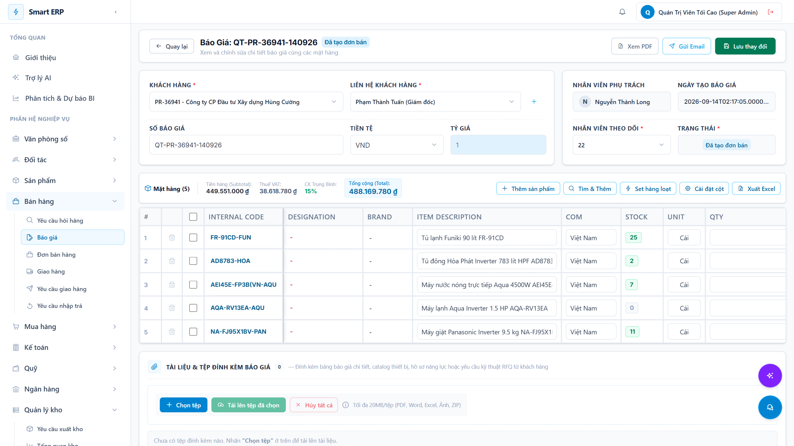

Hình 29 Màn hình chi tiết báo giá khách hàng

**Màn hình Đơn bán hàng** (`/order/:id/edit`). Đơn bán hàng hình thành từ báo giá hoặc lập trực tiếp. Màn hình hiển thị khách hàng, địa chỉ giao hàng, số đơn nội bộ và số đơn của khách, tiền tệ, trạng thái, bảng mặt hàng và khu vực đính kèm hợp đồng hoặc đơn đặt hàng của khách. Khi đơn đã duyệt, các trường bị khóa ("Đơn đã duyệt (Đã khóa)") để bảo đảm tính toàn vẹn của chứng từ; từ đơn đã duyệt người dùng lập Yêu cầu giao hàng.

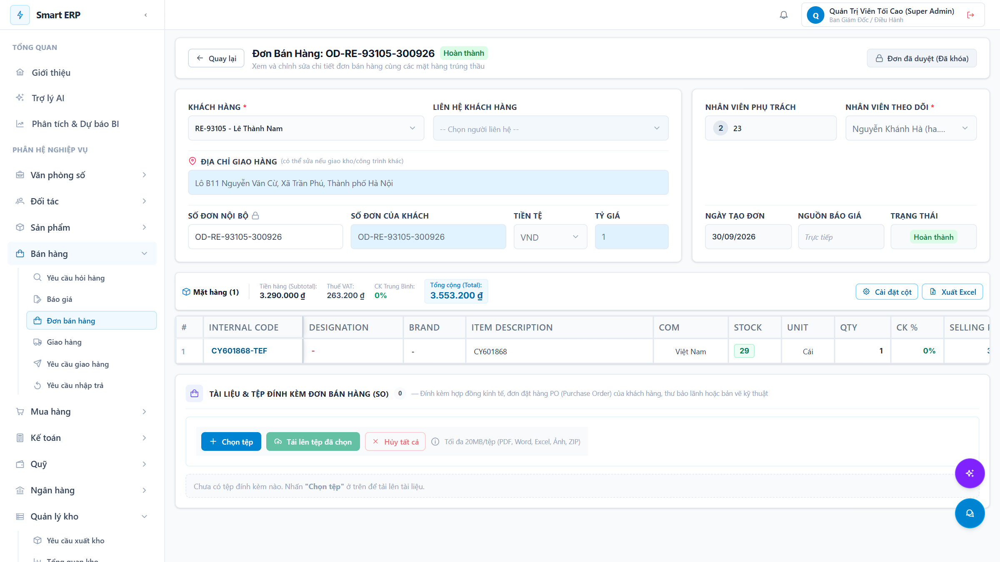

Hình 30 Màn hình chi tiết đơn bán hàng

**Màn hình Chứng từ Bán hàng** (`/invoice/:id/edit`). Chứng từ bán hàng là điểm giữ chỗ tồn kho của hệ thống: nút "Lưu Chứng Từ & Giữ Kho" ghi chứng từ và gửi yêu cầu giữ chỗ sang `inventory-service`, nút "Đồng Bộ Giữ Chỗ Kho" cho phép đồng bộ lại trạng thái giữ chỗ. Khung bên phải thể hiện nguồn gốc điều phối: số đơn hàng (SO), phiếu yêu cầu giao hàng (DR) và kho xuất hàng. Màn hình cũng cho phép xuất bộ chứng từ PDF (Biểu đồ 1 và Biểu đồ 3).

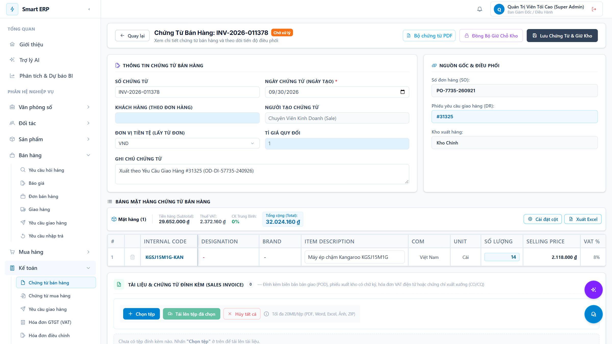

Hình 31 Màn hình chi tiết chứng từ bán hàng và giữ chỗ tồn kho

**Màn hình Bảng Tồn kho** (`/inventory/stocks`). Với mỗi SKU theo từng kho, hệ thống hiển thị ba chỉ số tách biệt: Tồn thực tế, Đang giữ chỗ (kèm biểu tượng khóa) và Khả dụng tại kho, cùng Tồn bán hàng. Công thức "Khả dụng = Tồn thực tế − Đang giữ chỗ" cho phép nhân viên kinh doanh biết ngay có thể bán thêm bao nhiêu mà không vượt tồn, đây là cơ chế chống bán khống.

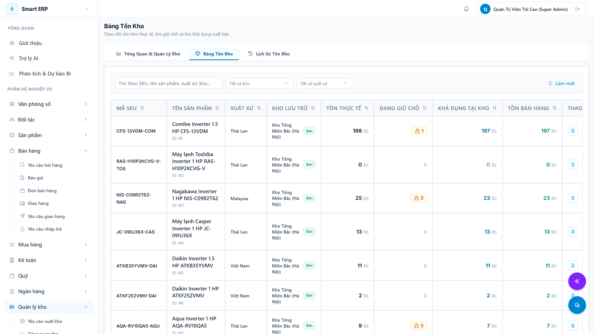

Hình 32 Màn hình bảng tồn kho thực tế, giữ chỗ và khả dụng

**Màn hình Lịch sử Tồn kho (Sổ cái thẻ kho)** (`/inventory/movements`). Nhật ký bất biến mọi biến động nhập, xuất: thời gian, loại giao dịch (ví dụ "Xuất giao hàng"), mã SKU, tồn trước, biến động, tồn sau, mã chứng từ gốc và kho. Tab thứ hai ghi riêng lịch sử tồn kho khả dụng (các lần giữ chỗ, hủy giữ chỗ).

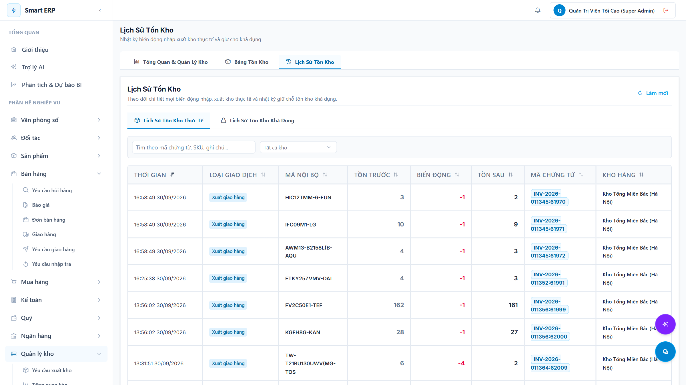

Hình 33 Màn hình lịch sử tồn kho (thẻ kho)

**Màn hình Đơn đặt mua hàng (PO)** (`/purchase/orders/:id`). Thông tin nhà cung cấp, kho tiếp nhận, ngày lập, hạn giao dự kiến, điều khoản và chi tiết dòng hàng với số lượng, đơn giá. Từ PO đã duyệt, bộ phận kho tạo phiếu "Nhập Kho Hàng (GRN)"; đơn chưa hoàn tất có thể bị hủy.

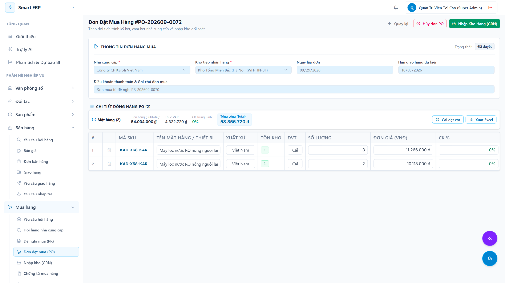

Hình 34 Màn hình chi tiết đơn đặt mua hàng

**Màn hình Công nợ Khách hàng** (`/customer-receivables`). Bốn chỉ số tổng hợp: Tổng phải thu, Đã thu, Còn phải thu và Nợ quá hạn, kèm danh sách hóa đơn GTGT với hạn thanh toán, số ngày quá hạn và trạng thái "Chưa thanh toán" hoặc "Quá hạn". Dữ liệu này là cơ sở để hệ thống cảnh báo rủi ro công nợ.

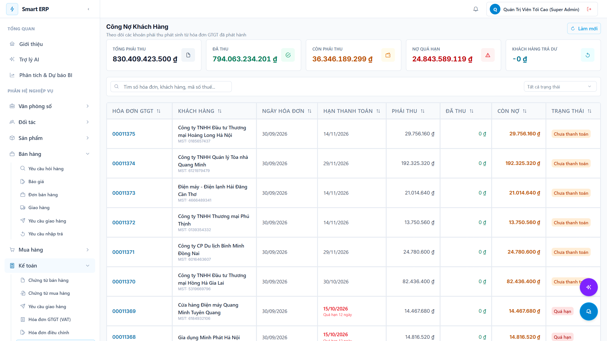

Hình 35 Màn hình theo dõi công nợ phải thu khách hàng

**Màn hình Sổ cái** (`/finance/general-ledger`). Lọc theo tài khoản, khoảng ngày và tiền tệ; hiển thị dư đầu kỳ, phát sinh Nợ, phát sinh Có, dư cuối kỳ và từng bút toán với tài khoản đối ứng. Với tài khoản 1311 (Phải thu khách hàng), dư cuối kỳ khớp với số "Còn phải thu" ở màn hình công nợ, thể hiện hóa đơn bán hàng đã được hạch toán tự động sang kế toán.

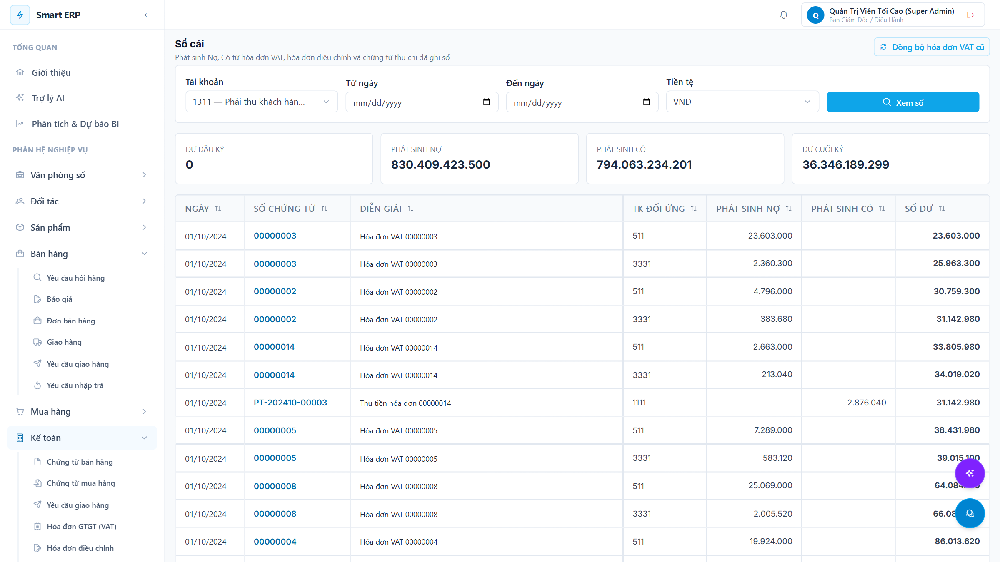

Hình 36 Màn hình sổ cái tài khoản 1311

#### 2.4.5.3 Phân hệ Giao tiếp thời gian thực (UC-02)

**Màn hình Tin nhắn Nội bộ** (`/chat`). Bố cục hai cột: bên trái là danh sách hội thoại với ô tìm kiếm và ba tab (Tất cả, Chưa đọc, Nhóm); bên phải là khung hội thoại. Tin nhắn được gửi và nhận tức thời qua SignalR Hub của `chat-service`, lưu trên MongoDB. Giao diện hiển thị thời điểm gửi, dấu đã xem của người nhận, nút đính kèm tệp, biểu tượng cảm xúc, tìm trong hội thoại và thông tin hội thoại. Ảnh minh họa cuộc trao đổi 1-1 giữa Super Admin và Trưởng phòng Kinh doanh về một đơn bán hàng.

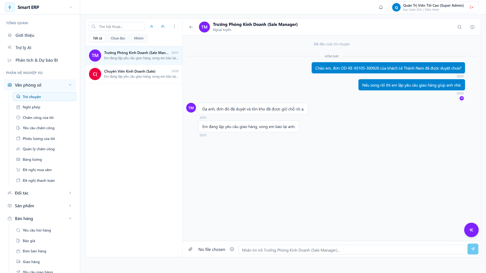

Hình 37 Màn hình tin nhắn nội bộ thời gian thực

#### 2.4.5.4 Phân hệ Phân tích dữ liệu và Trợ lý AI (UC-03)

**Màn hình Phân tích & Dự báo BI** (`/analytics`). Bốn thẻ KPI tính từ kho dữ liệu 24 tháng: Tổng doanh thu 766,3 tỷ đồng (23.448 đơn xuất bán), Lợi nhuận gộp 92,3 tỷ đồng (tỷ suất 12,04%), 2.591 khách hàng hoạt động và Nợ quá hạn báo động 903,8 triệu đồng (tỷ lệ thu hồi 95,62%). Bên dưới là biểu đồ dự báo doanh số chuỗi thời gian theo mô hình Holt-Winters kết hợp hồi quy mùa vụ, thể hiện doanh số thực tế (đường liền), dự báo (đường nét đứt) và dải tin cậy 95%. Độ chính xác công bố là MAPE 6,5% (chính xác 93,5%) và doanh số dự kiến tháng 10/2026 khoảng 30,2 tỷ đồng. Có nút tải lại dữ liệu và huấn luyện lại mô hình.

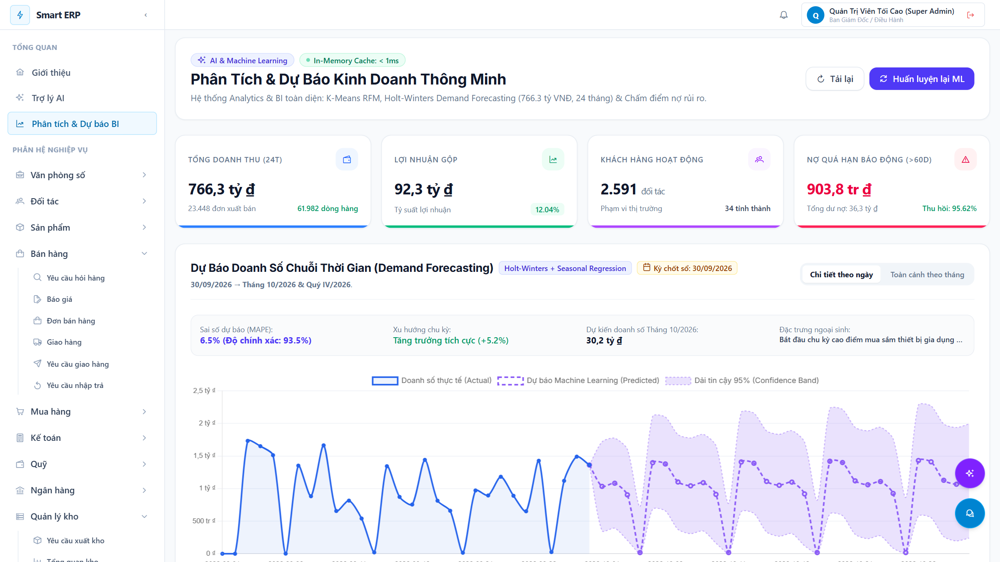

Hình 38 Màn hình phân tích và dự báo kinh doanh

**Màn hình Trợ lý AI** (`/ai`). Giao diện hội thoại với trợ lý chỉ đọc dữ liệu ERP theo quyền của người dùng. Màn hình mở đầu có sáu câu hỏi gợi ý (doanh thu theo ngành hàng, đại lý mua nhiều nhất, mã sắp hết hàng, công nợ quá hạn, nhà cung cấp giao trễ, tra cứu giá và tồn kho). Ảnh minh họa câu hỏi "Khách nào đang nợ quá hạn nhiều nhất?": trợ lý gọi công cụ đọc dữ liệu công nợ, trả về bảng gồm mã khách hàng, tên, loại khách, số nợ quá hạn, ngày quá hạn lâu nhất và số hóa đơn, kèm nguồn dữ liệu (Công nợ) và đề xuất hành động. Mỗi cuộc trò chuyện được lưu ở cột bên trái để người dùng mở lại.

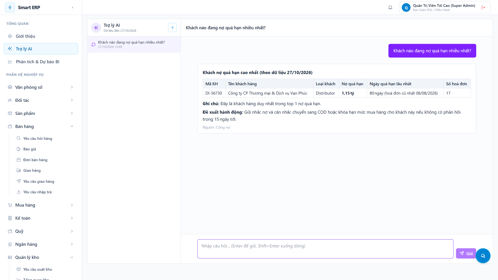

Hình 39 Màn hình trợ lý AI hỏi đáp dữ liệu ERP

#### 2.4.5.5 Phân hệ Văn phòng số, Chấm công và Bảng lương (UC-04)

**Màn hình Đơn xin nghỉ phép** (`/eoffice/leave/:id`). Form gồm loại nghỉ, từ ngày và đến ngày (chọn cả ngày hoặc nửa ngày), số ngày nghỉ tính công (đã loại trừ thứ Bảy, Chủ nhật và ngày lễ), lý do, người nhận bàn giao và nội dung bàn giao. Khung bên phải hiển thị quỹ phép năm (phép đầu kỳ, đã nghỉ, chờ duyệt, còn lại) và lịch sử xử lý của đơn theo thời gian. Đơn do người không có quản lý trực tiếp tạo sẽ được hệ thống tự động duyệt, thể hiện ở dòng "Tự động duyệt" trong lịch sử.

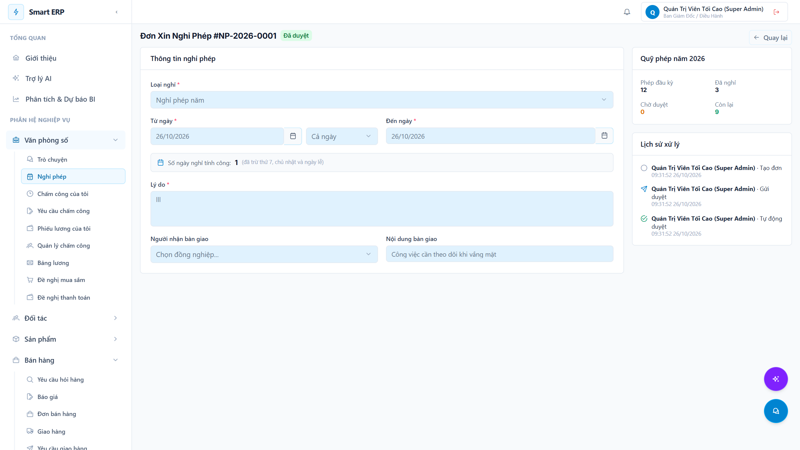

Hình 40 Màn hình chi tiết đơn xin nghỉ phép

**Màn hình Chấm công của tôi** (`/eoffice/attendance`). Bảng công theo tháng của chính nhân viên: giờ vào, giờ ra, đi trễ, về sớm, tăng ca, công và trạng thái từng ngày (Đủ công, Vắng, Cuối tuần), cùng các thẻ tổng hợp phía trên. Khi có ngày thiếu hoặc vắng chưa giải trình, hệ thống hiện cảnh báo và cho phép gửi yêu cầu bổ sung hoặc bù công cho từng ngày.

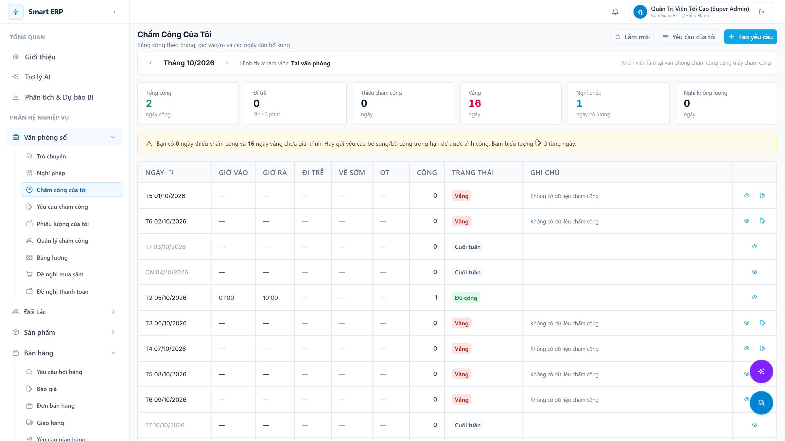

Hình 41 Màn hình chấm công cá nhân theo tháng

**Màn hình Quản lý Chấm công** (`/eoffice/attendance-manage`). Dành cho người có quyền quản lý chấm công, gồm bốn tab: Tổng hợp công tháng, Nhập file máy chấm công, Hồ sơ nhân sự và ca, Nhật ký điều chỉnh. Tab tổng hợp liệt kê công, lần trễ, phút trễ, vắng, thiếu chấm, nghỉ phép và nghỉ không lương của từng nhân viên, và có nút "Tính lại bảng công tháng". Màn hình này tổng hợp ba nguồn công của hệ thống: máy chấm công, yêu cầu bổ sung đã duyệt và đơn nghỉ phép.

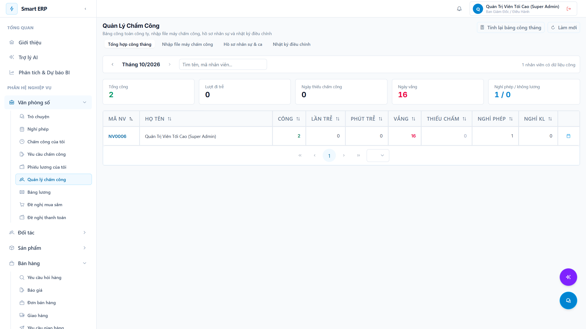

Hình 42 Màn hình quản lý chấm công toàn công ty

**Màn hình Bảng lương** (`/eoffice/payroll`). Danh sách kỳ lương bên trái (09/2026, 08/2026, 07/2026) kèm trạng thái (Đang lập, Chờ duyệt, Đã duyệt). Với kỳ đã chọn, hệ thống hiển thị số nhân viên, công chuẩn, tổng thu nhập, tổng bảo hiểm và thuế TNCN, tổng thực nhận, rồi đến bảng phiếu lương từng nhân viên (công, tăng ca, thu nhập, bảo hiểm, thuế TNCN, phạt, thực nhận). Quy trình đi theo trình tự: Khóa công, Thưởng/khấu trừ, Tính lương, Gửi duyệt, Duyệt, Chi lương (hạch toán sang kế toán, xem Biểu đồ 9). Hệ thống tách nhiệm vụ giữa người lập và người duyệt: người gửi duyệt không được tự duyệt bảng lương của chính mình. Ảnh minh họa kỳ 08/2026 với 23 nhân viên: Kế toán trưởng khóa công, tính lương và gửi duyệt, sau đó Super Admin duyệt; trạng thái chuyển sang "Đã duyệt" và xuất hiện nút "Chi lương".

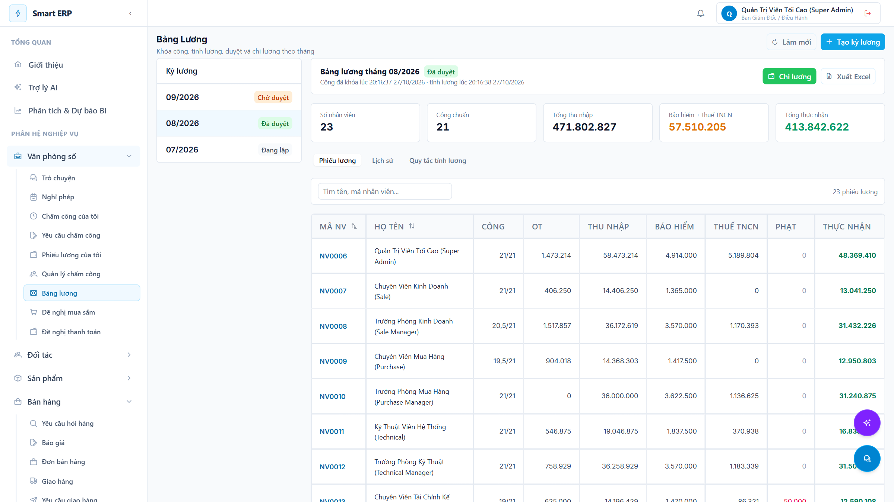

Hình 43 Màn hình bảng lương theo kỳ

**Màn hình Phiếu lương của tôi** (`/eoffice/payslip`). Mỗi nhân viên tự xem phiếu lương của mình, gồm kỳ lương, số công, tổng thu nhập, khấu trừ, thực nhận và trạng thái. Màn hình chỉ hiển thị các kỳ lương đã được duyệt nên nhân viên không thấy số liệu của kỳ còn đang lập hoặc chờ duyệt. Ảnh minh họa phiếu lương tháng 08/2026 của Super Admin sau khi bảng lương được duyệt.

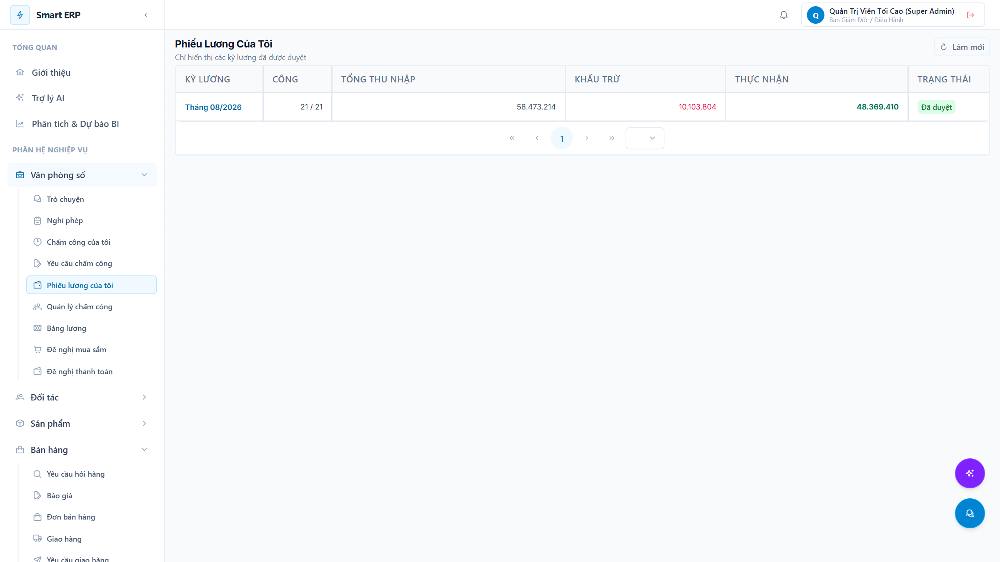

Hình 44 Màn hình phiếu lương cá nhân
