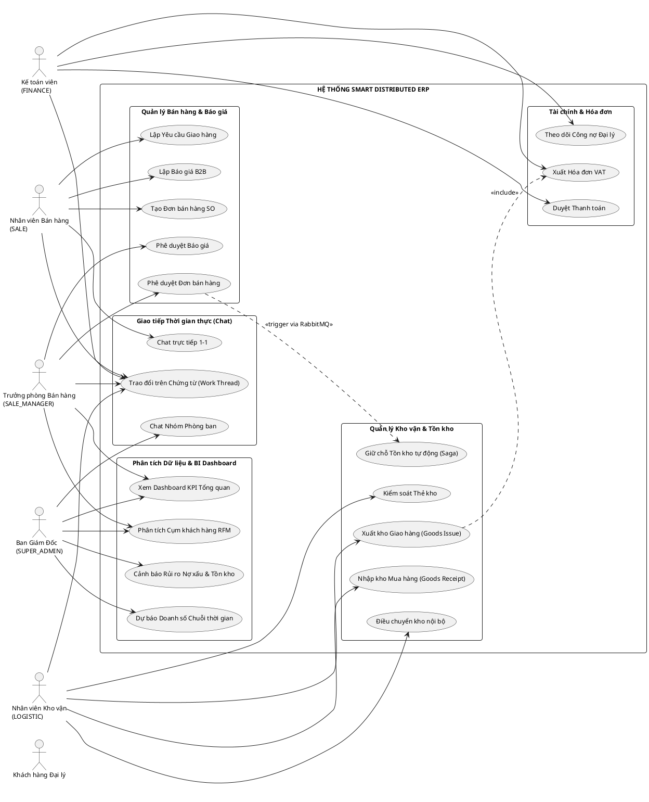
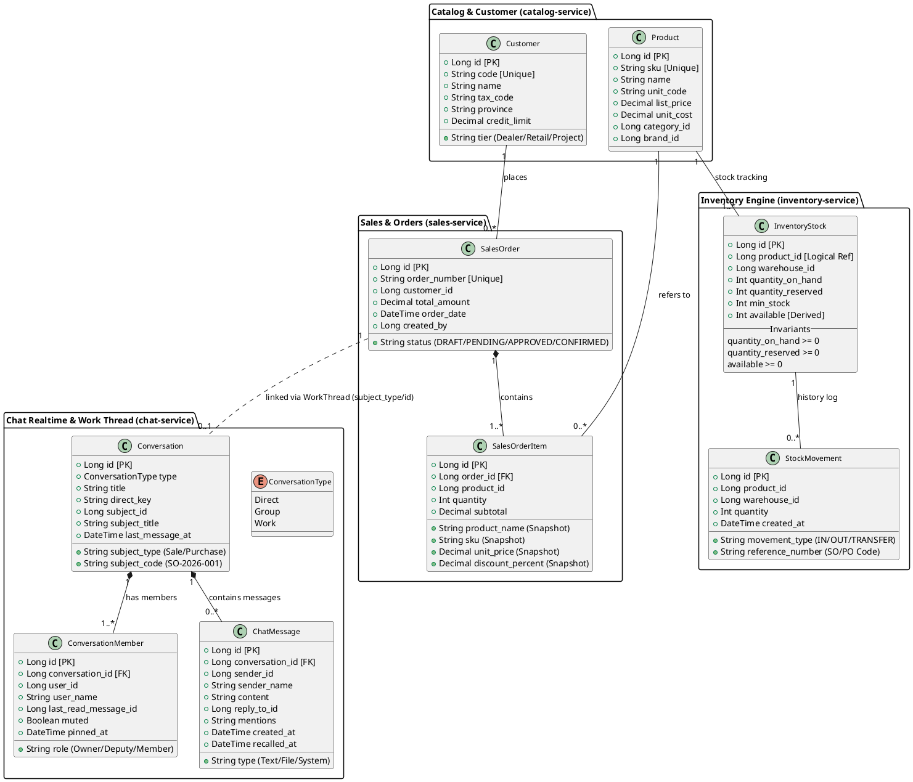
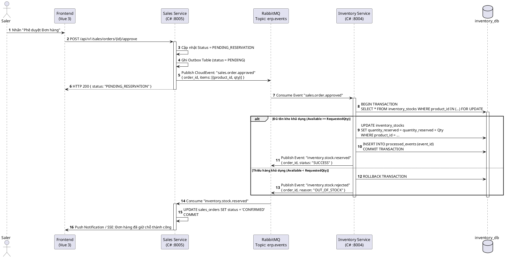
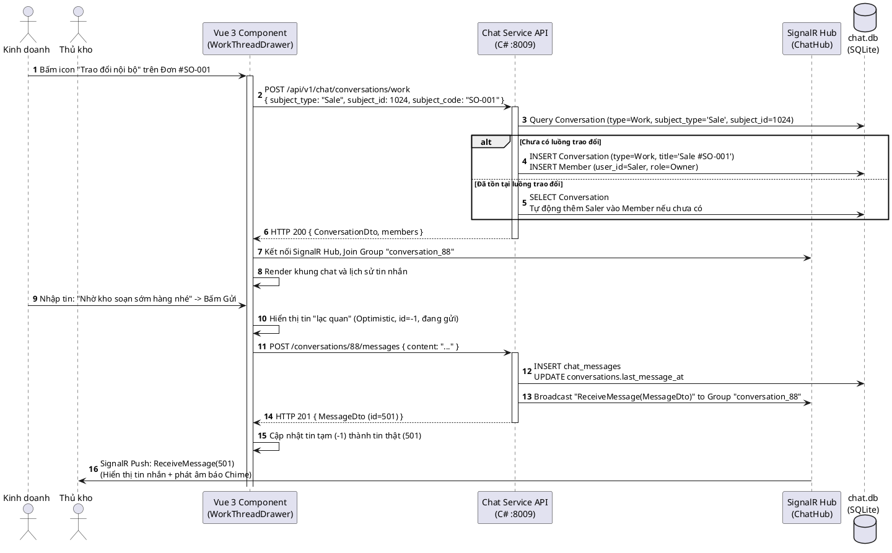

# CHƯƠNG 2: THIẾT KẾ VÀ TRIỂN KHAI

---

## 2.1. CÁC YÊU CẦU CHỨC NĂNG (FUNCTIONAL REQUIREMENTS)

Hệ thống **Smart Distributed ERP** được thiết kế bao phủ toàn diện chu trình vận hành phân phối thiết bị gia dụng B2B:

### 1. Phân hệ Quản trị Tổ chức & Phân quyền động (Identity & RBAC)
* **Xác thực tập trung (Authentication)**: Đăng nhập một lần (Single Sign-On logic), cấp phát và xác thực Stateless JWT Token kèm thời hạn sử dụng.
* **Quản trị cơ cấu tổ chức**: Quản lý cây phòng ban (`BOD`, `SALES`, `PURCHASE`, `TECHNICAL`, `FINANCE`, `LOGISTIC`) và hồ sơ nhân viên.
* **Phân quyền động 11 Roles (Dynamic RBAC)**: Phân định ranh giới chức năng giữa Nhân viên (Staff) và Trưởng phòng (Manager); kiểm soát quyền hạn hạt mịn theo chuẩn `<tài_nguyên>.<hành_động>` (ví dụ: `order.view`, `order.approve`, `inventory.receive`).

### 2. Phân hệ Danh mục Sản phẩm & Đối tác (Catalog Service)
* **Quản lý danh mục sản phẩm**: Quản lý 916 sản phẩm gia dụng (29 danh mục, 78 thương hiệu), mã SKU, mã vạch, đơn vị tính quy đổi, giá niêm yết, thông số kỹ thuật.
* **Quản lý đối tác thương mại**: Hồ sơ 1.256 khách hàng đại lý (Dealer, Distributor, Retail) và 32 nhà cung cấp; phân loại địa bàn kinh doanh trên 34 tỉnh thành.

### 3. Phân hệ Bán hàng & Giữ chỗ tồn kho (Sales & Saga Orchestration)
* **Quy trình Báo giá (Quotation Flow)**: Soạn thảo báo giá B2B, áp dụng chính sách chiết khấu bậc thang theo số lượng, luồng phê duyệt báo giá của Sale Manager.
* **Quy trình Đơn bán hàng (Sales Order Flow)**: Chuyển đổi từ Báo giá thành Đơn bán hàng chính thức (SO).
* **Điều phối phân tán (Saga Orchestration)**: Tự động kích hoạt luồng giữ chỗ tồn kho (Stock Reservation) qua RabbitMQ ngay khi đơn hàng được xác nhận; tự động bồi hoàn giải phóng hàng (Compensating Transaction) nếu khách hủy đơn.

### 4. Phân hệ Quản trị Kho vận & Chuỗi cung ứng (Inventory Engine)
* **Động cơ kiểm soát tồn kho 3 trạng thái**:
  * `Quantity On-Hand` (Tồn vật lý thực tế trong kho).
  * `Quantity Reserved` (Tồn đã cam kết giao cho các đơn bán hàng).
  * `Available = On-Hand - Reserved` (Tồn khả dụng thực tế để tiếp tục bán).
* **Ghi nhận nghiệp vụ kho**: Nhập kho mua hàng (Goods Receipt), Xuất kho giao hàng (Goods Issue), Điều chuyển nội bộ giữa các kho bãi (Stock Transfer).
* **Thẻ kho & Sổ kho điện tử**: Lưu vết toàn bộ biến động số lượng từng giao dịch theo thời gian thực kèm mã chứng từ gốc.

### 5. Phân hệ Mua hàng & Cung ứng (Purchase Service)
* **Yêu cầu hỏi hàng (Item Inquiry)**: Nhân viên kinh doanh gửi đề nghị kiểm tra giá vốn và khả năng đáp ứng hàng từ nhà cung cấp.
* **Đơn mua hàng PO (Purchase Order)**: Lập đơn mua hàng gửi NCC, luồng phê duyệt PO của Purchase Manager, liên kết đối soát với phiếu nhập kho.

### 6. Phân hệ Tài chính, Hóa đơn & Công nợ (Finance Service)
* **Xuất hóa đơn & Chứng từ**: Quản lý hóa đơn VAT theo đơn bán và phiếu giao hàng thành công.
* **Quản lý hạn mức tín dụng & Công nợ phải thu**: Theo dõi số dư công nợ của từng đại lý, cảnh báo các khoản nợ sắp đến hạn và đã quá hạn thanh toán.

### 7. Phân hệ Trao đổi Nội bộ Thời gian thực (Realtime Chat & Work Thread)
* **Chat trực tiếp & Nhóm phòng ban**: Giao tiếp 1-1 giữa đồng nghiệp; kênh chat phòng ban mặc định (`#chung`, `#kho-van`, `#thu-mua`, `#kinh-doanh`, `#tai-chinh`).
* **Work Thread (Hội thoại gắn chứng từ ERP)**: Mở luồng trao đổi trực tiếp trên từng chứng từ (`Sale`, `Quotation`, `Purchase`), tự động đồng bộ thành viên liên quan, hỗ trợ gửi file/ảnh, ghim tin, thả cảm xúc, @mention.
* **Đồng bộ đa thiết bị & Tự phục hồi kết nối**: Cơ chế Catch-up Sync tải bù tin nhắn bị lỡ qua API cursor `after_id` khi mạng chập chờn.

### 8. Phân hệ Phân tích Dữ liệu, Machine Learning & Dashboard BI
* **Kho dữ liệu Data Warehouse (Star Schema)**: Đồng bộ dữ liệu kinh doanh 1 năm (217 tỷ VNĐ doanh thu, 8.307 hóa đơn, 22.214 giao dịch thẻ kho) phục vụ phân tích OLAP.
* **Mô hình K-Means Clustering (Phân khúc RFM)**: Phân loại 1.256 khách hàng thành 4 cụm: *VIP/Champions, Trung thành, Tiềm năng, Nguy cơ rời bỏ*.
* **Mô hình Time-Series Forecasting**: Dự báo doanh số từng ngày cho 30 ngày tiếp theo bằng thuật toán Holt-Winters kết hợp Regression phân tích chu kỳ mùa vụ.
* **Chấm điểm rủi ro công nợ (Credit Risk Scoring)**: Đánh giá tỷ lệ nợ quá hạn trên hạn mức tín dụng, xếp hạng rủi ro (Xanh, Vàng, Đỏ).
* **Dashboard Quản trị BI Web**: Trực quan hóa các thẻ KPI, biểu đồ đường dự báo, biểu đồ tròn phân bổ cụm khách hàng trên Vue 3.

---

## 2.2. CÁC YÊU CẦU PHI CHỨC NĂNG (NON-FUNCTIONAL REQUIREMENTS)

| Tiêu chuẩn phi chức năng | Yêu cầu kỹ thuật chi tiết |
| :--- | :--- |
| **Hiệu năng & Khả năng xử lý tải (Performance & Concurrency)** | - Các API nghiệp vụ lõi (Kiểm tra tồn kho, Xác nhận đơn hàng) có thời gian phản hồi $P_{95} < 200ms$.<br>- Hệ thống Chat thời gian thực SignalR duy trì độ trễ truyền tin $Latency < 50ms$ trong mạng nội bộ.<br>- Áp dụng Atomic Concurrency Lock và `AsNoTracking()` trong EF Core để ngăn chặn hoàn toàn hiện tượng Race Condition khi hàng trăm nhân viên giữ chỗ hàng cùng lúc. |
| **Ràng buộc bất biến chuỗi cung ứng (SCM Invariant)** | - Ràng buộc mức CSDL: $\text{Available} = (\text{QuantityOnHand} - \text{QuantityReserved}) \ge 0$. Hệ thống tuyệt đối không bao giờ cho phép bán khống (số lượng khả dụng bị âm) trong bất kỳ tình huống đồng thời nào. |
| **Tính sẵn sàng & Khả năng mở rộng (Scalability & Availability)** | - Tuân thủ nguyên tắc thiết kế **Stateless Microservices**: Mỗi service có thể nâng cấp, khởi động lại và mở rộng ngang (Horizontal Scale-out) độc lập bằng cách tăng số lượng container Docker mà không gây gián đoạn các phân hệ khác.<br>- Sẵn sàng kết nối Redis Backplane cho SignalR Hub khi phân cụm nhiều máy chủ. |
| **Bảo mật & Toàn vẹn thông tin (Security)** | - Xác thực bằng JSON Web Token (JWT) mã hóa HS256 với secret key bảo mật.<br>- Mật khẩu người dùng được băm an toàn bằng thuật toán Bcrypt.<br>- Tách biệt triệt để cơ sở dữ liệu (**Database-per-Service**), nghiêm cấm mọi câu lệnh JOIN chéo hoặc khóa ngoại liên kết trực tiếp giữa các service.<br>- Chặn triệt để lỗ hổng Stored XSS bằng cách kiểm soát chặt chẽ MIME type file tải lên (chặn các file `.svg`, thực thi `inline` an toàn). |
| **Tính khả dụng & Trải nghiệm người dùng (Usability & Design)** | - Giao diện Single Page Application (SPA) phát triển trên nền tảng Vue 3 + Tailwind CSS tuân theo phong cách **Clean Flat White Canvas** (nền trắng tinh tế, viền mảnh hairline 1px `border-slate-200`, bo góc `6px`).<br>- Hỗ trợ đầy đủ trạng thái kết nối trực quan (Online/Offline, Typing dots, Thông báo âm thanh Chime). |

---

## 2.3. CÁC RÀNG BUỘC (CONSTRAINTS)

### 2.3.1. Các ràng buộc về triển khai (Deployment Constraints)
* **Môi trường Container hóa**: Toàn bộ các dịch vụ phân tán, cơ sở dữ liệu và message broker phải được cấu hình đồng bộ qua Docker Compose để có thể khởi chạy nhất quán trên cả môi trường phát triển (Development) và máy chủ thử nghiệm (Staging/Production).
* **Phân chia công nghệ đa ngôn ngữ (Polyglot Microservices)**:
  * Backend hiệu năng cao: C# (.NET 10 / ASP.NET Core Web API) cho `sales-service`, `inventory-service`, `chat-service`.
  * Backend nghiệp vụ quản trị: PHP 8.2+ (Laravel Framework) cho `identity-service`, `catalog-service`, `finance-service`.
  * Module Khoa học Dữ liệu & Học máy: Python 3.11+ (FastAPI, Scikit-learn, Statsmodels) cho `ai-service`.
* **Cơ sở dữ liệu độc lập**: Mỗi service sử dụng một CSDL riêng biệt (SQLite cho chat/analytics nội bộ, MySQL/PostgreSQL cho các nghiệp vụ ERP).
* **Định dạng dữ liệu trên đường truyền (Wire Format)**: 100% JSON Payload giữa Client, Gateway và các Service bắt buộc dùng chuẩn `snake_case`, thời gian luôn là chuỗi chuẩn ISO 8601 UTC kết thúc bằng ký tự `Z`.

### 2.3.2. Các ràng buộc kinh tế (Economic Constraints)
* Hệ thống được định hướng phục vụ các doanh nghiệp phân phối vừa và nhỏ (SMEs) tại Việt Nam, do đó giải pháp công nghệ ưu tiên tối đa các nền tảng **mã nguồn mở và miễn phí bản quyền** (Linux, Docker, .NET, Python, Vue 3, RabbitMQ).
* Kiến trúc tối ưu hóa tài nguyên phần cứng, cho phép toàn bộ hệ sinh thái dịch vụ có thể vận hành ổn định trên một máy chủ đám mây (Cloud VPS) cấu hình tiêu chuẩn (4 vCPU, 8GB - 16GB RAM), giúp tiết kiệm hàng trăm triệu đồng chi phí đầu tư ban đầu so với các giải pháp thương mại độc quyền.

### 2.3.3. Các ràng buộc về đạo đức & bảo mật thông tin (Ethical Constraints)
* **Bảo vệ bí mật kinh doanh**: Dữ liệu giá vốn sản phẩm (`unit_cost`), lợi nhuận gộp và hạn mức tín dụng khách hàng là tài sản nhạy cảm cốt lõi của doanh nghiệp, chỉ có các vai trò có thẩm quyền (`SUPER_ADMIN`, `FINANCE_ACCOUNTING_MANAGER`, `SALE_MANAGER`) mới được phép truy cập.
* **Bảo toàn dữ liệu lịch sử (Data Snapshotting)**: Khi phòng kinh doanh thay đổi giá niêm yết trong danh mục sản phẩm, toàn bộ thông tin giá đơn hàng, doanh số và hóa đơn trong quá khứ tuyệt đối không được phép biến động, đảm bảo tính trung thực của báo cáo thuế và kiểm toán tài chính.

---

## 2.4. MÔ HÌNH HỆ THỐNG / THIẾT KẾ GIẢI PHÁP

### 2.4.1. Các kịch bản Use-cases chính của hệ thống

1. **Kịch bản 1: Lập và phê duyệt Đơn bán hàng kèm Giữ chỗ tồn kho tự động**
   * *Tác nhân*: Nhân viên Kinh doanh (`SALE`), Trưởng phòng Kinh doanh (`SALE_MANAGER`).
   * *Luồng thực hiện*:
     1. Nhân viên Kinh doanh lập đơn hàng từ Báo giá hoặc tạo mới, chọn danh sách sản phẩm và khách hàng đại lý.
     2. Gửi yêu cầu phê duyệt đơn hàng (Trạng thái chuyển sang `PENDING_APPROVAL`).
     3. Trưởng phòng Kinh doanh kiểm tra công nợ và giá trị đơn, bấm **"Phê duyệt"** (`APPROVED`).
     4. `sales-service` cập nhật trạng thái đơn, ghi nhận sự kiện vào bảng Outbox và bắn CloudEvent `sales.order.approved` lên RabbitMQ Topic Exchange `erp.events`.
     5. `inventory-service` lắng nghe sự kiện, thực hiện kiểm tra tính sẵn sàng của kho hàng:
        - Nếu $\text{Available} \ge \text{Quantity}$: Thực hiện tăng `Reserved`, giảm `Available`, chuyển trạng thái đơn hàng sang `CONFIRMED`.
        - Nếu $\text{Available} < \text{Quantity}$: Hủy giữ chỗ, bắn sự kiện thất bại để kích hoạt Saga bồi hoàn.

2. **Kịch bản 2: Trao đổi nội bộ và phối hợp xử lý chứng từ qua Work Thread**
   * *Tác nhân*: Nhân viên Kinh doanh, Nhân viên Kho vận, Kế toán viên.
   * *Luồng thực hiện*:
     1. Nhân viên mở màn hình chi tiết Đơn bán hàng `#OD-2026-001`, bấm nút **"Trao đổi nội bộ"**.
     2. Giao diện kích hoạt component `WorkThreadDrawer.vue`, gửi request `POST /api/v1/chat/conversations/work` tới `chat-service`.
     3. `chat-service` tìm hội thoại tương ứng với `(SubjectType = "Sale", SubjectId = 1024)`. Nếu chưa có, tự động tạo mới và gắn người mở vào làm thành viên.
     4. Nhân viên gửi tin nhắn: *"@kho_van Nhờ chuẩn bị hàng xuất sớm trước 15h chiều nay cho khách"*.
     5. Server phát sự kiện Realtime qua SignalR Hub tới tất cả các thành viên đang trực tuyến trong kênh; avatar của người đọc tự động cập nhật báo trạng thái "Đã xem".

3. **Kịch bản 3: Phân tích cụm khách hàng RFM và Dự báo doanh số đón mùa cao điểm**
   * *Tác nhân*: Ban Giám Đốc (`SUPER_ADMIN`), Trưởng phòng Kinh doanh (`SALE_MANAGER`).
   * *Luồng thực hiện*:
     1. Nhà quản trị truy cập trang **Phân tích & Dự báo BI** (`/analytics`).
     2. Frontend gửi request tới `ai-service` (`/api/v1/ai/analytics/*`).
     3. `ai-service` truy vấn dữ liệu từ `analytics.db`:
        - Trích xuất đặc trưng Recency, Frequency, Monetary của 1.256 khách hàng, đưa qua mô hình **K-Means Clustering ($k=4$)** để phân cụm.
        - Trích xuất chuỗi doanh thu 365 ngày, đưa qua mô hình **Holt-Winters Smoothing & Regression** dự báo 30 ngày tiếp theo kèm dải tin cậy 95%.
     4. Giao diện BI hiển thị thẻ KPI tổng quan, biểu đồ đường dự báo và biểu đồ tròn phân khúc khách hàng.
     5. Quản lý bấm vào cụm **"Nguy cơ rời bỏ" (Churn Risk)** $\rightarrow$ Bảng bên cạnh lọc ngay danh sách các đại lý lớn lâu chưa phát sinh đơn để kịp thời phân công nhân viên liên hệ chăm sóc.

---

### 2.4.2. Mô hình Use-case tổng thể (PlantUML)



---

### 2.4.3. Mô hình Lớp và Đối tượng / ERD (PlantUML)

Mô hình dữ liệu phân tán chuẩn hóa giữa các thực thể cốt lõi của chuỗi cung ứng và phân hệ chat:



---

### 2.4.4. Các biểu đồ tuần tự Sequence Diagrams (PlantUML)

#### Biểu đồ 1: Luồng Đặt hàng và Giữ chỗ tồn kho phân tán (Saga Pattern)



#### Biểu đồ 2: Luồng Trao đổi nội bộ trên chứng từ (Work Thread Realtime)



#### Biểu đồ 3: Luồng Phân tích Dữ liệu BI & Dự báo Machine Learning

```plantuml
@startuml
autonumber
actor "Ban Giám Đốc" as Director
participant "Dashboard BI\n(Vue 3 /analytics)" as FE
participant "AI Service API\n(FastAPI :8010)" as AI
participant "ML Core Engine\n(ml.py)" as ML
database "Data Warehouse\n(analytics.db)" as DW

Director -> FE : Mở trang Dashboard BI (/analytics)
activate FE

par Tải dữ liệu Dự báo chuỗi thời gian
    FE -> AI : GET /api/v1/ai/analytics/forecast
    activate AI
    AI -> DW : SELECT date, SUM(amount) FROM fact_sales GROUP BY date
    DW --> AI : 365 bản ghi doanh thu theo ngày
    AI -> ML : forecast_sales_30_days(historical_data)
    activate ML
    ML -> ML : Áp dụng Holt-Winters Exponential Smoothing\nTính toán Confidence Interval 95% (Lower, Upper)
    ML --> AI : { historical: [...], forecast_30_days: [...] }
    deactivate ML
    AI --> FE : HTTP 200 { forecast_data, metrics: { mape: "6.8%" } }
    deactivate AI
and Tải phân cụm khách hàng RFM
    FE -> AI : GET /api/v1/ai/analytics/rfm-clusters
    activate AI
    AI -> DW : Trích xuất R, F, M từ fact_sales & dim_customer
    DW --> AI : 1.256 vector dữ liệu khách hàng
    AI -> ML : cluster_rfm_kmeans(rfm_vectors)
    activate ML
    ML -> ML : StandardScaler() -> KMeans(k=4)\nGán nhãn: VIP, Loyal, Potential, At-Risk
    ML --> AI : { clusters: [{label, count, percent}], details: [...] }
    deactivate ML
    AI --> FE : HTTP 200 { rfm_data }
    deactivate AI
end

FE -> FE : Render biểu đồ đường (Line Chart nét đứt dự báo)\nRender biểu đồ tròn Doughnut phân bổ cụm khách hàng
Director -> FE : Bấm chọn cụm "Nguy cơ rời bỏ" (At-Risk)
FE -> FE : Lọc bảng dữ liệu: Hiển thị ngay 377 đại lý cần chăm sóc
@enduml
```

---

### 2.4.5. Thiết kế màn hình giao diện người dùng (UI/UX)

Hệ thống được thiết kế theo quy chuẩn giao diện **Enterprise Clean Flat White Canvas**:

1. **Màn hình Đơn Bán Hàng & Drawer Trao đổi nội bộ (`/order`)**:
   * *Bố cục*: Header chứa thanh thống kê đơn hàng; Toolbar lọc tìm kiếm nhanh theo mã đơn, khách hàng và trạng thái (`DRAFT`, `APPROVED`, `CONFIRMED`).
   * *Bảng dữ liệu*: Sử dụng `CommonDataTable.vue` với viền hairline `1px border-slate-200`, hiển thị ID, mã đơn nội bộ font monospace, tên đại lý, tổng tiền và badge trạng thái màu sắc trực quan.
   * *Tích hợp Work Thread*: Cột *Thao Tác* chứa nút icon màu tím `pi-comments` (**"Trao đổi nội bộ về đơn này"**). Khi bấm, component `WorkThreadDrawer.vue` trượt mượt mà từ cạnh phải màn hình với độ rộng 520px, cho phép nhân viên chat, gửi file đính kèm và xem trạng thái đã đọc của đồng nghiệp mà không làm rời khỏi trang làm việc hiện tại.

2. **Màn hình Dashboard Phân tích & Dự báo BI (`/analytics`)**:
   * *Khu vực 1 (Hàng thẻ KPI)*: Hiển thị 4 thẻ thông số quan trọng: *Tổng doanh thu (216.9 tỷ VNĐ), Lợi nhuận gộp (38.5 tỷ VNĐ), Giá trị tồn kho (27.6 tỷ VNĐ), Công nợ quá hạn (3.6 tỷ VNĐ)*.
   * *Khu vực 2 (Biểu đồ Dự báo Doanh số)*: Biểu đồ đường kết hợp, đường màu xanh thể hiện doanh số thực tế trong năm, đường màu tím sáng nét đứt thể hiện 30 ngày dự báo của mô hình Machine Learning bao quanh bởi dải tin cậy 95%.
   * *Khu vực 3 (Phân khúc RFM & Bảng tương tác)*: Biểu đồ tròn thể hiện tỷ lệ 4 cụm khách hàng. Tính năng tương tác 2 chiều: bấm vào lát cắt *"Nguy cơ rời bỏ"* trên biểu đồ tròn thì bảng chi tiết bên cạnh lập tức lọc ra danh sách tên đại lý, công nợ quá hạn và số ngày chưa mua hàng.

3. **Màn hình Trung tâm Tin nhắn Nội bộ (`/chat`)**:
   * *Bố cục 3 cột hiện đại*:
     - Cột trái (320px): Danh sách các kênh phòng ban (`#kho-van`, `#thu-mua`, `#kinh-doanh`), các hội thoại 1-1 và các Work Thread gần nhất kèm badge số tin chưa đọc.
     - Khung giữa: Khung chat chính với bong bóng tin nhắn phân cấp (người gửi/người nhận), thanh tin nhắn ghim trên đầu, khu vực trả lời (quote) và ô soạn thảo hỗ trợ emoji, dán ảnh trực tiếp từ clipboard.
     - Cột phải (300px): Bảng thông tin hội thoại, danh sách thành viên nhóm, tài liệu và ảnh đã gửi trong phòng chat.
