# CHƯƠNG 2: THIẾT KẾ VÀ TRIỂN KHAI

---

## 2.1. CÁC YÊU CẦU CHỨC NĂNG (FUNCTIONAL REQUIREMENTS)

Hệ thống **Smart Distributed ERP** được thiết kế bao phủ toàn diện và tự động hóa khép kín chu trình vận hành phân phối thiết bị gia dụng B2B. Các yêu cầu chức năng được phân rã theo 9 phân hệ nghiệp vụ độc lập:

### 1. Phân hệ Quản trị Tổ chức, Người dùng & Phân quyền động (`identity-service`)
* **Xác thực người dùng tập trung (Authentication)**: 
  * Cơ chế đăng nhập một lần (Single Sign-On logic), cấp phát mã định danh truy cập không trạng thái (Stateless JSON Web Token - JWT) kèm thời gian sống (TTL) và mã làm mới (Refresh Token).
  * Mã hóa mật khẩu người dùng theo thuật toán Bcrypt an toàn với độ phức tạp cao (Work Factor = 12).
* **Quản trị cơ cấu tổ chức & phòng ban**:
  * Quản lý cây phòng ban đa cấp: Ban Giám đốc (`BOD`), Phòng Kinh doanh (`SALES`), Phòng Thu mua (`PURCHASE`), Phòng Kho vận (`LOGISTIC`), Phòng Kế toán - Tài chính (`FINANCE`), Phòng Kỹ thuật & Bảo hành (`TECHNICAL`).
  * Quản lý hồ sơ nhân viên: chức vụ, thông tin liên lạc, trạng thái hoạt động, phòng ban trực thuộc.
* **Phân quyền động hạt mịn (Dynamic RBAC)**:
  * Thiết lập ma trận phân quyền 11 Roles chuẩn hóa, phân định rõ ràng ranh giới giữa cấp quản lý (Manager) và cấp thực thi (Staff).
  * Kiểm soát quyền hạn truy cập API hạt mịn theo định dạng chuẩn `<resource>.<action>` (ví dụ: `order.create`, `order.approve`, `inventory.reserve`, `finance.view_cost`).
  * Tự động lọc và che giấu các trường dữ liệu nhạy cảm (giá vốn, hạn mức tín dụng, tỷ suất lợi nhuận) dựa trên quyền hạn của người dùng đăng nhập.

---

### 2. Phân hệ Quản lý Dữ liệu gốc Sản phẩm & Đối tác (`catalog-service`)
* **Quản trị danh mục sản phẩm (Master Data Product)**:
  * Quản lý thông tin chi tiết của 916 sản phẩm điện máy gia dụng thực tế (cào từ Điện Máy Xanh), thuộc 29 danh mục (điều hòa, tủ lạnh, máy giặt, tivi, bình nóng lạnh, bếp từ...) và 78 thương hiệu lớn (Samsung, LG, Daikin, Panasonic, Sony, Sunhouse...).
  * Quản lý đa đơn vị tính quy đổi (Bộ, Chiếc, Thùng, Dàn nóng/Dàn lạnh), mã vạch (Barcode), thông số kỹ thuật chi tiết, giá niêm yết bán lẻ (`list_price`), giá vốn tham chiếu (`unit_cost`) và định mức tồn kho tối thiểu (`min_stock`).
* **Quản trị hồ sơ đối tác thương mại (Partners)**:
  * Quản lý 2.591 khách hàng đại lý trên 34 tỉnh thành, phân nhóm thành 4 phân khúc: Đại lý cấp 2 (`Dealer`), Nhà phân phối cấp 1 (`Distributor`), Khách hàng Dự án (`Project / Business`), Khách mua lẻ (`Retail`).
  * Thiết lập mã số thuế, địa chỉ giao hàng, thông tin tài khoản ngân hàng và chính sách hạn mức tín dụng (`credit_limit`).
  * Quản lý danh bạ 32 nhà sản xuất/nhà cung cấp thiết bị gia dụng chính hãng, điều khoản thanh toán (Payment Terms) và người liên hệ đại diện.
* **Đồng bộ sự kiện danh mục (Outbox Pattern)**:
  * Mỗi khi phát sinh tạo mới hoặc điều chỉnh sản phẩm/đối tác, dịch vụ ghi sự kiện vào bảng `outbox_events` và tự động đẩy sự kiện lên RabbitMQ Topic Exchange `erp.events` để các service khác cập nhật bản ghi tham chiếu (Read Models).

---

### 3. Phân hệ Bán hàng & Điều phối Đơn hàng (`sales-service` - PHP Laravel 13)
* **Quy trình Lập và Phê duyệt Báo giá (Quotation Flow)**:
  * Nhân viên kinh doanh soạn thảo báo giá gửi khách hàng đại lý, áp dụng bảng giá niêm yết và chính sách chiết khấu bậc thang theo số lượng.
  * Tự động tính toán tổng tiền hàng, thuế GTGT (VAT 8% - 10%), tổng giá trị thanh toán.
  * Luồng phê duyệt báo giá: Báo giá có tỷ lệ chiết khấu vượt thẩm quyền nhân viên bắt buộc phải gửi yêu cầu phê duyệt tới Trưởng phòng Kinh doanh (`SALE_MANAGER`).
* **Quy trình Quản lý Đơn bán hàng (Sales Order - SO) & Snapshotting Dữ liệu**:
  * Chuyển đổi trạng thái từ Báo giá được chấp thuận sang Đơn bán hàng chính thức (SO) ở trạng thái `DRAFT`.
  * Áp dụng kỹ thuật chụp ảnh dữ liệu tham chiếu (**Reference Snapshot**): Khi tạo chứng từ, `sales-service` lưu lại bản sao thông tin sản phẩm, đơn giá, khách hàng và người lập từ `catalog-service` và `identity-service` nhằm đảm bảo tính bất biến tuyệt đối của chứng từ tài chính trong quá khứ.
* **Cơ chế Đặt chỗ tồn kho nguyên tử theo chứng từ (Atomic Document-level Stock Reservation)**:
  * Khi xuất kho hoặc phát hành hóa đơn (`Invoice/Dispatch`), `sales-service` thực hiện cuộc gọi REST API đồng bộ trực tiếp `POST /stocks/reserve/batch` sang `inventory-service` (:8004) kèm mã chứng từ gốc (`reference_type: "SalesInvoice"`, `reference_id`).
  * Cơ chế phản hồi tức thì (Fail-Fast): Nếu kho khả dụng đủ, giữ chỗ thành công; nếu thiếu hàng lập tức trả về ngoại lệ `StockReservationFailedException` (HTTP 422), ngăn chặn hoàn toàn việc xác nhận đơn ảo.
  * Khi hủy chứng từ (`cancel`), `sales-service` gọi `POST /stocks/release/batch` sang `inventory-service` để giải phóng toàn bộ số lượng hàng đã đặt chỗ cho chứng từ đó.

---

### 4. Phân hệ Quản trị Kho vận & Động cơ Tồn kho (`inventory-service` - C# .NET 10)
* **Động cơ kiểm soát tồn kho 3 trạng thái (Three-State Stock Engine)**:
  * Duy trì và kiểm soát chặt chẽ 3 biến số số lượng trên từng mã hàng (`product_id`) tại từng kho vật lý (`warehouse_id`):
    * $\text{QuantityOnHand}$ (Tồn kho vật lý thực tế).
    * $\text{QuantityReserved}$ (Tồn kho đã cam kết giữ chỗ cho các chứng từ bán hàng).
    * $\text{QuantityAvailable} = \text{QuantityOnHand} - \text{QuantityReserved}$ (Tồn kho thực sự khả dụng để tiếp tục chào bán).
  * **Ràng buộc bất biến tuyệt đối**: $\text{QuantityAvailable} \ge 0$. Ngăn chặn 100% nguy cơ bán khống trong các tình huống truy cập đồng thời cao.
* **Cơ chế Khóa phân tán & Nguyên tử (Atomic Concurrency Lock)**:
  * Sử dụng cơ chế khóa bi quan (Pessimistic Locking `SELECT ... FOR UPDATE`) kết hợp kiểm tra phiên bản dữ liệu khi xử lý giữ chỗ hàng (`/stocks/reserve/batch`), giải quyết triệt để xung đột Race Condition khi hàng chục nhân viên cùng chốt một mã điều hòa "hot".
* **Sổ cái Đặt chỗ theo Chứng từ (Document Reservation Ledger)**:
  * Quản lý trạng thái giữ chỗ độc lập theo từng chứng từ, cho phép giữ chỗ từng phần hoặc toàn phần và giải phóng nguyên tử khi chứng từ bị hủy bỏ.
* **Quản trị nghiệp vụ kho vật lý & Confirmed Outbox Publisher**:
  * *Nhập kho mua hàng (Goods Receipt - GRN)*: Tiếp nhận hàng từ nhà cung cấp theo đơn PO, tăng $\text{QuantityOnHand}$.
  * *Xuất kho bán hàng (Goods Issue - Delivery)*: Xuất hàng giao cho đại lý theo đơn SO, giảm đồng thời $\text{QuantityOnHand}$ và $\text{QuantityReserved}$.
  * *Thẻ kho điện tử (Stock Card)*: Ghi nhận tức thời lịch sử mọi biến động xuất/nhập/giữ chỗ kèm mã chứng từ tham chiếu gốc.
  * *Confirmed Outbox Publisher*: Phát sự kiện tên miền lên RabbitMQ Topic `erp.events` với cơ chế xác nhận Publisher Confirms và Dead-Letter Exchange (`erp.dlx`).

---

### 5. Phân hệ Mua hàng & Quản lý Cung ứng (`purchase-service` - C# .NET 10)
* **Đề nghị mua sắm (Purchase Requisition - PR)**:
  * Tiếp nhận nhu cầu đặt hàng từ các phòng ban hoặc tự động cảnh báo khi tồn kho khả dụng chạm ngưỡng an toàn ($\text{Available} \le \text{MinStock}$).
* **Đơn mua hàng (Purchase Order - PO)**:
  * Soạn thảo và phát hành đơn mua hàng gửi nhà sản xuất (Daikin, Panasonic, LG...), xác lập đơn giá nhập, điều khoản giao hàng và ngày dự kiến hàng về (Expected Delivery Date).
  * Luồng phê duyệt đơn mua sắm từ Giám đốc Thu mua.
* **Quy trình Đối soát 3 bên (Three-Way Matching)**:
  * Hệ thống tự động đối chiếu chéo số liệu giữa 3 chứng từ: **Đơn mua hàng (PO)** $\leftrightarrow$ **Phiếu nhập kho thực tế (GRN)** $\leftrightarrow$ **Hóa đơn tài chính từ nhà cung cấp (Vendor Invoice)**.
  * Chỉ khi số lượng và đơn giá khớp nhau trong biên độ dung sai cho phép ($\le 0.5\%$), hệ thống mới xác nhận chuyển hồ sơ sang bộ phận Kế toán để lập lệnh chi trả tiền.

---

### 6. Phân hệ Kế toán, Hóa đơn & Công nợ (`finance-service` - PHP Laravel 13)
* **Phát hành Hóa đơn tài chính (VAT Invoice)**:
  * Tự động sinh hóa đơn GTGT điện tử khi phiếu xuất kho giao hàng thành công, hỗ trợ bóc tách thuế suất GTGT chuẩn mực (8% hoặc 10%).
* **Kiểm soát Hạn mức tín dụng & Quản trị Công nợ (Credit Management)**:
  * Tự động tính toán số dư công nợ phải thu của từng đại lý.
  * Tự động kiểm tra điều kiện công nợ khi lập đơn bán: Nếu đơn hàng mới làm tổng nợ vượt hạn mức tín dụng ($\text{TotalDebt} > \text{CreditLimit}$) hoặc khách hàng có khoản nợ quá hạn trên 30 ngày, hệ thống tự động khóa luồng tạo đơn và yêu cầu chuyển tiền trước.
* **Phân loại Tuổi nợ (Aging Debts)**:
  * Phân loại công nợ theo các chu kỳ: Nợ trong hạn (0 - 30 ngày), Nợ quá hạn nhẹ (31 - 60 ngày), Nợ cảnh báo (61 - 90 ngày) và Nợ khó đòi (> 90 ngày).
* **Hạch toán Chi phí Lương & Bảo hiểm tự động (`PayrollJournalController`)**:
  * Tiếp nhận dữ liệu bảng lương đã duyệt từ `eoffice-service`, tự động sinh bút toán Sổ cái Kế toán (GL): Ghi Nợ TK 642 (Chi phí quản lý DN), Ghi Có TK 334 (Phải trả người lao động), Ghi Có TK 338 (Bảo hiểm xã hội/y tế/thất nghiệp) và Ghi Có TK 3335 (Thuế TNCN).

---

### 7. Phân hệ Giao tiếp Thời gian thực & Hội thoại gắn chứng từ (`chat-service` - C# .NET 10 + MongoDB 7)
* **Đa dạng hóa loại hình hội thoại**:
  * Chat trực tiếp 1-1 riêng tư giữa hai cá nhân (`direct`).
  * Kênh trao đổi nhóm theo phòng ban hoặc dự án có phân quyền Trưởng nhóm/Thành viên (`group`).
* **Đột phá với mô hình Work Thread (Hội thoại gắn chứng từ ERP)**:
  * Tự động kích hoạt luồng trao đổi trực tiếp trên từng chứng từ nghiệp vụ (`Sale`, `Quotation`, `Purchase`, `Invoice`).
  * Quyền tham gia được tự động suy diễn theo quyền hạn trên chứng từ gốc (Context-aware Access Control).
  * Toàn bộ thảo luận xin duyệt chiết khấu, giục xe giao hàng, báo lỗi vỏ hộp đều được lưu lại vĩnh viễn trên chứng từ, trở thành một chuỗi vết kiểm toán minh bạch (Audit Trail).
* **Kiến trúc Lưu trữ Phân tán trên MongoDB 7 (`erp_chat_db`)**:
  * Bảng `conversations` (lưu trữ danh sách thành viên nhúng), `chat_messages` (lưu trữ tệp đính kèm và reactions nhúng), phân tách hoàn toàn tải I/O chat khỏi hệ quản trị CSDL nghiệp vụ.
* **Tự phục hồi kết nối & Tải bù tin nhắn (Resilience & Catch-up Sync)**:
  * Cơ chế tự động tái kết nối WebSocket SignalR khi mạng chập chờn.
  * Tải bù toàn bộ tin nhắn bị lỡ trong lúc offline thông qua API REST cursor `after_id` mà không làm gián đoạn trải nghiệm người dùng.
* **Tính năng cộng tác phong phú**:
  * Gửi tệp đính kèm an toàn (PDF, DOCX, XLSX, ảnh JPEG/PNG), trả lời trích dẫn tin nhắn (Reply/Quote), ghim tin quan trọng (Pin), thả cảm xúc (Reactions) và gõ thông báo @mention trực tiếp.

---

### 8. Phân hệ Phân tích Dữ liệu Thông minh, Trợ lý AI & Machine Learning (`ai-service` - Python 3.12 FastAPI + MySQL 8)
* **Kho dữ liệu phân tích chuẩn hóa trên MySQL (`erp_analytics_db`)**:
  * Khai thác toàn diện bộ dữ liệu kinh doanh 2 năm (24 tháng: 10/2024 – 09/2026) với quy mô 765.4 tỷ VNĐ, 61.982 giao dịch chi tiết, 2.591 khách hàng và 916 sản phẩm gia dụng từ `kaggle_dataset/`.
  * Cơ chế đồng bộ dữ liệu tự động ETL (`warehouse.sync`) hỗ trợ cờ điều khiển `AI_WAREHOUSE_SYNC_ENABLED`.
* **Trợ lý AI Đàm thoại Thông minh (Agentic Conversational AI)**:
  * Tích hợp LLM qua Groq API, hỗ trợ người dùng truy vấn số liệu kinh doanh, kiểm tra tồn kho, tra cứu công nợ bằng ngôn ngữ tự nhiên tiếng Việt tuân thủ nghiêm ngặt ma trận quyền hạn người hỏi (Role-based Tool Scopes).
* **Phân cụm khách hàng RFM bằng thuật toán K-Means Clustering**:
  * Trích xuất bộ ba chỉ số RFM: Recency ($R$), Frequency ($F$), Monetary ($M$).
  * Tiền xử lý dữ liệu qua phép biến đổi logarit $\ln(x+1)$ và chuẩn hóa `StandardScaler` để xử lý các điểm dữ liệu ngoại lai (outliers).
  * Xác định số cụm tối ưu ($k=4$) thông qua phương pháp Elbow và Silhouette Score, phân loại khách hàng thành 4 cụm: *VIP/Champions*, *Trung thành*, *Tiềm năng*, *Nguy cơ rời bỏ (At-Risk/Churn Risk)*.
* **Dự báo chuỗi thời gian doanh số bán hàng (Time-series Demand Forecasting)**:
  * Ứng dụng mô hình **Holt-Winters Exponential Smoothing kết hợp Hồi quy Ridge/Polynomial** có tính đến chu kỳ tuần (7 ngày) và chu kỳ mùa vụ năm (Đợt nắng nóng hè và cao điểm mua sắm Tết).
  * Tích hợp biến ngoại sinh nhiệt độ trung bình (`avg_temperature_c`) để dự báo chính xác nhu cầu máy lạnh, quạt mát.
  * Dự báo doanh thu từng ngày cho 30 ngày tiếp theo kèm khoảng dao động tin cậy 95% (Confidence Interval: `lower_bound`, `upper_bound`), đạt sai số $\text{MAPE} < 8\%$.
* **Chấm điểm rủi ro công nợ (Credit Risk Scoring)**:
  * Đánh giá tỷ lệ nợ quá hạn trên hạn mức tín dụng và số ngày quá hạn thanh toán, gán nhãn mức độ rủi ro (Xanh - Vàng - Đỏ).
* **REST API Hiệu năng cao & In-memory Caching**:
  * Cung cấp các endpoints `/api/v1/ai/analytics/*` phục vụ Dashboard BI với cơ chế Pre-compute In-memory Caching, đảm bảo thời gian phản hồi siêu tốc dưới 50ms.

---

### 9. Phân hệ Văn phòng số, Chấm công & Bảng lương (`eoffice-service` - PHP Laravel 13 & `notification-service` - Node.js 22)
* **Số hóa quy trình văn phòng & Phê duyệt điện tử (e-Office Core)**:
  * Quản lý đơn xin nghỉ phép, đề xuất tạm ứng công tác phí, phiếu đề nghị mua sắm nội bộ và quy trình phê duyệt ký số nhiều cấp.
* **Phân hệ Quản lý Chấm công Thông minh (Attendance Management)**:
  * *Ca làm việc & Quy tắc tính công*: Cấu hình linh hoạt các ca làm việc (`Shift`: giờ vào, giờ ra, khung giờ cho phép đi muộn/về sớm).
  * *Máy quét chấm công*: Thu nhận dữ liệu quẹt thẻ/vân tay (`PunchLog`), tích hợp công cụ tính toán bù dữ liệu `RecalculateAttendance`.
  * *Tính toán ngày công tự động (`AttendanceDayCalculator`)*: Phân loại chính xác ngày công (Đủ công, Đi muộn, Về sớm, Nghỉ phép năm, Nghỉ không lương) và tổng số giờ làm việc thực tế.
  * *Yêu cầu điều chỉnh chấm công (`AttendanceRequest`)*: Nhân viên gửi yêu cầu giải trình quên quẹt thẻ hoặc đi công tác kèm minh chứng; luồng duyệt cấp Quản lý trực tiếp (`LINE_MANAGER`).
* **Phân hệ Quản lý Bảng lương & Phiếu lương (Payroll Management)**:
  * *Quy tắc lương linh hoạt (`PayrollRule`)*: Thiết lập công thức tính lương theo vị trí, hệ số lương, phụ cấp trách nhiệm, tỷ lệ trích nộp BHXH/BHYT/BHTN (10.5% người lao động, 21.5% doanh nghiệp) và biểu thuế lũy tiến TNCN.
  * *Kỳ tính lương (`PayrollPeriod`)*: Lập kỳ lương hàng tháng, tự động kết xuất dữ liệu ngày công từ phân hệ Chấm công để tính toán bảng lương tổng hợp.
  * *Phiếu lương cá nhân (`PayrollSlip`)*: Nhân viên tự tra cứu chi tiết thu nhập, tiền làm thêm giờ và các khoản khấu trừ trực tiếp trên giao diện cá nhân (`/eoffice/payslip`).
  * *Điều chỉnh lương (`PayrollAdjustment`)*: Hỗ trợ ghi nhận các khoản thưởng nóng, phụ cấp đột xuất hoặc phạt kỷ luật vào kỳ lương.
  * *Tích hợp Hạch toán Sổ cái*: Tự động gửi dữ liệu bảng lương đã duyệt sang `finance-service` để ghi sổ chi phí kế toán.
* **Động cơ gửi thông báo tập trung đa kênh (`notification-service` trên MongoDB 7)**:
  * Gửi thông báo tức thời đa kênh (In-app Push qua Socket.IO, Email SMTP queue qua Mailpit/Nodemailer).
  * Lưu trữ thông báo và nhật ký sự kiện trên MongoDB (`erp_notification_db`), bảo mật qua module Email Auth và lắng nghe sự kiện RabbitMQ (`eoffice.attendance.*`, `eoffice.payroll.*`, `catalog.product.*`, `inventory.goods.issued`).

---

## 2.2. CÁC YÊU CẦU PHI CHỨC NĂNG (NON-FUNCTIONAL REQUIREMENTS)

| Tiêu chuẩn | Yêu cầu kỹ thuật chi tiết | Phương pháp kiểm chứng |
| :--- | :--- | :--- |
| **Hiệu năng & Độ trễ (Performance & Latency)** | - Các API nghiệp vụ đọc/ghi thông thường đạt thời gian đáp ứng $P_{95} < 200ms$.<br>- API kiểm tra tồn kho phân tán đạt $P_{99} < 100ms$.<br>- API phân tích BI đạt thời gian phản hồi $< 50ms$ nhờ cơ chế In-memory Caching.<br>- Độ trễ truyền thông điệp WebSocket SignalR nội bộ duy trì $Latency < 50ms$. | Kiểm thử tải đồng thời bằng k6 / Apache JMeter với 500 kết nối đồng thời. |
| **Ràng buộc bất biến chuỗi cung ứng (SCM Invariant)** | - Tuyệt đối không cho phép bán khống: $\text{Available} = (\text{QuantityOnHand} - \text{QuantityReserved}) \ge 0$ trong mọi điều kiện đồng thời.<br>- Mọi thao tác trừ kho đều phải có chứng từ gốc đối soát. | Kiểm thử tải tranh chấp (Race Condition Test) 100 luồng đồng thời mua cùng 1 sản phẩm còn tồn kho bằng 5. |
| **Độ tin cậy & Tính nhất quán (Reliability & Consistency)** | - Đảm bảo tính nhất quán cuối cùng (Eventual Consistency) giữa các microservices qua RabbitMQ.<br>- Triển khai Idempotent Consumer và Transactional Outbox Pattern nhằm loại bỏ 100% rủi ro mất mát thông điệp hoặc xử lý trùng lặp sự kiện (At-least-once delivery). | Mô phỏng ngắt kết nối mạng giả lập (Chaos Engineering) giữa Sales và Inventory. |
| **Tính sẵn sàng & Mở rộng (Scalability & High Availability)** | - Thiết kế các microservices theo chuẩn **Stateless Service**, cho phép mở rộng ngang (Horizontal Scale-out) bằng cách tăng số lượng container Docker mà không gây gián đoạn hệ thống.<br>- Sẵn sàng cấu hình Redis Backplane cho SignalR Hub khi phân cụm đa máy chủ. | Thử nghiệm scale container từ 1 lên 3 replicas sau Nginx load balancer. |
| **Bảo mật & Toàn vẹn dữ liệu (Security & Integrity)** | - Xác thực bằng Stateless JWT (HMAC-SHA256) kèm thời hạn sống 8 giờ; băm mật khẩu bằng thuật toán Bcrypt.<br>- Phân quyền RBAC động 11 Roles kiểm soát tới từng API endpoint.<br>- Tách biệt cơ sở dữ liệu (**Database-per-Service**), nghiêm cấm mọi câu lệnh JOIN chéo giữa các service.<br>- Chặn hoàn toàn lỗ hổng Stored XSS bằng việc kiểm duyệt MIME type file đính kèm nghiêm ngặt (chặn định dạng `.svg` và các file thực thi `.exe`, `.sh`). | Rà soát lỗ hổng bảo mật theo chuẩn OWASP Top 10 và quét mã nguồn tĩnh (SAST). |
| **Tính khả dụng & Trải nghiệm (Usability & Design)** | - Giao diện Single Page Application (SPA) trên nền tảng Vue 3 + Tailwind CSS tuân thủ phong cách **Enterprise Clean Flat White Canvas** (nền trắng tinh tế, viền mảnh hairline 1px `border-slate-200`, bo góc 6px, độ tương phản cao).<br>- Hỗ trợ âm thanh phản hồi trực quan (Chime sound), trạng thái người dùng (Online/Offline, Typing indicator). | Đánh giá tính khả dụng UX qua thang đo SUS (System Usability Scale) đạt $\ge 85$ điểm. |

---

## 2.3. CÁC RÀNG BUỘC KỸ THUẬT, KINH TẾ VÀ ĐẠO ĐỨC

### 2.3.1. Ràng buộc triển khai (Deployment Constraints)
* **Kiến trúc Container hóa đồng bộ**: Toàn bộ 10 microservices, hệ quản trị cơ sở dữ liệu (MySQL 8, MongoDB 7), message broker RabbitMQ và Kong API Gateway được đóng gói và cấu hình nhất quán qua tệp `docker-compose.yml`, cho phép khởi chạy toàn bộ hệ thống bằng một câu lệnh duy nhất (`docker compose up -d`).
* **Mô hình công nghệ đa ngôn ngữ (Polyglot Microservices)**:
  * Backend lõi hiệu năng cao & Realtime: C# (.NET 10 Web API / ASP.NET Core SignalR) cho `inventory-service`, `purchase-service`, `chat-service`.
  * Backend quản trị & Nghiệp vụ doanh nghiệp: PHP 8.4 (Laravel 13 Framework) cho `identity-service`, `catalog-service`, `sales-service`, `finance-service`, `eoffice-service`.
  * Backend thông báo & hàng đợi: Node.js 22 (Express 4, Socket.IO 4) cho `notification-service`.
  * Module Phân tích dữ liệu, Trợ lý AI & Machine Learning: Python 3.12 (FastAPI, PyMySQL, Scikit-learn, Statsmodels, Pandas) cho `ai-service`.
  * Frontend: Vue 3.5 (Composition API), Vite 8, Pinia 4, PrimeVue, Tailwind CSS, Chart.js.
  * Hạ tầng trung gian: Kong API Gateway 3.9.1 DB-less (cổng 8000), RabbitMQ 3.13 Topic Exchange `erp.events` và Dead-Letter Exchange `erp.dlx`, Mailpit SMTP.
  * Hệ cơ sở dữ liệu phân tán: MySQL 8 (chứa các logical schema độc lập cho từng service nghiệp vụ và `erp_analytics_db`), MongoDB 7 Replica Set (cho `erp_chat_db` và `erp_notification_db`).
* **Quy chuẩn truyền thông tin (Wire Protocol)**: Toàn bộ dữ liệu JSON trao đổi giữa Frontend và Backend bắt buộc định dạng theo chuẩn `snake_case`; các trường thời gian luôn là chuỗi chuẩn ISO 8601 UTC kết thúc bằng ký tự `Z`.

### 2.3.2. Ràng buộc kinh tế (Economic Constraints)
* Hệ thống hướng tới phục vụ các doanh nghiệp phân phối vừa và nhỏ (SMEs) tại Việt Nam với ngân sách công nghệ hạn chế. Toàn bộ giải pháp phải sử dụng các **công nghệ mã nguồn mở miễn phí bản quyền** (Linux, .NET, PHP, Python, Node.js, MySQL, MongoDB, RabbitMQ, Kong).
* Cấu hình triển khai được tối ưu hóa để vận hành trơn tru trên một máy chủ đám mây (Cloud VPS) tiêu chuẩn (4 vCPU, 8GB - 16GB RAM), giúp doanh nghiệp tiết kiệm hàng trăm triệu đồng chi phí bản quyền và hạ tầng so với các hệ thống thương mại đóng gói.

### 2.3.3. Ràng buộc đạo đức nghề nghiệp, bảo mật tài chính & Tuân thủ Nghị định 13/2023/NĐ-CP

#### 1. Bảo vệ bí mật kinh doanh và tính bất biến của báo cáo tài chính
* **Bảo vệ dữ liệu giá vốn và tỷ suất lợi nhuận**: Giá vốn nhập hàng (`unit_cost`), giá trúng thầu dự án và biên lợi nhuận gộp là bí mật sống còn của doanh nghiệp phân phối. Hệ thống áp dụng nguyên tắc đặc quyền tối thiểu (Principle of Least Privilege), mã hóa các trường dữ liệu này ở tầng cơ sở dữ liệu và chỉ cho phép các vai trò có thẩm quyền tối cao (`SUPER_ADMIN`, `FINANCE_ACCOUNTING_MANAGER`) truy cập.
* **Bảo toàn dữ liệu lịch sử (Data Snapshotting)**: Khi phòng kinh doanh cập nhật giá niêm yết mới của sản phẩm, hệ thống áp dụng kỹ thuật Snapshotting lưu trữ bản sao cố định của tên hàng, đơn giá và tỷ lệ chiết khấu tại thời điểm lập đơn bán và phát hành hóa đơn VAT. Toàn bộ chứng từ đã phát hành trong quá khứ tuyệt đối không bị thay đổi, đảm bảo tính trung thực, khách quan và minh bạch của báo cáo tài chính trước cơ quan thuế và kiểm toán độc lập.

#### 2. Cơ chế hiện thực hóa và tuân thủ Nghị định 13/2023/NĐ-CP về Bảo vệ dữ liệu cá nhân
Nghị định số **13/2023/NĐ-CP** (ban hành ngày 17/04/2023 và có hiệu lực từ ngày 01/07/2023) là văn bản pháp quy quan trọng nhất của Chính phủ Việt Nam quy định về nghĩa vụ và trách nhiệm bảo vệ dữ liệu cá nhân của các tổ chức, doanh nghiệp. Trong mô hình hoạt động của Smart Distributed ERP, doanh nghiệp đóng vai trò là **Bên Kiểm soát và Xử lý dữ liệu cá nhân (Personal Data Controller and Processor)** đối với dữ liệu của cán bộ nhân viên, đối tác đại lý và người liên hệ.

Hệ thống được thiết kế kiến trúc kỹ thuật đáp ứng trực tiếp và toàn diện các điều khoản cốt lõi của Nghị định 13 thông qua 5 cơ chế kỹ thuật cụ thể:

```text
┌────────────────────────────────────────────────────────────────────────────────────────┐
│             KIẾN TRÚC TUÂN THỦ NGHỊ ĐỊNH 13/2023/NĐ-CP TRONG SMART DISTRIBUTED ERP     │
├────────────────────────────────────────────────────────────────────────────────────────┤
│ 1. PHÂN LOẠI DỮ LIỆU CÁ NHÂN  ──> Tách bạch Dữ liệu Cơ bản vs Dữ liệu Nhạy cảm (Đ. 2)  │
│ 2. KIỂM SOÁT TRUY CẬP RBAC    ──> Phân quyền hạt mịn, che giấu trường nhạy cảm (Đ. 26) │
│ 3. MÃ HÓA TĨNH VÀ TRUYỀN DẪN  ──> Bcrypt băm mật khẩu, TLS 1.3 / HTTPS / WSS (Đ. 27)  │
│ 4. ẨN DANH HÓA DỮ LIỆU        ──> Data Masking & Soft Delete bảo đảm quyền xóa (Đ. 9)  │
│ 5. NHẬT KÝ KIỂM TOÁN VẾT LƯU  ──> Ghi vết 100% thao tác truy cập dữ liệu cá nhân (Đ. 16)│
└────────────────────────────────────────────────────────────────────────────────────────┘
```

1. **Phân loại dữ liệu cá nhân theo Điều 2 của Nghị định**:
   * *Dữ liệu cá nhân cơ bản*: Họ và tên, giới tính, ngày tháng năm sinh, số điện thoại, địa chỉ email, địa chỉ cư trú/giao hàng, mã số thuế cá nhân, số Căn cước công dân (CCCD).
   * *Dữ liệu cá nhân nhạy cảm*: Thông tin tài khoản ngân hàng của đại lý/nhân viên, lịch sử giao dịch tín dụng công nợ, thông tin tiền lương và các trao đổi tài chính cá nhân trong hệ thống.
   * *Cơ chế kỹ thuật*: Tách biệt bảng dữ liệu người dùng (`users`) với bảng thông tin định danh mở rộng, áp dụng các chính sách bảo vệ nghiêm ngặt hơn đối với nhóm dữ liệu nhạy cảm.

2. **Nguyên tắc Giới hạn Mục đích & Sự Đồng thuận (Điều 9 & Điều 11)**:
   * Dữ liệu cá nhân của đại lý và nhân viên chỉ được thu thập và xử lý phục vụ các mục đích hợp pháp đã được đồng thuận: xác thực danh tính, đối soát hóa đơn VAT, giao nhận hàng hóa tại kho và liên lạc nghiệp vụ chuỗi cung ứng.
   * Hệ thống nghiêm cấm và không cung cấp bất kỳ API nào cho phép xuất khẩu (Export) hàng loạt hoặc chia sẻ dữ liệu đối tác cho bên thứ ba ngoài mục đích vận hành nội bộ.

3. **Hiện thực hóa Quyền của Chủ thể Dữ liệu (Điều 9) - Kỹ thuật Ẩn danh hóa (Data Anonymization)**:
   * *Quyền được biết & Truy cập*: Người dùng và khách hàng có quyền xem toàn bộ thông tin cá nhân mà hệ thống đang lưu trữ thông qua trang thông tin tài khoản cá nhân.
   * *Quyền rút lại sự đồng thuận và Quyền xóa dữ liệu (Right to be Forgotten)*: Khi một nhân viên nghỉ việc hoặc một đại lý chấm dứt hợp tác kinh doanh và yêu cầu xóa dữ liệu, hệ thống đối mặt với xung đột giữa **Luật Kế toán** (bắt buộc lưu trữ chứng từ tài chính tối thiểu 5 – 10 năm) và **Nghị định 13** (yêu cầu xóa dữ liệu cá nhân khi có yêu cầu).
   * *Giải pháp kỹ thuật của hệ thống*: Áp dụng kỹ thuật **Ẩn danh hóa dữ liệu (Data Masking & Pseudonymization)**:
     - Dữ liệu định danh cá nhân trực tiếp được mã hóa một chiều hoặc làm mờ: tên khách hàng chuyển thành `Khách hàng Ẩn danh #ID`, số điện thoại chuyển thành `0987***999`, email chuyển thành `anonymized_user_102@deleted.local`.
     - Số dư công nợ, giao dịch bán hàng và hóa đơn thuế gốc vẫn được bảo lưu trọn vẹn số tiền và mã hóa đơn phục vụ đối soát kế toán mà không còn liên kết với danh tính cá nhân thực tế ngoài đời thực.

4. **Biện pháp kỹ thuật bảo vệ dữ liệu cá nhân (Điều 26 & Điều 27)**:
   * *Bảo vệ tại nơi lưu trữ (Data at Rest)*: Mật khẩu 100% được băm bằng thuật toán **Bcrypt** với salt ngẫu nhiên; các trường nhạy cảm như số tài khoản ngân hàng được mã hóa đối xứng AES-256 trước khi ghi vào cơ sở dữ liệu.
   * *Bảo vệ trên đường truyền (Data in Transit)*: Toàn bộ giao tiếp giữa trình duyệt người dùng, API Gateway và các microservices đều bắt buộc mã hóa qua giao thức **HTTPS/TLS 1.3** và **WSS (Secure WebSocket)**, triệt tiêu hoàn toàn nguy cơ tấn công bắt gói tin (Packet Sniffing / Man-in-the-Middle).
   * *Kiểm soát truy cập hạt mịn*: Cơ chế RBAC ngăn chặn triệt để tình trạng nhân viên phòng ban này xem lén thông tin liên lạc, lương thưởng hoặc công nợ của nhân viên phòng ban khác.

5. **Lưu vết kiểm toán truy cập dữ liệu (Audit Trail & Logging - Điều 16 & Điều 39)**:
   * Hệ thống duy trì nhật ký kiểm toán bất biến (`audit_logs`) ghi nhận mọi thao tác: Xem thông tin chi tiết (`VIEW`), Chỉnh sửa (`UPDATE`), Xóa (`DELETE`) và đặc biệt là hành vi Xuất dữ liệu ra Excel (`EXPORT`).
   * Mỗi bản ghi lưu vết ghi nhận đầy đủ 5 tham số định danh: `user_id` người thực hiện, `ip_address`, `timestamp`, `action_type` và `impacted_records`.
   * Tính năng này giúp ban giám đốc phát hiện và ngăn chặn kịp thời các hành vi gian lận nội bộ như: nhân viên kinh doanh cố tình tải trộm toàn bộ danh bạ khách hàng đại lý để tuồn ra cho đối thủ cạnh tranh.

6. **Xóa bỏ hiện tượng "Vùng tối thông tin" (Shadow IT) qua Work Thread Chat nội bộ**:
   * Trước đây, nhân viên thường xuyên gửi ảnh Căn cước công dân, số tài khoản ngân hàng đại lý qua Zalo hoặc Facebook Messenger cá nhân để nhờ đồng nghiệp làm thủ tục. Dữ liệu này nằm ngoài tầm kiểm soát của doanh nghiệp và vi phạm nghiêm trọng Điều 26 của Nghị định 13.
   * Hệ thống `chat-service` với tính năng **Work Thread** nhúng trực tiếp vào chứng từ ERP tạo ra môi trường trao đổi khép kín, được lưu trữ trên máy chủ riêng của doanh nghiệp, có phân quyền xem theo chứng từ và được kiểm duyệt tệp đính kèm an toàn, giúp doanh nghiệp tuân thủ triệt để quy định bảo vệ dữ liệu cá nhân của pháp luật Việt Nam.

---

## 2.4. MÔ HÌNH HỆ THỐNG VÀ THIẾT KẾ GIẢI PHÁP

Nhằm phản ánh trực quan và có hệ thống toàn bộ quy trình nghiệp vụ của hệ thống **Smart Distributed ERP**, các kịch bản tương tác và biểu đồ Use-case được chuẩn hóa theo 4 nhóm phân hệ cốt lõi:

| Sơ đồ Use-case | Kịch bản tương ứng | Nội dung nghiệp vụ trọng tâm |
| :--- | :---: | :--- |
| **UC-01: Sales & Supply Chain** | 1, 2, 3 | Báo giá, đơn bán, đặt chỗ tồn kho nguyên tử theo chứng từ, mua hàng, nhập xuất kho, hóa đơn |
| **UC-02: Communication** | 4, 5 | Chat theo chứng từ (Work Thread trên MongoDB), xem lịch sử, đồng bộ tin nhắn |
| **UC-03: Analytics & BI** | 6 | Dashboard KPI, RFM, dự báo doanh số, cảnh báo công nợ, Trợ lý AI hội thoại |
| **UC-04: E-Office & HRM** | 7 | Ca làm việc, máy chấm công, tính ngày công, phê duyệt đề xuất công, lập bảng lương & hạch toán sổ cái |

---

### 2.4.1. Kịch bản các Use-cases chính của hệ thống

#### A. Phân nhóm UC-01: Bán hàng & Chuỗi cung ứng (Sales & Supply Chain)
*(Bao hàm chu trình vận hành khép kín Order-to-Cash và Procure-to-Pay qua Kịch bản 1, 2 và 3)*

##### Kịch bản 1: Lập báo giá, chuyển đổi Đơn bán hàng và Đặt chỗ tồn kho nguyên tử theo chứng từ (Atomic Document Reservation Flow)
* **Tác nhân**: Nhân viên Kinh doanh (`SALE`), Trưởng phòng Kinh doanh (`SALE_MANAGER`), Hệ thống tự động.
* **Điều kiện tiên quyết**: Khách hàng đại lý còn trong hạn mức tín dụng và không có nợ quá hạn > 30 ngày.
* **Quy trình thực hiện**:
  1. Nhân viên Kinh doanh lập Báo giá B2B trên giao diện `/quotation`, chọn danh sách thiết bị gia dụng và tỷ lệ chiết khấu thương mại.
  2. Báo giá được gửi lên cấp quản lý phê duyệt. Trưởng phòng Kinh doanh kiểm tra và bấm "Duyệt báo giá".
  3. Nhân viên Kinh doanh bấm **"Tạo đơn bán hàng"** (Chuyển đổi Báo giá thành Đơn bán hàng SO ở trạng thái `DRAFT`). `sales-service` chụp lại dữ liệu tham chiếu (**Reference Snapshot**) bảo toàn đơn giá và thông tin khách hàng.
  4. Trưởng phòng Kinh doanh kiểm tra đơn hàng và bấm **"Phê duyệt đơn hàng"**.
  5. Khi tiến hành xuất kho hoặc lập Hóa đơn bán (`Invoice`), `sales-service` thực hiện cuộc gọi REST API đồng bộ `POST /stocks/reserve/batch` sang `inventory-service` (:8004) kèm khóa chứng từ duy nhất (`reference_type: "SalesInvoice"`, `reference_id: 101`).
  6. `inventory-service` kích hoạt giao dịch nguyên tử (Pessimistic Lock `SELECT ... FOR UPDATE` trên bảng kho):
     - Kiểm tra điều kiện: Nếu $\text{QuantityAvailable} \ge \text{QuantityRequested}$, ghi sổ đặt chỗ (`stock_reservations`), tăng $\text{QuantityReserved}$, giảm $\text{QuantityAvailable}$, đảm bảo tính bất biến $\text{Available} \ge 0$, và phản hồi HTTP 200 thành công.
     - Nếu tồn kho khả dụng không đủ, ném ngoại lệ `StockReservationFailedException` và trả về HTTP 422 Fail-fast tức thời kèm danh sách mặt hàng thiếu.
  7. `sales-service` tiếp nhận kết quả:
     - Nếu thành công: Cập nhật trạng thái chứng từ sang `RESERVED / CONFIRMED`, sẵn sàng xuất kho giao hàng.
     - Nếu thất bại: Giữ nguyên chứng từ và hiển thị cảnh báo hết hàng cho nhân viên, không làm sai lệch tồn kho.
  8. Trong trường hợp chứng từ bị hủy (`cancel`), `sales-service` gọi `POST /stocks/release/batch` sang `inventory-service` để giải phóng toàn bộ số lượng hàng đã đặt chỗ cho chứng từ này.

##### Kịch bản 2: Mua hàng từ Hãng, Đối soát 3 bên (Three-Way Matching) và Nhập kho vật lý
* **Tác nhân**: Nhân viên Thu mua (`PURCHASE`), Thủ kho (`LOGISTIC`), Kế toán kho (`FINANCE`).
* **Quy trình thực hiện**:
  1. Dựa trên cảnh báo tồn kho tối thiểu, phòng Thu mua lập Đơn mua hàng (PO) gửi nhà sản xuất (ví dụ Daikin Vietnam). Đơn hàng được Giám đốc Thu mua duyệt.
  2. Khi xe tải của hãng chở hàng tới kho, Thủ kho tạo Phiếu nhập kho (Goods Receipt - GRN) trên hệ thống, kiểm đếm số lượng thực nhận và ghi nhận tình trạng bao bì.
  3. Hệ thống `purchase-service` kích hoạt tiến trình **Three-Way Matching**:
     - So khớp số lượng trên PO vs Số lượng thực nhận trên GRN vs Đơn giá trên Hóa đơn NCC.
     - Nếu phát hiện chênh lệch (ví dụ đặt 50 bộ điều hòa nhưng chỉ giao 45 bộ), hệ thống tự động sinh Biên bản sai lệch (Discrepancy Note) và chỉ ghi nhận nhập kho 45 bộ.
  4. Sau khi đối soát thành công, `inventory-service` tăng $\text{QuantityOnHand}$ và $\text{QuantityAvailable}$ tương ứng, tự động ghi sổ thẻ kho.

##### Kịch bản 3: Xuất kho giao hàng và Phát hành Hóa đơn VAT
* **Tác nhân**: Điều phối viên Kho vận (`LOGISTIC`), Kế toán bán hàng (`FINANCE`).
* **Quy trình thực hiện**:
  1. Từ Đơn hàng đã xác nhận (`CONFIRMED`), nhân viên tạo Phiếu yêu cầu xuất kho giao hàng (Delivery Request).
  2. Thủ kho kiểm tra hàng thực tế, đóng gói và xác nhận **"Đã xuất kho"** (Goods Issue).
  3. `inventory-service` giảm đồng thời $\text{QuantityOnHand}$ và $\text{QuantityReserved}$, cập nhật trạng thái đơn giao hàng sang `SHIPPED`.
  4. Sự kiện `inventory.goods.shipped` được phát đi; `finance-service` tự động tiếp nhận để xuất Hóa đơn tài chính điện tử (VAT Invoice), ghi nhận tăng doanh thu và hạch toán khoản phải thu vào sổ công nợ của đại lý.

#### B. Phân nhóm UC-02: Giao tiếp & Cộng tác thời gian thực (Communication)
*(Bao hàm cơ chế hội thoại cộng tác gắn liền chứng từ qua Kịch bản 4 và 5)*

##### Kịch bản 4: Trao đổi cộng tác trên chứng từ ERP qua Work Thread Realtime SignalR
* **Tác nhân**: Nhân viên Kinh doanh, Thủ kho, Kế toán viên.
* **Quy trình thực hiện**:
  1. Tại màn hình chi tiết Đơn bán hàng `#SO-2026-0089`, nhân viên bấm icon **"Trao đổi nội bộ"**.
  2. Drawer chat `WorkThreadDrawer.vue` trượt mượt mà ra từ mép phải màn hình, tự động kết nối WebSocket SignalR Hub tới `chat-service` và tham gia nhóm hội thoại `conversation_{id}` gắn liền với chứng từ `(SubjectType="Sale", SubjectId=89)` lưu trên MongoDB (`erp_chat_db`).
  3. Nhân viên gửi tin nhắn kèm hình ảnh: *"@kho_van Khách cần giao gấp trước 11h trưa nay, nhờ kho ưu tiên bốc hàng xe số 1"*.
  4. Tín hiệu được truyền tức thời qua SignalR tới màn hình của Thủ kho đang mở; hệ thống phát âm báo Chime và hiển thị avatar người đọc ngay dưới tin nhắn. Toàn bộ nội dung trao đổi được lưu trữ vĩnh viễn gắn liền với đơn hàng.

##### Kịch bản 5: Đồng bộ tin nhắn và Tự phục hồi kết nối (Catch-up Sync)
* **Tác nhân**: Người dùng hệ thống gặp sự cố ngắt kết nối mạng WiFi hoặc đổi tab trình duyệt.
* **Quy trình thực hiện**:
  1. Khi kết nối WebSocket bị đứt, SignalR Client trên Vue 3 tự động chuyển sang chế độ Reconnecting với thuật toán Exponential Backoff (thử lại sau 0s, 2s, 5s, 10s).
  2. Khi có mạng trở lại, SignalR Hub kích hoạt sự kiện `OnReconnected`.
  3. Client gửi request REST API `GET /api/v1/chat/conversations/{id}/messages?after_id={last_msg_id}`.
  4. Server truy vấn các tin nhắn trong MongoDB có ID lớn hơn `after_id` và trả về danh sách tin nhắn bị lỡ trong lúc mất mạng. Client nạp bù vào khung chat mà không cần tải lại toàn bộ trang web.

#### C. Phân nhóm UC-03: Phân tích Dữ liệu & Trí tuệ Doanh nghiệp (Analytics & BI)
*(Bao hàm báo cáo điều hành và các mô hình Học máy thông minh qua Kịch bản 6)*

##### Kịch bản 6: Khai thác dữ liệu, Phân cụm khách hàng RFM và Dự báo doanh số trên Dashboard BI
* **Tác nhân**: Ban Giám đốc (`SUPER_ADMIN`), Trưởng phòng Kinh doanh (`SALE_MANAGER`).
* **Quy trình thực hiện**:
  1. Nhà quản trị truy cập trang **Phân tích & Dự báo BI** (`/analytics`).
  2. Frontend gửi request đồng thời tới các endpoint `/api/v1/ai/analytics/overview`, `/forecast`, `/rfm-clusters`, `/credit-risk`.
  3. `ai-service` tận dụng kết quả tính toán đã lưu trong In-memory Cache từ kho phân tích MySQL (`erp_analytics_db`), trả về dữ liệu trong vòng dưới 50ms:
     - Chuỗi doanh thu lịch sử 24 tháng kèm 30 ngày dự báo nét đứt của mô hình Holt-Winters có tính đến yếu tố mùa vụ và nhiệt độ thời tiết.
     - Tỷ lệ phân bổ 4 cụm khách hàng RFM: VIP (8%), Trung thành (24%), Tiềm năng (38%), Nguy cơ rời bỏ (30%).
     - Danh sách các khoản nợ quá hạn có điểm rủi ro cao nhất.
  4. Quản lý bấm vào lát cắt **"Nguy cơ rời bỏ" (At-Risk)** trên biểu đồ tròn $\rightarrow$ Bảng danh sách bên cạnh lập tức lọc ra các đại lý lớn lâu chưa phát sinh đơn để kịp thời cử nhân viên kinh doanh liên hệ chăm sóc.

#### D. Phân nhóm UC-04: Văn phòng số, Quản lý Chấm công & Bảng lương (E-Office & HRM)
*(Bao hàm quy trình chấm công thông minh, duyệt công, tính lương và hạch toán tự động qua Kịch bản 7)*

##### Kịch bản 7: Chấm công tự động, Đề xuất điều chỉnh công, Lập bảng lương và Hạch toán Sổ cái Kế toán
* **Tác nhân**: Nhân viên công ty (`EMPLOYEE`), Trưởng bộ phận (`LINE_MANAGER`), Kế toán tiền lương (`ACCOUNTANT / FINANCE`), Ban Giám đốc (`BOD`).
* **Quy trình thực hiện**:
  1. **Thu nhận dữ liệu chấm công hàng ngày**: Nhân viên quẹt vân tay / nhận diện khuôn mặt; hệ thống ghi nhận vào bảng `punch_logs` (thời gian, loại IN/OUT). Định kỳ hoặc khi chạy lệnh `RecalculateAttendance`, dịch vụ `AttendanceDayCalculator` tự động đối soát với ca làm việc (`Shift`), tính toán giờ làm thực tế, thời gian đi muộn / về sớm và trạng thái ngày công (`COMPLETED`, `LATE`, `EARLY_LEAVE`, `ABSENT`).
  2. **Giải trình và Yêu cầu điều chỉnh công**: Trường hợp quên quẹt thẻ hoặc đi công tác ngoài văn phòng, nhân viên tạo đơn đề xuất điều chỉnh chấm công trên `/eoffice/attendance-requests/new` kèm lý do và minh chứng. Trưởng bộ phận duyệt đơn, hệ thống tự động cập nhật lại trạng thái ngày công tương ứng.
  3. **Lập kỳ lương và Tính toán Bảng lương**: Đến kỳ tính lương cuối tháng, Kế toán tạo kỳ lương (`PayrollPeriod`) trên `/eoffice/payroll` và bấm **"Tính bảng lương"**. `PayrollCalculator` kết xuất tự động toàn bộ dữ liệu ngày công, áp dụng công thức lương (`PayrollRule`), tính phụ cấp, khấu trừ bảo hiểm (10.5%) và thuế TNCN lũy tiến, sinh phiếu lương (`PayrollSlip`) cho từng nhân viên.
  4. **Tra cứu Phiếu lương cá nhân**: Nhân viên đăng nhập vào hệ thống, truy cập `/eoffice/payslip` để xem chi tiết tiền lương thực lĩnh, tiền làm thêm giờ và các khoản trích đóng bảo hiểm minh bạch.
  5. **Phê duyệt Bảng lương & Hạch toán Kế toán tự động**: Trưởng phòng nhân sự và Giám đốc phê duyệt kỳ lương. Hệ thống gửi thông tin sang `finance-service` (`PayrollJournalController`), tự động sinh chứng từ kế toán ghi sổ cái:
     - Ghi Nợ TK 642 (Chi phí quản lý doanh nghiệp).
     - Ghi Có TK 334 (Phải trả người lao động).
     - Ghi Có TK 338 (Bảo hiểm xã hội, y tế, thất nghiệp).
     - Ghi Có TK 3335 (Thuế thu nhập cá nhân).

---

### 2.4.2. Biểu đồ Use-case hệ thống (PlantUML)

Mô hình Use-case của hệ thống được kiến trúc hóa ở hai cấp độ: **Biểu đồ tổng thể** bao quát toàn bộ ranh giới tương tác của các nhóm vai trò người dùng trong hệ sinh thái Smart Distributed ERP, tiếp nối bởi **4 biểu đồ Use-case phân rã chi tiết (UC-01, UC-02, UC-03, UC-04)** tương ứng trực tiếp với các kịch bản vận hành nghiệp vụ.

#### 2.4.2.1. Biểu đồ Use-case tổng thể hệ thống (System Overview)

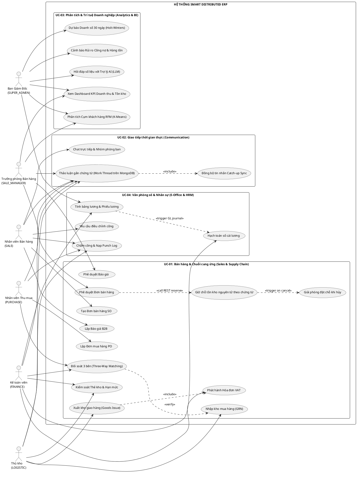

#### 2.4.2.2. Biểu đồ UC-01: Phân hệ Bán hàng & Chuỗi cung ứng (Sales & Supply Chain)
* **Kịch bản tương ứng**: Kịch bản 1, 2, 3.
* **Nội dung nghiệp vụ**: Báo giá, đơn bán, giữ kho nguyên tử, mua hàng, nhập xuất kho, hóa đơn.

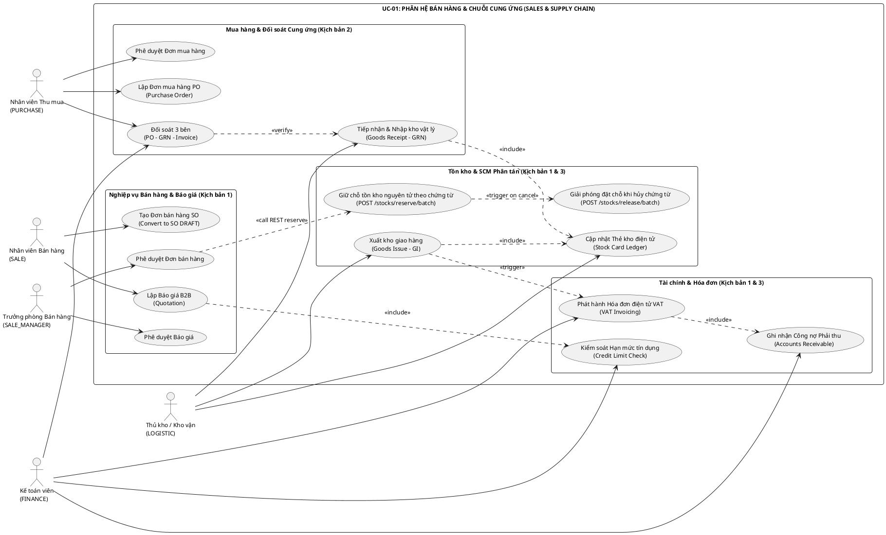

#### 2.4.2.3. Biểu đồ UC-02: Phân hệ Giao tiếp thời gian thực (Communication)
* **Kịch bản tương ứng**: Kịch bản 4, 5.
* **Nội dung nghiệp vụ**: Chat theo chứng từ, xem lịch sử, đồng bộ tin nhắn.

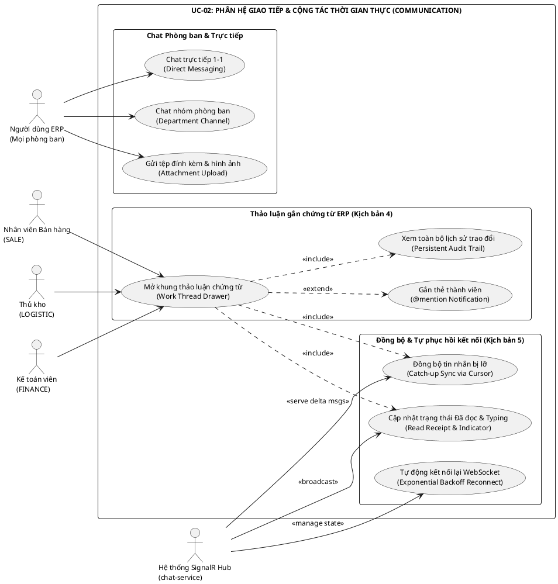

#### 2.4.2.4. Biểu đồ UC-03: Phân hệ Phân tích & Trí tuệ Doanh nghiệp (Analytics & BI)
* **Kịch bản tương ứng**: Kịch bản 6.
* **Nội dung nghiệp vụ**: Dashboard KPI, RFM, dự báo doanh số, cảnh báo công nợ.

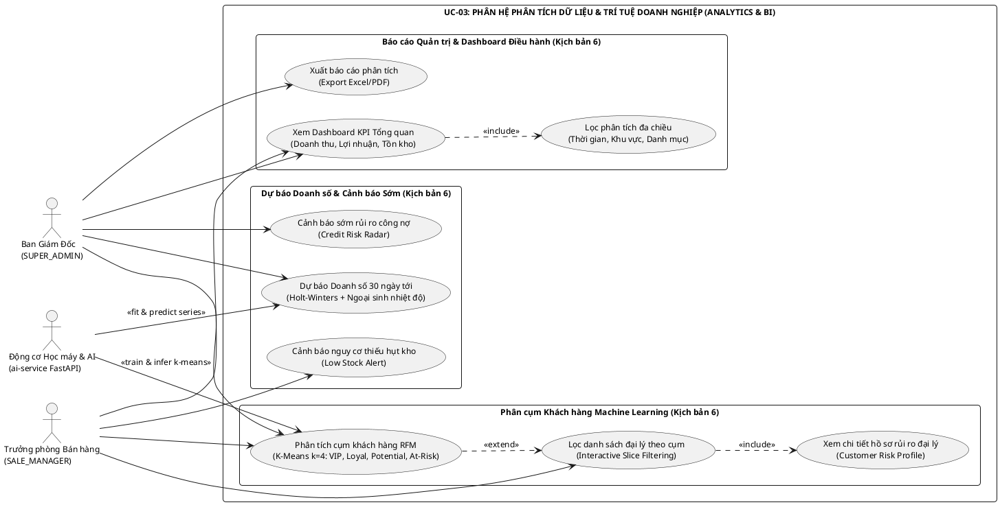

#### 2.4.2.5. Biểu đồ UC-04: Phân hệ Văn phòng số, Quản lý Chấm công & Bảng lương (E-Office & HRM)
* **Kịch bản tương ứng**: Kịch bản 7.
* **Nội dung nghiệp vụ**: Ca làm việc, máy quét chấm công, tính ngày công tự động, đề xuất điều chỉnh chấm công, lập bảng lương, phiếu lương cá nhân và hạch toán tự động vào sổ cái kế toán.

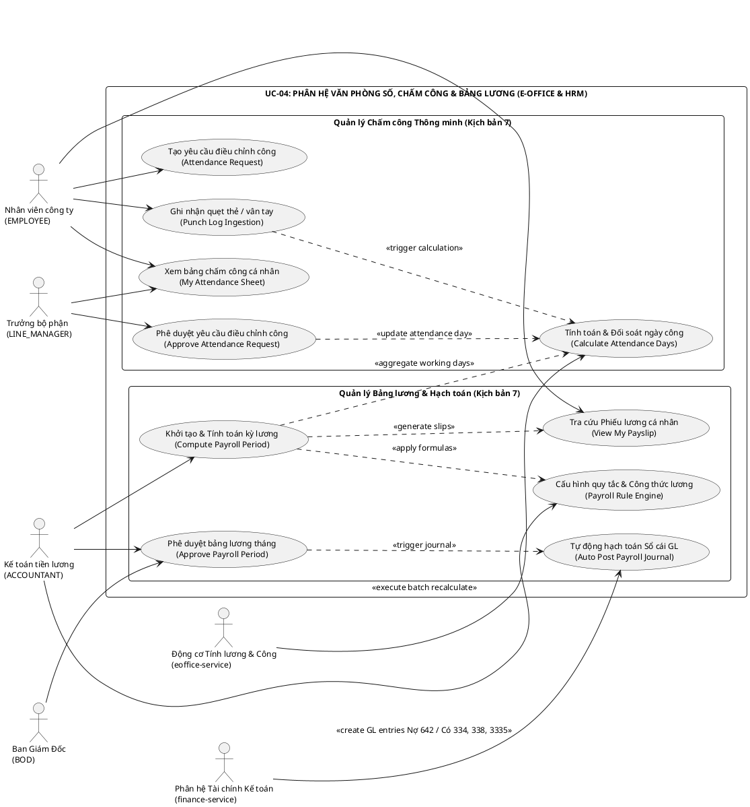


---

### 2.4.3. Mô hình Lớp và Thực thể Cơ sở dữ liệu phân tán (PlantUML Class Diagram & ERD)

Do áp dụng triệt để nguyên tắc **Database-per-Service**, cơ sở dữ liệu của từng service được cô lập độc lập, hoàn toàn không sử dụng khóa ngoại vật lý (Physical Foreign Keys) xuyên biên giới giữa các dịch vụ. Mối quan hệ liên dịch vụ được duy trì thông qua các khóa định danh logic (Logical Reference Keys) và cơ chế nhất quán cuối cùng (Eventual Consistency) qua Message Broker RabbitMQ.

Nhằm đảm bảo tính tường minh, tránh hiện tượng sơ đồ quá khổ gây lỗi bộ nhớ trình biên dịch hoặc vỡ bố cục khi trích xuất hình ảnh đưa vào báo cáo, mô hình thực thể dữ liệu được phân chia thành **4 sơ đồ chuyên biệt**:

#### 2.4.3.1. Sơ đồ Thực thể Dữ liệu Gốc & Xác thực Phân quyền (Identity & Catalog Databases)
Bao gồm cơ sở dữ liệu xác thực tập trung `identity_db` (quản trị tài khoản, phòng ban, vai trò RBAC động) và cơ sở dữ liệu danh mục chuẩn `catalog_db` (916 sản phẩm điện máy gia dụng, 29 danh mục, 78 thương hiệu, 2.591 khách hàng đại lý và 32 nhà sản xuất):

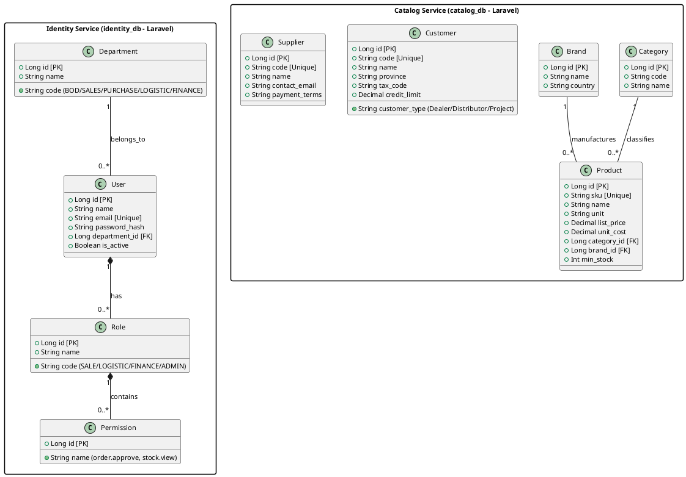

#### 2.4.3.2. Sơ đồ Thực thể Bán hàng, Mua hàng & Quản trị Tồn kho (Sales, Purchase & Inventory - UC-01)
Bao gồm cơ sở dữ liệu `sales_db` (Báo giá, Đơn bán hàng, Lưu trữ ảnh chụp giá Data Snapshotting), `purchase_db` (Đơn mua hàng PO, Phiếu nhập kho GRN, Đối soát 3 bên) và `inventory_db` (Động cơ tồn kho 3 trạng thái, Thẻ kho điện tử):

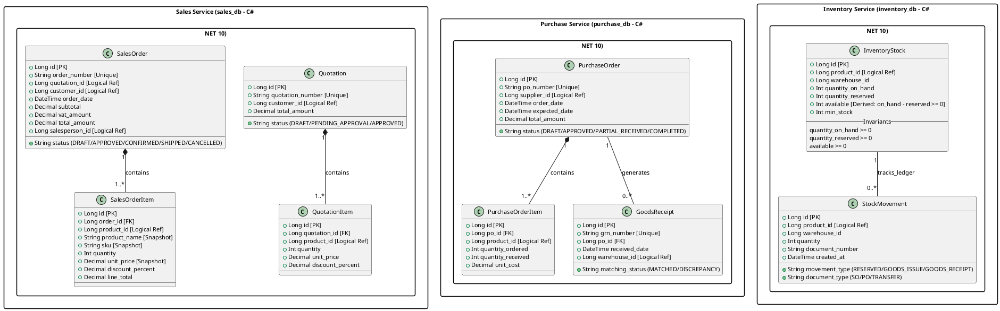

#### 2.4.3.3. Sơ đồ Thực thể Tài chính & Quản trị Công nợ (Finance Database - UC-01)
Bao gồm cơ sở dữ liệu `finance_db` thực hiện tự động phát hành hóa đơn điện tử VAT khi có sự kiện xuất kho, hạch toán công nợ phải thu đại lý và giám sát hạn mức tín dụng:

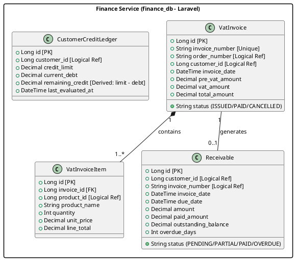

#### 2.4.3.4. Sơ đồ Thực thể Giao tiếp Realtime & Phân tích Dữ liệu BI (Chat & Analytics - UC-02 & UC-03)
Bao gồm cơ sở dữ liệu phi quan hệ `erp_chat_db` trên MongoDB phục vụ Work Thread hội thoại gắn trên chứng từ và kho dữ liệu phân tích `erp_analytics_db` trên MySQL 8 phục vụ các mô hình Machine Learning:

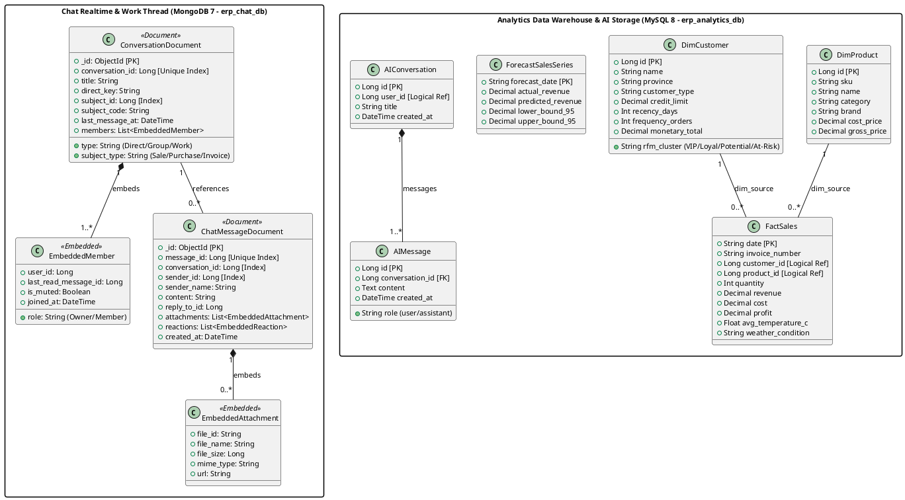

#### 2.4.3.5. Sơ đồ Thực thể Văn phòng số, Chấm công & Bảng lương (E-Office Database - erp_eoffice_db - UC-04)
Bao gồm cơ sở dữ liệu `erp_eoffice_db` trên MySQL 8 phục vụ toàn diện công tác quản trị nhân sự, ca làm việc, chấm công tự động, giải trình điều chỉnh công, tính lương và tích hợp sổ cái:

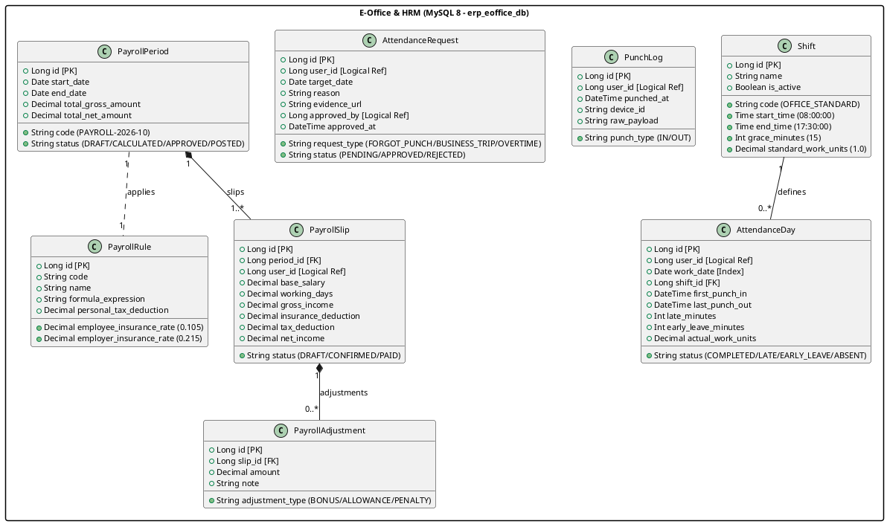


---

### 2.4.4. Các biểu đồ tuần tự Sequence Diagrams (PlantUML)

Mục này trình bày đầy đủ hệ thống **8 biểu đồ tuần tự**, mô hình hóa chi tiết luồng tương tác và giao dịch giữa người dùng, API Gateway, các microservices, cơ sở dữ liệu và Message Broker RabbitMQ cho toàn bộ 7 kịch bản hoạt động chính cùng nền tảng bảo mật của hệ thống.

#### Biểu đồ 1: Luồng Phê duyệt Đơn hàng & Đặt chỗ tồn kho nguyên tử theo chứng từ (Kịch bản 1)

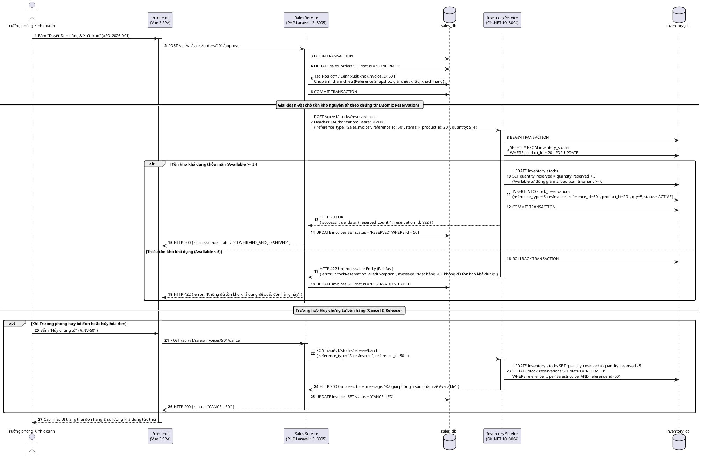

#### Biểu đồ 2: Luồng Mua hàng từ Hãng, Đối soát 3 bên (Three-Way Matching) & Nhập kho vật lý (Kịch bản 2)

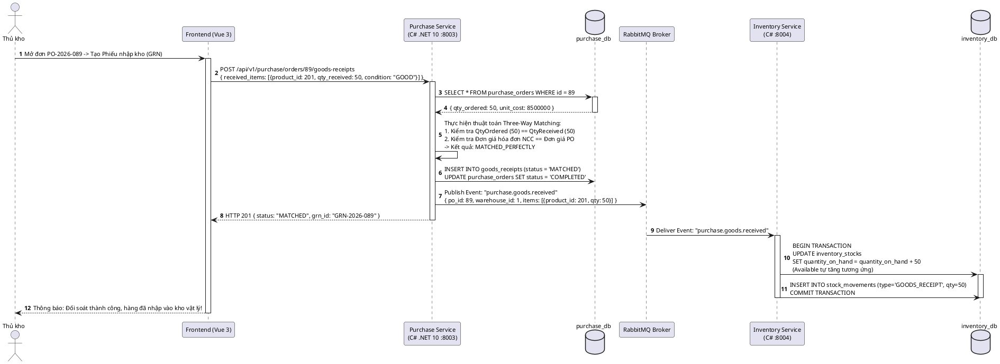

#### Biểu đồ 3: Luồng Xuất kho giao hàng (Goods Issue), Tự động phát hành Hóa đơn VAT & Hạch toán Công nợ (Kịch bản 3)

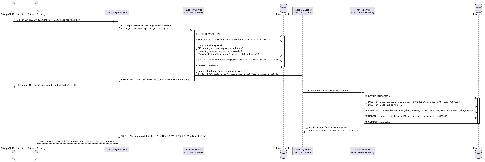

#### Biểu đồ 4: Luồng Giao tiếp Thời gian thực trên Chứng từ (SignalR Work Thread & Catch-up Sync) (Kịch bản 4 & 5)

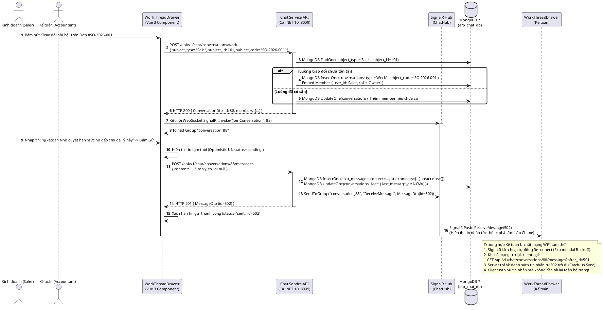

#### Biểu đồ 5: Luồng Khai thác Dữ liệu, Huấn luyện Học máy & Phục vụ Dashboard BI (Kịch bản 6)

```plantuml
@startuml
autonumber
skinparam roundcorner 6
skinparam defaultFontName Arial
skinparam defaultFontSize 11

actor "Ban Giám Đốc" as Director
participant "Dashboard BI\n(Vue 3 /analytics)" as FE
participant "AI Service API\n(Python FastAPI :8009)" as API
participant "In-Memory Cache\n(Singleton RAM)" as Cache
participant "Machine Learning Core\n(ml.py)" as ML
database "Kaggle Dataset\n(kaggle_dataset/*.csv)" as Data

note over API, ML
  Tiến trình Khởi động (Service Startup):
  1. ml.py đọc dữ liệu từ kaggle_dataset/ (24 tháng, 765 tỷ, 61.982 dòng).
  2. Huấn luyện mô hình K-Means Clustering (k=4) phân cụm RFM.
  3. Huấn luyện mô hình Holt-Winters kết hợp Hồi quy dự báo chuỗi thời gian 30 ngày.
  4. Tính toán trước (Pre-compute) kết quả và nạp vào In-Memory Cache.
end note

Director -> FE : Truy cập màn hình Dashboard Quản trị BI (/analytics)
activate FE

par Tải Dự báo Doanh số Chuỗi thời gian
    FE -> API : GET /api/v1/ai/analytics/forecast
    activate API
    API -> Cache : get("forecast_sales_30d")
    Cache --> API : { historical: [...], forecast_30_days: [...], metrics: { mape: "6.2%" } }
    API --> FE : HTTP 200 JSON (< 30ms)
    deactivate API
and Tải Phân khúc Khách hàng RFM
    FE -> API : GET /api/v1/ai/analytics/rfm-clusters
    activate API
    API -> Cache : get("rfm_clusters")
    Cache --> API : { clusters: [{label: "VIP", count: 207}, ...], details: [...] }
    API --> FE : HTTP 200 JSON (< 40ms)
    deactivate API
and Tải Cảnh báo Rủi ro Công nợ
    FE -> API : GET /api/v1/ai/analytics/credit-risk
    activate API
    API -> Cache : get("credit_risk_top")
    Cache --> API : { high_risk_accounts: [...] }
    API --> FE : HTTP 200 JSON (< 25ms)
    deactivate API
end

FE -> FE : Render biểu đồ kết hợp (Line Chart thực tế + nét đứt dự báo)\nRender biểu đồ tròn phân khúc RFM (Doughnut Chart)\nHiển thị thẻ KPI tổng quan doanh thu 765 tỷ

Director -> FE : Click chọn lát cắt "Nguy cơ rời bỏ" (At-Risk) trên biểu đồ tròn
FE -> FE : Lọc danh sách tức thì: Hiển thị 777 đại lý có nguy cơ rời bỏ kèm công nợ quá hạn
deactivate FE
@enduml
```

#### Biểu đồ 6: Luồng Đăng nhập tập trung & Cấp phát Token JWT (Centralized Authentication)

Biểu đồ này mô tả quy trình xác thực không trạng thái (Stateless Authentication): Người dùng đăng nhập qua API Gateway, dịch vụ `identity-service` tiến hành kiểm tra thông tin định danh bằng thuật toán băm mật khẩu Bcrypt, nạp các quyền hạn tương ứng và cấp phát cặp mã thông báo JWT Access Token kèm Refresh Token:

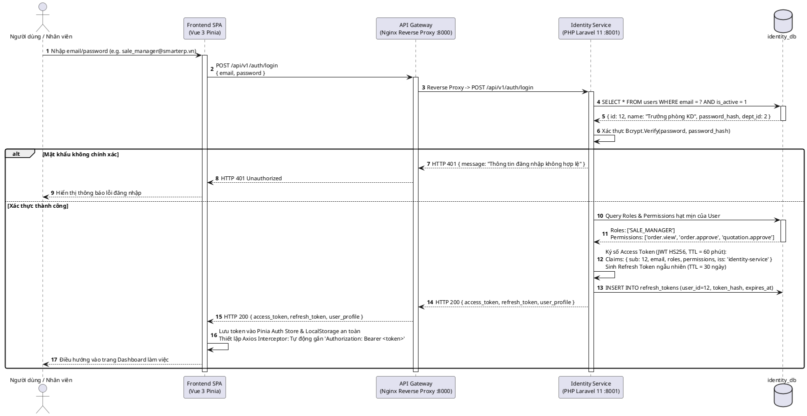

#### Biểu đồ 7: Luồng Ủy quyền & Phân quyền động RBAC qua API Gateway (Dynamic RBAC Authorization)

Biểu đồ này mô tả cơ chế kiểm soát truy cập phân tán (Decentralized RBAC Verification): Mọi yêu cầu nghiệp vụ đều được gắn kèm Bearer Token qua API Gateway chuyển tiếp tới microservice nghiệp vụ (`sales-service`). Middleware bảo mật giải mã Token tại chỗ bằng khóa bí mật chung (`JWT_SECRET` HS256) và kiểm tra quyền hạn hạt mịn trước khi thực thi Use Case:

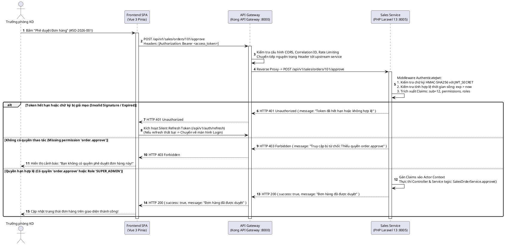

#### Biểu đồ 8: Luồng Quy trình Chấm công tự động, Phê duyệt Đề xuất công, Lập Bảng lương & Hạch toán Sổ cái Kế toán (Kịch bản 7)

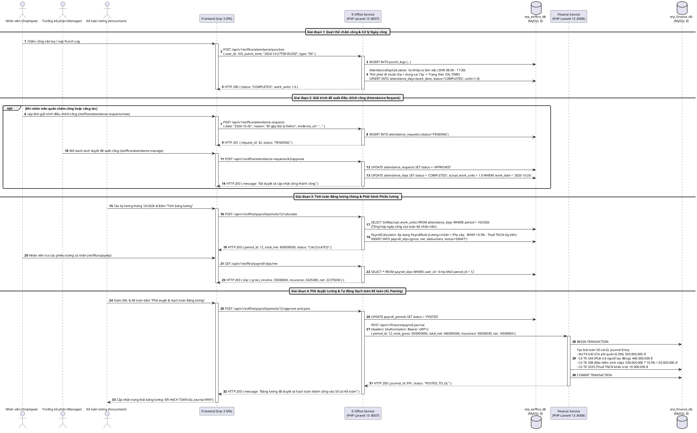

---

### 2.4.5. Thiết kế Kiến trúc Kỹ thuật Chi tiết (Architectural Deep-Dive)

#### 1. Kiến trúc Clean Architecture 4 tầng phân lập trong mỗi Service
Mỗi microservice (C# .NET hay PHP Laravel) đều được tổ chức nghiêm ngặt theo 4 tầng độc lập:
* **Tầng Miền (Domain Layer)**: Chứa các thực thể (Entities), Aggregate Roots, Value Objects và các quy tắc bất biến nghiệp vụ. Tầng này độc lập hoàn toàn, không phụ thuộc vào bất kỳ thư viện framework, database hay giao thức truyền thông nào.
* **Tầng Ứng dụng (Application Layer)**: Định nghĩa các Use Cases, Command/Query Handlers (sử dụng mẫu MediatR trong C#), Data Transfer Objects (DTOs) và các giao diện (Interfaces) của Repository và Message Publisher.
* **Tầng Hạ tầng (Infrastructure Layer)**: Triển khai chi tiết công nghệ: cấu hình Entity Framework Core 10 / Eloquent ORM, kết nối CSDL, triển khai RabbitMQ Publisher/Consumer và các dịch vụ bên thứ ba.
* **Tầng Trình bày (Presentation Layer)**: Controllers, API Middlewares, Correlation ID Filter và SignalR Hubs. Thực hiện kiểm tra tính hợp lệ dữ liệu đầu vào (Validation) và chuẩn hóa dữ liệu trả về theo Envelope thống nhất:
```json
{
  "success": true,
  "data": {},
  "message": "Operation completed successfully",
  "correlation_id": "req_corr_987654321",
  "timestamp": "2026-10-22T13:45:00.000Z"
}
```

#### 2. Cơ chế Bảo đảm Bất biến Chuỗi cung ứng (SCM Invariant Engine)
* Trong `inventory-service`, bất biến $\text{Available} = \text{OnHand} - \text{Reserved} \ge 0$ được bảo vệ bằng 3 lớp phòng vệ:
  1. *Lớp Domain Entity*: Hàm `ReserveStock(int qty)` kiểm tra logic `if (Available < qty) throw new InsufficientStockException()`.
  2. *Lớp Database Concurrency*: Câu lệnh SQL sử dụng cơ chế `SELECT ... FOR UPDATE` khóa dòng dữ liệu trong Local Database Transaction.
  3. *Lớp Database Constraint*: Bổ sung ràng buộc `CHECK (quantity_on_hand >= quantity_reserved)` trực tiếp ở tầng bảng CSDL.

#### 3. Chuẩn hóa Thông điệp Miền (RabbitMQ CloudEvents Envelope)
Mọi sự kiện miền bắn lên Message Broker đều tuân theo chuẩn **CloudEvents v1.0.2**:
```json
{
  "event_id": "evt_01J8ABCXYZ1234567890",
  "event_type": "SalesOrderApproved",
  "aggregate_type": "SalesOrder",
  "aggregate_id": "SO-2026-0089",
  "timestamp": "2026-10-22T13:50:00.000Z",
  "version": "1.0",
  "correlation_id": "req_corr_987654321",
  "producer": "sales-service",
  "payload": {
    "order_id": 89,
    "customer_id": 104,
    "items": [
      { "product_id": 312, "quantity": 10, "unit_price": 10500000.0 }
    ]
  }
}
```
Phía các Consumer sử dụng trường `event_id` làm khóa chống trùng lặp (**Idempotency Key**) ghi vào bảng `processed_events` để đảm bảo mỗi sự kiện chỉ được thực thi duy nhất một lần.

#### 4. Phương pháp luận Mô hình Học máy trong `ai-service`
* **Thuật toán Phân cụm RFM (K-Means Clustering)**:
  * Trích xuất ma trận dữ liệu từ 2.591 khách hàng trong `kaggle_dataset/`:
    $$\mathbf{X} = \begin{bmatrix} R_1 & F_1 & M_1 \\ R_2 & F_2 & M_2 \\ \vdots & \vdots & \vdots \\ R_n & F_n & M_n \end{bmatrix}$$
  * Xử lý độ lệch phân phối bằng phép biến đổi $y = \ln(x + 1)$ và chuẩn hóa $z = \frac{x - \mu}{\sigma}$.
  * Chạy thuật toán K-Means lặp qua các giá trị $k \in [2, 8]$, vẽ đồ thị Elbow theo tổng bình phương khoảng cách nội cụm (Inertia) và tính toán chỉ số Silhouette Score ($s \approx 0.46$ tại $k=4$).
  * Gán nhãn 4 cụm nghiệp vụ: VIP / Champions ($R$ thấp, $F$ cao, $M$ cao), Khách hàng trung thành, Khách hàng tiềm năng, và Khách hàng nguy cơ rời bỏ ($R$ rất cao, $F$ và $M$ trong quá khứ lớn).
* **Mô hình Dự báo Chuỗi thời gian (Holt-Winters Exponential Smoothing kết hợp Hồi quy)**:
  * Phương trình dự báo kết hợp thành phần xu thế (Trend $b_t$), thành phần mùa vụ (Seasonal $s_t$) với chu kỳ tuần $L=7$:
    $$\hat{y}_{t+m} = (\ell_t + m b_t) \cdot s_{t - L + 1 + (m-1) \pmod L} + \beta \cdot \text{Temperature}_t$$
  * Tích hợp biến ngoại sinh nhiệt độ trung bình ngày $\text{Temperature}_t$ giúp mô hình dự báo chính xác các điểm bùng nổ nhu cầu thiết bị làm mát trong mùa hè.
  * Đánh giá chất lượng mô hình trên tập kiểm thử (Test Set 60 ngày cuối) đạt chỉ số $\text{MAPE} = 6.2\%$, $\text{RMSE} = 34.5 \text{ triệu VNĐ}$, vượt trội so với các phương pháp trung bình trượt truyền thống.

---

### 2.4.6. Thiết kế Màn hình Giao diện Người dùng (UI/UX Design Specs)

Toàn bộ hệ thống giao diện Frontend được xây dựng theo phong cách chuẩn mực **Enterprise Clean Flat White Canvas**:
* **Quy chuẩn Màu sắc & Bố cục**: Nền trắng tinh khiết (`#ffffff`), nền xám nhạt trung tính (`#f8fafc`), đường viền siêu mảnh hairline 1px (`border-slate-200`), font chữ không chân hiện đại (Inter / Roboto), hệ thống bóng đổ phẳng tối giản (`shadow-xs`).
* **Các màn hình chức năng trọng điểm**:
  1. **Màn hình Đơn Bán Hàng & Drawer Trao đổi nội bộ (`/order`)**:
     * Bảng dữ liệu hiển thị danh sách đơn bán hàng, bộ lọc đa tiêu chí (mã đơn, đại lý, trạng thái, khoảng ngày).
     * Cột *Thao Tác* chứa nút icon màu tím `pi-comments` (**"Trao đổi nội bộ về đơn này"**). Khi bấm, component `WorkThreadDrawer.vue` trượt mượt mà ra từ mép phải màn hình (độ rộng cố định 520px), cho phép nhân viên kinh doanh, kế toán và thủ kho chat trực tiếp, đính kèm ảnh phiếu giao hàng, xem trạng thái avatar đã đọc mà không cần chuyển trang.
  2. **Màn hình Dashboard Quản trị BI (`/analytics`)**:
     * *Hàng thẻ KPI*: 4 thẻ số liệu kích thước lớn: Tổng Doanh Thu (765.4 tỷ VNĐ), Lợi Nhuận Gộp (~135.8 tỷ), Khách Hàng Hoạt Động (2.591 đối tác), Nợ Quá Hạn Cần Thu Hồi.
     * *Biểu đồ Dự báo Doanh số (Line Chart kết hợp)*: Trục hoành là 24 tháng lịch sử + 30 ngày tương lai. Đường nét liền màu xanh dương thể hiện doanh số thực tế, đường nét đứt màu tím sáng thể hiện 30 ngày dự báo học máy, bao quanh bởi dải mờ biểu thị khoảng dao động tin cậy 95%.
     * *Biểu đồ Phân khúc Khách hàng RFM (Doughnut Chart)*: Hiển thị tỷ trọng 4 cụm. Tính năng tương tác 2 chiều: Khi click vào lát cắt *"Nguy cơ rời bỏ"*, bảng dữ liệu chi tiết bên cạnh lập tức lọc ra danh sách tên đại lý, số điện thoại, hạn mức nợ và số ngày chưa mua hàng để đội ngũ kinh doanh lên kế hoạch tiếp cận.
  3. **Màn hình Trung tâm Tin nhắn Nội bộ (`/chat`)**:
     * Bố cục 3 cột hiện đại: Cột trái (Kênh phòng ban, Chat 1-1, Work Threads gần đây), Khung giữa (Khu vực tin nhắn, thanh ghim tin nhắn, hỗ trợ dán ảnh từ clipboard, trích dẫn), Cột phải (Thông tin phòng chat, danh sách thành viên, kho tệp/ảnh đính kèm).
  4. **Màn hình Quản trị Kho vận & Thẻ kho (`/inventory`)**:
     * Hiển thị bảng điều khiển tồn kho phân biệt rõ ràng 3 cột màu sắc: `Tồn vật lý` (Xanh lục), `Đã giữ chỗ` (Vàng hổ phách), `Khả dụng bán` (Xanh dương).
     * Modal xem Thẻ kho chi tiết: Lưu vết toàn bộ biến động xuất/nhập/giữ chỗ kèm mã chứng từ gốc.
  5. **Màn hình Quản lý Đơn mua hàng & Đối soát 3 bên (`/purchase`)**:
     * Giao diện đối chiếu trực quan: Đơn mua hàng PO đối sánh song song với Phiếu nhập kho GRN, tự động tô màu đỏ cảnh báo các dòng sản phẩm có sự sai lệch số lượng hoặc đơn giá.
