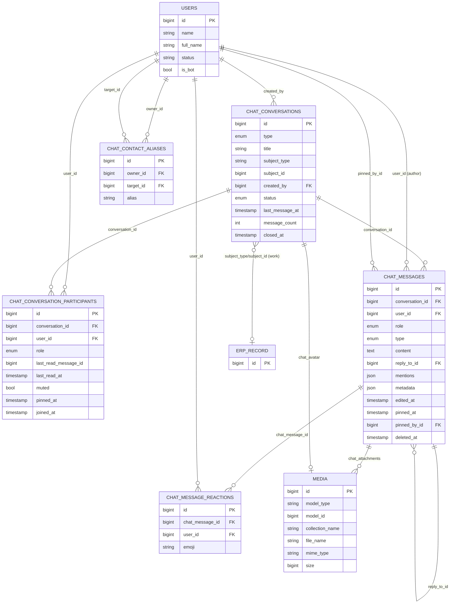
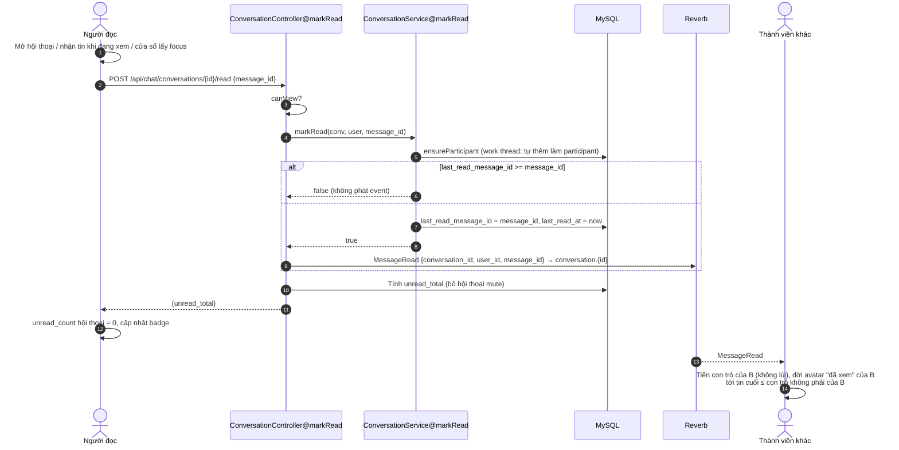

# Đặc tả nghiệp vụ chức năng Chat nội bộ (bản đọc từ code Laravel)

> Mục đích: làm tài liệu gốc để xây lại chức năng chat bằng .NET + SignalR, đúng với nghiệp vụ code hiện tại.
> Phạm vi: chỉ ghi những gì code **thực sự làm** (branch `fix/inventory`, đọc ngày 2026-10-17). Phần nào có trên UI/route nhưng chưa xong thì ghi **"chưa hoàn thiện"**; phần nào không có trong code thì ghi **"không có"**.
> Ký hiệu nguồn: `đường/dẫn/File.php@method`. Đường dẫn tính từ gốc repo.
> Tài liệu không chứa secret/key/dữ liệu người dùng thật.

---

## 1. Tổng quan kỹ thuật

### 1.1 Các loại hội thoại

Chat dùng **một bảng hội thoại chung** cho 4 loại (`chat_conversations.type`):

| type | Ý nghĩa | Ghi chú |
|---|---|---|
| `direct` | Chat riêng 1-1 giữa 2 người | Không có tên riêng, hiển thị tên người kia |
| `group` | Nhóm chat có tên, ảnh, trưởng nhóm | Loại duy nhất có quản lý thành viên |
| `work` | "Thread công việc" gắn với 1 chứng từ ERP (báo giá, đơn bán, hoá đơn...) | Thay thế hệ thống "ghi chú/comment" cũ. Người xem được quyết định theo chứng từ, không theo danh sách thành viên |
| `assistant` | Hội thoại riêng giữa 1 người và Trợ lý AI | Bot là một `User` thật có `is_bot = true` |

Nguồn: `database/migrations/2026_09_21_100000_create_chat_module_tables.php` (docblock), `app/Models/Conversation.php` (hằng `TYPE_*`).

### 1.2 Realtime

- **Server**: Laravel Broadcasting, driver mặc định lấy từ env `BROADCAST_CONNECTION` (mặc định `null`); môi trường thật dùng **Laravel Reverb** (WebSocket, giao thức Pusher). Có cấu hình supervisor cho Reverb: `deploy/server/supervisor/*-reverb.conf`, `.ddev/config.reverb.yaml`. Nguồn: `config/broadcasting.php`, `config/reverb.php`.
- **Client**: `laravel-echo` + `pusher-js`, `broadcaster: 'reverb'`, chỉ dùng transport `ws/wss`. Echo chỉ được khởi tạo khi cấu hình site có key Reverb; không có thì chat vẫn chạy nhưng **không realtime**. Nguồn: `resources/js/echo.js`.
- **Không có polling** dự phòng.
- Tất cả event chat implement `ShouldBroadcastNow` → phát **đồng bộ trong request**, không qua queue. Mọi lần phát đều bọc `try/catch`: nếu Reverb chết thì chỉ ghi log `Chat live signal not delivered.`, request vẫn thành công. Nguồn: `app/Services/Chat/ConversationService.php@broadcastLive`.
- **Client → server không đi qua WebSocket**: mọi thao tác (gửi tin, typing, đã đọc...) đều là HTTP REST; WebSocket chỉ dùng chiều server → client.

### 1.3 Channel và cách authorize

Nguồn: `routes/channels.php`.

| Channel | Loại | Ai được subscribe | Dùng cho |
|---|---|---|---|
| `chat.online` | **presence** | Mọi user đã đăng nhập; thông tin member chỉ có `{id}` | Trạng thái online |
| `user.{id}` | private | Chỉ đúng user có `id` đó | `ConversationUpdated` (cập nhật danh sách hội thoại, badge, âm báo) |
| `conversation.{id}` | private | `ConversationAccess::canView(user, conversation)` = là thành viên (direct/group/assistant) **hoặc** có quyền xem chứng từ (work) | `MessageSent`, `MessageUpdated`, `MessageDeleted`, `MessageRead`, `UserTyping`, `ConversationUpdated` |

Quyền channel **chỉ kiểm tra lúc subscribe**. Code không thu hồi subscription khi user bị xoá khỏi nhóm (xem §4.3).

### 1.4 Lưu file / ảnh

- Dùng **spatie/laravel-medialibrary**, disk `local` (private, không public URL).
- Tệp đính kèm tin nhắn: collection `chat_attachments` trên `ChatMessage`. Ảnh nhóm: collection `chat_avatar` trên `Conversation`, `singleFile` (ảnh mới đè ảnh cũ).
- File chỉ đọc được qua route có kiểm tra quyền:
  - `GET /chat/attachments/{media}` → `app/Http/Controllers/Chat/AttachmentController.php@show` (kiểm tra `canView` của hội thoại chứa tin nhắn, trả `Content-Disposition: inline`).
  - `GET /chat/conversations/{id}/avatar?v={mediaId}` → `AttachmentController@conversationAvatar` (cache `private, max-age=604800`; query `v` đổi theo media id để phá cache).
- Giới hạn:
  - Đính kèm tin nhắn: tối đa **10 tệp/tin**, mỗi tệp **20 MB** (`20480 KB`). Nguồn: `app/Http/Requests/Chat/StoreMessageRequest.php` (`MAX_FILES`, `MAX_FILE_KB`).
  - MIME cho phép (`config/media-library.php` → `accepted_mime_types`): pdf, doc/docx, xls/xlsx, ppt/pptx, txt, jpeg, png, gif, webp, **svg+xml**, tiff, zip, rar, 7z, step/stp.
  - Ảnh nhóm: `image`, chỉ jpeg/png/webp, tối đa **5 MB**. Nguồn: `ConversationController@storeAvatar`, `Conversation@registerMediaCollections`.
- Xoá tin nhắn là xoá mềm → **file đính kèm vẫn nằm trên disk** (không có job dọn).

### 1.5 Danh sách bảng liên quan

| Bảng | Vai trò |
|---|---|
| `chat_conversations` | Hội thoại (trước đây là `chat_sessions` → `conversations` → đổi tên) |
| `chat_conversation_participants` | Thành viên + trạng thái riêng từng người (đã đọc, mute, ghim) |
| `chat_messages` | Tin nhắn |
| `chat_message_reactions` | Cảm xúc |
| `chat_contact_aliases` | Tên gợi nhớ người này đặt cho người kia |
| `users` | Có thêm cột `is_bot` |
| `media` | Bảng chung của medialibrary (đính kèm, ảnh nhóm) |
| `notifications` | Bảng chung Laravel, nhận notification `database` của work thread |

Lịch sử migration: `2025_11_28_083253_create_chat_sessions_table.php`, `2025_11_28_083311_create_chat_messages_table.php`, `2026_09_21_100000_create_chat_module_tables.php`, `2026_09_21_105000_prefix_chat_conversation_tables.php`, `2026_09_21_110000_migrate_comments_into_work_threads.php`, `2026_09_24_032433_create_chat_message_reactions_table.php`, `2026_09_24_062822_create_chat_contact_aliases_table.php`, `2026_09_24_234809_add_pinned_at_to_conversation_participants_table.php`, `2026_09_24_234812_add_pin_columns_to_chat_messages_table.php`, `2026_10_01_171701_purge_system_messages_from_work_threads.php`.

---

## 2. Mô hình dữ liệu

### 2.1 `chat_conversations` (model `App\Models\Conversation`)

| Cột | Kiểu | Null | Mặc định | Ghi chú |
|---|---|---|---|---|
| id | bigint PK | | | |
| type | enum(`direct`,`group`,`work`,`assistant`) | không | `assistant` | |
| created_by | bigint FK→users.id | **có** | | `ON DELETE SET NULL` |
| title | varchar(255) | có | | Tên nhóm / nhãn chứng từ / tiêu đề hội thoại AI. Direct để null |
| subject_type | varchar(255) | có | | Tên class model ERP (work thread) |
| subject_id | bigint | có | | |
| status | enum(`active`,`closed`,`archived`) | không | `active` | Chỉ `active` mới được gửi tin |
| metadata | json | có | | Không dùng trong luồng chat người-người |
| last_message_at | timestamp | có | | Dùng để sắp xếp |
| message_count | int unsigned | không | 0 | Bộ đếm tăng/giảm thủ công |
| created_at, updated_at | timestamp | | | |
| closed_at | timestamp | có | | |

Index: `UNIQUE(subject_type, subject_id)` (tên `conversations_subject_unique`) → **mỗi chứng từ có đúng 1 thread**; `INDEX(type, last_message_at)`; `INDEX(created_by, status)` (kế thừa từ `chat_sessions`); `INDEX(created_at)`.
Không soft delete. Không có unique nào chống trùng hội thoại `direct`.

Quan hệ: `participants` (hasMany), `users` (belongsToMany qua participants, pivot `role, last_read_message_id, muted`), `messages` (hasMany), `lastMessage` (hasOne latestOfMany), `subject` (morphTo), `creator` (belongsTo), media `chat_avatar`.

Hàm trạng thái: `close()` → `status=closed, closed_at=now`; `archive()` → `status=archived` (**không có route nào gọi `archive()`**).

### 2.2 `chat_conversation_participants` (model `ConversationParticipant`)

| Cột | Kiểu | Null | Mặc định | Ghi chú |
|---|---|---|---|---|
| id | bigint PK | | | |
| conversation_id | FK→chat_conversations | không | | cascade delete |
| user_id | FK→users | không | | cascade delete |
| role | enum(`owner`,`member`) | không | `member` | |
| last_read_message_id | bigint | có | | **Con trỏ đã đọc** (không có FK) |
| last_read_at | timestamp | có | | |
| muted | boolean | không | false | Tắt thông báo (riêng từng người) |
| pinned_at | timestamp | có | | Ghim hội thoại lên đầu (riêng từng người) |
| joined_at | timestamp | có | | |
| created_at, updated_at | | | | |

Index: `UNIQUE(conversation_id, user_id)`, `INDEX(user_id, conversation_id)`. Không soft delete — rời nhóm/bị xoá là **xoá hẳn dòng**.

Vai trò:

| role | Ý nghĩa |
|---|---|
| `owner` | Trưởng nhóm/quản trị (UI hiển thị "Quản trị"). Người tạo nhóm/hội thoại AI |
| `member` | Thành viên thường |

**Không có vai trò phó nhóm.** Không có API đổi vai trò.

### 2.3 `chat_messages` (model `ChatMessage`, có `SoftDeletes`)

| Cột | Kiểu | Null | Mặc định | Ghi chú |
|---|---|---|---|---|
| id | bigint PK | | | Dùng làm cursor phân trang và con trỏ đã đọc |
| conversation_id | FK→chat_conversations | không | | cascade delete |
| user_id | FK→users | có | | Tác giả. `null` = tin hệ thống. `ON DELETE SET NULL` |
| role | enum(`user`,`assistant`,`system`) | không | `user` | |
| type | enum(`text`,`file`,`system`) | không | `text` | |
| content | text | không | | Có thể là chuỗi rỗng khi chỉ gửi file |
| reply_to_id | bigint FK→chat_messages | có | | `ON DELETE SET NULL` |
| intent, module | varchar | có | | Dùng cho AI |
| metadata | json | có | | `mention_all`, `forwarded_from`, dữ liệu AI, `feedback` |
| mentions | json (mảng user id) | có | | |
| tokens_used, processing_time_ms | int unsigned | có | | AI |
| edited_at | timestamp | có | | Có giá trị = đã sửa |
| pinned_at | timestamp | có | | Ghim tin |
| pinned_by_id | FK→users | có | | `ON DELETE SET NULL` |
| deleted_at | timestamp | có | | Soft delete |
| legacy_comment_id | bigint | có | | UNIQUE, dùng khi chuyển comment cũ sang |
| created_at, updated_at | | | | |

Index: `(conversation_id, id)`, `(conversation_id, pinned_at)`, `intent`, `module`, `UNIQUE(legacy_comment_id)`.

Enum:

| Trường | Giá trị | Ý nghĩa |
|---|---|---|
| role | `user` | Người gửi |
| | `assistant` | Bot AI gửi |
| | `system` | Tin hệ thống (không có tác giả) |
| type | `text` | Tin chữ (có thể kèm file) |
| | `file` | Chỉ có file, không có chữ (tự xác định khi `content` rỗng và có đính kèm) |
| | `system` | "A đã thêm B", "A đã đổi tên nhóm"... |

Hằng số nghiệp vụ trong model:
- `REACTIONS = ['❤️','👍','😄','😮','😢','😡']` — danh sách đóng, client phải khớp.
- `DELETE_WINDOW_HOURS = 24` — chỉ xoá được tin trong 24h.

### 2.4 `chat_message_reactions`

| Cột | Kiểu | Ghi chú |
|---|---|---|
| id | PK | |
| chat_message_id | FK→chat_messages, cascade | |
| user_id | FK→users, cascade | |
| emoji | varchar(16) | |
| timestamps | | |

`UNIQUE(chat_message_id, user_id)` → **mỗi người tối đa 1 cảm xúc / tin** (kiểu Zalo).

### 2.5 `chat_contact_aliases`

| Cột | Kiểu | Ghi chú |
|---|---|---|
| owner_id | FK→users, cascade | Người đặt tên |
| target_id | FK→users, cascade | Người được đặt tên |
| alias | varchar(60) | |

`UNIQUE(owner_id, target_id)`. Chỉ người đặt mới thấy; **không** nằm trong payload tin nhắn, client tự thay tên lúc render.

### 2.6 `users` (phần liên quan)

- `is_bot` boolean (mặc định false). Migration tạo sẵn 1 user bot tên "Trợ lý AI" (email lấy từ `config('chatbot.bot_user_email')`). Bot bị chặn đăng nhập ở `app/Http/Requests/Auth/LoginRequest.php` (dòng kiểm tra `is_bot`).
- `User::bot()` / `User::botOrNull()`: lấy user bot, có memo theo request.
- `status`: chat chỉ lọc `status = 'active'` khi tìm người/danh bạ.
- **Không có cột `last_seen`/`last_active_at`.**

---

## 3. Luồng nghiệp vụ

Ghi chú chung cho mọi endpoint `api/chat/*`: middleware `auth`, `verified`, và hầu hết nằm trong limiter `throttle:chatbot` = **60 request/phút/user, dùng chung cho tất cả endpoint trong nhóm** (kể cả gửi tin, đánh dấu đã đọc). Nguồn: `routes/chat.php`, `app/Providers/AIServiceProvider.php@registerRateLimiters`.

### 3.1 Chat cá nhân 1-1

**Endpoint**: `POST /api/chat/conversations/direct` → `ConversationController@storeDirect` → `ConversationService@direct`.

- **Ai**: mọi user đã đăng nhập.
- **Input**: `user_id` (required, integer, tồn tại trong `users`).
- **Validate**: `user_id` ≠ chính mình ("Không thể tự chat với chính mình."). **Không** kiểm tra người kia còn `active` hay không.
- **Xử lý**:
  1. Nếu người kia là bot → tạo **hội thoại `assistant` mới** (không phải direct) và trả về.
  2. Tìm hội thoại `type=direct` mà cả hai đều là participant và có **đúng 2** participant → có thì trả về (tránh trùng).
  3. Không có → transaction: tạo `chat_conversations(type=direct, created_by=actor, status=active)`, thêm 2 participant role `member`.
- **Tránh trùng**: chỉ bằng truy vấn kiểm tra trước; **không có unique constraint/lock** → 2 request đồng thời có thể tạo 2 hội thoại trùng.
- **Event realtime**: **không phát** event nào khi tạo. Người kia chỉ thấy hội thoại khi có tin đầu tiên (qua `ConversationUpdated` trên `user.{id}`).
- **Response**: `201` + `conversation` (kể cả khi trả về hội thoại đã có).
- **Lỗi**: 422 (validate), 404.

### 3.2 Nhóm chat

#### 3.2.1 Tạo nhóm

`POST /api/chat/conversations/group` → `ConversationController@storeGroup` → `ConversationService@group`. Request: `app/Http/Requests/Chat/StoreGroupConversationRequest.php`.

- **Ai**: mọi user đã đăng nhập.
- **Input**: `title` (required, ≤120), `user_ids[]` (required, ≥1, mỗi id tồn tại).
- **Validate**: không được có bot ("Không thể thêm trợ lý AI vào nhóm."). Sau khi loại trùng và loại chính người tạo, nếu danh sách rỗng → 422 "Cần ít nhất một thành viên.".
- **Ảnh nhóm khi tạo**: **không hỗ trợ** — chỉ đặt được sau khi tạo (§3.2.2).
- **Xử lý** (transaction): tạo conversation `type=group`; người tạo `role=owner`; các thành viên `role=member`.
- **Không** tạo tin hệ thống, **không** phát event → các thành viên không thấy nhóm cho tới khi có tin nhắn đầu tiên hoặc tải lại danh sách.
- **Không giới hạn số thành viên**, **không** kiểm tra thành viên còn active.

#### 3.2.2 Đổi tên / đổi ảnh / xoá ảnh

| Hành động | Endpoint | Method nguồn | Validate | Tin hệ thống | Event |
|---|---|---|---|---|---|
| Đổi tên | `PATCH /api/chat/conversations/{id}` | `ConversationController@update` | `title` required ≤120; trim; chỉ ghi khi khác tên cũ | "`{actor}` đã đổi tên nhóm thành "`{title}`"" | `MessageSent` + `ConversationUpdated` (từ tin hệ thống) |
| Đổi ảnh | `POST /api/chat/conversations/{id}/avatar` (multipart `avatar`) | `@storeAvatar` | image jpeg/png/webp ≤5MB | "`{actor}` đã đổi ảnh nhóm" | như trên |
| Xoá ảnh | `DELETE /api/chat/conversations/{id}/avatar` | `@destroyAvatar` | — | **không có** | `ConversationUpdated` |

- **Ai**: `canManage` = conversation là `group` **và** (user là `owner` **hoặc** có role Spatie `Super Admin`). Hội thoại không phải group → 404.

#### 3.2.3 Thêm thành viên

`POST /api/chat/conversations/{id}/participants` → `ConversationController@storeParticipants`.

- **Ai**: `canManage` (owner hoặc Super Admin).
- **Input**: `user_ids[]` (required, ≥1, tồn tại).
- **Xử lý**: lọc bỏ bot và người đã là thành viên; thêm từng người `role=member` (`ensureParticipant`). Nếu có người được thêm → tin hệ thống "`{actor}` đã thêm `{tên1}, {tên2}`".
- **Event**: `MessageSent` (conversation channel), `ConversationUpdated` (conversation channel + `user.{id}` của tất cả thành viên, kể cả người mới) → người mới thấy nhóm ngay.
- Người mới được thêm **thấy toàn bộ lịch sử cũ** (không có mốc "chỉ xem từ lúc vào").

#### 3.2.4 Xoá thành viên / tự rời nhóm

`DELETE /api/chat/conversations/{id}/participants/{userId}` → `ConversationController@destroyParticipant`.

- **Ai**: chính người đó (tự rời) **hoặc** `canManage`.
- **Ràng buộc**: nếu người bị xoá/rời là `owner` và nhóm **không còn owner nào khác** → 422 "Nhóm cần ít nhất một quản trị viên. Hãy chỉ định người khác trước khi rời nhóm.".
- **Xử lý**: xoá dòng participant; tin hệ thống "`{tên}` đã rời nhóm" hoặc "`{actor}` đã xoá `{tên}` khỏi nhóm".
- **Event**: `MessageSent` + `ConversationUpdated` phát **sau khi** đã xoá → người bị xoá **không nhận** `ConversationUpdated` trên `user.{id}`; nhưng nếu đang subscribe `conversation.{id}` thì **vẫn nhận tiếp** mọi tin (xem §4.3).
- Owner có thể bị owner khác (hoặc Super Admin) xoá nếu còn owner khác.
- **UI**: chỉ có nút xoá thành viên (dấu ×) cho người quản lý; **không có nút "Rời nhóm"** → tự rời nhóm **chưa hoàn thiện** ở UI (chỉ có API).

#### 3.2.5 Giải tán nhóm, chuyển quyền trưởng nhóm, phó nhóm

- Giải tán nhóm: **không có**.
- Chuyển quyền trưởng nhóm / bổ nhiệm owner khác: **không có** API nào đổi `role`. Hệ quả: owner duy nhất **không bao giờ rời được nhóm** (thông báo lỗi yêu cầu "chỉ định người khác" nhưng không có cách chỉ định) → **chưa hoàn thiện**.
- Phó nhóm: **không có**.

### 3.3 Gửi tin nhắn

`POST /api/chat/conversations/{id}/messages` (multipart) → `ConversationController@storeMessage` → `ConversationService@postMessage`. Request: `StoreMessageRequest`.

- **Ai**: `canPost` = conversation `status = active` **và** `canView` (thành viên; với work thread là người có quyền xem chứng từ — **không cần là participant**).
- **Input**:

| Trường | Rule |
|---|---|
| content | `required_without:attachments`, string, ≤ **16000** ký tự |
| reply_to_id | integer, phải thuộc cùng hội thoại |
| mentions[] | integer, tồn tại; phải nằm trong danh sách được nhắc (§3.4.3) |
| mention_all | boolean, chỉ hợp lệ với `group` |
| attachments[] | ≤10 tệp, mỗi tệp ≤20MB, đúng MIME |

- **Rate limit riêng cho AI**: nếu tin này đánh thức bot (hội thoại `assistant`, hoặc `mentions` có id bot) → `RateLimiter::attempt('chatbot-messages:{userId}')` với hạn mức/phút theo role (`config/chatbot.php` → `rate_limits`: Super Admin 60, Admin 40, Manager 30, mặc định 20). Vượt → `429 {error:'rate_limit', message}` + header `Retry-After`. Chat người-người không bị trừ hạn mức này.
- **Xử lý** (`postMessage`):
  1. Nếu `mention_all` và là group → gộp id của **tất cả participant trừ người gửi** vào `mentions`, `metadata.mention_all = true`.
  2. `role`: tác giả null → `system`; tác giả là bot → `assistant`; còn lại `user`.
  3. `type`: có file và content rỗng → `file`, ngược lại `text` (trừ khi truyền `type` rõ).
  4. Transaction: insert `chat_messages`; lưu từng file vào media `chat_attachments`; `message_count += 1`; `last_message_at = created_at`; nếu tác giả là người (không phải bot) → `ensureParticipant(author)` + `markRead(author, message.id)` (người gửi coi như đã đọc tới tin của mình); `ensureParticipant` cho từng người được mention (**mention kéo người đó vào hội thoại**).
  5. Phát `MessageSent` (conversation channel) và `ConversationUpdated` (conversation channel + `user.{id}` của mọi participant).
  6. `afterPost` (bỏ qua nếu tin hệ thống):
     - Nếu `AiTrigger::shouldReply` → dispatch `GenerateAiReplyJob` (queue).
     - Nếu là `work` thread → dispatch `NotifyWorkThreadJob` (queue).
- **Response**: `201 {message: <MessagePayload>}`.
- **Lỗi**: 403 (không có quyền/hội thoại không active), 422 (validate), 429.

Theo từng loại nội dung:

| Loại | Trạng thái | Ghi chú |
|---|---|---|
| Text | Có | Hiển thị plain text, xuống dòng giữ nguyên |
| Emoji | Có | Chỉ là ký tự unicode chèn vào text từ `EmojiPicker.vue` |
| Ảnh | Có | Là attachment MIME `image/*`; client hiển thị lightbox (`ImageLightbox.vue`). Dán ảnh từ clipboard được, ảnh dán được đổi tên theo thời điểm (`ChatInput.vue`) |
| File | Có | Attachment, link tải qua `/chat/attachments/{media}` |
| Link preview | **Không có**. Client chỉ tự biến URL `http(s)://...` thành thẻ `<a>` (`MessageBubble.vue@linkifiedContent`) |
| Sticker | **Không có** |
| Tin hệ thống | Có | `type=system`, `user_id=null`, `role=system`. Các trường hợp: đổi tên nhóm, đổi ảnh nhóm, thêm thành viên, xoá/rời nhóm, AI trả lời lỗi ("Trợ lý AI gặp lỗi khi trả lời, vui lòng thử lại."). Tạo nhóm và xoá ảnh nhóm **không** sinh tin hệ thống. Không được sửa/thả cảm xúc/ghim/chuyển tiếp tin hệ thống |
| Tin AI (`assistant`) | Có | Render markdown (đã sanitize DOMPurify), có nút 👍/👎 feedback |

### 3.4 Trả lời, chuyển tiếp, nhắc tên

#### 3.4.1 Trả lời (reply/quote)
- Gửi kèm `reply_to_id` trong luồng gửi tin; phải thuộc cùng hội thoại (`StoreMessageRequest@withValidator`).
- Payload tin có `reply_to: {id, content, user_name}` (nội dung đầy đủ, client tự cắt).
- Chỉ 1 cấp; tin gốc bị xoá mềm → `reply_to` thành `null` khi đọc lại.
- UI: nút "Trả lời" trên thanh hành động của tin, hiện thanh "Trả lời {tên}: ..." trên ô nhập (`ChatInput.vue`); có hàm cuộn tới tin gốc (`chat.ts@ensureMessageLoaded`, tải tối đa 40 trang cũ).

#### 3.4.2 Chuyển tiếp (forward)
`POST /api/chat/messages/{id}/forward` → `MessageActionController@forward` → `ConversationService@forwardMessage`. Request `ForwardMessageRequest`.
- **Ai**: người `canView` hội thoại nguồn.
- **Input**: `conversation_ids[]` (1–10, không trùng, tồn tại).
- **Validate**: không chuyển tiếp tin hệ thống (422). Mỗi hội thoại đích phải tồn tại, **không phải `assistant`**, và người dùng `canPost` → nếu có bất kỳ đích nào bị từ chối thì **từ chối toàn bộ** (422 "Bạn không thể gửi vào N hội thoại đã chọn.").
- **Xử lý**: với mỗi đích gọi `postMessage` với người chuyển là tác giả, copy `content`, `type`, **copy file** (nhân bản media), `metadata.forwarded_from = {message_id, conversation_id, user_name}`. Không copy mentions, reply. Mỗi tin mới phát event như gửi tin thường.
- **Response**: `{forwarded: [id tin mới...]}`.
- UI: "↪ Chuyển tiếp từ {tên}" (`MessageBubble.vue`), dialog chọn hội thoại `ForwardMessageDialog.vue`.

#### 3.4.3 Nhắc tên (@mention)
- Lưu `mentions` = mảng user id; nội dung vẫn là text "@Tên". Payload trả kèm `mentioned_users` (id, name, aliases, avatar, is_bot) để client biến "@Tên" thành chip bấm được — chỉ khi tên khớp duy nhất 1 người (`MessageBubble.vue@mentionTargets`).
- Ai được nhắc (`ConversationAccess@mentionableUserIds`):
  - `group`: chỉ thành viên nhóm (+ bot).
  - `work`: mọi người có quyền xem chứng từ (+ bot).
  - `direct`, `assistant`: **không được nhắc** (422 "Hội thoại này không hỗ trợ nhắc tên.").
- `@Tất cả` (`mention_all`): chỉ trong group; server tự mở rộng thành tất cả thành viên.
- Hiệu ứng: người được nhắc được **thêm làm participant** (quan trọng với work thread). Nhắc bot → bot trả lời (`AiTrigger`), tin trả lời của bot có `reply_to_id` = tin gọi nó.
- Notification theo mention chỉ có ở work thread (§3.12).
- Gợi ý người khi gõ "@": `GET /api/chat/users/search?conversation_id=...` hoặc `subject_type&subject_id` (§3.11).

### 3.5 Sửa tin, xoá tin

#### Sửa tin — `PATCH /api/chat/messages/{id}` → `ConversationController@updateMessage`
- **Ai**: chỉ tác giả. Không sửa tin hệ thống.
- **Input**: `content` required, ≤16000.
- **Xử lý**: cập nhật `content`, `edited_at = now`; phát `MessageUpdated`.
- **Không** kiểm tra hội thoại còn active, còn là thành viên, giới hạn thời gian; **không** cập nhật lại `mentions`; không đổi được file.
- UI hiển thị "· đã sửa" nhưng **không có nút sửa tin** (hàm `chat.ts@editMessage` không được component nào gọi) → **chưa hoàn thiện ở UI**.

#### Xoá tin — `DELETE /api/chat/messages/{id}` → `ConversationController@destroyMessage`
- Chỉ có **một kiểu xoá = thu hồi với mọi người** (soft delete). **Không có "xoá phía mình"**.
- **Ai**: tác giả **hoặc** `canManage` (owner nhóm / Super Admin — chỉ áp dụng với group).
- **Giới hạn thời gian**: chỉ trong **24 giờ** kể từ `created_at` (`ChatMessage::DELETE_WINDOW_HOURS`); quá hạn → 422 "Không thể xoá tin nhắn đã gửi quá 1 ngày.". Payload có cờ `can_delete` cho client.
- **Xử lý**: soft delete; `message_count -= 1`; phát `MessageDeleted {message_id, conversation_id}`. **Không** phát `ConversationUpdated` (preview "tin cuối" ở danh sách người khác không cập nhật realtime), không cập nhật `last_message_at`, không xoá file.
- Tin đã xoá biến mất hoàn toàn khỏi lịch sử (không hiện "Tin nhắn đã được thu hồi").
- UI: nút "Xoá" chỉ hiện với tin **của mình** và `can_delete = true` (`MessageBubble.vue@canRemove`); owner không có nút xoá tin người khác dù API cho phép.

### 3.6 Thả cảm xúc, ghim tin nhắn

#### Cảm xúc — `POST /api/chat/messages/{id}/reactions` → `ConversationController@react` → `ConversationService@toggleReaction`
- **Ai**: `canPost` trên hội thoại; không áp dụng cho tin hệ thống.
- **Input**: `emoji` ∈ `['❤️','👍','😄','😮','😢','😡']`.
- **Quy tắc**: mỗi người 1 cảm xúc/tin. Gửi lại đúng emoji đang có → **gỡ**; emoji khác → **thay**; chưa có → thêm.
- **Event**: `MessageUpdated` (payload `reactions: [{emoji, users:[{id,name}]}]`, nhóm theo emoji, thứ tự lần đầu xuất hiện).
- Client áp dụng lạc quan (optimistic), lỗi thì hoàn tác (`chat.ts@toggleReaction`).

#### Ghim tin — `POST|DELETE /api/chat/messages/{id}/pin`, `GET /api/chat/conversations/{id}/pins`
- Nguồn: `MessageActionController@pin|unpin|pins`, `ConversationService@pinMessage|unpinMessage`.
- **Ai**: bất kỳ ai `canPost` (không cần là tác giả/owner). Ai cũng bỏ ghim được tin người khác ghim.
- **Giới hạn**: tối đa **5 tin ghim / hội thoại** (khoá `lockForUpdate` hàng conversation để tránh race); vượt → 422 "Chỉ ghim tối đa 5 tin nhắn trong một hội thoại.". Không ghim tin hệ thống (422).
- **Xử lý**: set `pinned_at`, `pinned_by_id`; ghim lại tin đã ghim → không đổi gì. Phát `MessageUpdated` chỉ khi có thay đổi.
- Danh sách ghim: sắp xếp `pinned_at desc, id desc`. UI: thanh `PinnedMessagesBar.vue`.
- Không có tin hệ thống "A đã ghim tin nhắn".

### 3.7 Đã gửi / đã nhận / đã xem

- **Đã gửi**: chỉ ở client — tin lạc quan có `pending: true` hiển thị "· đang gửi…", có id âm; khi HTTP trả về thì thay bằng tin thật. Không có trạng thái "gửi lỗi, thử lại" (lỗi → xoá tin lạc quan + ném lỗi).
- **Đã nhận (delivered)**: **không có**.
- **Đã xem**: lưu bằng **con trỏ đọc theo người**: `chat_conversation_participants.last_read_message_id` (+ `last_read_at`). Không có bảng đã-xem-từng-tin.
  - Cập nhật qua `POST /api/chat/conversations/{id}/read {message_id}` (§3.9). Con trỏ chỉ tiến, không lùi.
  - Người gửi tự động có con trỏ = tin vừa gửi.
  - Phát `MessageRead {conversation_id, user_id, message_id}` khi con trỏ thực sự tiến.
- **Hiển thị trong nhóm** (`ConversationView.vue@readersByMessage`, kiểu Messenger): avatar mỗi người (trừ chính mình và bot) đặt dưới **tin cuối cùng mà họ đã đọc, không tính tin của chính họ**. Nếu con trỏ vượt quá phần đã tải thì neo vào tin mới nhất đã tải ≤ con trỏ.
- Danh sách participant trả về trong `ConversationResource` có `last_read_message_id` để client vẽ.

### 3.8 Đang soạn tin, online/offline/last seen

- **Typing**: `POST /api/chat/conversations/{id}/typing` → `ConversationController@typing`. Ai: `canView`. Rate limit riêng `chat-typing` 30/phút. Phát `UserTyping {conversation_id, user_id, name}`.
  - Client chỉ gửi khi text thực sự thay đổi, tối đa 1 lần/3 giây (`chat.ts@typing`); bên nhận hiển thị 4 giây (`TYPING_TTL_MS`) rồi tự tắt; tắt ngay khi nhận tin của người đó.
  - Bot cũng phát typing khi bắt đầu xử lý (`GenerateAiReplyJob`).
  - Không có event "ngừng gõ".
- **Online/offline**: presence channel `chat.online`; client giữ tập `onlineUserIds` từ `here/joining/leaving`, hiển thị chấm xanh `OnlineDot.vue`. Online = đang mở ít nhất 1 tab có chat store (trang Chat hoặc widget nổi).
- **Last seen**: **không có** (không lưu thời điểm offline).

### 3.9 Tin chưa đọc, đánh dấu đã đọc, badge

- **Định nghĩa chưa đọc** (cả server và client): tin trong hội thoại mà mình là participant, `id > last_read_message_id`, `user_id <> mình`, chưa bị xoá. Do so sánh SQL `user_id <> X` với `NULL` cho kết quả NULL, **tin hệ thống (user_id null) không bao giờ được tính là chưa đọc**.
- **Số chưa đọc từng hội thoại**: subquery trong `ConversationService@listFor` và `ConversationController@unreadForConversation`. **Có tính cả hội thoại đã mute.**
- **Badge tổng**: `ConversationService@unreadCount` — **loại hội thoại đã mute**. Được share sẵn vào mọi trang Inertia (`chatUnreadCount` trong `app/Http/Middleware/HandleInertiaRequests.php`) và `GET /api/chat/unread-count`.
- Người xem work thread nhưng chưa là participant: không có số chưa đọc.
- **Đánh dấu đã đọc 1 hội thoại**: `POST /api/chat/conversations/{id}/read {message_id}` → `ConversationController@markRead` → `ConversationService@markRead`.
  - Ai: `canView`. **Gọi `ensureParticipant` → nếu chưa là participant (work thread) sẽ bị thêm vào** (= tự "theo dõi").
  - Không kiểm tra `message_id` thuộc hội thoại.
  - Trả `{unread_total}`.
- **Đánh dấu tất cả đã đọc**: `POST /api/chat/conversations/read-all` → `ConversationService@markAllRead`: 1 câu UPDATE đặt con trỏ = id tin lớn nhất (chưa xoá) cho mọi hội thoại của user (kể cả mute). Không phát `MessageRead`. Trả `{updated, unread_total}`.
- **Khi nào client gọi đánh dấu đã đọc** (`resources/js/stores/chat.ts`): mở hội thoại (tin cuối), nhận tin mới trong hội thoại đang mở **khi tab đang hiển thị và có focus** (hoặc tin của chính mình), khi cửa sổ lấy lại focus/visibility.

### 3.10 Danh sách hội thoại

`GET /api/chat/conversations?page&per_page&search&filter` → `ConversationController@index` → `ConversationService@listFor`.

- Chỉ hội thoại mà user là **participant** (work thread chỉ hiện khi đã theo dõi/đã gửi/được nhắc/đã mở đọc).
- `per_page` mặc định 30, kẹp 1–50. Phân trang **offset** (LengthAwarePaginator), trả `meta {current_page,last_page,total}`. Client cuộn vô hạn và lọc trùng (`chat.ts@loadMoreConversations`).
- `filter`: `unread` (unread_count > 0) | `read` (= 0) | bỏ trống.
- **Sắp xếp**: hội thoại ghim trước (theo `pinned_at` giảm dần) → `last_message_at` giảm dần → `id` giảm dần. Client sắp xếp lại giống vậy khi có event.
- Mỗi phần tử = `ConversationResource` + `unread_count`.
- **Ghim hội thoại**: `POST|DELETE /api/chat/conversations/{id}/pin` → `ConversationPreferenceController@pin|unpin` → `setConversationPinned`. Ai: `canView`. Riêng từng người. **Không giới hạn số lượng ghim.** Không phát event (đa tab không đồng bộ).
- **Tắt thông báo (mute)**: `POST|DELETE /api/chat/conversations/{id}/mute` → `@mute|unmute`. Ai: `canView`. Ảnh hưởng: loại khỏi badge tổng; client không phát âm báo / thông báo desktop. **Không** ảnh hưởng notification của work thread. Không có mute theo thời hạn.
- Cả pin và mute đều gọi `ensureParticipant` → với work thread sẽ tự thêm người đó làm participant.
- Danh sách id đã ghim/đã mute + alias lấy qua `GET /api/chat/preferences` → `ContactController@preferences`.
- **Ẩn / lưu trữ hội thoại**: **không có** (model có `archive()` nhưng không có route).
- **Xoá lịch sử phía mình**: **không có**.
- **Đóng hội thoại**: `DELETE /api/chat/conversations/{id}` → `ConversationController@close` — chỉ cho `assistant`, chỉ người tạo; set `status=closed` → không gửi tin được nữa. Hàm client `closeConversation` có nhưng **không component nào gọi** → **chưa hoàn thiện ở UI**.
- **Theo dõi work thread**: `POST|DELETE /api/chat/conversations/{id}/follow` → `@follow|unfollow` (chỉ type `work`). Follow: `canView` → thêm participant + phát `ConversationUpdated`. Unfollow: xoá dòng participant của chính mình (không kiểm tra quyền, không event). UI: nút "Theo dõi / Đang theo dõi" trong `ConversationView.vue`.
- **Tên gợi nhớ (alias)**: `PUT /api/chat/users/{userId}/alias {alias}` → `ContactController@storeAlias`. ≤60 ký tự; rỗng = xoá; không đặt cho chính mình. Không event. UI: menu chuột phải hội thoại direct, danh sách thành viên, thẻ profile.

### 3.11 Tìm kiếm

| Chức năng | Endpoint / nguồn | Quy tắc |
|---|---|---|
| Tìm hội thoại | `GET /api/chat/conversations?search=` → `ConversationService@listFor` | `title LIKE %q%`; **hoặc** với `direct`: tên/họ tên của **người kia** (không phải mình) LIKE, hoặc alias **của mình** đặt cho người kia LIKE. Group chỉ tìm theo tên nhóm (không theo tên thành viên). Work thread tìm theo title (nhãn chứng từ) |
| Tìm người | `GET /api/chat/users/search?q&limit&conversation_id&subject_type&subject_id` → `ConversationController@searchUsers` | Chỉ user `status=active`; `q` LIKE trên `name`, `full_name`, `email`; mặc định 20, tối đa 50; bot luôn xếp đầu. Có `conversation_id`: giới hạn theo `mentionableUserIds` (+bot); không xem được hội thoại hoặc direct/assistant → trả `[]`. Có `subject_*`: giới hạn theo người xem chứng từ. Không có ngữ cảnh → **toàn bộ user active** |
| Danh bạ | `GET /api/chat/contacts` → `ContactController@index` | User active, không phải bot, khác mình, và (đã có direct với mình **hoặc** cùng `department_id`). Trả toàn bộ, không phân trang |
| Tìm tin trong hội thoại | `GET /api/chat/conversations/{id}/messages/search?q` → `MessageActionController@search` | `canView`; `q` 2–100 ký tự; `content LIKE %q%`, bỏ tin hệ thống, mới nhất trước, tối đa **50** kết quả; trả `{id, content, user, created_at}` |
| Tìm toàn hệ thống (mọi hội thoại) | **Không có** |

Không có full-text index; mọi tìm kiếm là `LIKE`, ký tự `%`/`_` của người dùng không được escape.

### 3.12 Thông báo

| Kênh | Khi nào | Nguồn |
|---|---|---|
| Âm báo (chime, Web Audio) trên client | Nhận `ConversationUpdated` có tin mới, tin không phải của mình, hội thoại **không mute**, và không đang xem đúng hội thoại đó. Bật/tắt bằng cài đặt lưu `localStorage` key `chat.notify` (mặc định bật) | `chat.ts@subscribeUser`, `playChime` |
| Thông báo desktop (Web Notification API) | Như trên + người dùng đã bật (mặc định tắt) và đã cấp quyền + tab không được focus. Bấm vào → mở `/chat/{id}` | `chat.ts@subscribeUser` |
| Notification `database` (in-app chuông ERP) | **Chỉ work thread**, khi có tin mới (không phải tin hệ thống): gửi `GenericCommentAdded` cho danh sách `WorkThreadAccessService@notifiableUsers` (trừ tác giả và người đã được mention) | `NotifyWorkThreadJob`, `app/Notifications/Comment/GenericCommentAdded.php` (`via = ['database']`) |
| Notification `database` + **email** | **Chỉ work thread**, người được @mention (giao với danh sách được xem chứng từ, trừ tác giả) nhận `MentionInComment` | `NotifyWorkThreadJob`, `app/Notifications/Comment/MentionInComment.php` (`via = ['database','mail']`) |
| Push mobile (FCM/APNs) | **Không có** |
| Notification server cho direct/group/assistant | **Không có** (chỉ có âm báo/desktop phía client khi đang mở web) |

Mute **không** chặn notification work thread (job không đọc cột `muted`).

### 3.13 Phân trang / tải tin cũ

`GET /api/chat/conversations/{id}/messages?limit&before_id` → `ConversationController@messages`.
- Ai: `canView`.
- **Cursor theo id**: lấy `limit` tin có `id < before_id` (bỏ trống = mới nhất), sắp xếp giảm dần rồi đảo lại thành tăng dần.
- `limit` mặc định **50**, kẹp 1–100. Client luôn dùng mặc định.
- Trả `{data: [MessagePayload...], has_more: bool}` (`has_more` = còn tin cũ hơn tin đầu trang).
- Tin xoá mềm bị loại tự động.

### 3.14 Liên kết nghiệp vụ ERP

- **Work thread** = thread thảo luận gắn với 1 chứng từ. Các model được hỗ trợ (`WorkThreadAccessService::SUBJECT_TYPES`): `Inquiry`, `InquiryReport`, `Quotation`, `CustomerVisit`, `Purchase`, `Sale`, `SaleInvoice`, `SaleReturnRequest`, `PaymentRequest`, `PersonalPlan`, `ProcurementRequest`.
- Mở thread: `POST /api/chat/conversations/for-subject {subject_type, subject_id}` → `ConversationController@forSubject` → `ConversationService@forSubject`: kiểm tra `canAccess` chứng từ; tìm hoặc tạo (bắt lỗi unique để chống race); title = `subjectLabel`. Người mở **không** được thêm làm participant ở bước này (nhưng sẽ bị thêm khi client gọi markRead — xem §7.3).
- Payload `subject: {type, module, id, label, url}` để client hiển thị link về chứng từ.
- UI: `WorkThreadSidebar.vue` nhúng trong các trang nghiệp vụ (vd `CustomerVisits/Form.vue`, `InquiryReports/Form.vue`, `VatInvoice/Request.vue`, `VatInvoice/Confirm.vue`, `CustomerVisit/VisitDetailModal.vue`).
- Quy tắc ai xem được thread (`WorkThreadAccessService@allowedUserIds`) + Super Admin luôn xem được (`canAccess`):

| Chứng từ | Người xem |
|---|---|
| Inquiry | người tạo, `assigned_to`, chủ khách hàng (`customer.owner_id`), followers |
| Quotation | người tạo, `assigned_user_id`, followers |
| CustomerVisit | người tạo, người duyệt, người từ chối, mọi user có **cả** role Manager và Sale |
| Purchase | **mọi user** |
| Sale | người tạo, `saler_id`, mọi user có role Customer Service / Sale / Manager |
| SaleInvoice | `getSaleInvoiceViewerUserIds` (theo role và nhân viên của saler) |
| PaymentRequest | người yêu cầu, role Super Admin / Finance & Accounting |
| SaleReturnRequest | người yêu cầu, người duyệt, người nhận, Super Admin |
| PersonalPlan | chủ kế hoạch, line manager, người duyệt/từ chối, Super Admin |
| InquiryReport | người tạo, user có permission `inquiry-reports` hoặc `approve-price-syncs` |
| ProcurementRequest | requester, người tạo, người duyệt, manager, manager_approved_by, Super Admin |

- Dữ liệu cũ: bảng `comments` được chuyển thành tin trong work thread (`2026_09_21_110000_migrate_comments_into_work_threads.php`), comment lồng nhau làm phẳng thành `reply_to_id`; tin hệ thống trong work thread đã bị xoá bằng migration `2026_10_01_171701_...`.
- **Bot AI** (`assistant` thread hoặc @bot trong group/work): `GenerateAiReplyJob` (queue, `tries=1`, timeout 90s) → phát typing của bot → gọi `ChatbotCoreService@processMessage` → bot đăng tin `role=assistant` (trong group/work có `reply_to_id` = tin gọi). Hội thoại assistant: sau câu trả lời đầu tiên (`message_count === 2`) đặt title = 50 ký tự đầu của câu hỏi. Lỗi → tin hệ thống báo lỗi. Có thêm: `regenerate` (`POST /api/chat/messages/{id}/regenerate`, chỉ assistant thread, xoá câu trả lời kế tiếp và sinh lại), `feedback` (`POST /api/chat/messages/{id}/feedback {type: positive|negative, comment≤500}` lưu vào `metadata.feedback`), bản nháp báo giá (`ChatDraftController`, `/api/chat/conversations/{session}/drafts/{type}`, `/api/chat/drafts/{type}/confirm`). Chi tiết module AI xem `docs/chatbot-*.md` — **ngoài phạm vi** đặc tả chat người-người.
- Chat **không** gắn với khách hàng/phòng ban dưới dạng hội thoại riêng (phòng ban chỉ dùng để gợi ý danh bạ).

---

## 4. Phân quyền

### 4.1 Hàm kiểm tra quyền (không có Policy/Gate — tất cả nằm trong `app/Services/Chat/ConversationAccess.php`)

- `canView(user, conv)`: work → `WorkThreadAccessService::canAccess(subject, user)`; loại khác → là participant.
- `canPost`: `status === 'active'` && `canView`.
- `canManage`: chỉ group; Super Admin **hoặc** participant `role=owner`.
- `isParticipant`.
- "Admin hệ thống" trong bảng dưới = user có role Spatie **Super Admin**.

### 4.2 Bảng quyền — nhóm (`group`)

| Hành động | Người ngoài nhóm | Thành viên | Phó nhóm | Trưởng nhóm (owner) | Super Admin (không là thành viên) |
|---|---|---|---|---|---|
| Xem nhóm, tin, file, subscribe channel | ✗ | ✓ | *(không tồn tại)* | ✓ | ✗ (chỉ qua `api/admin/chat/sessions`, xem §4.3) |
| Gửi tin, reply, thả cảm xúc, typing | ✗ | ✓ | — | ✓ | ✗ |
| Ghim / bỏ ghim tin bất kỳ | ✗ | ✓ | — | ✓ | ✗ |
| Sửa tin | — | chỉ tin của mình | — | chỉ tin của mình | chỉ tin của mình |
| Xoá tin của mình (≤24h) | — | ✓ | — | ✓ | — |
| Xoá tin người khác (≤24h) | ✗ | ✗ | — | ✓ (API; UI không có nút) | ✓ |
| Chuyển tiếp tin ra ngoài | ✗ | ✓ | — | ✓ | ✗ |
| Đổi tên / ảnh / xoá ảnh nhóm | ✗ | ✗ | — | ✓ | ✓ |
| Thêm thành viên | ✗ | ✗ | — | ✓ | ✓ (kể cả **tự thêm mình**) |
| Xoá thành viên | ✗ | ✗ | — | ✓ (kể cả owner khác) | ✓ |
| Tự rời nhóm | — | ✓ (API) | — | ✓ nếu còn owner khác | — |
| Chuyển quyền / giải tán | không có | | | | |
| Ghim/mute hội thoại cho mình | ✗ | ✓ | — | ✓ | ✗ |

Direct: 2 người đều như "thành viên"; không có quản lý. Assistant: chủ hội thoại; chỉ người tạo được đóng. Work: mọi người có quyền xem chứng từ = như thành viên (xem, gửi, ghim, cảm xúc, typing), không có quản lý.

### 4.3 Chỗ KHÔNG kiểm tra quyền / lỗ hổng tìm thấy

| # | Vấn đề | Vị trí | Mức độ |
|---|---|---|---|
| 1 | **Thành viên bị xoá khỏi nhóm vẫn nhận realtime**: quyền channel chỉ kiểm tra lúc subscribe, server không ngắt kết nối; client đã subscribe `conversation.{id}` tiếp tục nhận mọi tin mới tới khi reload/rời kênh | `routes/channels.php`, `ConversationController@destroyParticipant` | Cao |
| 2 | **Lộ email/SĐT bất kỳ ai**: `userProfile` chỉ cho xem khi "đã chung hội thoại", nhưng `storeDirect` cho tạo direct với bất kỳ user nào (không cần đồng ý) → tạo direct xong là xem được profile (email, phone, mã NV, chức vụ, phòng ban) | `ConversationController@storeDirect`, `@userProfile` | Trung bình |
| 3 | **File SVG được phép và trả `inline` cùng origin ứng dụng** → mở trực tiếp URL đính kèm có thể chạy script trong SVG (stored XSS) | `config/media-library.php` (`image/svg+xml`), `AttachmentController@show` | Cao |
| 4 | **Super Admin tự thêm mình vào nhóm riêng bất kỳ** (`canManage` true với mọi group) và đọc toàn bộ lịch sử; ngoài ra `GET /api/admin/chat/sessions` trả **mọi hội thoại kèm toàn bộ tin nhắn** (cả direct/group riêng tư), không giới hạn số tin | `ConversationAccess@canManage`, `ChatAdminController@sessions` | Cần quyết định nghiệp vụ |
| 5 | **Sửa tin không kiểm tra quyền hội thoại**: chỉ kiểm tra là tác giả → người đã bị xoá khỏi nhóm, hoặc hội thoại đã `closed`, vẫn sửa được tin cũ (và event phát vào nhóm); không giới hạn thời gian | `ConversationController@updateMessage` | Trung bình |
| 6 | Owner/Super Admin xoá được **tin hệ thống** (không chặn `type=system` khi xoá) → xoá dấu vết "A đã xoá B" | `ConversationController@destroyMessage` | Thấp |
| 7 | `markRead` không kiểm tra `message_id` thuộc hội thoại → tự đặt con trỏ tuỳ ý (ảnh hưởng chính mình + phát `MessageRead` sai cho người khác) | `ConversationController@markRead` | Thấp |
| 8 | Bất kỳ thành viên nào bỏ ghim được tin người khác ghim; không có nhật ký | `MessageActionController@unpin` | Thấp (nghiệp vụ) |
| 9 | Tìm người không ngữ cảnh trả toàn bộ user active (tối đa 50/lần), tìm được theo email | `ConversationController@searchUsers` | Thấp |
| 10 | `unfollow` không kiểm tra quyền (chỉ xoá dòng của chính mình — vô hại) | `ConversationController@unfollow` | Không đáng kể |
| 11 | Route file đính kèm/ảnh nhóm chỉ `auth`, không `verified` (khác API) | `routes/chat.php` | Thấp |
| 12 | Presence `chat.online` cho mọi user thấy danh sách id đang online | `routes/channels.php` | Chấp nhận được |
| 13 | Forward: nội dung từ work thread (chứng từ có giới hạn người xem) có thể chuyển tiếp sang direct/group cho người không có quyền xem chứng từ | `ConversationService@forwardMessage` | Nghiệp vụ cần quyết định |

Ghi chú: các FormRequest chat đều `authorize() = user !== null`; quyền thật kiểm tra trong controller bằng `abort_unless`.

---

## 5. API & Realtime contract

### 5.1 Endpoint

Tất cả JSON, prefix `/api/chat`, middleware `auth, verified, throttle:chatbot (60/phút)` trừ khi ghi khác. Lỗi chung: `401` chưa đăng nhập, `403` không có quyền, `404` không tồn tại / sai loại hội thoại, `422` validate (`{message, errors:{field:[...]}}`), `429` quá rate limit.

| Method | URL | Body / Query | Response (rút gọn) | Lỗi đặc thù |
|---|---|---|---|---|
| GET | `/conversations` | `page, per_page(1-50,30), search, filter(unread\|read)` | `{data:[Conversation], meta:{current_page,last_page,total}}` | |
| POST | `/conversations/direct` | `{user_id}` | `201 {conversation}` | 422 tự chat với mình |
| POST | `/conversations/group` | `{title, user_ids[]}` | `201 {conversation}` | 422 không có thành viên / có bot |
| POST | `/conversations/assistant` | `{title?}` (≤120) | `201 {conversation}` | |
| POST | `/conversations/for-subject` | `{subject_type, subject_id}` | `{conversation}` | 404 chứng từ không có, 403 |
| GET | `/conversations/{id}` | | `{conversation}` | 403 |
| PATCH | `/conversations/{id}` | `{title}` | `{conversation}` | 404 không phải group, 403 |
| DELETE | `/conversations/{id}` | | `{closed:true}` | 404 không phải assistant, 403 không phải người tạo |
| POST | `/conversations/{id}/avatar` | multipart `avatar` | `{conversation}` | |
| DELETE | `/conversations/{id}/avatar` | | `{conversation}` | |
| POST/DELETE | `/conversations/{id}/pin` | | `{pinned:true\|false}` | |
| POST/DELETE | `/conversations/{id}/mute` | | `{muted:true\|false}` | |
| GET | `/conversations/{id}/messages` | `limit(1-100,50), before_id` | `{data:[Message], has_more}` | |
| POST | `/conversations/{id}/messages` | multipart `content, reply_to_id, mentions[], mention_all, attachments[]` | `201 {message}` | 429 `{error:'rate_limit', message}` + `Retry-After` |
| GET | `/conversations/{id}/messages/search` | `q` (2-100) | `{hits:[{id,content,user:{id,name},created_at}]}` | |
| GET | `/conversations/{id}/pins` | | `{pins:[Message]}` | |
| POST | `/conversations/{id}/read` | `{message_id}` | `{unread_total}` | |
| POST | `/conversations/read-all` | | `{updated, unread_total}` | |
| POST | `/conversations/{id}/participants` | `{user_ids[]}` | `{conversation}` | |
| DELETE | `/conversations/{id}/participants/{userId}` | | `{removed:true}` | 422 owner cuối cùng |
| POST/DELETE | `/conversations/{id}/follow` | | `{following:true\|false}` | 404 không phải work |
| POST | `/conversations/{id}/typing` | | `{ok:true}` | limiter `chat-typing` 30/phút (không thuộc `chatbot`) |
| PATCH | `/messages/{id}` | `{content}` | `{message}` | 403 không phải tác giả / tin hệ thống |
| DELETE | `/messages/{id}` | | `{deleted:true}` | 422 quá 24h |
| POST | `/messages/{id}/reactions` | `{emoji}` | `{message}` | |
| POST/DELETE | `/messages/{id}/pin` | | `{message}` | 422 quá 5 / tin hệ thống |
| POST | `/messages/{id}/forward` | `{conversation_ids[]}` (1-10) | `{forwarded:[id]}` | 422 |
| POST | `/messages/{id}/feedback` | `{type, comment?}` | `{message:'Feedback recorded successfully'}` | 404 không phải tin AI |
| POST | `/messages/{id}/regenerate` | | `{message}` | limiter `chatbot-messages` |
| GET | `/users/search` | `q, limit(≤50), conversation_id, subject_type, subject_id` | `{users:[{id,name,avatar_url,is_bot}]}` | |
| GET | `/users/{id}/profile` | `conversation_id?` | `{user:{id,name,employee_code,position,department,email,phone,avatar_url,is_bot,is_self}}` | 403 |
| GET | `/contacts` | | `{contacts:[{id,name,avatar_url,position,department}]}` | |
| GET | `/preferences` | | `{aliases:{userId:alias}, pinned_conversation_ids:[], muted_conversation_ids:[]}` | |
| PUT | `/users/{id}/alias` | `{alias}` | `{alias\|null}` | 403 đặt cho mình |
| GET | `/unread-count` | | `{count}` | |
| GET | `/modules` | | thông tin module AI | |

Ngoài prefix:
- `GET /chat`, `GET /chat/{conversationId}` → trang Inertia `Chat/Index` với prop `initialConversationId` (`ChatPageController@index`).
- `GET /chat/attachments/{mediaId}` → stream file (`auth`).
- `GET /chat/conversations/{id}/avatar` → stream ảnh nhóm (`auth`).
- `GET /chat-admin`, `GET /api/admin/chat/{statistics|sessions|audit-logs}` → chỉ Super Admin.

**Payload `Conversation`** (`app/Http/Resources/Chat/ConversationResource.php`):

```json
{
  "id": 12, "type": "group", "title": "Nhóm kinh doanh", "avatar_url": "/chat/conversations/12/avatar?v=345",
  "status": "active",
  "subject": null,
  "last_message_at": "2026-10-17T03:00:00.000000Z", "message_count": 120,
  "unread_count": 3,
  "participants": [
    { "id": 5, "name": "Nguyễn Văn A", "avatar_url": null, "is_bot": false, "role": "owner", "last_read_message_id": 990 }
  ],
  "last_message": { "content": "Ok", "user_name": "Nguyễn Văn A", "user_id": 5, "created_at": "..." }
}
```
`subject` (work thread): `{type, module, id, label, url}`. `unread_count` **không có** trong payload broadcast (vì broadcast dùng chung cho mọi người).

**Payload `Message`** (`ChatMessage@toChatArray` — dùng chung cho REST và broadcast):

```json
{
  "id": 991, "conversation_id": 12, "type": "text", "role": "user", "content": "@Trần B xem giúp",
  "user": { "id": 5, "name": "Nguyễn Văn A", "avatar_url": null, "is_bot": false },
  "reply_to": { "id": 980, "content": "...", "user_name": "Trần B" },
  "reactions": [ { "emoji": "👍", "users": [ { "id": 7, "name": "Trần B" } ] } ],
  "mentions": [7],
  "mentioned_users": [ { "id": 7, "name": "Trần B", "aliases": ["Trần B","tranb"], "avatar_url": null, "is_bot": false } ],
  "metadata": { "mention_all": true, "forwarded_from": { "message_id": 1, "conversation_id": 3, "user_name": "..." } },
  "attachments": [ { "id": 345, "name": "bao-gia.pdf", "size": 102400, "mime_type": "application/pdf", "url": "/chat/attachments/345" } ],
  "edited_at": null, "pinned_at": null, "pinned_by_id": null,
  "created_at": "2026-10-17T03:00:00.000000Z",
  "can_delete": true
}
```
`can_delete` chỉ phản ánh "còn trong 24h", không phản ánh quyền.

### 5.2 Event broadcast

Tên event được phát bằng `broadcastAs()` (client nghe với dấu chấm đầu, vd `.MessageSent`). Nguồn: `app/Events/Chat/*`.

| Event | Channel | Payload | Phát khi |
|---|---|---|---|
| `MessageSent` | `private-conversation.{id}` | `{message: Message}` | Mọi tin mới (người, bot, hệ thống, chuyển tiếp) — `ConversationService@postMessage` |
| `ConversationUpdated` | `private-conversation.{id}` **và** `private-user.{uid}` cho mọi participant hiện tại | `{conversation: Conversation (không có unread_count)}` | Sau mỗi tin mới; xoá ảnh nhóm; follow work thread |
| `MessageUpdated` | `private-conversation.{id}` | `{message: Message}` | Sửa tin, thả/gỡ/đổi cảm xúc, ghim/bỏ ghim |
| `MessageDeleted` | `private-conversation.{id}` | `{message_id, conversation_id}` | Xoá tin |
| `MessageRead` | `private-conversation.{id}` | `{conversation_id, user_id, message_id}` | Con trỏ đọc của một người tiến lên (không phát khi read-all, không phát khi tự gửi tin) |
| `UserTyping` | `private-conversation.{id}` | `{conversation_id, user_id, name}` | Gọi API typing; bot bắt đầu trả lời |
| (presence) | `presence-chat.online` | member `{id}` | join/leave |

Event phát cho cả người gây ra nó (không dùng `toOthers()`), client tự chống trùng.

---

## 6. Giao diện & hành vi phía client

### 6.1 Bố cục

- **Trang `/chat`** (`resources/js/pages/Chat/Index.vue`): 2 cột — trái `ChatSidebar` (tab "Hội thoại" / "Danh bạ", nút cài đặt thông báo), phải `ConversationView`. Chiều cao tự đo theo viewport. URL `/chat/{id}` mở sẵn hội thoại.
- **Widget nổi** (`ChatFloatingButton.vue`, `ChatWidget.vue`): có ở mọi trang, thu nhỏ/phóng to, dùng chung store.
- **Work thread** (`WorkThreadSidebar.vue`): panel bên trong trang chứng từ.
- **Danh sách hội thoại** (`ConversationList.vue`): avatar, tên (alias nếu có), preview "Tên: nội dung", icon ghim / tắt thông báo, badge chưa đọc, lọc tất cả/chưa đọc/đã đọc, nút "Đánh dấu tất cả đã đọc", nút tạo mới (Trợ lý AI / Người dùng / Nhóm). **Menu chuột phải** (và nút "Tuỳ chọn") trên hội thoại: Đặt tên gợi nhớ (chỉ direct), Ghim/Bỏ ghim, Tắt/Bật thông báo.
- **Khung hội thoại** (`ConversationView.vue`): header (avatar, tên, nút tìm tin, nút Theo dõi với work thread, mở panel thông tin), thanh tin ghim, danh sách tin nhóm theo ngày, nút "Tải tin cũ hơn", hàng avatar "đã xem", chỉ báo đang gõ, ô nhập. Kéo-thả file vào khung để đính kèm. Panel nhóm: đổi tên, đổi/xoá ảnh, danh sách thành viên (tag "Quản trị" cho owner, nút × xoá cho người quản lý, nút đặt tên gợi nhớ), "Thêm thành viên". Bấm @mention → thẻ profile (Nhắn tin trực tiếp, Đặt tên gợi nhớ).
- **Tin nhắn** (`MessageBubble.vue`): thanh hành động khi hover (không có menu chuột phải/long-press trên tin): Trả lời, Sao chép, Chuyển tiếp, Ghim/Bỏ ghim, (tin AI) Hữu ích/Không hữu ích, Xoá (chỉ tin của mình còn trong 24h). Meta: giờ, "· đã sửa", "· Đã ghim", "· đang gửi…". Nút cảm xúc: hover mở bảng 6 emoji (chạm để mở trên màn hình cảm ứng); chip cảm xúc gộp bấm để xem ai đã thả.
- **Ô nhập** (`ChatInput.vue`, `MentionTextarea.vue`): Enter gửi, Shift+Enter xuống dòng; "@" mở dropdown (có "Tất cả" trong nhóm); emoji picker; đính kèm tối đa 10 file, dán ảnh từ clipboard; thanh "Trả lời ...".

### 6.2 Xử lý realtime ở client (`resources/js/stores/chat.ts`)

- Khi mở trang/widget: `subscribeUser()` → subscribe `user.{me}` (nghe `ConversationUpdated`) và join `chat.online`.
- Mở hội thoại: `subscribe(conversation.{id})`, tải tin + ghim, `markRead` tin cuối.
- **Giới hạn 5 channel hội thoại** cùng lúc (`MAX_LIVE_CHANNELS`); channel cũ nhất (không phải đang mở) bị `leave` và cache tin của nó bị xoá — mở lại sẽ tải lại.
- `MessageSent` → `applyIncoming`: bỏ qua nếu id đã có; xoá bản lạc quan khớp nội dung; push; xoá typing của tác giả; dịch con trỏ đọc của tác giả; cập nhật preview hội thoại; nếu đang xem (tab visible + focus) hoặc là tin mình → `markRead`; ngược lại tăng badge (nếu không mute) và `unread_count`.
- `ConversationUpdated` (kênh user) → upsert vào danh sách (giữ `unread_count` cũ), sắp xếp lại; nếu có hoạt động mới không phải của mình: chime/desktop notification; tăng `unread_count` cho hội thoại không đang subscribe; gọi lại `GET /unread-count`.
- `MessageUpdated` → thay tin và cập nhật danh sách ghim. `MessageDeleted` → xoá tin khỏi danh sách và ghim. `MessageRead` → tiến con trỏ participant (không lùi). `UserTyping` → hiện 4s.
- **Chống trùng tin**: theo `id`; tin lạc quan có id âm, bị thay khi HTTP trả về. (Bản lạc quan có `user: null` nên điều kiện so khớp trong `applyIncoming` không bao giờ đúng; nếu broadcast đến trước HTTP response thì sẽ thấy 2 tin trong chốc lát, sau đó bản lạc quan bị xoá.)
- **Kết nối lại**: **không có xử lý**. Không nghe sự kiện reconnect, không tải bù tin bị lỡ khi mất kết nối; chỉ đồng bộ lại khi mở lại hội thoại, khi cửa sổ lấy focus (chỉ markRead), hoặc reload trang.
- Pin/mute/alias không đồng bộ giữa các tab/thiết bị (không có event).

---

## 7. Quy tắc & edge case

### 7.1 Giới hạn

| Mục | Giá trị | Nguồn |
|---|---|---|
| Số thành viên nhóm | Không giới hạn | — |
| Tên nhóm | ≤120 ký tự | `StoreGroupConversationRequest`, `ConversationController@update` |
| Độ dài tin | ≤16000 ký tự | `StoreMessageRequest`, `@updateMessage` |
| Số file / tin | ≤10 | `StoreMessageRequest::MAX_FILES` (client cũng chặn) |
| Dung lượng file | ≤20 MB / file | `StoreMessageRequest::MAX_FILE_KB` |
| Ảnh nhóm | jpeg/png/webp ≤5 MB | `@storeAvatar` |
| Thời gian thu hồi | 24 giờ | `ChatMessage::DELETE_WINDOW_HOURS` |
| Thời gian sửa | Không giới hạn | — |
| Tin ghim / hội thoại | ≤5 | `ConversationService@pinMessage` |
| Hội thoại ghim / người | Không giới hạn | — |
| Chuyển tiếp | ≤10 hội thoại / lần | `ForwardMessageRequest` |
| Cảm xúc | 6 emoji cố định, 1 / người / tin | `ChatMessage::REACTIONS`, unique index |
| Tên gợi nhớ | ≤60 ký tự | `ContactController@storeAlias` |
| Tìm tin | q 2–100 ký tự, ≤50 kết quả | `SearchMessagesRequest`, `MessageActionController@search` |
| Tải tin | 50 / trang (≤100) | `ConversationController@messages` |
| Danh sách hội thoại | 30 / trang (≤50) | `@index` |
| Rate limit API chung | 60 req/phút/user | limiter `chatbot` |
| Rate limit typing | 30 req/phút/user | limiter `chat-typing` |
| Rate limit gọi AI | 20–60 / phút theo role | `config/chatbot.php` |

### 7.2 Thành viên bị xoá / nghỉ việc / khoá tài khoản

- **Bị xoá khỏi nhóm**: mất dòng participant → mất quyền xem/gửi qua REST ngay; nhưng vẫn nhận realtime nếu còn subscribe (§4.3 #1); danh sách hội thoại ở client không tự xoá nhóm đó (không có event cho người bị xoá); tin cũ của họ vẫn còn, vẫn sửa được (§4.3 #5).
- **User bị xoá cứng khỏi `users`**: participant, reaction, alias bị cascade xoá; tin nhắn còn lại với `user_id = null` (hiển thị như tin không có tác giả, role vẫn `user`); `created_by` của hội thoại thành null.
- **Nghỉ việc / khoá (`status ≠ active`)**: chat chỉ ẩn họ khỏi tìm người và danh bạ. **Không** tự xoá khỏi nhóm, **không** chặn tạo direct với họ (`storeDirect` chỉ kiểm tra tồn tại), vẫn thêm được vào nhóm (`storeParticipants` chỉ lọc bot). Việc họ còn đăng nhập được hay không không do module chat quyết định (`LoginRequest` chỉ thấy chặn `is_bot`).
- **Work thread**: quyền theo chứng từ tính lại mỗi request → người không còn liên quan chứng từ mất quyền xem ngay (trừ realtime đã subscribe), nhưng dòng participant cũ vẫn còn → hội thoại vẫn nằm trong danh sách của họ (mở ra sẽ 403).

### 7.3 Bug, TODO, điểm bất hợp lý

1. **Owner duy nhất không thể rời nhóm** và không có API chuyển quyền/đổi role (thông báo lỗi bảo "chỉ định người khác" nhưng không có cách). `ConversationController@destroyParticipant`.
2. **Tạo nhóm / tạo direct không phát event** và không có tin hệ thống → người được thêm không thấy hội thoại cho tới khi có tin đầu tiên. `ConversationService@group`, `@direct`.
3. **Direct có thể bị tạo trùng** khi 2 request đồng thời (không unique, không lock). `ConversationService@direct`.
4. **Đọc work thread = tự động theo dõi**: client gọi `markRead` khi mở hội thoại có tin → `ConversationService@markRead` gọi `ensureParticipant`. Mâu thuẫn với comment ở `ConversationController@forSubject` ("opening a record should not subscribe you"). Ghim/mute cũng tự thêm participant.
5. **Xoá tin không phát `ConversationUpdated`** và không cập nhật `last_message_at` → preview danh sách của người khác vẫn hiện tin đã xoá tới khi tải lại.
6. **Người bị xoá khỏi nhóm không nhận `ConversationUpdated`** (phát sau khi xoá participant) → UI của họ không biết mình đã bị xoá.
7. **Limiter `chatbot` 60/phút dùng chung** cho gửi tin, markRead (gọi mỗi khi nhận tin lúc đang xem), tải danh sách, search... → nhóm chat sôi nổi có thể dính 429 khi chat người-người, trái với ý định ghi trong `routes/chat.php`.
8. **UI chưa có**: sửa tin (API có), rời nhóm (API có), đóng hội thoại AI (`closeConversation` không ai gọi), xoá tin người khác cho owner.
9. **Không có**: giải tán nhóm, phó nhóm, chuyển quyền, xoá phía mình, ẩn/lưu trữ hội thoại (model có `archive()` không dùng), xoá lịch sử, delivered receipt, last seen, link preview, sticker, push mobile, notification cho direct/group, tìm tin toàn hệ thống, xử lý reconnect.
10. **Sửa tin không cập nhật `mentions`**, không kiểm tra hội thoại còn active/còn là thành viên.
11. **Đếm chưa đọc không nhất quán**: per-conversation tính cả hội thoại mute, tổng thì không; tin hệ thống không bao giờ là chưa đọc (do so sánh NULL — có vẻ ngẫu nhiên chứ không phải cố ý).
12. **Không nhất quán quy tắc work thread**: Inquiry dùng `assigned_to` khi xét quyền xem nhưng `assigned_user_id` khi gửi notification; Sale xem theo role `Sale/Manager/Customer Service` nhưng notify theo `Customer Service/Sale Manager`; `SaleReturnRequest` có quyền xem nhưng **không** có nhánh trong `notifiableUsers` → không ai nhận notification; PersonalPlan notify thêm role `Admin` không có trong danh sách xem. `WorkThreadAccessService`.
13. **File đính kèm không bao giờ bị xoá** khỏi disk khi xoá tin (soft delete); chuyển tiếp nhân bản file.
14. **`ChatAdminController@sessions`** eager-load toàn bộ tin của mỗi hội thoại → rất nặng; thống kê vẫn mang ngữ nghĩa "session" của chatbot cũ dù bảng đã gồm cả chat người-người.
15. Client chống trùng tin lạc quan theo `content + user.id` nhưng tin lạc quan có `user: null` → không bao giờ khớp (§6.2).
16. Tìm kiếm `LIKE` không escape `%`/`_`; không có full-text index → chậm khi dữ liệu lớn.
17. `message_count` là bộ đếm thủ công (tăng khi gửi, giảm khi xoá) — dễ lệch nếu có lỗi giữa chừng; có migration phải tính lại.
18. AI trả lời lỗi đăng tin hệ thống vào cả work thread, trong khi đã có migration xoá tin hệ thống khỏi work thread.

---

## 8. Sơ đồ

### 8.1 ERD



### 8.2 Gửi tin nhắn

```mermaid
sequenceDiagram
    autonumber
    actor A as Người gửi (client)
    participant API as ConversationController@storeMessage
    participant S as ConversationService@postMessage
    participant DB as MySQL
    participant WS as Reverb
    participant Q as Queue
    actor B as Thành viên khác (client)

    A->>A: Thêm tin lạc quan (id âm, pending)
    A->>API: POST /api/chat/conversations/{id}/messages (multipart)
    API->>API: StoreMessageRequest (content/file, reply_to cùng hội thoại, mentions hợp lệ)
    API->>API: canPost? (active + thành viên / quyền xem chứng từ)
    alt Tin đánh thức AI
        API->>API: RateLimiter chatbot-messages (429 nếu vượt)
    end
    API->>S: postMessage(...)
    S->>DB: BEGIN; insert chat_messages; lưu media
    S->>DB: message_count+1, last_message_at
    S->>DB: ensureParticipant(tác giả), last_read_message_id = id tin
    S->>DB: ensureParticipant(từng người được mention); COMMIT
    S->>WS: MessageSent → conversation.{id}
    S->>WS: ConversationUpdated → conversation.{id} + user.{uid} mọi thành viên
    opt @bot hoặc hội thoại assistant
        S->>Q: GenerateAiReplyJob
    end
    opt Work thread
        S->>Q: NotifyWorkThreadJob (notification database/mail)
    end
    API-->>A: 201 {message}
    A->>A: Thay tin lạc quan bằng tin thật
    WS-->>B: MessageSent (nếu đang subscribe conversation.{id})
    WS-->>B: ConversationUpdated (user.{uid}) → cập nhật danh sách, chime/desktop nếu không mute
    alt B đang xem hội thoại (tab visible + focus)
        B->>API: POST /conversations/{id}/read {message_id}
    else
        B->>B: unread_count+1, badge+1 (nếu không mute)
    end
```

### 8.3 Tạo nhóm

```mermaid
sequenceDiagram
    autonumber
    actor A as Người tạo
    participant API as ConversationController@storeGroup
    participant S as ConversationService@group
    participant DB as MySQL
    actor M as Thành viên được thêm

    A->>API: POST /api/chat/conversations/group {title, user_ids[]}
    API->>API: StoreGroupConversationRequest (title ≤120, ≥1 user, không có bot)
    API->>S: group(creator, title, ids)
    S->>S: Loại trùng, loại chính mình; rỗng → 422
    S->>DB: BEGIN; insert chat_conversations(type=group)
    S->>DB: participant(creator, role=owner)
    S->>DB: participant(mỗi thành viên, role=member); COMMIT
    API-->>A: 201 {conversation}
    A->>A: Thêm vào danh sách, mở hội thoại, subscribe conversation.{id}
    Note over M: Không có event/tin hệ thống nào được phát.<br/>M chỉ thấy nhóm khi có tin đầu tiên<br/>(ConversationUpdated trên user.{M}) hoặc khi tải lại danh sách.
```

### 8.4 Đánh dấu đã xem



---

## Phụ lục: chỉ mục file nguồn

- Routes: `routes/chat.php`, `routes/chat-admin.php`, `routes/channels.php`
- Controllers: `app/Http/Controllers/Chat/{ConversationController, MessageActionController, ConversationPreferenceController, ContactController, AttachmentController, ChatPageController}.php`, `app/Http/Controllers/{ChatAdminController, ChatDraftController}.php`
- Requests: `app/Http/Requests/Chat/{StoreMessageRequest, StoreGroupConversationRequest, ForwardMessageRequest, SearchMessagesRequest}.php`
- Resource: `app/Http/Resources/Chat/ConversationResource.php`
- Services: `app/Services/Chat/{ConversationService, ConversationAccess, WorkThreadAccessService, AiTrigger}.php`
- Models: `app/Models/{Conversation, ConversationParticipant, ChatMessage, ChatMessageReaction, ChatContactAlias, User}.php`
- Events: `app/Events/Chat/{MessageSent, MessageUpdated, MessageDeleted, MessageRead, UserTyping, ConversationUpdated}.php`
- Jobs: `app/Jobs/Chat/{GenerateAiReplyJob, NotifyWorkThreadJob}.php`
- Notifications: `app/Notifications/Comment/{GenericCommentAdded, MentionInComment}.php`, `app/Services/Notification/GenericNotificationService.php`
- Config: `config/broadcasting.php`, `config/reverb.php`, `config/media-library.php`, `config/chatbot.php`, `app/Providers/AIServiceProvider.php`
- Frontend: `resources/js/echo.js`, `resources/js/stores/chat.ts`, `resources/js/types/chat.ts`, `resources/js/pages/Chat/Index.vue`, `resources/js/components/Chat/*.vue`
- Tests tham khảo hành vi: `tests/Feature/Chat/*.php`
