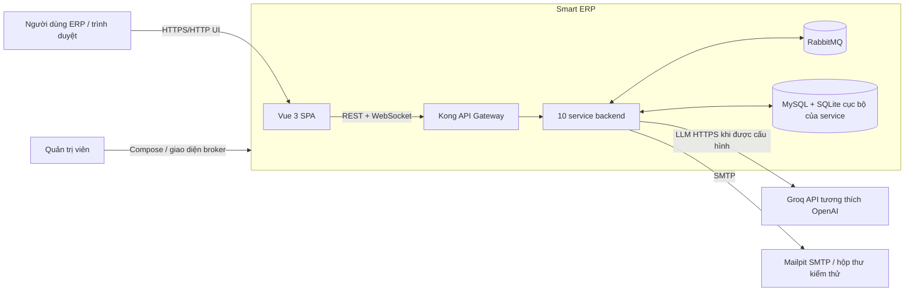
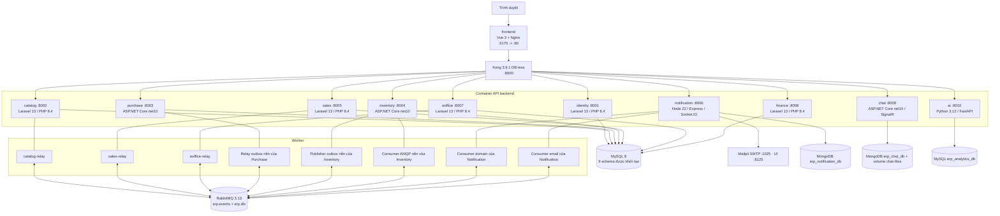
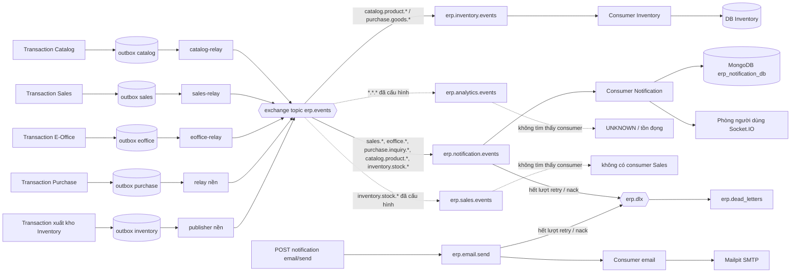

# Smart ERP — Kiến trúc hiện tại

> Đánh giá tĩnh, chỉ đọc repository, tính đến **2026-10-26**. Tài liệu này mô tả bằng chứng tìm thấy trong source và cấu hình; nó không khẳng định các container đang chạy hay khỏe mạnh.

## 1. Phạm vi, phương pháp và cách gắn nhãn trạng thái

Phạm vi: `docker-compose.yml`, mọi Dockerfile, Kong, RabbitMQ, khởi tạo MySQL, frontend, 10 service backend, các worker relay/nền, migration, route/controller, client gọi giữa các service, và các tài liệu kiến trúc/roadmap liên quan.

Các nhãn trạng thái dùng trong toàn tài liệu:

| Nhãn | Ý nghĩa |
|---|---|
| **IMPLEMENTED** | Mã thực thi đã được nối vào ứng dụng/container. Chưa khẳng định chạy thành công khi thực tế, trừ khi đã được thực thi. |
| **CONFIGURED_ONLY** | Hạ tầng/cấu hình khai báo đường đi, queue, schema hoặc dependency, nhưng chưa tìm thấy đường producer/consumer thực thi đầy đủ. |
| **PLANNED / DOC_ONLY** | Được mô tả trong tài liệu roadmap/mục tiêu nhưng mâu thuẫn với, hoặc không có trong, mã thực thi hiện tại. |
| **UNKNOWN** | Bằng chứng trong repository chưa đủ. |

Định dạng bằng chứng là `đường/dẫn:dòng — symbol`. Số dòng chỉ là mốc cho bản đánh giá này; symbol mới là tham chiếu ổn định. Các lần tìm kiếm đã loại trừ thư mục dependency được sinh tự động (`vendor`, `node_modules`, `bin`, `obj`).

Giới hạn quan trọng: đây là đánh giá tĩnh. Binding RabbitMQ đang chạy, schema production đã migrate, dữ liệu seed, tình trạng sức khỏe container, khả năng sẵn sàng của Groq bên ngoài và secret thật đều là **UNKNOWN**.

## 2. Phát hiện chính

1. Repository có **10 service backend**: Identity, Catalog, Purchase, Inventory, Sales, Notification, E-Office, Finance, Chat và AI. Kong expose cả 10; Vue/Nginx là điểm vào của trình duyệt. Bằng chứng: định nghĩa service trong `docker-compose.yml`; `infrastructure/kong/kong.yml` — `services`.
2. Database-per-service mới chỉ đúng ở mức logic với 6 service nghiệp vụ dùng MySQL: chúng dùng các schema riêng trên cùng một container MySQL 8. Notification và Chat dùng container MongoDB 7 riêng (replica set một node, database `erp_notification_db` và `erp_chat_db`); AI giữ lịch sử hội thoại và read model phân tích trong schema MySQL `erp_analytics_db`. Bằng chứng: `docker-compose.yml` — `mysql` và biến môi trường kết nối của các service; `infrastructure/mysql/init/01-create-databases.sql`.
3. Tích hợp nghiệp vụ bất đồng bộ thực sự tồn tại: producer ở Catalog/Sales/E-Office/Purchase, producer và consumer ở Inventory, consumer ở Notification. Trong mã hiện tại chỉ Inventory và Notification consume domain event. Bằng chứng: `Inventory.Infrastructure.DependencyInjection.AddInfrastructure`, `notification-service/src/index.js — startConsumer`, và kết quả tìm kiếm consumer trên toàn repository.
4. Tạo đơn bán hàng **không** giữ hàng. Nó snapshot dữ liệu từ Catalog/Identity và lưu một `DRAFT`. Việc giữ hàng là một lời gọi đồng bộ sau đó, từ thao tác trên Hóa đơn sang Inventory `POST /stocks/reserve/batch`. Bằng chứng: `SalesOrderController.store`, `ReferenceSnapshot`, `InvoiceController.syncReserve`, `InvoiceController.reserveStockForInvoice`.
5. Transactional Outbox được triển khai ở Catalog, Sales, E-Office, Purchase và Inventory. Catalog/Sales/E-Office chạy các container relay riêng trong Compose; Purchase và Inventory chạy worker relay nền ngay trong tiến trình API. Bằng chứng: Compose `*-relay`; `RelayOutboxEvents.handle`; `Purchase.Infrastructure.DependencyInjection.AddInfrastructure`; `Inventory.Infrastructure.DependencyInjection.AddInfrastructure`.
6. Realtime của Chat được triển khai bằng SignalR qua `/api/v1/chat/hub`; realtime của Notification được triển khai độc lập bằng Socket.IO qua `/api/v1/notifications/socket.io`. Hai bên không kết nối với nhau. Bằng chứng: `Chat.Api.Program`, `ChatHub`, `notification-service/src/realtime/socket.js — createRealtime`.
7. Routing analytics trên RabbitMQ đã được cấu hình, nhưng AI không có AMQP consumer. Roadmap của Chat nói có bot worker qua RabbitMQ, nhưng project Chat hiện tại không có `RabbitMQ.Client` và cũng không đăng ký worker nào. Cả hai đều là **CONFIGURED_ONLY / DOC_ONLY**, không phải tích hợp đã triển khai. Bằng chứng: `infrastructure/rabbitmq/definitions.json`; `services/ai-service/requirements.txt`; `services/chat-service/src/Chat.Infrastructure/Chat.Infrastructure.csproj`; đối chiếu `docs/csharp-realtime-chat-roadmap.md:201-205`.
8. ETL của AI đọc schema MySQL của các service khác ở chế độ chỉ đọc, và làm mới read model phân tích mỗi `SYNC_INTERVAL_SECONDS` khi `AI_WAREHOUSE_SYNC_ENABLED=true` (mặc định tắt). Cách này vượt qua ranh giới service và là điểm lệch chuẩn đã biết, cho đến khi consumer `erp.analytics.events` hoặc export API thay thế. Bằng chứng: `services/ai-service/app/warehouse.py — _src/build/sync`; `services/ai-service/app/main.py — lifespan`; `docker-compose.yml — ai-service`.

## 3. Bối cảnh hệ thống

Bằng chứng: `frontend/nginx.conf:20-31`; `infrastructure/kong/kong.yml`; `docker-compose.yml`; `services/ai-service/app/llm.py — chat/_call`; `services/notification-service/src/email/email.routes.js — createTransport`.

## 4. Kiến trúc container

Ghi chú:

- `gateway-legacy` nằm sau profile Compose `legacy-gateway`; đây là hạ tầng dự phòng khi rollback, không thuộc topology mặc định. Bằng chứng: `docker-compose.yml — gateway-legacy`; `gateway/nginx.conf`.
- Compose có khởi tạo `erp_analytics_db` và `erp_chat_db`, nhưng container AI và Chat hiện tại không dùng chúng. Đây là **CONFIGURED_ONLY**. Bằng chứng: `01-create-databases.sql`; `Chat.Infrastructure.DependencyInjection.AddInfrastructure`; `ai-service/app/config.py`.
- Comment trong Compose ghi PHP 8.3, trong khi mọi Dockerfile Laravel dùng `php:8.4-cli-alpine`; `composer.json` chấp nhận `^8.3`. Bằng chứng từ image runtime được ưu tiên. Bằng chứng: Dockerfile của từng service và `composer.json` ở gốc.

## 5. Danh mục service

| Service | Công nghệ / tiến trình | Trách nhiệm đã triển khai | Dữ liệu sở hữu | Phụ thuộc thực tế | Trạng thái và bằng chứng |
|---|---|---|---|---|---|
| `identity-service` | Laravel 13.17, PHP 8.4 | Đăng nhập, cấp JWT HS256, người dùng, vai trò, quyền, phòng ban, hồ sơ công ty/logo | `erp_identity_db`: users, roles, permissions, liên kết role/user, departments, company profile | Chỉ MySQL | **IMPLEMENTED** — `AuthController.login/me`; `JwtIssuer.issue`; `routes/api.php` |
| `catalog-service` | Laravel 13.17, PHP 8.4; relay riêng | Sản phẩm, thương hiệu, danh mục, khách hàng/liên hệ, nhà cung cấp, đối tác; phát sự kiện tạo sản phẩm | `erp_catalog_db`: bảng catalog/master data + `outbox_events` | MySQL, RabbitMQ | **IMPLEMENTED** — `ProductController`; `ProductEvents.created`; `RelayOutboxEvents.handle` |
| `purchase-service` | ASP.NET Core `net10.0`, EF Core 8/Pomelo; relay nền | Yêu cầu mua (PR), PO, nhận hàng, đối chiếu và ghi nhận hóa đơn 3 bên, trả hàng mua, hỏi hàng/nhà cung cấp | `erp_purchase_db`: bảng aggregate mua hàng, bảng hỏi hàng, outbox/processed events | MySQL, RabbitMQ; HTTP tới các endpoint Identity/Catalog/Notification trong mã hỏi hàng | **IMPLEMENTED** — controller trong `Purchase.Api/Controllers`; `Purchase.Application.DependencyInjection.AddApplication`; `ItemInquiriesController` |
| `inventory-service` | ASP.NET Core `net10.0`, EF Core 8/Pomelo; hai worker nền | Kho, sổ tồn thực tế, giữ chỗ, chuyển nhận/xuất/trả; consume sự kiện sản phẩm và nhận hàng | `erp_inventory_db`: kho, stock, sổ giữ chỗ và sổ giao dịch, outbox/processed events | MySQL, RabbitMQ | **IMPLEMENTED** — `StocksController`; `WarehousesController`; `RabbitMqConsumerWorker.ProcessMessageAsync` |
| `sales-service` | Laravel 13.17, PHP 8.4; relay riêng | Báo giá, đơn bán, giao hàng, hóa đơn/điều phối xuất kho, hóa đơn VAT/điều chỉnh, trả hàng, báo cáo, đính kèm | `erp_sales_db`: bảng chứng từ bán/báo cáo/trả hàng + `outbox_events` | MySQL, RabbitMQ; gọi đồng bộ Catalog, Identity, Inventory, Finance | **IMPLEMENTED** — `routes/api.php`; `ReferenceSnapshot`; `InvoiceController`; `CustomerReceivableService` |
| `notification-service` | Node 22, Express 4, MongoDB driver 6, Socket.IO 4, Nodemailer; hai consumer chạy trong tiến trình | Hộp thư thông báo, xác định người nhận, xử lý sự kiện có idempotent, đẩy realtime, hàng đợi email | MongoDB `erp_notification_db`: notifications, processed_events (TTL 30 ngày), email_jobs | RabbitMQ, REST Identity, SMTP Mailpit | **IMPLEMENTED** — `src/index.js`; `NotificationService.handleEvent`; `email.queue.js` |
| `eoffice-service` | Laravel 13.17, PHP 8.4; relay riêng | Nghỉ phép, đề nghị mua sắm/thanh toán, các bước và lịch sử phê duyệt, số dư phép/ngày lễ | `erp_eoffice_db`: bảng nghỉ phép/phê duyệt/đề nghị + `outbox_events` | MySQL, RabbitMQ, REST Identity | **IMPLEMENTED** — `routes/api.php`; `LeaveRequestService`; `OfficeRequestService`; `IdentityClient` |
| `finance-service` | Laravel 13.17, PHP 8.4 | Hệ thống tài khoản, sổ quỹ/ngân hàng, phiếu thu chi/ghi sổ/phân bổ, công nợ phải thu, sổ cái, đồng bộ điều chỉnh hóa đơn | `erp_finance_db`: tài khoản, quỹ/ngân hàng, phiếu và dòng phiếu, phân bổ, công nợ phải thu, bút toán sổ cái | MySQL; nhận lời gọi REST từ Sales | **IMPLEMENTED** — `routes/api.php`; các controller của Finance |
| `chat-service` | ASP.NET Core `net10.0`, MongoDB.Driver 3, SignalR | Chat trực tiếp, nhóm, luồng công việc; tin nhắn, file, reaction, ghim, trạng thái đọc, online/đang gõ | MongoDB `erp_chat_db`: conversations (members nhúng), chat_messages (attachments và reactions nhúng), message_hides, contact_aliases, counters; volume file cục bộ | REST Identity; không có package RabbitMQ trong project hiện tại | REST/SignalR **IMPLEMENTED**; bot Rabbit **DOC_ONLY** — `Program.cs`; `ChatHub`; `IdentityUserDirectory`; `.csproj` |
| `ai-service` | Python 3.12, FastAPI, PyMySQL, HTTPX, Groq bên ngoài | Phân tích hội thoại có kiểm soát quyền, lịch sử hội thoại; ETL read model cục bộ tùy chọn | MySQL `erp_analytics_db`: conversations/messages/tool_calls và read model phân tích | HTTPS tới Groq; truy cập MySQL chỉ đọc tới schema của 6 service cho ETL | API **IMPLEMENTED**; ETL trong Compose **OPT-IN (mặc định TẮT)**; consumer AMQP phân tích **KHÔNG CÓ** — `main.py`; `warehouse.py`; Compose `WAREHOUSE_SYNC_ENABLED` |

### Frontend và gateway

- Frontend dùng Vue 3.5 + Pinia 4 + PrimeVue 5 + Tailwind 4, build bằng Vite 8 và phục vụ bằng Nginx. Frontend dùng URL tương đối `/api/v1/*`, client SignalR và client Socket.IO. Bằng chứng: `frontend/package.json`; `frontend/src/api/*`; `frontend/src/stores/chatStore.js — buildConnection`; `frontend/src/composables/useNotifications.js — connect`.
- Kong chạy DB-less, gắn/trả lại `X-Correlation-ID`, bật CORS khá rộng, xóa header `X-Internal-Service-Key` do client gửi lên, và giữ timeout dài cho các route realtime. Bằng chứng: `infrastructure/kong/kong.yml — plugins/services`.
- Xác thực nằm ở tầng ứng dụng, không dùng plugin JWT của Kong. Mọi service tự xác minh token HS256 dùng chung ở local. Bằng chứng: không có plugin xác thực trong `kong.yml`; các implementation `JwtVerifier`/`HmacJwtTokenValidator`.

## 6. Sở hữu dữ liệu

| Chủ sở hữu | Database khi triển khai | Bảng/read model chính | Bằng chứng |
|---|---|---|---|
| Identity | MySQL `erp_identity_db` | departments, permissions, roles, role_permissions, users, user_roles, company_profiles | `identity-service/database/migrations/*` |
| Catalog | MySQL `erp_catalog_db` | categories, brands, products, partners, customers, customer_contacts, suppliers, product_price_histories, outbox_events | `catalog-service/database/migrations/*`; migration sau cùng xóa bảng warehouse của Catalog |
| Purchase | MySQL `erp_purchase_db` (dùng SQLite cho dev/test) | requisitions/items, orders/items/PR allocations, receipts/items, invoices/items, returns/items, aggregate hỏi hàng, outbox_events, processed_events | `Purchase.Infrastructure.Persistence.Configurations.*`; `DependencyInjection.AddInfrastructure` |
| Inventory | MySQL `erp_inventory_db` (dùng SQLite cho dev/test) | warehouses, inventory_stocks, sổ giữ chỗ/giao dịch, outbox_events, processed_events | `InventoryDbContext.OnModelCreating`; `DependencyInjection.AddInfrastructure` |
| Sales | MySQL `erp_sales_db` | quotations/orders/deliveries/invoices và dòng, dispatches, chứng từ/điều chỉnh VAT, trả hàng bán, đính kèm, báo cáo, sequences, outbox_events | `sales-service/database/migrations/*` |
| E-Office | MySQL `erp_eoffice_db` | leave types/balances/requests, holidays, các bước/lịch sử phê duyệt, office requests/items/attachments, outbox_events | `eoffice-service/database/migrations/*` |
| Finance | MySQL `erp_finance_db` | chart_of_accounts, cash_funds, bank_accounts, customer_receivables, vouchers/lines, allocations, GL entries, receivable_adjustments | `finance-service/database/migrations/*` |
| Notification | MongoDB `erp_notification_db` | notifications (unique `event_id` + `recipient_id`), processed_events (TTL), email_jobs | `notification-service/src/db.js — openDatabase` |
| Chat | MongoDB `erp_chat_db`; file trong `/app/chat-files` | conversations (members nhúng), chat_messages (attachments/reactions nhúng), message_hides, contact_aliases, counters | `MongoChatContext.EnsureIndexesAsync`; `MongoChatRepository`; volume Compose |
| AI | MySQL `erp_analytics_db` | conversations/messages/tool_calls; read model dimensions/facts/stock/receivable (dựng lại dưới tên `<table>_new` rồi đổi tên bằng một lệnh `RENAME TABLE` nguyên tử) | `ai-service/app/store.py — SCHEMA`; `warehouse.py — TABLES` |

Các bảng khung của Laravel (`users`, sessions, jobs, cache) cũng có trong migration của Finance/E-Office, nhưng không có bằng chứng nào cho thấy chúng là dữ liệu định danh chính thức. Hãy coi đây là phần thừa của framework, không phải dữ liệu sở hữu chéo service.

## 7. Giao tiếp HTTP đồng bộ

### Định tuyến API cho trình duyệt

| Tiền tố công khai | Hành vi upstream của Kong | Bằng chứng route backend |
|---|---|---|
| `/api/v1/auth` | bỏ tiền tố; base upstream `/api` | Identity `routes/api.php` |
| `/api/v1/catalog` | bỏ tiền tố; base upstream `/api` | Catalog `routes/api.php` |
| `/api/v1/purchase` | giữ nguyên đường dẫn | Controller Purchase `[Route("api/v1/purchase/...")]` |
| `/api/v1/inventory` | giữ nguyên đường dẫn | Controller Inventory |
| `/api/v1/sales` | bỏ tiền tố; base upstream `/api` | Sales `routes/api.php` |
| `/api/v1/notifications` | giữ nguyên đường dẫn; timeout đọc/ghi một giờ | Notification `app.js`; đường dẫn Socket.IO |
| `/api/v1/eoffice` | bỏ tiền tố; base upstream `/api` | E-Office `routes/api.php` |
| `/api/v1/finance` | bỏ tiền tố; base upstream `/api` | Finance `routes/api.php` |
| `/api/v1/chat` | giữ nguyên đường dẫn; timeout đọc/ghi một giờ | Controller và hub của Chat |
| `/api/v1/ai` | giữ nguyên đường dẫn; timeout 120 giây | AI `APIRouter(prefix="/api/v1/ai")` |

Bằng chứng: `infrastructure/kong/kong.yml`.

### Lời gọi giữa các service trên thực tế

| Bên gọi → bên được gọi | Mục đích / nhóm endpoint | Xác thực | Phân loại / bằng chứng |
|---|---|---|---|
| Sales → Catalog | Snapshot sản phẩm và khách hàng: `/api/products`, `/api/customers` | JWT người dùng được chuyển tiếp hoặc internal key | **IMPLEMENTED** — `ServiceClient.getData/http`; `CatalogClient.fetch`; `PartnerClient.customer` |
| Sales → Identity | Lấy snapshot người phụ trách/người dùng qua `/api/users` | JWT được chuyển tiếp hoặc internal key | **IMPLEMENTED** — `IdentityClient.users/findByNameOrEmail` |
| Sales → Inventory | Kho; giữ/nhả hàng theo lô; xuất kho; nhận/chuyển hàng trả | JWT người dùng được chuyển tiếp | **IMPLEMENTED** — `DeliveryController.sellableWarehouse`; `InvoiceController.reserveStockForInvoice/releaseStockForInvoice/issueStock`; controller trả hàng bán |
| Sales → Finance | Đồng bộ công nợ phải thu và điều chỉnh VAT | JWT người dùng được chuyển tiếp | **IMPLEMENTED** — `CustomerReceivableService.sync`; `VatInvoiceAdjustmentService.issue` |
| E-Office → Identity | Người dùng/phòng ban và xác định quản lý trực tiếp/người phê duyệt | `X-Internal-Service-Key` | **IMPLEMENTED** — `EOffice IdentityClient.get/directReportIds` |
| Notification → Identity | Xác định người nhận theo quyền | `X-Internal-Service-Key` | **IMPLEMENTED** — `RecipientResolver`; được nối trong `src/index.js:48-52` |
| Chat → Identity | Danh bạ người dùng, cache 60 giây | `X-Internal-Service-Key` | **IMPLEMENTED** — `IdentityUserDirectory.GetUsersAsync` |
| Purchase → Identity/Catalog/Notification | Kiểm tra người dùng khi hỏi hàng, áp dụng kết quả hỏi hàng, quy trình email nhà cung cấp | Internal key hoặc JWT tùy phương thức | **IMPLEMENTED**, tập trung trong `ItemInquiriesController` |
| AI → các API khác | Không tìm thấy | Không áp dụng | **UNKNOWN/ABSENT**; AI đọc kho SQLite của nó thay vì gọi API nghiệp vụ |

Kong chỉ xóa `X-Internal-Service-Key` ở gateway công khai. Các bên gọi nội bộ truy cập trực tiếp qua DNS của service, nên header được giữ nguyên. Bằng chứng: `kong.yml — request-transformer`; base URL của service trong Compose.

## 8. Giao tiếp bất đồng bộ và Transactional Outbox

### Luồng sự kiện

### Producer và relay

| Producer | Sự kiện tìm thấy | Hành vi relay | Bằng chứng |
|---|---|---|---|
| Catalog | `ProductCreated` → `catalog.product.created` | `catalog-relay` riêng; publisher confirm + xử lý mandatory/unroutable | `ProductEvents.created`; `RelayOutboxEvents.relayBatch`; `RabbitMqPublisher.publish` |
| Sales | báo giá gửi/duyệt/từ chối; đơn gửi/duyệt/từ chối; sự kiện trạng thái giao hàng; yêu cầu điều phối xuất kho | `sales-relay` riêng; cùng mẫu relay/publisher của Laravel | các method `recordEvent` trong controller; `Outbox.record` |
| E-Office | vòng đời nghỉ phép và đề nghị mua sắm/thanh toán | `eoffice-relay` riêng | `LeaveRequestService.recordEvent`; `OfficeRequestService.recordEvent` |
| Purchase | nhận hàng, PO được duyệt/hủy, trả hàng đã gửi, yêu cầu/phản hồi hỏi hàng | `OutboxRelayBackgroundService` nền, poll mỗi 1,5 giây | application services; `ItemInquiriesController`; worker relay |
| Inventory | chỉ tìm thấy `GoodsIssued` → `inventory.goods.issued` | `OutboxPublisherWorker` nền, poll mỗi 1,5 giây | `StocksController.Issue`; `OutboxPublisherWorker` |

`Outbox::record` của Laravel được gọi trong cùng một `DB::transaction` cho các bước chuyển trạng thái phê duyệt, đáp ứng phần ghi nguyên tử của Transactional Outbox. Relay riêng sẽ publish sau đó. Ví dụ bằng chứng: `SalesOrderController.submitApproval/approve`; `Outbox.record`.

### Routing và consumer

| Queue / binding | Consumer trong mã hiện tại | Hành vi thực tế |
|---|---|---|
| `erp.inventory.events`: `purchase.goods.*`, `catalog.product.*` | `RabbitMqConsumerWorker` | Chỉ xử lý `GoodsReceived` và `ProductCreated`; idempotency được giao cho `IEventConsumerHandler`/`processed_events`. **IMPLEMENTED**. |
| `erp.notification.events`: duyệt/giao/điều phối đơn bán, E-Office, hỏi hàng, sản phẩm, `inventory.stock.*` | `startConsumer` của Notification | Tra cứu rule, xác định người nhận, ghi SQLite có idempotent, đẩy Socket.IO. Loại sự kiện không có rule được đánh dấu đã xử lý với `NO_RULE`. **IMPLEMENTED**. |
| `erp.email.send` | `startEmailConsumer` của Notification | Gửi SMTP, có hàng đợi retry và DLX. **IMPLEMENTED**. |
| `erp.analytics.events`: `*.*.*` | Không tìm thấy | Chỉ có queue và binding. **CONFIGURED_ONLY**; khi chạy, message có thể tích lũy. |
| `erp.sales.events`: `inventory.stock.*` | Không tìm thấy trong Sales | Chỉ có queue và binding. **CONFIGURED_ONLY**. |
| `erp.purchase.events` | Không có; không có binding trong definitions | Chỉ khai báo queue. **CONFIGURED_ONLY**. |
| `erp.eoffice.events` | Không có; không có binding trong definitions | Chỉ khai báo queue. **CONFIGURED_ONLY**. |
| Queue sự kiện của Chat | Không có `erp.chat.events` trong definitions và không có consumer/package trong mã hiện tại | **PLANNED / DOC_ONLY**, dù roadmap đã đánh dấu hoàn thành. |

Điểm lệch routing nghiêm trọng: Inventory publish `inventory.goods.issued`, nhưng binding của Sales/Notification đã cấu hình lại nghe `inventory.stock.*`. Analytics là bên nhận wildcard duy nhất. Publisher của Inventory không dùng mandatory routing hay publisher confirm trước khi đánh dấu dòng outbox là `PUBLISHED`. Vì vậy mã hiện tại không đảm bảo sự kiện `GoodsIssued` được chuyển đến nơi cần nhận. Bằng chứng: `StocksController:562-568`; `definitions.json`; `OutboxPublisherWorker:86-95`.

## 9. Giao tiếp realtime

| Kênh | Đường dẫn | Chiều dữ liệu và nguồn chuẩn | Bằng chứng |
|---|---|---|---|
| SignalR của Chat | `/api/v1/chat/hub` | Server → client: sự kiện hội thoại/tin nhắn/đã đọc/trạng thái online. Client → server: chỉ đang gõ. Ghi dữ liệu đi qua REST. JWT được truyền qua `access_token` của SignalR. | `ChatHub`; `JwtAuthMiddleware.HubPath`; `chatStore.buildConnection` |
| Socket.IO của Notification | `/api/v1/notifications/socket.io` | Tín hiệu thông báo theo phòng người dùng và broadcast catalog/tồn kho. Nguồn chuẩn vẫn là REST/SQLite của Notification. JWT trong `auth.token` của handshake. | `createRealtime`; `useNotifications.connect` |

Không có bằng chứng nào cho thấy Notification dùng SignalR hay Chat dùng Socket.IO. Cũng không có liên kết trực tiếp giữa Chat và Notification.
