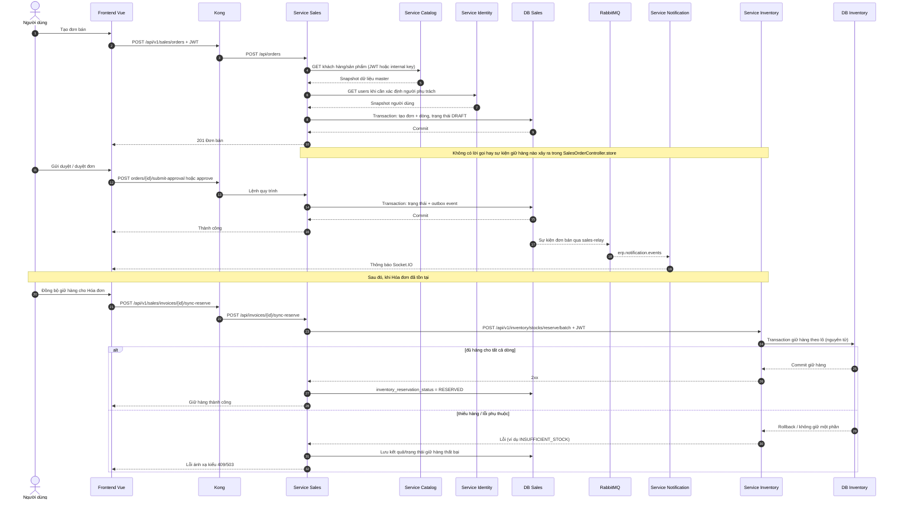

## 11. Tuần tự: tạo đơn bán và giữ kho

Sơ đồ này cố ý thể hiện điểm không liền mạch đã triển khai: tạo đơn bán không giữ hàng. Việc giữ hàng được thực hiện sau đó, cho một Hóa đơn.

Bằng chứng: `SalesOrderController.store:56-230`; `SalesOrderController.submitApproval/approve`; `InvoiceController.syncReserve:272-306`; `InvoiceController.reserveStockForInvoice:766-817`; `StocksController.BatchReserveStock`.
