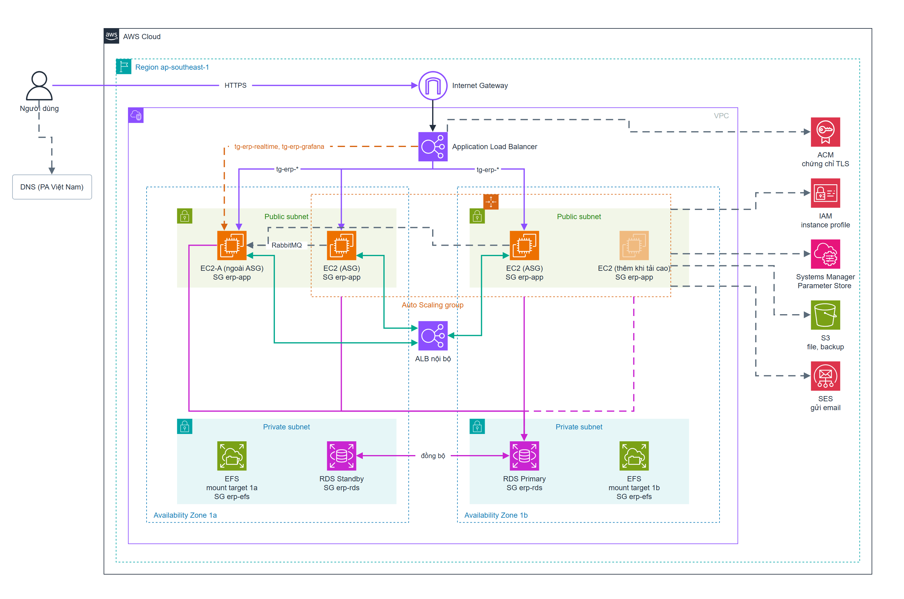
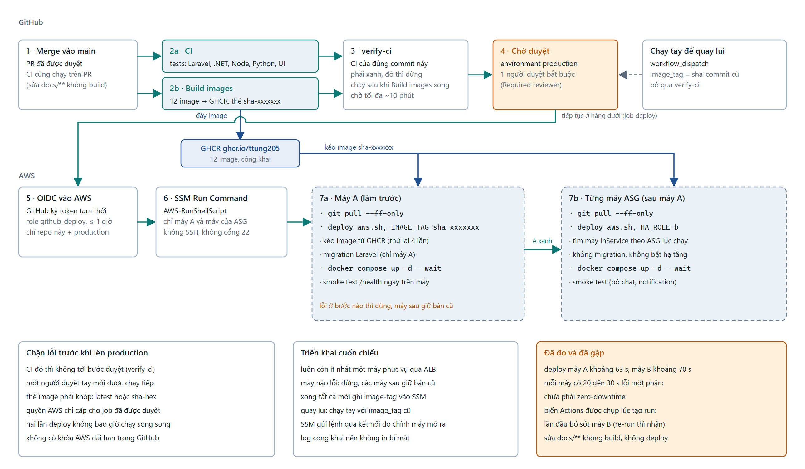

# 08. DevOps trên AWS: những gì đã dựng và vì sao

> Bài này giải thích **mục đích** của từng thứ đã dựng trên AWS (S3, IAM, Security Group, ALB, RDS, EFS, CD), nó liên quan gì tới hệ thống phân tán, thầy có thể hỏi gì, và những sự cố thật đã gặp.
> Cập nhật 09/11/2026: hệ thống đã chuyển từ **một EC2** sang **kiến trúc HA hai AZ** (ALB, MySQL ở RDS Multi-AZ, tệp trên EFS), rồi nâng cấp tiếp: **RDS và EFS trong subnet riêng**, tầng ứng dụng chạy trong **Auto Scaling Group** dựng từ golden AMI với bí mật lấy từ SSM Parameter Store, và CD deploy theo ASG. Số liệu chịu lỗi nằm ở bài `08-chiu-loi.md`.

## 1. Bức tranh tổng thể (kiến trúc hiện tại)



*Hình 1. Kiến trúc AWS hiện tại. Bản vector: [aws-ha-architecture.svg](images/aws-ha-architecture.svg). Bản chữ của cùng sơ đồ nằm ngay dưới.*

```text
 Người dùng ─https─► erp.transportbooking.xyz (DNS: CNAME → ALB, ở PA Việt Nam)
                         │
              ┌──────────▼───────────────────────────────────────────────┐
              │ Application Load Balancer `erp-alb` (2 AZ, chứng chỉ ACM) │
              │  mặc định ─────────► tg-erp-web  (EC2-A + máy của ASG)    │
              │  /api/v1/chat*, /api/v1/notifications* ► tg-erp-realtime  │ (chỉ A, stickiness)
              │  /grafana* ────────► tg-erp-grafana  (chỉ A, cổng 3000)   │
              └──────────┬───────────────────────────────┬───────────────┘
                         │                               │
              EC2-A (AZ 1a, đứng riêng)      Auto Scaling Group erp-app-asg (Min 1, Desired 2, Max 3, AZ 1a và 1b)
              nginx → Kong → service         nginx → Kong → service; dựng từ golden AMI;
              + RabbitMQ, Mongo, relay,      .env và thẻ image lấy từ SSM Parameter Store
                chat, notification, ...
                         │                               │
                         └─► RDS MySQL 8.4 Multi-AZ, subnet RIÊNG (primary + standby) ◄─┘
                         └─► EFS, mount target ở subnet RIÊNG 1a và 1b ◄────────────────┘

 Quản trị : IAM + Session Manager (không cổng 22, không khóa SSH)
 Bí mật   : SSM Parameter Store (env-app SecureString; image-tag), đọc bằng IAM role của máy
 Sao lưu  : IAM role của EC2 ─► S3 `smart-erp-backup`
 Triển khai: GitHub Actions ─OIDC─► IAM role ─SSM─► máy A, rồi từng máy InService của ASG
```

Bốn nguyên tắc xuyên suốt, thầy rất thích nghe:
1. **Đặc quyền tối thiểu (least privilege):** mỗi thứ chỉ được làm đúng việc nó cần.
2. **Không có bí mật dài hạn nằm trên máy chủ hay trong GitHub:** dùng quyền tạm thời (IAM role, OIDC).
3. **Diện tấn công nhỏ nhất:** chỉ ALB nhận traffic từ Internet; EC2, RDS, EFS chỉ nhận từ tầng ngay trước nó.
4. **Không điểm lỗi đơn ở tầng web và DB:** máy ứng dụng trong Auto Scaling Group ở hai AZ (tự thay, tự mở rộng), một DB Multi-AZ trong subnet riêng. (Những điểm lỗi đơn còn lại được liệt kê thẳng ở mục 5.)

## 2. Từng bước: mục đích, nếu bỏ qua thì sao, kiểm tra thế nào

### 2.1. Chọn Region Singapore
- **Là gì:** AWS đặt máy ở nhiều khu vực địa lý (Region). Mỗi tài nguyên (EC2, S3, RDS) thuộc **một** Region. IAM và Billing là dịch vụ toàn cầu nên ô Region hiện "Global".
- **Vì sao Singapore (ap-southeast-1):** gần Việt Nam nhất trong các Region mở cho tài khoản, nên độ trễ thấp.
- **Nếu bỏ qua:** tạo nhầm Region thì tài nguyên rải rác, không thấy nhau (Security Group, chứng chỉ ACM không dùng chung giữa các Region; chứng chỉ cho ALB phải ở **cùng Region với ALB**).

### 2.2. Budget cảnh báo chi phí
- **Là gì:** một cảnh báo gửi email khi chi tiêu thực tế hoặc dự báo chạm ngưỡng. Budget **chỉ cảnh báo, không tự chặn**.
- **Credits (120 USD):** AWS trừ credit trước khi tính vào thẻ. Trang Credits cho biết còn bao nhiêu.
- **Với kiến trúc HA** chi phí tăng (xem mục 2.12): ước tính khoảng 7 USD mỗi ngày khi bật liên tục. Vì vậy nên đặt ngưỡng cảnh báo cao hơn lúc còn một máy (kiểm tra lại Budget đang đặt ở mức nào).
- **Nếu bỏ qua:** quên tắt máy hay ALB thì chỉ biết khi hết credit.

### 2.3. S3 bucket `smart-erp-backup`
**S3** là kho lưu **đối tượng** (file) với độ bền rất cao, tách biệt khỏi máy EC2. Lý do phải tách: nếu máy EC2 hỏng hoặc bị xóa thì bản sao lưu nằm cùng máy cũng mất theo (xem bài 07).

| Thiết lập | Chống rủi ro | Giải thích |
|---|---|---|
| **Block all public access** | Rò rỉ dữ liệu | Bản sao lưu chứa dữ liệu thật. Bật chặn này thì dù ai lỡ cấu hình sai (ACL, policy) bucket vẫn không công khai được |
| **Mã hóa SSE-S3** | Lộ dữ liệu khi lấy được ổ lưu trữ | AES-256 khi lưu (*at rest*), trong suốt với ứng dụng |
| **Lifecycle rule 14 ngày** | Chi phí tăng mãi, dữ liệu cũ tồn tại vô hạn | S3 tự xóa bản cũ hơn 14 ngày; bổ sung cho retention 7 ngày phía máy chủ |

- **Prefix `smart-erp/`:** S3 không có thư mục thật; phần đứng đầu tên là prefix, hoạt động như thư mục và dùng để giới hạn quyền.

### 2.4. IAM role của EC2 (`ec2-ssm-smart-erp`)
**Vấn đề:** máy EC2 cần ghi lên S3. Cách "dễ" là tạo Access Key rồi dán vào `.env`: khóa đó **không hết hạn**, lộ là dùng được từ khắp nơi.

**Cách đúng:** IAM role. Máy "đóng vai" một role và AWS cấp **thông tin đăng nhập tạm thời, tự xoay vòng** (qua IMDSv2). Không có khóa dài hạn để lộ. Cả hai máy (A và B) dùng cùng một instance profile.

Một role luôn có hai phần:
| Phần | Trả lời | Ở đây |
|---|---|---|
| **Trust policy** | *Ai được đóng vai role này?* | Dịch vụ EC2 |
| **Permission policy** | *Role này được làm gì?* | Hai policy bên dưới |

Hai permission policy:
1. **`AmazonSSMManagedInstanceCore`** (AWS viết sẵn): cho SSM Agent đăng ký với Systems Manager, nhờ đó có **Session Manager** (cửa sổ dòng lệnh trên trình duyệt, xác thực bằng IAM, **không cần cổng 22**).
2. **Inline policy `smart-erp-backup-s3`**:
   - `s3:ListBucket` (và `GetBucketLocation`) trên **chính bucket**;
   - `s3:PutObject` + `s3:GetObject` chỉ trên `smart-erp-backup/smart-erp/*`;
   - **không có `DeleteObject`:** máy chủ bị xâm nhập cũng không xóa được bản sao lưu (chống ransomware); việc xóa bản cũ do lifecycle của S3 làm.

> Quyền S3 của role này từng **thiếu** (sự cố 4 ở mục 6): `aws s3 sync` cần `ListBucket` ở cấp bucket; thiếu thì sao lưu lên S3 bị `AccessDenied`.

> **Câu chốt:** "Máy chủ không giữ khóa AWS nào. Nó nhận quyền tạm thời từ IAM role, chỉ ghi được vào một thư mục của một bucket và không xóa được gì."

### 2.5. Security Group: mỗi tầng chỉ nhận từ tầng ngay trước nó
**Security Group** là tường lửa ảo gắn vào tài nguyên: mặc định **chặn mọi kết nối vào**, bạn chỉ khai báo cái được phép. **Stateful:** phản hồi của kết nối được phép tự được đi ra.

Từ khi có HA, thay một nhóm cũ (`smart-erp-web-sg`, mở 80/443 cho cả Internet) bằng **bốn nhóm theo vai trò**, quy tắc tham chiếu **nhóm nguồn** chứ không dùng IP:

| Nhóm | Gắn vào | Cho phép vào (inbound) |
|---|---|---|
| `erp-alb` | ALB | 80 và 443 từ mọi nơi (đây là cửa duy nhất ra Internet) |
| `erp-app` | EC2-A và máy ASG | 80 và 3000 **từ `erp-alb`**; 5672 (RabbitMQ) **từ chính `erp-app`** (máy ASG gọi RabbitMQ của máy A) |
| `erp-rds` | RDS | 3306 **từ `erp-app`** |
| `erp-efs` | mount target EFS | 2049 (NFS) **từ `erp-app`** |

- **Vì sao tham chiếu nhóm, không mở theo IP/cổng:** quy tắc của RDS là "cho nhóm `erp-app` vào cổng 3306". Máy mới chỉ cần được gắn `erp-app` là tự có quyền (máy ASG mới sinh ra, máy thay thế); không phải sửa quy tắc hay nhớ IP. Quy tắc nằm ở **phía nhận** (RDS quyết định ai được vào DB), không phải phía gọi.
- **Vì sao KHÔNG mở cổng 22:** cổng 22 bị dò mật khẩu tự động liên tục. Session Manager thay thế SSH, xác thực bằng IAM, ghi lại phiên, không có cổng nào để tấn công.
- **Máy A đã gỡ nhóm cũ** nên không còn truy cập thẳng từ Internet (đã kiểm tra: `http://<IP máy A>` hết thời gian chờ); chỉ vào được qua ALB.
- **Outbound mặc định cho phép tất cả:** máy cần đi ra để tải image GHCR, cài gói, ghi S3, nối SSM. (Giới hạn chặt hơn là hướng nâng cao.)

### 2.6. VPC mặc định
Mọi máy nằm trong một **VPC**. Dùng VPC mặc định (`172.31.0.0/16`) có ba subnet công khai (1a, 1b, 1c) và cổng Internet. Ta thêm **ba subnet riêng** `erp-private-1a/1b/1c` (`172.31.100.0/24`, `.101.0/24`, `.102.0/24`) cùng bảng định tuyến `rtb-erp-private` **chỉ có route `local`** (không có `0.0.0.0/0` tới Internet Gateway). **Subnet chỉ "riêng" khi bảng định tuyến của nó không có đường tới Internet Gateway**; subnet mới tự dùng bảng định tuyến chính (đang có đường ra Internet) nên phải gắn bảng riêng vào. RDS và các mount target của EFS nằm trong subnet riêng; EC2 vẫn ở subnet công khai vì cần IP công khai để kéo image và nối SSM (ta không dùng NAT Gateway để khỏi tốn tiền). Một hệ thống sản xuất thật sẽ đặt cả EC2 vào subnet riêng kèm NAT hoặc VPC endpoint. Đây là điểm yếu nên tự nói trước (mục 5).

### 2.7. Tài khoản đầu tiên: không có tài khoản mẫu với mật khẩu công khai
- **Vấn đề:** seeder tạo sẵn 18 tài khoản (có SUPER_ADMIN) với mật khẩu cố định công khai. Ở máy dev thì tiện, nhưng trên địa chỉ HTTPS công khai thì ai cũng vào được với quyền cao nhất. Tên miền mới còn bị các chương trình theo dõi **nhật ký chứng chỉ công khai (Certificate Transparency)** dò thử trong vài phút sau khi cấp chứng chỉ.
- **Cách xử lý cuối cùng:** production **không bao giờ có tài khoản mẫu**. `SEED=1` chỉ nạp phòng ban, vai trò, quyền, rồi `identity:bootstrap-admin` tạo **một** Super Admin với mật khẩu mạnh (từ 14 ký tự). `identity:purge-demo-users` xóa các tài khoản `@erp.local` còn sót.
- **Đăng nhập:** bằng **mã nhân viên** kèm **OTP gửi email** (6 số, sống 5 phút, dùng một lần, tối đa 5 lần sai, chỉ lưu mã băm HMAC; số lần thử và việc tiêu thụ dùng UPDATE có điều kiện nên các yêu cầu song song không vượt giới hạn, đúng cơ chế chương 6) hoặc mật khẩu.
- **Email OTP qua Amazon SES** (production, địa chỉ/tên miền đã xác minh bằng DKIM). Thông tin SMTP nằm trong `.env` trên máy chủ, không nằm trong Git. Lưu ý: SES qua SMTP dùng khóa SMTP của một IAM user (**dài hạn**), trái nguyên tắc "không khóa dài hạn", nên IAM user đó chỉ nên có quyền gửi email.

### 2.8. CD: tự động triển khai không cần khóa AWS và không cần cổng 22


*Hình 2. Luồng CI/CD. Bản vector: [cicd-pipeline.svg](images/cicd-pipeline.svg).*

**Chuỗi hoạt động khi merge vào `main`:**
```text
push vào main ─► CI (chạy test)            ┐
              └► Build images (12 image) ──┴─► Deploy production
                    1. verify-ci   : CI của ĐÚNG commit này phải xanh, đỏ thì dừng
                    2. chờ duyệt   : environment "production" có người duyệt bắt buộc
                    3. OIDC        : GitHub xin token tạm thời, AWS cấp quyền của role deploy
                    4. SSM         : gửi lệnh tới từng máy, lần lượt (A rồi từng máy ASG): git pull + scripts/deploy-aws.sh
                    5. smoke test  : mỗi máy tự kiểm tra các route /health của chính nó; lỗi thì dừng, máy sau giữ nguyên
```

**OIDC là gì và vì sao tốt hơn Access Key?** Cách "dễ" là dán Access Key vào GitHub Secrets: khóa không hết hạn, lộ là dùng được từ khắp nơi. Với OIDC, mỗi lần chạy GitHub tự ký một **token tạm thời** ghi rõ "tôi là workflow của repo X, môi trường Y". AWS kiểm tra chữ ký rồi cấp quyền của một IAM role trong **tối đa 1 giờ**. **Không có khóa dài hạn trong GitHub** (Secrets trống; chỉ có các biến không nhạy cảm: Region, ID hai máy, ARN của role).

**Trust policy của role `github-deploy-smart-erp`:** `Principal` là OIDC provider của GitHub; điều kiện `sub` giới hạn **đúng repo này, đúng môi trường `production`** (so khớp chính xác `StringEquals`, kèm ID số của chủ sở hữu và repo nên xóa repo rồi tạo lại cùng tên cũng không khớp); `aud` phải là `sts.amazonaws.com`. Vì `sub` có `environment:production`, **chỉ job đã được người duyệt cho chạy** mới lấy được quyền AWS; cổng duyệt tay còn là lớp bảo vệ phía AWS.

**Permission policy của role (quyền tối thiểu):** `ssm:SendCommand` **chỉ trên hai instance (A và B) và tài liệu `AWS-RunShellScript`**; `ssm:GetCommandInvocation` (AWS không cho giới hạn theo tài nguyên nên là `*`). Thêm máy mới phải thêm ARN của nó vào đây, nếu không CD báo `AccessDenied` ở máy đó.

**Các lớp bảo vệ khác trong `deploy.yml`:** kiểm tra thẻ image bằng biểu thức chính quy (`latest` hoặc `sha-` + hex) vì giá trị này được ghép vào lệnh chạy trên máy chủ (chống chèn lệnh); `concurrency` để hai lần deploy không song song; chạy bằng user `ubuntu` (không phải root); quay lui bằng cách chạy tay với `image_tag` của commit trước.

**Triển khai cuốn chiếu (A rồi từng máy ASG):** máy A theo ID; máy ASG đổi liên tục nên được tìm **lúc chạy** bằng `describe-auto-scaling-groups` (chỉ máy `InService`), deploy lần lượt, chờ 30 giây giữa hai máy để ALB kịp coi máy vừa deploy là healthy. Máy nào lỗi thì dừng, các máy sau giữ bản cũ. **Chỉ khi mọi máy thành công** CD mới ghi thẻ image vào tham số SSM `/smart-erp/prod/image-tag`, để máy ASG sinh ra sau đó chạy đúng bản đã được xác nhận. Đã đo: **không phải zero-downtime**, mỗi máy có cửa sổ khoảng 20–30 giây lỗi một phần vì ALB chưa kịp loại máy đang tạo lại container (bài `08-chiu-loi.md`, thí nghiệm A4). Muốn bằng 0 cần rút máy khỏi ALB trước khi deploy.

**Bài học về biến Actions:** GitHub **chụp giá trị biến lúc tạo run**. Lần đầu CD bỏ sót máy B vì biến `EC2_INSTANCE_ID_B` được tạo *sau* khi run được tạo; dòng `INSTANCE_IDS:` trong log chỉ có một ID. Chạy lại (re-run) mới nhận biến.

**Đã vá sau rà soát:**
| Điểm yếu | Vá |
|---|---|
| Deploy không xét CI, commit CI đỏ vẫn tới bước chờ duyệt | Job `verify-ci` chạy **trước** và dừng nếu CI của cùng commit không xanh |
| Sửa tài liệu cũng build lại 12 image và xin duyệt | `paths-ignore` cho `docs/**` và `**.md` |
| EC2 đang dừng thì lỗi khó hiểu | Thông báo rõ: bật máy rồi chạy lại |
| Quyền SSM của role rộng hơn cần thiết | Máy A giới hạn theo ARN; máy ASG giới hạn theo thẻ `Name = erp-app-asg` (`ssm:resourceTag/Name`); `ssm:PutParameter` chỉ cho đúng tham số `image-tag`, không động tới `env-app` |

**Còn lại (nói thật khi bị hỏi):** environment `production` chưa chắc đã giới hạn nhánh được deploy (nên đặt chỉ `main`); repo công khai nên log workflow ai cũng đọc được (không được in bí mật ra log).

### 2.9. ALB, chứng chỉ ACM và DNS
- **ALB (Application Load Balancer, L7):** nhận HTTPS từ Internet, chuyển tới các EC2 theo **target group**, kiểm tra sức khỏe từng máy (`/health` mỗi 10 giây; cần vài lần thất bại liên tiếp mới loại máy), kết thúc TLS, hỗ trợ WebSocket. Đặt ở **hai AZ** nên bản thân nó không phải một máy đơn lẻ. Dùng ALB của AWS thay vì tự dựng Nginx/HAProxy để tránh tạo SPOF mới.
- **Ba target group và luật định tuyến** (listener 443, luật xét theo thứ tự **Priority** nhỏ đến lớn, mặc định xét cuối): Priority 10 `/api/v1/chat*` và `/api/v1/notifications*` → `tg-erp-realtime` (chỉ máy A, có stickiness vì SignalR/Socket.IO giữ trạng thái trong bộ nhớ); Priority 20 `/grafana*` → `tg-erp-grafana` (chỉ máy A, cổng **3000**: cổng mặc định của target group là 80 nhưng đăng ký máy với cổng 3000); mặc định → `tg-erp-web` (cả hai máy). Listener 80 chuyển hướng **301** sang HTTPS.
- **Stickiness** phải bật ở **cả thuộc tính của target group lẫn luật của listener**, nếu không ALB bỏ qua.
- **Chứng chỉ ACM (miễn phí, tự gia hạn):** ACM cấp chứng chỉ sau khi chứng minh bạn sở hữu tên miền bằng **bản ghi CNAME xác minh** đặt trong DNS. **Không xóa** bản ghi đó sau này vì ACM dùng nó để tự gia hạn. Chứng chỉ phải ở cùng Region với ALB.
- **DNS ở PA Việt Nam:** `erp` là **CNAME** trỏ tới tên DNS của ALB (không dùng bản ghi A vì ALB đổi IP theo thời gian; một tên không thể vừa có A vừa có CNAME). TTL hạ xuống 300 giây trước khi chuyển để đổi nhanh và đổi ngược nhanh. Giữ nguyên các bản ghi DKIM/DMARC của SES. Ô Host ở trang DNS của nhà đăng ký chỉ nhận phần đứng **trước** tên miền gốc (xem sự cố 5).

### 2.10. RDS MySQL Multi-AZ
- **Vì sao một DB dùng chung (không phải mỗi máy một MySQL):** chốt chống bán âm `UPDATE ... WHERE quantity >= :qty` chỉ đúng khi mọi request đi qua cùng một bản dữ liệu; hai DB độc lập thì hai đơn có thể cùng lấy hàng cuối ở hai nơi.
- **Multi-AZ DB instance (2 máy):** primary + standby ở AZ khác, ghi **đồng bộ**; khi hỏng AWS chuyển endpoint sang standby (khoảng 1 phút), **không mất dữ liệu đã commit**. Standby **không phục vụ truy vấn** (khác read replica: bất đồng bộ, đọc được). Đã thử *Reboot with failover*: PHP gián đoạn ~7s, .NET ~19s (bài chịu lỗi).
- **Cấu hình đã chọn:** MySQL **8.4** (8.0 đã hết hỗ trợ tiêu chuẩn từ 31/07/2026, giữ lại phải trả Extended Support), `db.t4g.small`, gp3 **20 GiB**, tắt storage autoscaling, không public, security group `erp-rds`. Mật khẩu quản trị tối đa **41 ký tự** (giới hạn của RDS).
- **Khởi tạo:** `scripts/aws/rds-init.sh` dùng đúng `01-create-databases.sql` và `03-create-service-users.sh` như môi trường một máy, chạy qua mạng bằng tài khoản `admin`, nên quyền hạn **giống hệt** (mỗi service một tài khoản chỉ có quyền trên schema của mình, `erp_backup` chỉ đọc).
- **Chuyển dữ liệu:** dùng chính công cụ sao lưu/phục hồi của dự án (bài 07): sao lưu từ MySQL cũ rồi `recovery restore latest --mysql --yes` vào RDS. 8 schema mất **12 giây**.
- **Chuyển vào subnet riêng:** RDS **không cho đổi sang subnet group khác** trong cùng VPC (lỗi *You cannot move DB instance ... the specified DB subnet group and DB instance are in the same VPC*). Cách làm theo hướng dẫn AWS: **sửa chính subnet group đang dùng** (thêm 3 subnet riêng, giữ lại subnet công khai của AZ nơi primary đang đứng), bật Multi-AZ để bản chờ nằm ở subnet riêng, **Reboot with failover** để primary dời sang đó, tắt Multi-AZ để xóa bản cũ ở subnet công khai, gỡ subnet công khai khỏi nhóm, rồi bật lại Multi-AZ. Endpoint không đổi nên không phải sửa `.env`. Đo: failover làm `sales` ngừng ~8s, .NET ~20s.
- **Bài học chi phí:** form tạo RDS tự điền 200 GiB (cho ước tính 129 USD/tháng). Dung lượng ổ RDS **chỉ tăng được, không giảm được**, nên phải xóa và tạo lại với 20 GiB.

### 2.11. EFS: tệp đính kèm dùng chung
- Disk `local` của Laravel nằm trong container, nên upload ở máy A không thấy ở máy B. **EFS** là ổ NFS chia sẻ qua nhiều AZ, mount ở `/mnt/efs` trên cả hai máy (`fstab` với `_netdev` và `hard`; `hard` để khi mất kết nối tạm thời thì chờ và thử lại thay vì báo lỗi làm hỏng file đang ghi).
- Thư mục `/mnt/efs/sales` thuộc uid 33 (`www-data`, người dùng PHP trong container).
- Compose mount thư mục này với `create_host_path: false`: nếu EFS chưa mount, container sales **không khởi động** thay vì ghi âm thầm vào đĩa cục bộ (khi đó mỗi máy một bản file).
- Đã kiểm tra: khởi động lại máy, EFS tự mount trước khi Docker chạy, container tự lên.
- **Mount target trong subnet riêng** (1a và 1b, security group `erp-efs`). Mỗi AZ chỉ có **một** mount target nên phải xóa cái cũ rồi tạo cái mới; trong khoảng đó `sales` dừng (nhờ `create_host_path: false` nó không ghi nhầm vào đĩa cục bộ). Tên DNS **chung** của EFS cập nhật chậm sau khi tạo lại mount target (máy không phân giải được tên trong vài phút), còn tên **riêng của AZ** (`<az>.fs-xxxx.efs...`) dùng được ngay.

### 2.12. Dựng máy mới bằng script (user data), và bảng chi phí
- **`scripts/aws/bootstrap-ec2.sh`** dán vào ô *User data* khi tạo EC2: tự cài Docker, mount EFS, `git clone`. Việc còn lại làm tay qua Session Manager: dán `.env`, chạy `deploy-aws.sh`. Đây là một dạng *Infrastructure as Code* nhỏ: máy hỏng thì dựng lại y hệt.
- **Vì sao dựng máy B từ Ubuntu trắng, không tạo AMI từ máy A:** AMI của A mang theo các container đang chạy với `restart: unless-stopped` (relay, scheduler, RabbitMQ, Mongo), nên B khởi động sẽ tự bật chúng trước khi bạn đổi `.env`, gây relay chạy hai nơi; còn mang theo cả `.env` cũ chứa secret.
- **Hai file `.env` (máy A, máy B) dùng chung một bộ secret**, sinh trong **một lần chạy** `make-prod-env.ps1 -Ha`. Chung `JWT_SECRET` thì token do máy này ký máy kia mới chấp nhận; chung mật khẩu DB thì cả hai vào được RDS. Chạy lại script là đổi **toàn bộ** secret của cả hai.

| Thành phần | Ước tính (khi bật liên tục) |
|---|---|
| 2 × EC2 `m7i-flex.large` | ~4,8 USD/ngày |
| RDS Multi-AZ `db.t4g.small` | ~2 USD/ngày |
| ALB | ~0,6 USD/ngày (không dừng được, chỉ xóa) |
| EFS, S3, Elastic IP, EBS | vài chục cent/ngày |

**Kiểm soát chi phí giữa các buổi:** Stop (không Terminate) hai EC2 và Stop RDS (tự bật lại sau 7 ngày). Bật theo thứ tự **RDS → máy A → máy B** để service không khởi động khi DB chưa sẵn sàng.

### 2.13. Quy trình chuyển từ một máy sang HA (đã làm thật, có thể kể lại)
1. Dừng các service ghi dữ liệu (giữ MySQL/Mongo/RabbitMQ chạy).
2. Sao lưu cuối cùng (và đẩy S3).
3. Chuyển nhánh code, thay `.env` bằng bản HA của máy A.
4. `rds-init.sh`: dựng schema và tài khoản trên RDS.
5. `recovery restore latest --mysql --yes`: đổ dữ liệu vào RDS (12 giây).
6. Gỡ Caddy (HA để frontend nghe cổng 80), đặt lại mật khẩu RabbitMQ (volume cũ không nhận mật khẩu mới), `deploy-aws.sh`.
7. Dựng máy B từ script, dán `.env` của B, deploy.
8. Tạo target group, ALB, luật định tuyến, chứng chỉ ACM; kiểm tra bằng cách gọi thẳng vào ALB trước khi động tới DNS.
9. Đổi DNS (A → CNAME); gỡ security group cũ khỏi máy A.
Khoảng ngừng phục vụ chỉ nằm ở bước 1–6 (hệ thống chưa có người dùng thật).

### 2.14. Auto Scaling Group: tầng ứng dụng tự thay máy và tự mở rộng
**Vì sao ASG và vì sao máy A không vào:** ASG chỉ hợp với máy không giữ trạng thái. Máy A có RabbitMQ, Mongo, relay outbox, chat (chỉ được chạy một bản) nên đứng riêng; ASG thay vai trò máy B dựng tay trước đó.

**Các thành phần:**
- **Golden AMI** `erp-app-ami-sha-2cea7c0`: Ubuntu + Docker + AWS CLI + 9 image ứng dụng kéo sẵn (`scripts/aws/bake-ami.sh`). **Không có `.env` và không có container** (script kiểm tra trước khi tạo AMI). Dựng từ một máy sạch, không chụp từ máy đang chạy vì sẽ kèm bí mật.
- **SSM Parameter Store:** `/smart-erp/prod/env-app` (SecureString, **tier Advanced** vì `.env` hơn 4 KB, giới hạn của tier Standard) và `/smart-erp/prod/image-tag` (String, do CD cập nhật). IAM role của máy chỉ được `ssm:GetParameter` đúng hai tham số này.
- **Launch template** `erp-app-lt`: AMI, `m7i-flex.large`, role `ec2-ssm-smart-erp`, security group `erp-app`, IMDSv2 bắt buộc, IP công khai, thẻ `Name = erp-app-asg`, user data = `scripts/aws/asg-boot.sh`.
- **ASG** `erp-app-asg`: Min 1, Desired 2, Max 3, hai subnet công khai (1a và 1b; hai máy ASG được đặt mỗi AZ một máy), gắn `tg-erp-web`, health check loại ELB, grace period 420 giây.
- **Chính sách mở rộng** `erp-requests-per-target`: target tracking theo **ALBRequestCountPerTarget**, ngưỡng 300 request mỗi máy mỗi phút, instance warmup 240 giây.

**Máy mới tự cấu hình** (`asg-boot.sh`): mount EFS → lấy `.env` và thẻ image từ SSM → `git pull` → `deploy-aws.sh` với `HA_ROLE=b` (không migration, không bật hạ tầng). Đo: user data chạy khoảng **89 giây**; cộng khởi động hệ điều hành và ALB kiểm tra thành khoảng 2,5 phút.

**Đo được (08-chiu-loi.md, A6 đến A8):** terminate một máy → ASG phát hiện sau ~55s, tạo máy thay dưới 10s sau đó, người dùng chỉ thấy lỗi lẻ ~30s; tải → cảnh báo sau ~6 phút, ASG tăng 2 → 3 sau 13s; hết tải → giảm sau ~18 phút, mỗi máy terminate mất ~5 phút (ALB xả kết nối). Tăng nhanh giảm chậm là thiết kế (3 điểm đo để tăng, 15 để giảm).

**Chi phí:** trạng thái bình thường là máy A + 2 máy ASG = 3 EC2; tải cao thì ASG thêm 1 máy (tối đa A + 3). Ngưỡng 300 request mỗi máy mỗi phút tính trên cả `tg-erp-web`, nên có cả máy A. Giữa các buổi học đặt Min và Desired của ASG về 0 để dừng chi phí; nhớ đặt lại Min 1, Desired 2, Max 3 vài giờ trước buổi tập hoặc bảo vệ. Không để Min 0 khi chạy thật: ASG không tự thêm máy lên từ 0.

## 3. Vì sao tất cả điều này thuộc môn "ứng dụng phân tán"?

| Chương rubric | Phần AWS liên quan |
|---|---|
| **Ch2 Kiến trúc** | Kiến trúc microservice chạy trên nhiều máy ở nhiều AZ; tách tầng (ALB → web/API → DB Multi-AZ); phần giữ trạng thái (realtime, broker) được ghim vào một máy có chủ đích |
| **Ch3 Tiến trình & luồng** | Mỗi máy chạy nhiều container; relay chỉ chạy ở một máy vì không khóa dòng |
| **Ch4 Trao đổi thông tin** | ALB định tuyến theo đường dẫn; RabbitMQ giữa hai máy qua IP private; WebSocket qua ALB |
| **Ch5 Định danh** | IAM role (máy), OIDC (pipeline), chứng chỉ ACM và DNS (website), JWT (người dùng) |
| **Ch6 Đồng bộ hóa** | Một DB dùng chung để giữ atomic guard; relay một nơi; EFS dùng chung |
| **Ch7 Sao lưu** | S3 ngoài máy chủ, mã hóa, lifecycle, quyền không xóa được; phục hồi 12 giây vào RDS |
| **Ch8 Chịu lỗi** | Hai AZ, ALB health check, RDS Multi-AZ, **Auto Scaling Group tự thay máy và tự mở rộng**, deploy cuốn chiếu; số liệu đo thật ở bài `08-chiu-loi.md` |

## 4. Thầy có thể hỏi

**H: Vì sao dùng IAM role mà không dùng Access Key?**
Đ: Access Key không hết hạn, nằm trên máy chủ nên lộ là dùng được từ khắp nơi. IAM role cấp quyền tạm thời, tự xoay vòng, không khóa nào để lộ.

**H: Sao không mở cổng SSH để quản trị?**
Đ: Cổng 22 bị dò mật khẩu liên tục. Session Manager xác thực bằng IAM, ghi nhật ký phiên và không cần mở cổng nào.

**H: Bucket sao lưu có thể công khai không? Dữ liệu có mã hóa không?**
Đ: Không: bật "Block all public access". Mã hóa khi lưu bằng SSE-S3 (AES-256). Máy chủ chỉ ghi/đọc được một thư mục, không có quyền xóa.

**H: Security Group khác firewall thường thế nào? Stateful nghĩa là gì?**
Đ: Tường lửa ảo gắn vào tài nguyên, chặn mặc định và chỉ mở cái khai báo. Stateful: kết nối đã được phép thì phản hồi tự được đi ra.

**H: Vì sao quy tắc của RDS cho nguồn là một security group mà không phải IP hay `0.0.0.0/0`?**
Đ: Nhóm là "danh tính theo vai trò": máy nào mang nhãn `erp-app` tự có quyền, không phải nhớ IP. `0.0.0.0/0` cho cả Internet chạm cổng DB, dù có mật khẩu mạnh cũng chỉ là lớp bảo vệ duy nhất thay vì nhiều lớp. Mỗi tầng chỉ nhận từ tầng ngay trước nó.

**H: Vì sao không để mỗi EC2 một MySQL?**
Đ: Dữ liệu không thống nhất, chốt chống bán âm (UPDATE có điều kiện) mất tác dụng giữa hai DB. Dùng một DB Multi-AZ, ghi đồng bộ sang bản chờ.

**H: Vì sao dùng ALB của AWS mà không tự dựng Nginx/HAProxy?**
Đ: Tự dựng lại thành điểm lỗi đơn mới. ALB chạy nhiều AZ, có health check, kết thúc HTTPS bằng chứng chỉ ACM, định tuyến theo đường dẫn, hỗ trợ WebSocket.

**H: Sao chat và notification không chạy ở cả hai máy?**
Đ: Trạng thái kết nối (SignalR, Socket.IO) nằm trong bộ nhớ từng process nên người ở máy này không nhận tin của người ở máy kia. Muốn chạy hai bản phải thêm backplane (Redis). Hiện ghim vào máy A, ghi rõ là điểm lỗi đơn còn lại.

**H: Vì sao relay outbox chỉ chạy một máy?**
Đ: Relay Laravel đọc 50 dòng rồi phát, không khóa dòng; chạy hai nơi sẽ phát trùng. Consumer idempotent chịu được trùng, nhưng cố ý tránh. Các relay .NET nằm trong process dịch vụ nên tắt bằng `Outbox__RelayEnabled=false` ở máy B.

**H: CD của em hoạt động thế nào? Vì sao không dùng Access Key của AWS trong GitHub?**
Đ: GitHub dùng OIDC: mỗi lần chạy ký một token tạm thời nói rõ repo và môi trường; AWS kiểm tra chữ ký rồi cấp quyền của một IAM role trong tối đa 1 giờ. Không khóa dài hạn trong GitHub. Role chỉ cho đóng vai khi token đúng repo và môi trường `production`.

**H: Làm sao đảm bảo không ai deploy mã lỗi lên production?**
Đ: Nhiều lớp: CI của đúng commit phải xanh (`verify-ci`), môi trường `production` bắt buộc người duyệt, quyền AWS gắn với môi trường đó, và deploy cuốn chiếu có smoke test từng máy (máy đầu lỗi thì máy sau giữ nguyên). Sai thì quay lui bằng cách chạy tay với `image_tag` của commit trước.

**H: Deploy của em có zero-downtime không?**
Đ: Không hoàn toàn. Luôn còn một máy phục vụ nhưng ALB cần vài lần health check mới loại máy đang cập nhật, nên mỗi máy có cửa sổ ~20–30 giây lỗi một phần (đã đo). Muốn bằng 0 cần rút máy khỏi ALB trước khi deploy.

**H: Vì sao dựng máy B bằng script mà không sao chép AMI?**
Đ: AMI mang theo container đang chạy (relay, scheduler, broker) tự bật khi máy khởi động, và mang cả secret cũ. Máy trắng + script sạch hơn, lặp lại được, và script chính là tài liệu.

**H: Chi phí? Làm sao tránh phát sinh?**
Đ: Credit 120 USD; HA khoảng 7 USD/ngày khi bật liên tục. Đặt Budget, dừng EC2 và RDS giữa các buổi (bật RDS trước), và xóa ALB, RDS, EFS, Elastic IP, bucket sau khi nộp bài.

**H: Vì sao chọn MySQL 8.4 mà không phải 8.0?**
Đ: 8.0 hết hỗ trợ tiêu chuẩn trên RDS từ 31/07/2026; giữ lại phải trả Extended Support. 8.4 là bản LTS còn hỗ trợ; đã kiểm tra migration và các script khởi tạo chạy được trên 8.4.

**H: Auto Scaling Group làm gì? Vì sao máy A không nằm trong đó?**
Đ: ASG giữ đúng số máy mong muốn (tự thay máy hỏng) và thêm bớt theo tải. Máy A giữ RabbitMQ, Mongo, relay, chat: có trạng thái và chỉ được chạy một bản, nên không nhân bản hay thay tự động được. ASG chỉ dành cho tầng không giữ trạng thái.

**H: Máy mới của ASG lấy cấu hình và mật khẩu từ đâu mà không để trong AMI hay Git?**
Đ: Từ SSM Parameter Store (tham số SecureString mã hóa bằng KMS), đọc bằng IAM role của máy, nên bí mật không nằm trong ảnh đĩa hay mã nguồn. Role chỉ đọc được đúng hai tham số.

**H: Golden AMI để làm gì, sao không tạo từ máy đang chạy?**
Đ: Để máy mới khởi động nhanh (Docker và image đã có sẵn, chỉ mất khoảng 1,5 phút thay vì 10 phút). Dựng từ máy sạch vì chụp máy đang chạy sẽ kèm `.env`, container và dữ liệu.

**H: Vì sao ASG tăng máy nhanh nhưng giảm chậm?**
Đ: Tăng cần 3 điểm đo liên tiếp trên ngưỡng; giảm cần 15 điểm đo liên tiếp dưới ngưỡng. Thiết kế bất đối xứng để tránh dao động và tránh cắt máy đúng lúc tải quay lại. Đo được: tăng sau ~6 phút kể từ lúc tải bắt đầu, giảm sau ~18 phút kể từ lúc tải dừng.

**H: Subnet riêng khác subnet công khai ở đâu? Làm sao biết một subnet là riêng?**
Đ: Khác nhau ở **bảng định tuyến**: subnet công khai có route `0.0.0.0/0` tới Internet Gateway, subnet riêng thì không. Tên "private" không có tác dụng; chỉ bảng định tuyến quyết định.

**H: RDS không cho đổi subnet group trong cùng VPC, em chuyển DB vào subnet riêng thế nào?**
Đ: Sửa chính subnet group đang dùng: thêm subnet riêng, bật Multi-AZ để bản chờ nằm ở subnet riêng, failover để primary dời sang đó, tắt Multi-AZ để xóa bản cũ ở subnet công khai, gỡ subnet công khai khỏi nhóm, rồi bật lại Multi-AZ. Endpoint không đổi, ngừng chỉ ở lúc failover (khoảng 8 đến 20 giây).

## 5. Điểm yếu (nói thật khi bị hỏi)
- **Máy A là điểm lỗi đơn cho phần "một bản"**: RabbitMQ, Mongo, relay, scheduler, chat, notification, Grafana, sao lưu. A chết ⇒ realtime ngừng, sự kiện nằm trong outbox chờ A lên lại; web/API vẫn chạy nhờ máy B (đã đo).
- **Máy A không nằm trong ASG** (đứng riêng, chết phải tự Start); ASG chỉ bảo vệ tầng ứng dụng. Máy ASG mới mất khoảng 2,5 phút mới nhận traffic.
- **Cửa sổ ~50 giây** lỗi một phần khi mất máy (health check); ALB không tự thử lại request đã gửi vào máy chết.
- **Một Region**; sao lưu S3 cùng vùng; chưa có sao chép chéo vùng.
- **VPC mặc định**: RDS và EFS đã vào subnet riêng, nhưng **EC2 vẫn ở subnet công khai** có IP công khai (không có NAT); chưa tách VPC riêng hay đặt EC2 vào subnet riêng.
- **Health check mới ở mức liveness** (đặc biệt `inventory /health` không chạm DB); ALB chỉ đo tới Kong.
- **Bí mật nằm trong `.env`** trên từng máy (chmod 600); tốt hơn là Secrets Manager hoặc SSM Parameter Store.
- Tài khoản dùng vai trò **toàn quyền** cho tiện, chưa tách quyền theo công việc.
- Bucket **chưa bật versioning**.
- Security Group cho phép outbound tất cả.
- Container MySQL cũ và volume dữ liệu cũ vẫn còn trên máy A để làm đường lui (nên dọn khi chắc chắn không cần).

**Giới hạn của tầng tự mở rộng và hướng phát triển (nên chủ động nói trước khi bị hỏi):**
- **Chịu lỗi theo AZ chưa tức thì.** Một AZ sập thì còn máy ở AZ kia phục vụ, ASG tự dựng máy bù, nhưng cần khoảng 5 đến 6 phút (3 điểm đo, dựng máy khoảng 90 giây, ALB kiểm tra health). Muốn tức thì phải chạy sẵn N+1 ở cả hai AZ, tốn thêm chi phí.
- **Máy A vẫn là điểm chết đơn** cho RabbitMQ, Mongo, relay, chat. Hướng: Amazon MQ, DocumentDB hoặc Atlas, relay nhiều bản có khóa lãnh đạo (trang 2 của sơ đồ).
- **Chỉ số scale còn thô.** Số request mỗi máy gộp cả máy A (A gánh thêm nhiều thứ), tải thử chỉ là `curl` vào `/health`. Tốt hơn: `TargetResponseTime` hoặc CPU; thêm warm pool hoặc lịch scale trước để rút 5 đến 6 phút.
- **Triển khai thay đổi tại chỗ** qua SSM trên từng máy, trong khi máy mới dựng từ AMI cộng thẻ image: hai nguồn sự thật nên có thể lệch. Hướng: AMI bất biến cộng instance refresh, hoặc ECS.
- **EC2 có IP công khai**, chỉ bảo vệ bằng security group; production nên đặt EC2 vào subnet riêng, ra Internet qua NAT hoặc VPC endpoint (ta bỏ NAT vì tốn khoảng 32 USD mỗi tháng).
- **Chưa có cảnh báo vận hành** (CloudWatch alarm qua SNS khi máy unhealthy, RDS failover, tải bất thường) và **chưa có IaC**: toàn bộ dựng bằng console, hướng tiếp theo là Terraform.

## 6. Nhật ký sự cố khi triển khai (để trả lời "kể một lần xử lý sự cố")

### Sự cố 1. "Error establishing SSH connection" khi bấm Connect
- **Hiện tượng:** không vào được máy EC2 ngay sau khi tạo.
- **Nguyên nhân:** tab mặc định của nút Connect là EC2 Instance Connect, **dùng SSH qua cổng 22**, mà Security Group cố ý không mở cổng 22.
- **Cách giải quyết:** chọn tab **Session Manager**. Lỗi này chính là bằng chứng Security Group hoạt động đúng.

### Sự cố 2. `connection reset by peer` khi kéo image
- **Nguyên nhân:** sự cố mạng thoáng qua tới máy chủ lưu image, không phải lỗi cấu hình.
- **Cách giải quyết:** Docker giữ lại các lớp đã tải nên chạy lại chỉ tải phần còn thiếu; thêm vòng tự thử lại 4 lần vào `deploy-aws.sh`.
- **Bài học:** thao tác qua Internet phải chịu được lỗi tạm thời (retry).

### Sự cố 3. MySQL lần đầu: `MYSQL_ONETIME_PASSWORD: unbound variable`
- **Giả thuyết ban đầu (sai):** healthcheck thiếu `start_period`. Log cho thấy khởi tạo chỉ ~10 giây nên sai.
- **Cách tìm ra:** so sánh log máy chủ với máy dev: dev ghi `running ...03-...sh`, máy chủ ghi `sourcing ...03-...sh`.
- **Nguyên nhân gốc:** `git clone` trên Linux cho file `.sh` quyền 644 (không thực thi), nên entrypoint của MySQL **nạp thẳng** file; `set -u` trong script rò rỉ sang entrypoint. Trên Windows mọi file bind-mount đều thực thi được nên không gặp.
- **Cách sửa:** đặt quyền thực thi trong git **và** bọc script trong shell con.
- **Bài học:** dev (Windows) khác production (Linux) ở chi tiết nhỏ như quyền file; khi chẩn đoán đừng tin giả thuyết đầu tiên, hãy so sánh log hai môi trường.

### Sự cố 4. Sao lưu lên S3 bị `AccessDenied` (ListBucket)
- **Hiện tượng:** `backup` tạo xong bản cục bộ nhưng bước đẩy S3 lỗi: *not authorized to perform s3:ListBucket on arn:aws:s3:::smart-erp-backup*.
- **Nguyên nhân:** role đang gắn vào EC2 (`ec2-ssm-smart-erp`) có quyền SSM nhưng **chưa có quyền S3**. `aws s3 sync` cần liệt kê bucket trước.
- **Cách sửa:** thêm inline policy `smart-erp-backup-s3` (ListBucket trên bucket; Put/Get chỉ trên prefix `smart-erp/*`; không Delete).
- **Bài học:** `ListBucket` áp dụng cho bucket chứ không phải object, nên cần một dòng `Resource` riêng; kiểm tra quyền sao lưu **trước** khi cần phục hồi.

### Sự cố 5. Chứng chỉ ACM mãi ở "Pending validation"
- **Hiện tượng:** đã thêm bản ghi CNAME xác minh mà chứng chỉ không được cấp.
- **Cách tìm ra:** tra DNS công khai (`nslookup`) cho **tên đầy đủ** mà ACM yêu cầu: không tồn tại; còn tên thiếu phần `.erp` lại tồn tại.
- **Nguyên nhân:** ô Host của trang DNS chỉ nhận phần đứng trước tên miền gốc; đã điền thiếu `.erp` nên bản ghi rơi sai chỗ.
- **Bài học:** kiểm tra bản ghi DNS bằng công cụ tra cứu bên ngoài thay vì tin vào giao diện nhập.

### Sự cố 6. RDS: `mysql 8.0 reached end of standard support`
- **Hiện tượng:** tạo RDS báo lỗi vì 8.0 đã hết hỗ trợ tiêu chuẩn.
- **Cách xử lý:** chuyển sang MySQL 8.4, kiểm chứng trước trên máy dev (script khởi tạo, migration Laravel, hai service .NET) rồi mới tạo.
- **Hệ quả phụ:** bản tạo đầu bị lệch cấu hình (Multi-AZ = No, 200 GiB). Vì ổ RDS không giảm được dung lượng nên phải xóa và tạo lại. Bài học: **chụp trang Configuration và ước tính chi phí trước khi bấm Create**.

### Sự cố 7. Công cụ phục hồi báo `Access denied for user 'root'`
- **Hiện tượng:** `recovery restore` đăng nhập RDS bằng `root` (RDS chỉ có `admin`).
- **Nguyên nhân:** sửa `backup.sh` đã có trong repo, nhưng công cụ chạy từ **image** kéo về từ GHCR (build từ `main`, bản cũ cứng `root`).
- **Cách sửa:** build image từ nhánh (thẻ theo commit) rồi `IMAGE_TAG=sha-... docker compose pull recovery backup`.
- **Bài học:** code trên máy chủ và code trong image là hai thứ riêng; muốn thay đổi có hiệu lực phải build lại và kéo image mới.

### Sự cố 8. RabbitMQ không có người dùng nào
- **Hiện tượng:** `rabbitmqctl change_password` báo user không tồn tại; `list_users` trống.
- **Nguyên nhân:** người dùng mặc định chỉ được tạo ở **lần khởi tạo đầu** của volume; sau khi container được tạo lại thì không có tài khoản nào (chưa xác định chắc nguyên nhân sâu hơn; nghi cơ sở dữ liệu node được dựng lại).
- **Cách sửa:** tạo lại `erp_rabbit` bằng `add_user`, `set_user_tags administrator`, `set_permissions`. Không mất dữ liệu nghiệp vụ vì sự kiện chưa gửi vẫn nằm trong outbox.
- **Bài học:** các dịch vụ chỉ đọc mật khẩu từ `.env` lúc khởi tạo (RabbitMQ, Grafana); đổi `.env` sau đó không đổi mật khẩu thật.

### Sự cố 9. CD bỏ sót máy B
- **Hiện tượng:** deploy "thành công" nhưng không thấy log của máy B.
- **Nguyên nhân:** log ghi `INSTANCE_IDS: i-0f33...` (chỉ máy A). Biến `EC2_INSTANCE_ID_B` được tạo sau khi run được tạo, và GitHub chụp giá trị biến lúc tạo run.
- **Cách sửa:** chạy lại (re-run) run đó; lần này log có hai khối (A rồi B), mỗi khối kết thúc bằng smoke test đạt.
- **Bài học:** luôn đọc dòng biến trong log trước khi kết luận deploy xong.

### Sự cố 10. RDS không cho đổi sang subnet group khác
- **Hiện tượng:** Modify → chọn subnet group `erp-private` báo *You cannot move DB instance smart-erp-db to subnet group erp-private. The specified DB subnet group and DB instance are in the same VPC.* (lúc đầu ô chọn subnet group còn không hiện vì DB đang Multi-AZ).
- **Nguyên nhân:** RDS không hỗ trợ chuyển sang subnet group khác trong cùng VPC.
- **Cách giải quyết:** sửa chính subnet group đang dùng (thêm subnet riêng, giữ lại subnet nơi DB đứng), rồi dùng bật Multi-AZ và failover để dời DB (xem mục 2.10). Nhóm `erp-private` tạo ra hóa ra không dùng tới.
- **Bài học:** đọc tài liệu về giới hạn của dịch vụ trước khi lên kế hoạch; khi hướng dẫn sai, kiểm chứng bằng tài liệu AWS thay vì thử lại nhiều lần.

### Sự cố 11. Đổi mount target của EFS làm `sales` dừng
- **Hiện tượng:** sau khi xóa mount target cũ, `mount` báo *Failed to resolve server fs-...*, container `sales` không khởi động lại được (*bind source path does not exist: /mnt/efs/sales*).
- **Nguyên nhân:** tên DNS chung của EFS chỉ phân giải khi AZ của máy có mount target; sau khi tạo lại, bản ghi chung cập nhật chậm. Container dừng vì `create_host_path: false` (chủ ý, để không ghi nhầm vào đĩa cục bộ).
- **Cách giải quyết:** kiểm tra bằng `aws efs describe-mount-targets` (mount target đã `available`), thử tên DNS riêng của AZ (phân giải được ngay) rồi mount lại; sau vài phút tên chung cũng hoạt động.
- **Bài học:** thay đổi hạ tầng giữ trạng thái luôn có khoảng ngừng; cơ chế bảo vệ (`create_host_path: false`) đã ngăn một lỗi dữ liệu thầm lặng.

### Sự cố 12. ASG không tự tăng máy dù tải rất cao
- **Hiện tượng:** số request mỗi máy vọt lên ~820 nhưng ASG vẫn 2 máy.
- **Cách tìm ra:** CloudWatch Alarms không có cảnh báo `TargetTracking-erp-app-asg-...` nào; `describe-policies` trống.
- **Nguyên nhân:** chính sách scaling là một bước riêng khi tạo ASG (mặc định "No scaling policies") và đã bị bỏ sót.
- **Cách giải quyết:** tạo chính sách target tracking (ALBRequestCountPerTarget, ngưỡng 300); chạy lại tải thì ASG tăng 2 → 3 sau ~6 phút.
- **Bài học:** kiểm tra từng thành phần của cơ chế (chính sách, cảnh báo) thay vì chỉ nhìn kết quả; đo bằng số liệu CloudWatch.

## 7. Tự kiểm tra
- [ ] Vẽ lại sơ đồ mục 1 không nhìn tài liệu, chỉ ra đường đi của một request chat và một request web.
- [ ] Giải thích vì sao đặt Budget và nó có chặn chi tiêu không.
- [ ] Kể 3 thiết lập bảo mật của bucket S3 và mỗi cái chống rủi ro nào.
- [ ] Phân biệt trust policy với permission policy của một IAM role; vì sao role không có quyền xóa.
- [ ] Giải thích bốn security group và vì sao quy tắc tham chiếu nhóm thay vì IP.
- [ ] Vì sao một DB Multi-AZ chứ không phải hai MySQL độc lập? Multi-AZ khác read replica thế nào?
- [ ] Vì sao chat và notification phải ghim vào máy A? Vì sao relay chỉ chạy một máy?
- [ ] Mô tả chuỗi CD và vì sao OIDC an toàn hơn Access Key; vì sao CD lần đầu bỏ sót máy B.
- [ ] Vì sao CNAME mà không dùng bản ghi A cho `erp`? Chứng chỉ ACM được xác minh thế nào?
- [ ] Kể một sự cố trong mục 6 từ hiện tượng đến bài học.
- [ ] Giải thích vì sao ASG không chứa máy A, và máy mới của ASG tự cấu hình bằng cách nào (AMI, SSM, user data).
- [ ] Phân biệt subnet công khai và subnet riêng bằng bảng định tuyến; vì sao RDS và EFS nằm trong subnet riêng còn EC2 thì chưa.
- [ ] Kể các bước đưa RDS vào subnet riêng khi không đổi được subnet group.
- [ ] Giải thích vì sao ASG tăng nhanh giảm chậm và đọc được số đo A6 đến A8.
