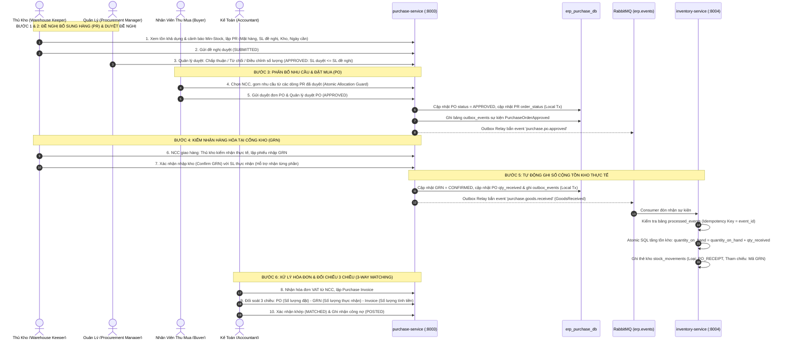

# LỘ TRÌNH PHÁT TRIỂN PURCHASE-SERVICE (C# .NET 10)
## Hệ Thống Quản Lý Đề Nghị Mua Hàng, Đặt Mua, Nhập Kho & Đối Soát Hóa Đơn (SCM Procurement Hub)

> **Mục tiêu**: Xây dựng microservice **`purchase-service`** trên nền tảng **C# .NET 10 Web API** (Port **8003**), quản lý toàn bộ chuỗi cung ứng mua hàng B2B khép kín theo chuẩn ERP quốc tế:  
> **Đề Nghị Mua Hàng (PR)** $\longrightarrow$ **Duyệt Đề Nghị** $\longrightarrow$ **Phân Bổ Nhu Cầu & Đặt Mua (PO)** $\longrightarrow$ **Kiểm Nhận Hàng (GRN)** $\longrightarrow$ **Ghi Sổ Cộng Tồn Kho** $\longrightarrow$ **Đối Soát Hóa Đơn (3-Way Matching)**.  
> Tuân thủ 100% các tiêu chuẩn kiến trúc tại thư mục `docs/` ([AGENTS.md](file:///g:/Do_an_lien_nganh/smart-erp/docs/Ai_rule/AGENTS.md), [architecture.md](file:///g:/Do_an_lien_nganh/smart-erp/docs/Ai_rule/architecture.md), [api-guidelines.md](file:///g:/Do_an_lien_nganh/smart-erp/docs/Ai_rule/api-guidelines.md), [coding-style.md](file:///g:/Do_an_lien_nganh/smart-erp/docs/Ai_rule/coding-style.md), [database-guidelines.md](file:///g:/Do_an_lien_nganh/smart-erp/docs/Ai_rule/database-guidelines.md), [UI_RULES.md](file:///g:/Do_an_lien_nganh/smart-erp/docs/Ai_UI_rule/UI_RULES.md)).

---

## 📑 MỤC LỤC
1. [Tổng Quan Kiến Trúc & Vị Trí Hệ Thống](#1-tổng-quan-kiến-trúc--vị-trí-hệ-thống)
2. [Luồng Nghiệp Vụ Chuẩn 6 Bước (End-to-End Procurement Lifecycle)](#2-luồng-nghiệp-vụ-chuẩn-6-bước-end-to-end-procurement-lifecycle)
3. [Cơ Chế Phân Bổ Nhu Cầu PR Sang PO & Kiểm Soát Tranh Chấp Đồng Thời](#3-cơ-chế-phân-bổ-nhu-cầu-pr-sang-po--kiểm-soát-tranh-chấp-đồng-thời)
4. [Thiết Kế Cơ Sở Dữ Liệu Phân Tán (erp_purchase_db)](#4-thiết-kế-cơ-sở-dữ-liệu-phân-tán-erp_purchase_db)
5. [Cấu Trúc Mã Nguồn Clean Architecture (C# .NET 10)](#5-cấu-trúc-mã-nguồn-clean-architecture-c-net-10)
6. [Đặc Tả Hợp Đồng Sự Kiện (Domain Events & Outbox)](#6-đặc-tả-hợp-đồng-sự-kiện-domain-events--outbox)
7. [Đặc Tả Danh Sách REST API (Gateway :8000 -> :8003)](#7-đặc-tả-danh-sách-rest-api-gateway-8000---8003)
8. [Quy Chuẩn Giao Diện Frontend (Vue 3 + PrimeVue 4)](#8-quy-chuẩn-giao-diện-frontend-vue-3--primevue-4)
9. [Kế Hoạch Triển Khai Chi Tiết Từng Giai Đoạn (Sprint Checklist)](#9-kế-hoạch-triển-khai-chi-tiết-từng-giai-đoạn-sprint-checklist)
10. [Báo Cáo Phân Tích & Xác Nhận Quy Tắc Hệ Thống](#10-báo-cáo-phân-tích--xác-nhận-quy-tắc-hệ-thống)

---

## 1. TỔNG QUAN KIẾN TRÚC & VỊ TRÍ HỆ THỐNG

| Thuộc Tính | Quy Định Chuẩn |
|---|---|
| **Tên Dịch Vụ** | `purchase-service` |
| **Công Nghệ Cốt Lõi** | C# (.NET 10 Web API), C# 13, Entity Framework Core 10 |
| **Cổng Nội Bộ (Internal Port)** | **`8003`** (HTTP Kestrel) |
| **Tuyến Đường Gateway** | `http://localhost:8000/api/v1/purchase/*` |
| **Cơ Sở Dữ Liệu** | MySQL 8.0 — Schema chuẩn: **`erp_purchase_db`** (Đồng nhất tiền tố `erp_*`) |
| **Message Broker** | RabbitMQ Topic Exchange: **`erp.events`** |
| **Kiến Trúc Triển Khai** | Clean Architecture 4 lớp + Transactional Outbox + Atomic Concurrency Guard |
| **Giao Tiếp Frontend** | Vue 3 (Composition API `<script setup>`) + PrimeVue 4 + Tailwind CSS v4 |

---

## 2. LUỒNG NGHIỆP VỤ CHUẨN 6 BƯỚC (END-TO-END PROCUREMENT LIFECYCLE)



---

## 3. CƠ CHẾ PHÂN BỔ NHU CẦU PR SANG PO & KIỂM SOÁT TRANH CHẤP ĐỒNG THỜI

Để giải quyết bài toán nghiệp vụ phức tạp khi chuyển đổi từ **Đề nghị mua (PR)** sang **Đơn mua hàng (PO)**, hệ thống áp dụng bộ 6 quy tắc bất biến (Invariants):

```text
 ┌────────────────────────────────────────────────────────────────────────┐
 │           BỘ 6 QUY TẮC PHÂN BỔ NHU CẦU TỪ PR SANG PO (PR ALLOCATION)    │
 ├────────────────────────────────────────────────────────────────────────┤
 │ 1. Nguồn hợp lệ     : Chỉ phân bổ từ PR có approval_status = 'APPROVED'.│
 │ 2. Giới hạn số lượng: Tổng lượng phân bổ hiệu lực <= quantity_approved.│
 │ 3. Đồng nhất sản phẩm: Dòng PR và dòng PO phải cùng product_id & unit. │
 │ 4. Khớp số lượng PO : Tổng phân bổ các dòng PR = quantity_ordered PO.  │
 │ 5. Cơ chế hoàn trả  : Hủy đơn PO -> Tự động giải phóng phân bổ cho PR. │
 │ 6. Chống đặt trùng  : Khóa nguyên tử (Atomic SQL Guard) chống Race.    │
 └────────────────────────────────────────────────────────────────────────┘
```

### 3.1. Ràng Buộc Nghiệp Vụ Bất Biến

1. **Chỉ phân bổ từ PR đã duyệt, còn hiệu lực**:
   - Dòng PR chỉ được đưa vào đơn PO khi `purchase_requisitions.approval_status = 'APPROVED'`.
   - Số lượng khả dụng để phân bổ của một dòng PR:
     $$\text{AvailableToOrder} = \text{quantity\_approved} - \text{quantity\_ordered} > 0$$
2. **Tổng lượng phân bổ không vượt số lượng duyệt**:
   - Tại mọi thời điểm: $\text{quantity\_ordered} \le \text{quantity\_approved} \le \text{quantity\_requested}$.
3. **Đồng nhất sản phẩm & đơn vị tính**:
   - Dòng PO phải có cùng `product_id` và cùng `unit` (chuỗi chuẩn hóa từ Catalog: `'Cái'`, `'Bộ'`, `'Hộp'`) với dòng PR nguồn.
4. **Khớp số lượng dòng PO hoàn toàn từ PR**:
   - Nếu dòng PO được tạo từ việc gom nhu cầu PR:
     $$\text{purchase\_order\_items.quantity\_ordered} = \sum \text{allocated\_quantity}$$
5. **Giải phóng phân bổ khi Hủy PO (Release Allocation)**:
   - Khi đơn PO bị Hủy (`CANCELLED`):
     - Bản ghi trong bảng `purchase_order_pr_allocations` chuyển trạng thái `status = 'RELEASED'`.
     - Hoàn trả lại số lượng cho dòng PR:
       $$\text{quantity\_ordered}_{\text{new}} = \text{quantity\_ordered}_{\text{old}} - \text{allocated\_quantity}$$
     - Đánh giá lại trạng thái đặt mua của PR (`order_status`): Nếu chưa có dòng nào khác đặt mua $\rightarrow$ đưa về `NOT_ORDERED`, nếu còn một phần $\rightarrow$ `PARTIALLY_ORDERED`.
     - Nhu cầu PR này ngay lập tức có thể được nhân viên thu mua khác sử dụng để lập PO mới.

### 3.2. Kiểm Soát Tranh Chấp Đồng Thời Bằng Atomic SQL Guard

Khi hai nhân viên thu mua (Buyer A và Buyer B) cùng mở danh sách nhu cầu PR trên màn hình và đồng thời bấm tạo đơn PO gom cùng một dòng PR:

```sql
-- ATOMIC ALLOCATION GUARD (Chống đặt trùng số lượng PR giữa 2 nhân viên)
UPDATE purchase_requisition_items 
SET quantity_ordered = quantity_ordered + :requested_allocation_qty,
    updated_at = UTC_TIMESTAMP()
WHERE id = :pr_item_id 
  AND (quantity_approved - quantity_ordered) >= :requested_allocation_qty;
```

* **Xử lý kết quả**:
  * Nếu số dòng bị ảnh hưởng = 1: Cập nhật thành công, tiếp tục tạo bản ghi `purchase_order_pr_allocations`.
  * Nếu số dòng bị ảnh hưởng = 0: Lập tức Rollback Transaction và báo lỗi nghiệp vụ:
    `PR_QUANTITY_EXCEEDED` hoặc `CONCURRENT_CONFLICT` (*"Số lượng nhu cầu còn lại của mặt hàng này không đủ hoặc vừa được nhân viên khác tạo đơn"*).

---

## 4. THIẾT KẾ CƠ SỞ DỮ LIỆU PHÂN TÁN (`erp_purchase_db`)

Tuân thủ nguyên tắc **Database-per-Service** ([database-guidelines.md](file:///g:/Do_an_lien_nganh/smart-erp/docs/Ai_rule/database-guidelines.md)):
* Database name: **`erp_purchase_db`** (Khớp với file khởi tạo [01-create-databases.sql](file:///g:/Do_an_lien_nganh/smart-erp/infrastructure/mysql/init/01-create-databases.sql)).
* Không tạo `FOREIGN KEY` sang cơ sở dữ liệu khác; liên kết qua ID nguyên thủy.
* **Data Snapshotting**: Lưu cứng `sku`, `product_name`, `unit`, `unit_cost` tại thời điểm tạo chứng từ.

```sql
-- =========================================================================
-- DATABASE: erp_purchase_db (Schema Thu Mua & Nhập Kho Chuỗi Cung Ứng)
-- =========================================================================

-- 1. BẢNG ĐỀ NGHỊ BỔ SUNG HÀNG (PURCHASE REQUISITIONS - PR)
CREATE TABLE purchase_requisitions (
    id BIGINT AUTO_INCREMENT PRIMARY KEY,
    code VARCHAR(50) NOT NULL UNIQUE,                       -- Ví dụ: PR-202610-0001
    warehouse_id BIGINT NOT NULL,                           -- Kho yêu cầu nhận hàng (ID logic)
    requested_by BIGINT NOT NULL,                           -- Thủ kho / Nhân viên đề xuất
    request_date DATE NOT NULL,                             -- Ngày lập phiếu
    expected_needed_date DATE NOT NULL,                     -- Ngày cần hàng có mặt tại kho
    priority VARCHAR(20) NOT NULL DEFAULT 'MEDIUM',         -- LOW, MEDIUM, HIGH, URGENT
    reason TEXT NULL,                                       -- Lý do (Dưới ngưỡng tồn an toàn, Phục vụ dự án)
    notes TEXT NULL,
    
    -- Tách bạch 2 luồng trạng thái độc lập
    approval_status VARCHAR(30) NOT NULL DEFAULT 'DRAFT',   -- DRAFT, SUBMITTED, APPROVED, REJECTED, CANCELLED
    order_status VARCHAR(30) NOT NULL DEFAULT 'NOT_ORDERED',-- NOT_ORDERED, PARTIALLY_ORDERED, FULLY_ORDERED
    
    approved_by BIGINT NULL,
    approved_at TIMESTAMP NULL,
    rejected_reason TEXT NULL,
    version INT NOT NULL DEFAULT 1,
    created_at TIMESTAMP DEFAULT CURRENT_TIMESTAMP,
    updated_at TIMESTAMP DEFAULT CURRENT_TIMESTAMP ON UPDATE CURRENT_TIMESTAMP,

    INDEX idx_pr_warehouse (warehouse_id),
    INDEX idx_pr_approval_status (approval_status),
    INDEX idx_pr_order_status (order_status),
    INDEX idx_pr_needed_date (expected_needed_date)
);

-- 2. BẢNG DÒNG ĐỀ NGHỊ BỔ SUNG HÀNG (PURCHASE REQUISITION ITEMS)
CREATE TABLE purchase_requisition_items (
    id BIGINT AUTO_INCREMENT PRIMARY KEY,
    purchase_requisition_id BIGINT NOT NULL,
    product_id BIGINT NOT NULL,                             -- ID logic từ Catalog Service
    
    -- Snapshot định danh sản phẩm & đơn vị tính
    sku VARCHAR(100) NOT NULL,
    product_name VARCHAR(255) NOT NULL,
    unit VARCHAR(50) NOT NULL DEFAULT 'Cái',                -- Đơn vị chuẩn từ Catalog: Cái, Hộp, Bộ, Mét, Kg...
    
    quantity_requested INT NOT NULL,                        -- Số lượng đề nghị (>= 1)
    quantity_approved INT NOT NULL DEFAULT 0,               -- Số lượng được quản lý duyệt (có thể điều chỉnh giảm)
    quantity_ordered INT NOT NULL DEFAULT 0,                -- Lũy kế số lượng đã lên đơn PO
    estimated_unit_cost DECIMAL(15,2) NULL,                 -- Giá dự kiến (tham khảo từ giá vốn gần nhất)
    notes VARCHAR(255) NULL,

    CONSTRAINT fk_pri_requisition FOREIGN KEY (purchase_requisition_id) REFERENCES purchase_requisitions(id) ON DELETE CASCADE,
    CONSTRAINT chk_pri_qty_requested CHECK (quantity_requested > 0),
    CONSTRAINT chk_pri_qty_approved CHECK (quantity_approved >= 0),
    CONSTRAINT chk_pri_qty_ordered CHECK (quantity_ordered >= 0),
    CONSTRAINT chk_pri_ordered_not_exceed_approved CHECK (quantity_ordered <= quantity_approved)
);

-- 3. BẢNG ĐƠN MUA HÀNG (PURCHASE ORDERS - PO)
CREATE TABLE purchase_orders (
    id BIGINT AUTO_INCREMENT PRIMARY KEY,
    code VARCHAR(50) NOT NULL UNIQUE,                       -- Ví dụ: PO-202610-0001
    supplier_id BIGINT NOT NULL,                            -- ID logic nhà cung cấp từ Catalog Service
    warehouse_id BIGINT NOT NULL,                           -- Kho nhận hàng
    status VARCHAR(30) NOT NULL DEFAULT 'DRAFT',            -- DRAFT, PENDING_APPROVAL, APPROVED, PARTIALLY_RECEIVED, COMPLETED, CANCELLED
    order_date DATE NOT NULL,                               -- Ngày ký đơn
    expected_delivery_date DATE NULL,                       -- Hạn NCC cam kết giao hàng
    currency VARCHAR(10) NOT NULL DEFAULT 'VND',
    subtotal_amount DECIMAL(15,2) NOT NULL DEFAULT 0.00,    -- Tiền hàng trước thuế
    tax_amount DECIMAL(15,2) NOT NULL DEFAULT 0.00,         -- Thuế VAT
    discount_amount DECIMAL(15,2) NOT NULL DEFAULT 0.00,    -- Tiền chiết khấu
    grand_total DECIMAL(15,2) NOT NULL DEFAULT 0.00,        -- Tổng thanh toán
    payment_terms VARCHAR(100) NULL,                        -- Điều khoản thanh toán (COD, Net 30...)
    notes TEXT NULL,
    created_by BIGINT NOT NULL,
    approved_by BIGINT NULL,
    approved_at TIMESTAMP NULL,
    version INT NOT NULL DEFAULT 1,
    created_at TIMESTAMP DEFAULT CURRENT_TIMESTAMP,
    updated_at TIMESTAMP DEFAULT CURRENT_TIMESTAMP ON UPDATE CURRENT_TIMESTAMP,

    INDEX idx_po_supplier (supplier_id),
    INDEX idx_po_warehouse (warehouse_id),
    INDEX idx_po_status (status),
    INDEX idx_po_order_date (order_date)
);

-- 4. BẢNG DÒNG HÀNG ĐƠN MUA (PURCHASE ORDER ITEMS) - DATA SNAPSHOTTING
CREATE TABLE purchase_order_items (
    id BIGINT AUTO_INCREMENT PRIMARY KEY,
    purchase_order_id BIGINT NOT NULL,
    product_id BIGINT NOT NULL,
    
    -- DATA SNAPSHOTTING
    sku VARCHAR(100) NOT NULL,
    product_name VARCHAR(255) NOT NULL,
    unit VARCHAR(50) NOT NULL DEFAULT 'Cái',
    unit_cost DECIMAL(15,2) NOT NULL,                       -- Giá mua thỏa thuận với NCC
    
    quantity_ordered INT NOT NULL,                          -- Số lượng đặt mua
    quantity_received INT NOT NULL DEFAULT 0,               -- Lũy kế đã kiểm nhận thực tế
    quantity_invoiced INT NOT NULL DEFAULT 0,               -- Lũy kế đã lên hóa đơn
    tax_rate DECIMAL(5,2) NOT NULL DEFAULT 10.00,           -- % Thuế VAT
    discount_percent DECIMAL(5,2) NOT NULL DEFAULT 0.00,
    subtotal DECIMAL(15,2) NOT NULL,
    notes VARCHAR(255) NULL,

    CONSTRAINT fk_poi_order FOREIGN KEY (purchase_order_id) REFERENCES purchase_orders(id) ON DELETE CASCADE,
    CONSTRAINT chk_poi_qty_ordered CHECK (quantity_ordered > 0),
    CONSTRAINT chk_poi_qty_received CHECK (quantity_received >= 0)
);

-- 5. BẢNG PHÂN BỔ NHU CẦU TỪ PR SANG PO (PURCHASE ORDER PR ALLOCATIONS)
-- Bảng trung gian theo dõi phân bổ nhu cầu, chống đặt trùng & giải phóng khi hủy PO
CREATE TABLE purchase_order_pr_allocations (
    id BIGINT AUTO_INCREMENT PRIMARY KEY,
    purchase_order_id BIGINT NOT NULL,
    purchase_order_item_id BIGINT NOT NULL,
    purchase_requisition_id BIGINT NOT NULL,
    purchase_requisition_item_id BIGINT NOT NULL,
    allocated_quantity INT NOT NULL,                        -- Số lượng nhu cầu được phân bổ sang dòng PO này
    status VARCHAR(30) NOT NULL DEFAULT 'ACTIVE',           -- ACTIVE, RELEASED (khi hủy PO)
    created_at TIMESTAMP DEFAULT CURRENT_TIMESTAMP,
    updated_at TIMESTAMP DEFAULT CURRENT_TIMESTAMP ON UPDATE CURRENT_TIMESTAMP,

    CONSTRAINT fk_popa_po FOREIGN KEY (purchase_order_id) REFERENCES purchase_orders(id) ON DELETE CASCADE,
    CONSTRAINT fk_popa_poi FOREIGN KEY (purchase_order_item_id) REFERENCES purchase_order_items(id) ON DELETE CASCADE,
    CONSTRAINT fk_popa_pr FOREIGN KEY (purchase_requisition_id) REFERENCES purchase_requisitions(id) ON DELETE RESTRICT,
    CONSTRAINT fk_popa_pri FOREIGN KEY (purchase_requisition_item_id) REFERENCES purchase_requisition_items(id) ON DELETE RESTRICT,
    CONSTRAINT chk_popa_alloc_qty CHECK (allocated_quantity > 0),
    INDEX idx_popa_pri_status (purchase_requisition_item_id, status)
);

-- 6. BẢNG PHIẾU NHẬP KHO (GOODS RECEIPTS / GRN)
CREATE TABLE goods_receipts (
    id BIGINT AUTO_INCREMENT PRIMARY KEY,
    code VARCHAR(50) NOT NULL UNIQUE,                       -- Ví dụ: GR-202610-0001
    purchase_order_id BIGINT NOT NULL,                      -- Tham chiếu PO bắt buộc
    warehouse_id BIGINT NOT NULL,                           -- Kho thực nhận
    received_by BIGINT NOT NULL,                            -- Thủ kho tiếp nhận
    received_at TIMESTAMP NOT NULL,                         -- Thời điểm kiểm nhận thực tế
    delivery_note_number VARCHAR(100) NULL,                 -- Số phiếu giao hàng / vận đơn của NCC
    status VARCHAR(30) NOT NULL DEFAULT 'DRAFT',            -- DRAFT, CONFIRMED, REJECTED
    inventory_sync_status VARCHAR(30) NOT NULL DEFAULT 'PENDING_SYNC', -- PENDING_SYNC, SYNCED, FAILED
    notes TEXT NULL,
    version INT NOT NULL DEFAULT 1,
    created_at TIMESTAMP DEFAULT CURRENT_TIMESTAMP,
    updated_at TIMESTAMP DEFAULT CURRENT_TIMESTAMP ON UPDATE CURRENT_TIMESTAMP,

    CONSTRAINT fk_gr_order FOREIGN KEY (purchase_order_id) REFERENCES purchase_orders(id) ON DELETE RESTRICT,
    INDEX idx_gr_warehouse (warehouse_id),
    INDEX idx_gr_received_at (received_at),
    INDEX idx_gr_status (status)
);

-- 7. BẢNG DÒNG PHIẾU NHẬP KHO (GOODS RECEIPT ITEMS)
CREATE TABLE goods_receipt_items (
    id BIGINT AUTO_INCREMENT PRIMARY KEY,
    goods_receipt_id BIGINT NOT NULL,
    purchase_order_item_id BIGINT NOT NULL,
    product_id BIGINT NOT NULL,
    sku VARCHAR(100) NOT NULL,
    product_name VARCHAR(255) NOT NULL,
    unit VARCHAR(50) NOT NULL DEFAULT 'Cái',
    quantity_ordered INT NOT NULL,                          -- Số lượng theo PO
    quantity_received INT NOT NULL,                         -- Số lượng thực nhận đạt chuẩn (>= 0)
    quantity_rejected INT NOT NULL DEFAULT 0,               -- Số lượng hàng lỗi / trả về NCC
    unit_cost DECIMAL(15,2) NOT NULL,
    batch_number VARCHAR(100) NULL,                         -- Số lô sản xuất (nếu có)
    expiry_date DATE NULL,                                  -- Hạn sử dụng (nếu có)
    notes VARCHAR(255) NULL,

    CONSTRAINT fk_gri_receipt FOREIGN KEY (goods_receipt_id) REFERENCES goods_receipts(id) ON DELETE CASCADE,
    CONSTRAINT fk_gri_poi FOREIGN KEY (purchase_order_item_id) REFERENCES purchase_order_items(id) ON DELETE RESTRICT,
    CONSTRAINT chk_gri_qty_received CHECK (quantity_received >= 0)
);

-- 8. BẢNG CHỨNG TỪ MUA HÀNG / HÓA ĐƠN TÀI CHÍNH (PURCHASE INVOICES)
CREATE TABLE purchase_invoices (
    id BIGINT AUTO_INCREMENT PRIMARY KEY,
    code VARCHAR(50) NOT NULL UNIQUE,                       -- Ví dụ: PINV-202610-0001
    purchase_order_id BIGINT NOT NULL,                      -- Tham chiếu PO gốc
    goods_receipt_id BIGINT NULL,                           -- Tham chiếu GRN đối soát
    supplier_id BIGINT NOT NULL,                            -- ID logic
    supplier_invoice_number VARCHAR(100) NOT NULL,          -- Số hóa đơn VAT gốc từ NCC
    invoice_date DATE NOT NULL,                             -- Ngày trên hóa đơn VAT
    due_date DATE NULL,                                     -- Hạn thanh toán
    subtotal_amount DECIMAL(15,2) NOT NULL DEFAULT 0.00,
    tax_amount DECIMAL(15,2) NOT NULL DEFAULT 0.00,
    grand_total DECIMAL(15,2) NOT NULL DEFAULT 0.00,
    status VARCHAR(30) NOT NULL DEFAULT 'DRAFT',            -- DRAFT, POSTED, PAID, CANCELLED
    matching_status VARCHAR(30) NOT NULL DEFAULT 'UNMATCHED',-- UNMATCHED, MATCHED, DISCREPANCY (Đối soát 3 chiều)
    notes TEXT NULL,
    created_at TIMESTAMP DEFAULT CURRENT_TIMESTAMP,
    updated_at TIMESTAMP DEFAULT CURRENT_TIMESTAMP ON UPDATE CURRENT_TIMESTAMP,

    CONSTRAINT fk_pi_po FOREIGN KEY (purchase_order_id) REFERENCES purchase_orders(id) ON DELETE RESTRICT,
    CONSTRAINT fk_pi_gr FOREIGN KEY (goods_receipt_id) REFERENCES goods_receipts(id) ON DELETE SET NULL,
    INDEX idx_pi_supplier_inv (supplier_invoice_number),
    INDEX idx_pi_status (status)
);

-- 9. BẢNG DÒNG HÓA ĐƠN MUA HÀNG & ĐỐI CHIẾU 3 CHIỀU (PURCHASE INVOICE ITEMS)
CREATE TABLE purchase_invoice_items (
    id BIGINT AUTO_INCREMENT PRIMARY KEY,
    purchase_invoice_id BIGINT NOT NULL,
    purchase_order_item_id BIGINT NOT NULL,
    goods_receipt_item_id BIGINT NULL,                      -- Khớp trực tiếp dòng thực nhận
    product_id BIGINT NOT NULL,
    sku VARCHAR(100) NOT NULL,
    product_name VARCHAR(255) NOT NULL,
    unit VARCHAR(50) NOT NULL DEFAULT 'Cái',
    quantity_invoiced INT NOT NULL,                         -- Số lượng ghi trên hóa đơn VAT
    unit_cost DECIMAL(15,2) NOT NULL,
    tax_rate DECIMAL(5,2) NOT NULL DEFAULT 10.00,
    subtotal DECIMAL(15,2) NOT NULL,
    matching_status VARCHAR(30) NOT NULL DEFAULT 'MATCHED', -- MATCHED, PRICE_DIFF, QTY_DIFF

    CONSTRAINT fk_pii_invoice FOREIGN KEY (purchase_invoice_id) REFERENCES purchase_invoices(id) ON DELETE CASCADE,
    CONSTRAINT fk_pii_poi FOREIGN KEY (purchase_order_item_id) REFERENCES purchase_order_items(id) ON DELETE RESTRICT,
    CONSTRAINT fk_pii_gri FOREIGN KEY (goods_receipt_item_id) REFERENCES goods_receipt_items(id) ON DELETE SET NULL
);

-- 10. BẢNG TRANSACTIONAL OUTBOX (outbox_events)
CREATE TABLE outbox_events (
    id BIGINT AUTO_INCREMENT PRIMARY KEY,
    event_id VARCHAR(100) NOT NULL UNIQUE,
    event_type VARCHAR(100) NOT NULL,
    aggregate_type VARCHAR(100) NOT NULL,
    aggregate_id VARCHAR(100) NOT NULL,
    routing_key VARCHAR(150) NOT NULL,
    payload LONGTEXT NOT NULL,
    status VARCHAR(30) NOT NULL DEFAULT 'PENDING',          -- PENDING, PUBLISHED, FAILED
    retry_count INT NOT NULL DEFAULT 0,
    last_error TEXT NULL,
    published_at TIMESTAMP NULL,
    created_at TIMESTAMP DEFAULT CURRENT_TIMESTAMP,

    INDEX idx_status_created (status, created_at)
);

-- 11. BẢNG CHỐNG TRÙNG LẶP SỰ KIỆN (processed_events)
CREATE TABLE processed_events (
    event_id VARCHAR(100) NOT NULL,
    consumer_name VARCHAR(100) NOT NULL,
    processed_at TIMESTAMP DEFAULT CURRENT_TIMESTAMP,

    PRIMARY KEY (event_id, consumer_name)
);
```

---

## 5. CẤU TRÚC MÃ NGUỒN CLEAN ARCHITECTURE (C# .NET 10)

Mã nguồn đặt tại `services/purchase-service/`:

```text
services/purchase-service/
├── PurchaseService.slnx
├── src/
│   ├── Purchase.Domain/                                    # Lớp 1: Core Domain Entities & Rules
│   │   ├── Entities/
│   │   │   ├── PurchaseRequisition.cs                      # Aggregate Root đề nghị mua hàng
│   │   │   ├── PurchaseRequisitionItem.cs
│   │   │   ├── PurchaseOrder.cs                            # Aggregate Root đơn mua hàng
│   │   │   ├── PurchaseOrderItem.cs
│   │   │   ├── PurchaseOrderPrAllocation.cs                # Quản lý phân bổ nhu cầu PR sang PO
│   │   │   ├── GoodsReceipt.cs                             # Phiếu kiểm nhận nhập kho
│   │   │   ├── GoodsReceiptItem.cs
│   │   │   ├── PurchaseInvoice.cs                          # Hóa đơn tài chính mua hàng
│   │   │   ├── PurchaseInvoiceItem.cs
│   │   │   └── OutboxEvent.cs
│   │   ├── Enums/
│   │   │   ├── RequisitionApprovalStatus.cs                # DRAFT, SUBMITTED, APPROVED, REJECTED
│   │   │   ├── RequisitionOrderStatus.cs                   # NOT_ORDERED, PARTIALLY_ORDERED, FULLY_ORDERED
│   │   │   ├── RequisitionPriority.cs                      # LOW, MEDIUM, HIGH, URGENT
│   │   │   ├── PurchaseOrderStatus.cs
│   │   │   ├── GoodsReceiptStatus.cs
│   │   │   └── ThreeWayMatchingStatus.cs                   # UNMATCHED, MATCHED, DISCREPANCY
│   │   └── Exceptions/
│   │       ├── InvalidRequisitionQuantityException.cs      # Lỗi khi SL duyệt > SL đề xuất hoặc SL mua > SL duyệt
│   │       ├── PrQuantityExceededException.cs              # Lỗi khi Atomic Allocation Guard phát hiện vượt hạn mức
│   │       └── OverReceiptNotAllowedException.cs           # Lỗi khi nhận vượt SL đặt mua
│   │
│   ├── Purchase.Application/                                 # Lớp 2: Use Cases & Business Handlers
│   │   ├── Common/
│   │   │   ├── Models/ApiEnvelope.cs                       # Chuẩn { success, data, error, meta }
│   │   │   └── Events/CloudEventEnvelope.cs                # Chuẩn Event Wire Format
│   │   ├── DTOs/
│   │   │   ├── Requisitions/                               # CreatePRDto, ApprovePRDto, PRResponseDto
│   │   │   ├── PurchaseOrders/                             # CreatePODto, ConvertPRToPODto, CancelPODto
│   │   │   ├── GoodsReceipts/                              # ConfirmReceiptDto, GRDetailDto
│   │   │   └── Invoices/                                   # CreateInvoiceDto, MatchingResultDto
│   │   ├── Interfaces/
│   │   │   ├── IPurchaseDbContext.cs
│   │   │   └── IOutboxPublisher.cs
│   │   └── Services/
│   │       ├── PurchaseRequisitionService.cs               # Nghiệp vụ lập & duyệt PR, theo dõi SL
│   │       ├── PurchaseOrderService.cs                     # Lập PO gom từ PR (Atomic Guard), Hủy PO & giải phóng
│   │       ├── GoodsReceiptService.cs                      # Xác nhận nhập kho, ghi Outbox GoodsReceived
│   │       └── ThreeWayMatchingService.cs                  # Đối chiếu tự động PO - GRN - Invoice
│   │
│   ├── Purchase.Infrastructure/                              # Lớp 3: EF Core, RabbitMQ, Background Workers
│   │   ├── Persistence/
│   │   │   ├── PurchaseDbContext.cs                        # EF Core DbContext với MySQL Pomelo
│   │   │   └── Configurations/                             # Fluent API Mapping & Check Constraints
│   │   ├── Messaging/
│   │   │   ├── RabbitMqPublisher.cs                        # Gửi AMQP tới exchange erp.events
│   │   │   └── OutboxRelayBackgroundService.cs             # Background worker quét outbox_events định kỳ
│   │   └── Services/
│   │       └── SystemClock.cs                              # Cung cấp DateTime.UtcNow
│   │
│   └── Purchase.Api/                                         # Lớp 4: Controllers & Entry Point
│       ├── Controllers/
│       │   ├── PurchaseRequisitionsController.cs           # REST /api/v1/purchase/requisitions
│       │   ├── PurchaseOrdersController.cs                 # REST /api/v1/purchase/orders
│       │   ├── GoodsReceiptsController.cs                  # REST /api/v1/purchase/receipts
│       │   └── PurchaseInvoicesController.cs               # REST /api/v1/purchase/invoices
│       ├── Middlewares/
│       │   ├── CorrelationIdMiddleware.cs                  # Trích xuất / sinh X-Correlation-ID
│       │   └── GlobalExceptionFilter.cs                    # Bắt lỗi -> Chuẩn API Envelope Error
│       ├── appsettings.json
│       └── Program.cs                                      # Khởi tạo DI, Kestrel Port 8003, SnakeCaseLower
│
└── tests/
    └── Purchase.Domain.Tests/                              # Unit test logic phân bổ PR, hủy PO & 3-way matching
```

---

## 6. ĐẶC TẢ HỢP ĐỒNG SỰ KIỆN (DOMAIN EVENTS & OUTBOX)

Định dạng Message bắn lên RabbitMQ Topic Exchange `erp.events` tuân thủ [events-spec.md](file:///g:/Do_an_lien_nganh/smart-erp/docs/contracts/events-spec.md):

### 6.1. Event 1: `PurchaseOrderApproved`
* **Routing Key**: `purchase.po.approved`
* **Thời điểm kích hoạt**: Khi Quản lý nhấn "Phê Duyệt Đơn Mua Hàng".
* **Consumer**: `inventory-service` (lên kế hoạch dự kiến nhập hàng), `eoffice-service`.
* **Payload**:
```json
{
  "event_id": "evt_01J8ABCXYZ1234567890",
  "event_type": "PurchaseOrderApproved",
  "aggregate_type": "PurchaseOrder",
  "aggregate_id": "PO-202610-0001",
  "timestamp": "2026-10-01T14:00:00.000Z",
  "version": "1.0",
  "correlation_id": "req_corr_987654321",
  "producer": "purchase-service",
  "payload": {
    "po_id": "PO-202610-0001",
    "supplier_id": 302,
    "warehouse_id": 1,
    "approved_by": 12,
    "approved_at": "2026-10-01T14:00:00.000Z",
    "items": [
      {
        "product_id": 201,
        "warehouse_id": 1,
        "quantity_expected": 80,
        "unit_cost": 120000.0
      }
    ]
  }
}
```

### 6.2. Event 2: `GoodsReceived` (Sự kiện quyết định ghi sổ kho)
* **Routing Key**: `purchase.goods.received`
* **Thời điểm kích hoạt**: Khi Thủ kho nhấn "Xác Nhận Phiếu Nhập Kho (Confirm Goods Receipt)".
* **Consumer**: `inventory-service` (đã có sẵn [EventPayloads.cs](file:///g:/Do_an_lien_nganh/smart-erp/services/inventory-service/src/Inventory.Application/Common/Events/EventPayloads.cs#L55-L84)).
* **Hành vi xử lý phía Inventory**:
  1. Kiểm tra chống trùng `processed_events`.
  2. Tăng tồn kho vật lý nguyên tử: `quantity_on_hand = quantity_on_hand + quantity_received`.
  3. Ghi thẻ kho `stock_movements` (MovementType: `PO_RECEIPT`).
* **Payload (Khớp chính xác đợt giao thực tế)**:
```json
{
  "event_id": "evt_01J8DEFXYZ9876543210",
  "event_type": "GoodsReceived",
  "aggregate_type": "GoodsReceipt",
  "aggregate_id": "GR-202610-0001",
  "timestamp": "2026-10-01T15:30:00.000Z",
  "version": "1.0",
  "correlation_id": "req_corr_987654321",
  "producer": "purchase-service",
  "payload": {
    "receipt_id": "GR-202610-0001",
    "po_id": "PO-202610-0001",
    "warehouse_id": 1,
    "received_by": 15,
    "received_at": "2026-10-01T15:30:00.000Z",
    "items": [
      {
        "product_id": 201,
        "quantity_received": 50
      }
    ]
  }
}
```

---

## 7. ĐẶC TẢ DANH SÁCH REST API (GATEWAY :8000 -> :8003)

Mọi API phản hồi theo chuẩn Envelope:  
`{ "success": true/false, "data": ..., "error": ..., "meta": { "correlation_id", "timestamp", "pagination" } }`

| Nhóm Nghiệp Vụ | Method | Endpoint Tuyến Đường | Mô Tả & Tác Động |
|---|---|---|---|
| **Đề Nghị Bổ Sung (PR)** | `GET` | `/api/v1/purchase/requisitions` | Danh sách PR (lọc theo kho, trạng thái duyệt, trạng thái đặt mua) |
| | `POST` | `/api/v1/purchase/requisitions` | Tạo phiếu PR mới (Thủ kho lập từ màn hình Kho hoặc Thu mua) |
| | `GET` | `/api/v1/purchase/requisitions/{id}` | Chi tiết PR kèm danh sách mặt hàng đề xuất |
| | `POST` | `/api/v1/purchase/requisitions/{id}/submit` | Gửi đề nghị sang chờ duyệt (`SUBMITTED`) |
| | `POST` | `/api/v1/purchase/requisitions/{id}/approve` | **Duyệt PR**: Chấp thuận và điều chỉnh số lượng `quantity_approved` |
| | `POST` | `/api/v1/purchase/requisitions/{id}/reject` | Từ chối duyệt PR kèm lý do |
| | `GET` | `/api/v1/purchase/requisitions/approved-items` | Lấy danh sách các dòng PR đã duyệt còn khả dụng để lên đơn PO |
| **Đơn Mua Hàng (PO)** | `GET` | `/api/v1/purchase/orders` | Danh sách PO (phân trang, lọc theo trạng thái, NCC, ngày) |
| | `POST` | `/api/v1/purchase/orders` | Tạo PO mới gom từ các dòng PR đã duyệt (Áp dụng **Atomic Allocation Guard**) |
| | `GET` | `/api/v1/purchase/orders/{id}` | Lấy chi tiết đơn mua hàng kèm danh sách phân bổ PR |
| | `POST` | `/api/v1/purchase/orders/{id}/submit` | Gửi đơn PO chờ phê duyệt (`PENDING_APPROVAL`) |
| | `POST` | `/api/v1/purchase/orders/{id}/approve` | **Duyệt PO** $\rightarrow$ status `APPROVED` + ghi Outbox `PurchaseOrderApproved` |
| | `POST` | `/api/v1/purchase/orders/{id}/cancel` | **Hủy đơn PO** $\rightarrow$ status `CANCELLED` + **giải phóng số lượng phân bổ PR** |
| **Kiểm Nhận Hàng (GRN)** | `GET` | `/api/v1/purchase/receipts` | Danh sách phiếu nhập kho (GRN) |
| | `POST` | `/api/v1/purchase/receipts` | Tạo phiếu nhập kho theo PO (nhập toàn bộ hoặc một phần) |
| | `GET` | `/api/v1/purchase/receipts/{id}` | Chi tiết phiếu kiểm nhận kho |
| | `POST` | `/api/v1/purchase/receipts/{id}/confirm` | **Xác nhận Nhập kho** $\rightarrow$ Cập nhật PO + ghi Outbox `GoodsReceived` |
| **Hóa Đơn & Đối Soát** | `GET` | `/api/v1/purchase/invoices` | Danh sách hóa đơn mua hàng / chứng từ tài chính |
| | `POST` | `/api/v1/purchase/invoices` | Nhập hóa đơn VAT NCC và thực hiện đối chiếu 3 chiều tự động |
| | `POST` | `/api/v1/purchase/invoices/{id}/post` | Ghi nhận công nợ kế toán (`POSTED`) |

---

## 8. QUY CHUẨN GIAO DIỆN FRONTEND (VUE 3 + PRIMEVUE 4)

Tuân thủ nghiêm ngặt quy định tại [UI_RULES.md](file:///g:/Do_an_lien_nganh/smart-erp/docs/Ai_UI_rule/UI_RULES.md):
* **Bố cục**: Clean Flat White Canvas, bo góc chuẩn **`6px`** (`rounded-[6px]`), viền mỏng hairline `1px solid #E2E8F0` (`border-slate-200`). Cấm Gradient và cấm Glassmorphism.
* **Màu sắc**: Slate & Sky-600 (`#0284C7`), nền `bg-slate-50`, thẻ card `bg-white`.

### 8.1. Phân Định Rõ Ràng 2 Component Bảng Dữ Liệu

| Mục Đích Giao Diện | Component Bắt Buộc | Tệp Nguồn / Đường Dẫn | Màn Hình Áp Dụng |
|---|---|---|---|
| **Trang Danh Sách (Listing / Index)** | **`CommonDataTable.vue`** | `src/components/common/CommonDataTable.vue` | 1. `/purchase/requisitions` (Danh sách Đề nghị mua hàng PR)<br>2. `/purchase/orders` (Danh sách Đơn mua hàng PO)<br>3. `/purchase/receipts` (Danh sách Phiếu nhập kho GRN)<br>4. `/purchase/invoices` (Danh sách Hóa đơn đối soát) |
| **Trang Biểu Mẫu (Document Form)** | **`ItemDataTable.vue`** | `src/components/common/ItemDataTable.vue` | 1. `/purchase/requisitions/create` (Form lập PR: Catalog search, số lượng đề nghị, đơn vị tính chuẩn)<br>2. `/purchase/orders/create` (Form lập PO: Chọn từ PR đã duyệt, giá mua, chiết khấu, VAT, banner tổng tiền)<br>3. `/purchase/receipts/create` (Form kiểm đếm hàng: SL đặt, SL thực nhận đợt này)<br>4. `/purchase/invoices/create` (Form đối soát 3 chiều PO - GRN - Invoice) |

### 8.2. Modal Gom Nhu Cầu PR Khi Lập Đơn Mua Hàng (PO Form)
* Trong form lập đơn mua hàng (`/purchase/orders/create`):
  * Bên cạnh nút `[Thêm sản phẩm]`, có thêm nút nổi bật: `[+ Gom Nhu Cầu Từ PR Đã Duyệt]`.
  * Nhấn vào sẽ hiển thị Modal tra cứu các dòng PR có `approval_status = 'APPROVED'` và `quantity_ordered < quantity_approved`.
  * Cho phép chọn nhiều dòng PR thuộc cùng một Nhà cung cấp (hoặc lọc theo Nhà cung cấp đề xuất).
  * Khi bấm "Đưa vào đơn hàng", hệ thống tự động đổ dữ liệu vào **`ItemDataTable.vue`** với số lượng mặc định là số lượng còn lại chưa đặt mua.

---

## 9. KẾ HOẠCH TRIỂN KHAI CHI TIẾT TỪNG GIAI ĐOẠN (SPRINT CHECKLIST)

### Pha 1: Khởi Tạo Dự Án C# .NET 10 & Cấu Hình Môi Trường
- [x] Khởi tạo thư mục `services/purchase-service` với solution file `PurchaseService.slnx`.
- [x] Tạo 4 project Clean Architecture: `Purchase.Domain`, `Purchase.Application`, `Purchase.Infrastructure`, `Purchase.Api`.
- [x] Cài đặt các NuGet Packages: `Pomelo.EntityFrameworkCore.MySql`, `RabbitMQ.Client`, `Microsoft.EntityFrameworkCore.Design`, `Dapper`, `Swashbuckle.AspNetCore`.
- [x] Cấu hình Kestrel Port `8003` và định dạng JSON `JsonNamingPolicy.SnakeCaseLower`.
- [x] Tích hợp Middlewares: `CorrelationIdMiddleware`, `GlobalExceptionHandlingMiddleware`, chuẩn Envelope `ApiEnvelope`.
- [x] Cập nhật tệp khởi động `start_dev.bat` và `start_dev.ps1` để chạy song song 6 services (:8001 -> :8005 và frontend).

### Pha 2: Thiết Kế Entity Framework Core & Migration Database `erp_purchase_db`
- [x] Định nghĩa 9 Entities cốt lõi:
  - `PurchaseRequisition`, `PurchaseRequisitionItem`
  - `PurchaseOrder`, `PurchaseOrderItem`
  - `PurchaseOrderPrAllocation` (quản lý phân bổ nhu cầu)
  - `GoodsReceipt`, `GoodsReceiptItem`
  - `PurchaseInvoice`, `PurchaseInvoiceItem`
  - `OutboxEvent`, `ProcessedEvent`
- [x] Cấu hình Fluent API:
  - Snapshotting (`sku`, `product_name`, `unit`, `unit_cost`).
  - Indexing cho các khóa logic (`warehouse_id`, `supplier_id`, `product_id`).
  - Ràng buộc Check Constraints (`qty_requested > 0`, `qty_approved >= 0`, `qty_received >= 0`).
  - Cột `version` phục vụ Optimistic Concurrency Control.
- [x] Tích hợp cơ chế Dual Database Provider (SQLite cho dev cục bộ & Pomelo MySQL cho Docker/Production).
- [x] Tạo Migration và thực thi cập nhật Database `purchase.db` với đầy đủ các bảng và Seed dữ liệu mẫu.

### Pha 3: Triển Khai Logic Nghiệp Vụ Cốt Lõi (Domain & Application)
- [x] **Nghiệp vụ Đề nghị bổ sung (PR)**:
  - Lập PR, kiểm tra tính hợp lệ số lượng đề xuất.
  - Phê duyệt PR: Cho phép Quản lý duyệt số lượng `quantity_approved <= quantity_requested`.
  - Quản lý 2 trạng thái: `approval_status` và `order_status`.
- [x] **Nghiệp vụ Phân bổ & Lập PO (PO & Allocation)**:
  - Hiện thực **Atomic Allocation Guard**: Câu lệnh SQL UPDATE có điều kiện chặn để trừ nguyên tử hạn mức PR, chống tranh chấp giữa 2 nhân viên thu mua.
  - Tạo các bản ghi `purchase_order_pr_allocations`.
  - Nghiệp vụ **Hủy đơn PO**: Giải phóng các phân bổ (`status = 'RELEASED'`), hoàn trả số lượng `quantity_ordered` cho PR item và cập nhật lại `order_status` của PR.
  - Phê duyệt PO $\rightarrow$ Chuẩn bị sẵn sàng cho Outbox `PurchaseOrderApproved`.
- [x] **Nghiệp vụ Kiểm nhận hàng (GRN)**:
  - Lập phiếu nhập kho theo PO. Hỗ trợ nhập một phần hoặc nhập đủ.
  - Ngăn chặn nhập vượt số lượng đặt mua (`OVER_RECEIPT_NOT_ALLOWED`).
  - Xác nhận GRN và tự động cập nhật số lượng thực nhận cùng trạng thái PO (`PartiallyReceived` / `Received`).
- [x] **Nghiệp vụ Đối chiếu 3 chiều (3-Way Matching)**:
  - So khớp dòng hóa đơn với dòng PO và dòng GRN tương ứng (`MATCHED` / `PRICE_DIFF` / `QTY_DIFF` / `BOTH`).
  - Chặn ghi sổ (Post) hóa đơn khi phát hiện chênh lệch đối chiếu (`MATCHING_DISCREPANCY`).
  - Ghi sổ hóa đơn thành công và tự động chuyển PO sang `Completed` khi hoàn tất nhận hàng và hóa đơn.
- [x] **Kiểm thử tự động (Unit Tests)**:
  - Dự án `Purchase.Tests` với SQLite In-memory đạt 14/14 bài test PASS toàn diện.

### Pha 4: Cơ Chế Transactional Outbox & Tích Hợp RabbitMQ
- [x] Xây dựng dịch vụ `IOutboxService`: Ghi domain event vào bảng `outbox_events` trong cùng một Local SQL Transaction.
- [x] Viết `OutboxRelayBackgroundService` (`IHostedService` / `BackgroundService`):
  - Định kỳ 1.5 giây quét các bản ghi `outbox_events` có `status = 'PENDING'`.
  - Tự động publish qua RabbitMQ Topic Exchange `erp.events`.
  - Cập nhật trạng thái thành `PUBLISHED`, retry tối đa 5 lần nếu kết nối gián đoạn.
- [x] Đảm bảo Schema sự kiện `GoodsReceived` khớp 100% với `GoodsReceivedPayload` mà `inventory-service` đang đón nhận (`receipt_id`, `po_id`, `warehouse_id`, `received_by`, `received_at`, `items: [{ product_id, quantity_received }]`).
- [x] Tích hợp phát sinh Outbox event tự động cho các luồng:
  - `purchase.goods.received`: Kích hoạt khi xác nhận nhập kho GRN $\rightarrow$ `inventory-service` tự động cộng tồn kho vật lý OnHand và ghi thẻ kho.
  - `purchase.order.approved`: Kích hoạt khi duyệt đơn mua PO.
  - `purchase.order.cancelled`: Kích hoạt khi hủy đơn mua PO.
- [x] Bộ kiểm thử tích hợp Outbox `OutboxIntegrationTests.cs` đạt 100% PASS (Tổng 16/16 tests PASS).

### Pha 5: REST API Controllers & Định Tuyến Gateway
- [x] Viết Controllers chuẩn RESTful:
  - `PurchaseRequisitionsController` (`/api/v1/purchase/requisitions` & `/requisitions`): Tạo PR, gửi duyệt, phê duyệt điều chỉnh số lượng, từ chối, tra cứu dòng PR khả dụng gom PO.
  - `PurchaseOrdersController` (`/api/v1/purchase/orders` & `/orders`): Tạo đơn PO với phân bổ PR, gửi duyệt, phê duyệt PO, hủy đơn hoàn trả phân bổ.
  - `GoodsReceiptsController` (`/api/v1/purchase/receipts` & `/receipts`): Tạo phiếu nhập theo PO, xác nhận nhập kho, ngăn chặn nhận vượt.
  - `PurchaseInvoicesController` (`/api/v1/purchase/invoices` & `/invoices`): Tạo hóa đơn VAT, chạy đối chiếu 3 chiều tự động (PO - GRN - Invoice), ghi sổ hóa đơn (Post).
  - `HealthCheckController` (`/api/v1/purchase/health` & `/health`): Kiểm tra trạng thái sống của dịch vụ.
- [x] Bọc toàn bộ dữ liệu phản hồi theo cấu trúc chuẩn `ApiEnvelope<T>.Ok(...)` và `ApiEnvelope<T>.Fail(...)`.
- [x] Tích hợp `CorrelationIdMiddleware` tự động sinh hoặc chuyển tiếp header `X-Correlation-ID`.
- [x] Tích hợp `GlobalExceptionHandlingMiddleware` chuẩn hóa mã lỗi miền và HTTP Status (400, 404, 409, 500).
- [x] Định tuyến API Gateway (`gateway/nginx.conf`): Đã định tuyến sẵn `/api/v1/purchase/` $\rightarrow$ `http://purchase-service:8003/`.
- [x] Kiểm thử toàn diện API Controllers `ApiControllerTests.cs` (Đạt 21/21 tests PASS toàn bộ solution).

### Pha 6: Xây Dựng Giao Diện Người Dùng (Frontend Vue 3 + PrimeVue 4)
- [x] Tạo các trang Index sử dụng **`CommonDataTable.vue`**:
  - `requisition/index.vue`, `order/index.vue`, `receipt/index.vue`, `invoice/index.vue`.
  - Tuân thủ 100% chuẩn [UI_RULES.md](file:///g:/Do_an_lien_nganh/smart-erp/docs/Ai_UI_rule/UI_RULES.md): Clean Flat White Canvas, bo góc chuẩn `6px` (`rounded-[6px]`), viền mỏng hairline `border-slate-200`, không Gradient/Glassmorphism, không nhảy rung lắc card.
- [x] Tạo các trang Form sử dụng **`ItemDataTable.vue`**:
  - `requisition/form.vue`, `order/form.vue` (có modal tra cứu và kéo mặt hàng từ PR đã duyệt), `receipt/form.vue` (có cảnh báo ngăn chặn over-receipt), `invoice/form.vue` (ma trận kiểm soát đối chiếu 3 chiều PO - GRN - Invoice, khóa nút Post khi có Discrepancy).
- [x] Bổ sung nút bấm tạo nhanh PR từ màn hình Tồn kho (`/inventory/stocks` - `StocksTab.vue`) tự động điền SKU, kho đích và số lượng cần bù.
- [x] Đăng ký cụm Menu **"Thu Mua"** (`purchase-hub`) trên Sidebar Navigation và cấu hình đầy đủ 8 routes trong `router/index.js`.
- [x] Kiểm thử build production Vue 3 + Vite (`npm run build`) thành công 100% không có lỗi cú pháp hoặc import.

### Pha 7: Kiểm Thử Tích Hợp End-to-End & Đối Soát SCM
- [ ] **Kịch bản kiểm thử luồng 6 bước hoàn chỉnh**:
  1. Thủ kho thấy SKU-001 tại Kho Hà Nội còn 20 (MinStock = 30), lập PR xin mua 100 cái.
  2. Quản lý phê duyệt 80 cái (`quantity_approved = 80`).
  3. Kiểm tra tính năng đồng thời: 2 nhân viên cùng bấm tạo PO cho 80 cái $\rightarrow$ Chỉ 1 nhân viên thành công, nhân viên thứ 2 nhận thông báo lỗi không đủ số lượng duyệt.
  4. Thu mua tạo PO mua 80 cái từ NCC Long Sơn $\rightarrow$ Quản lý duyệt PO $\rightarrow$ Outbox ghi `PurchaseOrderApproved`.
  5. Thử nghiệm Hủy PO $\rightarrow$ Kiểm tra số lượng phân bổ được hoàn trả, PR quay về trạng thái `NOT_ORDERED` để lập lại đơn.
  6. Tạo lại PO và NCC giao đợt 1 là 50 cái $\rightarrow$ Thủ kho kiểm nhận lập GRN xác nhận nhận 50 cái.
  7. Xác nhận GRN $\rightarrow$ Outbox bắn `GoodsReceived` $\rightarrow$ `inventory-service` tự động cộng On-Hand thêm 50 cái và ghi thẻ kho `PO_RECEIPT`.
  8. Kế toán nhận hóa đơn VAT cho 50 cái, thực hiện 3-Way Matching khớp thành công và ghi nhận công nợ.
