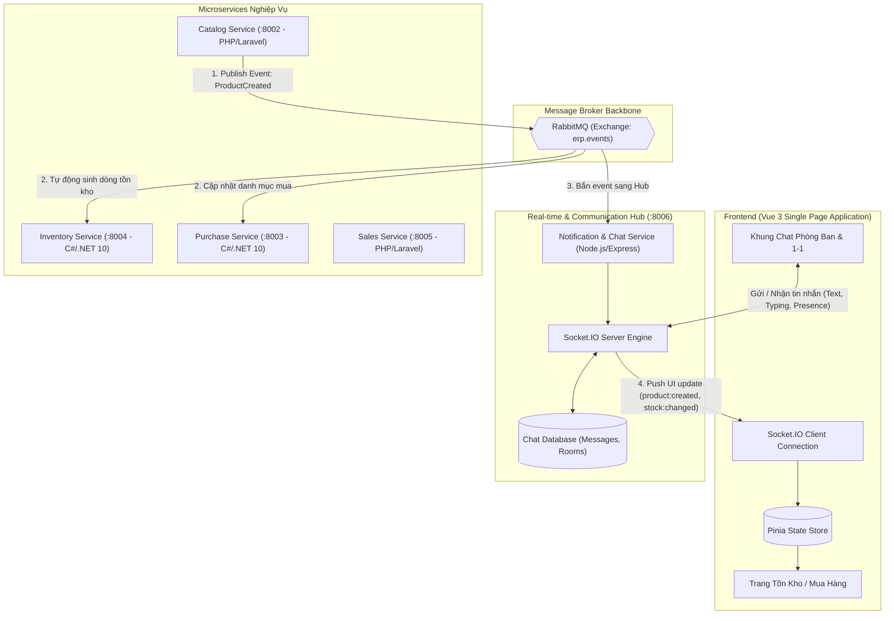

# Lộ Trình Kiến Trúc Đồng Bộ Dữ Liệu Thời Gian Thực & Chat Doanh Nghiệp (Real-time Architecture & Enterprise Chat Roadmap)

> **Dự án:** Smart Distributed ERP  
> **Phiên bản:** 1.0  
> **Ngày lập:** 13/10/2026  
> **Trạng thái:** Kế hoạch kiến trúc & Đang triển khai  

---

## 1. TỔNG QUAN & MỤC TIÊU KIẾN TRÚC

### 1.1. Bối cảnh
Trong hệ thống Microservices hiện tại:
- **`catalog-service` (:8002):** Quản lý danh mục sản phẩm (Master Data) trong SQLite riêng.
- **`inventory-service` (:8004):** Quản lý số lượng tồn kho theo kho trong SQLite riêng.
- **`purchase-service` (:8003):** Quản lý đề nghị mua (PR) và đơn mua (PO).
- **`sales-service` (:8005):** Quản lý bán hàng và xuất kho.
- **`notification-service` (:8006):** Dịch vụ thông báo và gửi mail (Node.js/Express).

### 1.2. Vấn đề giải quyết
1. **Loại bỏ độ trễ và lệch dữ liệu (Data Inconsistency):** Khi tạo sản phẩm mới ở Catalog Service, thông tin xuất xứ và bản ghi tồn kho (số lượng = 0) phải được đồng bộ tức thời sang Inventory và Purchase mà không cần seed thủ công hay tải lại trang.
2. **Loại bỏ sự phụ thuộc vào file dữ liệu cứng:** Chuyển từ file tĩnh `catalogProducts.constant.js` sang cơ chế Real-time State (Pinia Store kết hợp Socket.IO).
3. **Mở rộng tính năng giao tiếp doanh nghiệp:** Tích hợp hệ thống **Chat Real-time** nội bộ phân theo phòng ban (Kho, Thu mua, Kinh doanh, Kế toán) và chat trực tiếp 1-1 giữa các nhân viên.

---

## 2. SƠ ĐỒ KIẾN TRÚC TỔNG THỂ



---

## 3. LỘ TRÌNH TRIỂN KHAI CHI TIẾT (4 GIAI ĐOẠN)

### GIAI ĐOẠN 1: Kích Hoạt Hạ Tầng Message Broker & Socket Hub
*Mục tiêu: Đưa hạ tầng trung tâm vào hoạt động mà không xung đột với các dịch vụ hiện có.*

1. **Khởi động RabbitMQ:**
   - Sử dụng file `docker-compose.yml` có sẵn trong thư mục gốc.
   - Chạy lệnh:
     ```powershell
     docker compose up -d rabbitmq
     ```
   - Cổng hoạt động:
     - `5672`: AMQP protocol cho các Microservice kết nối.
     - `15672`: Giao diện Dashboard (Web UI quản lý tại `http://localhost:15672`, user: `erp_rabbit` / pass: `rabbit_secret`).
   - Exchange chính: `erp.events` (Topic Exchange).

2. **Cài đặt Socket.IO vào `notification-service` (:8006):**
   - Chuyển vào thư mục: `services/notification-service`
   - Cài đặt gói:
     ```bash
     npm install socket.io amqplib
     ```
   - Khởi tạo `Server` từ thư viện `socket.io` gắn kèm HTTP server hiện tại của Express.

---

### GIAI ĐOẠN 2: Đồng Bộ Dữ Liệu Nghiệp Vụ Giữa Các Microservices (Backend-to-Backend)
*Mục tiêu: Khi Catalog tạo sản phẩm mới, Inventory và Purchase tự động nhận diện và cập nhật DB.*

#### 1. Catalog Service (Publisher)
- Khi `ProductController@store` lưu thành công một sản phẩm mới vào `products`:
- Gửi message chuẩn lên RabbitMQ:
  - **Exchange:** `erp.events`
  - **Routing Key:** `catalog.product.created`
  - **Payload Specification:**
    ```json
    {
      "event_id": "evt_prod_202610130001",
      "event_type": "ProductCreated",
      "producer": "catalog-service",
      "timestamp": "2026-10-13T00:30:00Z",
      "payload": {
        "product_id": 105,
        "sku": "IPHONE-16",
        "name": "iPhone 16 Pro Max 256GB",
        "origin": "Mỹ",
        "unit": "Cái",
        "gross_price": 32990000.0,
        "min_stock": 10
      }
    }
    ```

#### 2. Inventory Service (Consumer)
- Sử dụng worker nền `RabbitMqConsumerWorker.cs` trong `Inventory.Infrastructure`.
- Lắng nghe queue `erp.inventory.events`.
- Khi nhận sự kiện `catalog.product.created`:
  - Trích xuất thông tin sản phẩm.
  - Tự động thêm dòng tồn kho vào bảng `inventory_stocks` cho từng kho (Kho Hà Nội, Kho TP.HCM, Kho Đà Nẵng) với:
    - `product_id` = `105`
    - `product_sku` = `"IPHONE-16"`
    - `product_name` = `"iPhone 16 Pro Max 256GB"`
    - `origin` = `"Mỹ"`
    - `quantity_on_hand` = `0`
    - `available_quantity` = `0`
- **Kết quả:** Không cần reset DB, không cần seed cứng, module Kho tự động có sản phẩm mới.

---

### GIAI ĐOẠN 3: Đẩy Dữ Liệu Thời Gian Thực Lên Frontend (Backend-to-Frontend)
*Mục tiêu: Giao diện người dùng tự động cập nhật mà không cần bấm F5.*

1. **Notification Service chuyển tiếp (Relay):**
   - Lắng nghe sự kiện `catalog.product.created` và `inventory.stock.changed` từ RabbitMQ.
   - Bắn broadcast qua Socket.IO tới toàn bộ client đang kết nối:
     ```javascript
     io.emit('catalog:product_created', data.payload);
     io.emit('inventory:stock_updated', data.payload);
     ```

2. **Frontend Vue 3 tiếp nhận:**
   - Cài đặt `socket.io-client` và `pinia`:
     ```bash
     cd frontend
     npm install socket.io-client pinia
     ```
   - Khởi tạo `useCatalogStore` và `useStockStore` trong Pinia.
   - Khi có socket event tới:
     - Tự động `push()` sản phẩm mới vào danh sách Pinia.
     - Component `StocksTab.vue` và popup chọn sản phẩm tự động phản hồi (Reactive).
     - Hiển thị Toast thông báo: *"Sản phẩm mới [IPHONE-16] vừa được thêm vào hệ thống"*.

---

### GIAI ĐOẠN 4: Xây Dựng Hệ Thống Chat Doanh Nghiệp (Phòng Ban & Cá Nhân)
*Mục tiêu: Hỗ trợ trao đổi công việc tức thì giữa các phòng ban và nhân viên.*

#### 1. Mô hình Phân chia Phòng Ban (Socket Rooms)
Mỗi người dùng khi đăng nhập sẽ tự động tham gia các phòng chat dựa trên vai trò:
* **Kênh Phòng Ban (Department Channels):**
  - `#chung` (`dept:general`): Toàn thể công ty.
  - `#kho-van` (`dept:inventory`): Nhân viên kho, quản lý kho.
  - `#thu-mua` (`dept:purchase`): Nhân viên mua sắm, procurement.
  - `#kinh-doanh` (`dept:sales`): Nhân viên sale, chăm sóc khách hàng.
  - `#ke-toan` (`dept:accounting`): Duyệt chi, hóa đơn.
* **Kênh Tin Nhắn Trực Tiếp (Direct Message):**
  - `user:{user_id}`: Trao đổi riêng tư 1-1 giữa 2 nhân viên bất kỳ.

#### 2. Thiết kế Cơ sở Dữ liệu Tin nhắn (Chat Database Schema)
Lưu trữ trong SQLite / MySQL của `notification-service`:

```sql
-- Bảng phòng chat / hội thoại
CREATE TABLE conversations (
    id VARCHAR(36) PRIMARY KEY,
    type VARCHAR(20) NOT NULL, -- 'DEPARTMENT' hoặc 'DIRECT'
    name VARCHAR(100),         -- Tên kênh (vd: #kho-van)
    department VARCHAR(50),    -- 'inventory', 'purchase', 'sales'...
    created_at TIMESTAMP DEFAULT CURRENT_TIMESTAMP
);

-- Bảng tin nhắn
CREATE TABLE chat_messages (
    id VARCHAR(36) PRIMARY KEY,
    conversation_id VARCHAR(36) NOT NULL,
    sender_id INT NOT NULL,
    sender_name VARCHAR(100) NOT NULL,
    sender_avatar VARCHAR(255),
    content TEXT NOT NULL,
    attachment_url VARCHAR(255),
    created_at TIMESTAMP DEFAULT CURRENT_TIMESTAMP,
    FOREIGN KEY (conversation_id) REFERENCES conversations(id)
);

-- Bảng trạng thái đã đọc
CREATE TABLE message_receipts (
    message_id VARCHAR(36),
    user_id INT,
    read_at TIMESTAMP,
    PRIMARY KEY (message_id, user_id)
);
```

#### 3. Danh sách Sự kiện Socket Chat (Socket.IO Events API)

| Event Name | Hướng | Mô tả |
| :--- | :--- | :--- |
| `chat:join_rooms` | Client $\rightarrow$ Server | Gửi danh sách phòng ban người dùng tham gia sau khi đăng nhập |
| `chat:send_message` | Client $\rightarrow$ Server | Gửi tin nhắn mới vào phòng ban hoặc cho nhân viên khác |
| `chat:new_message` | Server $\rightarrow$ Client | Nhận tin nhắn mới tức thời |
| `chat:typing` | Client $\rightarrow$ Server | Phát tín hiệu đang soạn tin nhắn |
| `chat:user_status` | Server $\rightarrow$ Client | Báo trạng thái Online / Offline của đồng nghiệp |
| `chat:mark_as_read` | Client $\rightarrow$ Server | Cập nhật trạng thái đã xem tin nhắn |

#### 4. Giao diện Chat trên Frontend
* **Floating Widget (Góc phải dưới màn hình):** Thu gọn thành icon tin nhắn có badge đỏ thông báo tin mới.
* **Trang Quản Trị Chat Chuyên Dụng (`/chat`):**
  - Cột trái: Danh sách phòng ban (#kho-van, #thu-mua, #kinh-doanh) & Danh sách đồng nghiệp kèm chấm trạng thái Online (xanh lá) / Offline (xám).
  - Khung giữa: Lịch sử tin nhắn, bong bóng chat kèm avatar, tên người gửi và thời gian gửi.
  - Ô nhập liệu: Soạn văn bản, đính kèm file/ảnh, hiển thị *"Nguyễn Văn A đang soạn tin..."*.

---

## 4. CHECKLIST THỰC HIỆN TỪNG BƯỚC

- [ ] **Giai đoạn 1:**
  - [ ] Bật container RabbitMQ bằng Docker Compose.
  - [ ] Cài đặt `socket.io` vào `services/notification-service`.
  - [ ] Khởi động test thử cổng kết nối Socket.IO trên cổng 8006.
- [ ] **Giai đoạn 2:**
  - [ ] Cấu hình AMQP publisher trong `catalog-service`.
  - [ ] Hoàn thiện `RabbitMqConsumerWorker.cs` trong `inventory-service`.
  - [ ] Test tạo sản phẩm mới ở Catalog $\rightarrow$ kiểm tra xem bảng `inventory_stocks` có tự sinh dòng không.
- [ ] **Giai đoạn 3:**
  - [ ] Cài đặt `socket.io-client` vào `frontend`.
  - [ ] Tạo Pinia Store để quản lý State danh mục và tồn kho.
  - [ ] Kiểm tra tính năng cập nhật bảng tồn kho không cần F5.
- [ ] **Giai đoạn 4:**
  - [ ] Tạo bảng `conversations` và `chat_messages` trong `notification-service`.
  - [ ] Xây dựng bộ điều khiển Socket Room cho phòng ban và chat 1-1.
  - [ ] Thiết kế UI Khung Chat (Chat Window / Floating Chat Widget) trên Vue 3.
  - [ ] Thử nghiệm chat thời gian thực giữa 2 tài khoản khác nhau trên 2 tab trình duyệt.
